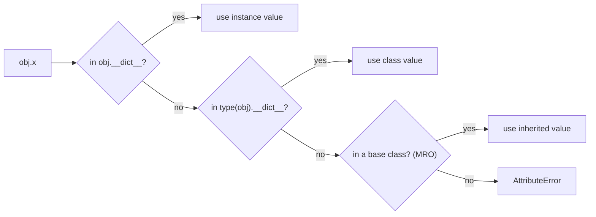

# Class vs Instance Attributes

Attributes can live in two places: on **each instance** (`self.x = ...` in `__init__`) or on the **class itself** (assigned in the class body). Class attributes are shared by every instance. That's ideal for constants and counters, and a classic source of bugs when the shared value is mutable. Understanding attribute **lookup order** explains both, and it's the same mechanism that makes methods and inheritance work.

## 1. Two kinds of attributes

```python
class Robot:
    wheels = 4                      # CLASS attribute: one value, shared by all robots
    count = 0

    def __init__(self, name):
        self.name = name            # INSTANCE attribute: each robot has its own
        Robot.count += 1            # update the shared counter via the class

a, b = Robot("ada"), Robot("bo")
print(a.wheels, b.wheels, Robot.wheels)   # 4 4 4
print(a.name, b.name)                     # ada bo
print(Robot.count)                        # 2
```

| | Class attribute | Instance attribute |
|---|---|---|
| Defined | in the class body | via `self.x = ...` (usually in `__init__`) |
| Stored in | `ClassName.__dict__` | `obj.__dict__` |
| Shared? | yes, by all instances | no, per object |
| Typical use | constants, defaults, counters, registries | the object's own state |

## 2. Attribute lookup order

When you read `obj.x`, Python searches:



(The full rule also involves descriptors such as `property`, covered in the Descriptors lesson. For plain attributes, it's instance first, then class, then base classes.)

## 3. Assignment always goes to the instance

Reading falls back to the class, but **assigning through an instance creates or updates an instance attribute**. It never changes the class attribute:

```python
a.wheels = 3            # creates a.__dict__['wheels'], shadowing the class value
print(a.wheels, b.wheels, Robot.wheels)   # 3 4 4
del a.wheels            # remove the shadow, and a sees the class value again
print(a.wheels)         # 4
Robot.wheels = 6        # change the class attribute: everyone without a shadow sees it
print(b.wheels)         # 6
```

> [!KEY]
> - Read: instance → class → bases.
> - Write via `obj.x = …`: always the instance.
> - To change a shared value, write via the class: `Robot.count += 1` (not `self.count += 1`, which would create a per-instance copy).

```python
class Counter:
    count = 0
    def __init__(self):
        self.count += 1      # BUG: reads Counter.count (0), then writes self.count = 1
```

## 4. The mutable class attribute trap

```python
class Team:
    members = []                    # ONE list shared by every Team!
    def add(self, name):
        self.members.append(name)   # mutates the shared list (no assignment, so no shadow)

t1, t2 = Team(), Team()
t1.add("ada")
print(t2.members)                   # ['ada']: surprise
```

Mutation (`append`) doesn't assign, so no instance attribute is created and both teams use the class's list. It's the same family of bug as mutable default arguments.

**Fix**: create mutable state in `__init__`:

```python
class Team:
    def __init__(self):
        self.members = []           # a new list per instance
```

> [!DANGER]
> Never use a mutable class attribute (`[]`, `{}`, `set()`) for per-instance data. Class attributes should be immutable constants, or deliberately shared registries that you modify through the class.

## 5. Good uses of class attributes

```python
class Motor:
    MAX_RPM = 3000                         # constant shared by all motors
    _registry = {}                         # deliberately shared: every motor by name

    def __init__(self, name, max_rpm=None):
        self.name = name
        self.max_rpm = max_rpm or Motor.MAX_RPM   # a default from the class
        Motor._registry[name] = self

    @classmethod
    def get(cls, name):
        return cls._registry[name]
```

Also common: default values that instances may override, such as `timeout = 5`, which a specific object can change with `obj.timeout = 10`.

## 6. Inspecting

```python
print(vars(a))          # {'name': 'ada'}: instance attributes only
print("wheels" in vars(Robot))     # True
print(type(a).wheels)   # access the class attribute explicitly
```

## 7. Exam-ready answers

> [!EXAM]
> **Class vs instance attributes.** Instance attributes belong to a particular object and are normally created in `__init__` through `self`; they are stored in the instance's `__dict__`, so each object has its own values. Class attributes are defined in the class body and stored in the class's namespace; they are shared by all instances. When an attribute is read through an instance, Python looks in the instance first, then in its class and base classes. Assigning through an instance always creates or modifies an instance attribute, which shadows any class attribute with the same name. Mutable class attributes are shared, so mutating them through one instance affects all instances.

## 8. Cheat sheet

| Need | Code |
|---|---|
| constant for all | `class C: LIMIT = 10` |
| per-object state | `self.x = ...` in `__init__` |
| shared counter | `C.count += 1` |
| read the class attribute explicitly | `type(self).LIMIT` / `C.LIMIT` |
| per-object list | `self.items = []` in `__init__` (never in the class body) |
| see instance state | `vars(obj)` |

> [!INTERVIEW]
> **"Why does `self.count += 1` inside `__init__` not increase the class counter?"** `self.count += 1` is `self.count = self.count + 1`. The right side **reads** `count`, which falls back to the class value, but the assignment **writes** a new instance attribute. The class attribute never changes. Use `type(self).count += 1` or `ClassName.count += 1`.
