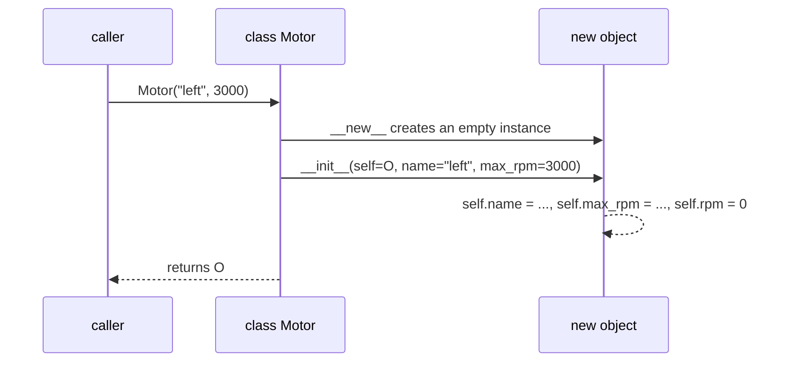

# Classes and Objects

Until now you've organised programs around **functions** acting on data passed in and out. **Object-oriented programming (OOP)** bundles data and the functions that operate on it into one unit, an **object**, created from a blueprint called a **class**. That bundling is what lets large systems be split into independent, understandable parts: a `Motor` that knows its speed and how to change it, a `Lidar` that knows how to read itself, a `Robot` that owns both. This lesson builds the mental model precisely. The Master OOP module at the end of the course teaches the design side: how to decide which classes a project needs.

## 1. Why objects? Data + behaviour together

Without classes, a bank account is a dict, and the rules live in scattered functions:

```python
account = {"owner": "Ada", "balance": 100}

def withdraw(acc, amount):
    if amount > acc["balance"]:
        raise ValueError("insufficient funds")
    acc["balance"] -= amount

account["balance"] = -500        # nothing stops anyone from breaking the rules
```

With a class, the data and the rules travel together, and the class decides how its data may change:

```python
class BankAccount:
    def __init__(self, owner, balance=0):
        self.owner = owner
        self.balance = balance

    def withdraw(self, amount):
        if amount > self.balance:
            raise ValueError("insufficient funds")
        self.balance -= amount

acc = BankAccount("Ada", 100)
acc.withdraw(30)
print(acc.balance)       # 70
```

> [!KEY]
> - A **class** is a blueprint: it defines what data (attributes) and behaviour (methods) its objects have.
> - An **object** (instance) is one concrete thing built from the class, with its own data.
> - **State** = the object's current attribute values. **Behaviour** = its methods. **Identity** = which object it is (`id`).

## 2. Defining a class

> [!SYNTAX]
> ```python
> class ClassName:                     # CapWords naming
>     """Docstring."""
>     class_attribute = value          # shared by all instances (next lesson)
>
>     def __init__(self, param1, param2):   # initialiser: sets up a new instance
>         self.attr1 = param1          # instance attributes
>         self.attr2 = param2
>
>     def method(self, arg):           # every instance method takes self first
>         return self.attr1 + arg
> ```

```python
class Motor:
    """A DC motor with a speed limit."""

    def __init__(self, name, max_rpm):
        self.name = name
        self.max_rpm = max_rpm
        self.rpm = 0                      # every motor starts stopped

    def set_speed(self, rpm):
        self.rpm = max(-self.max_rpm, min(self.max_rpm, rpm))

    def describe(self):
        return f"{self.name}: {self.rpm}/{self.max_rpm} rpm"

left = Motor("left", 3000)      # create (instantiate) an object
right = Motor("right", 3000)    # another, independent object
left.set_speed(5000)
print(left.describe())          # left: 3000/3000 rpm (clamped)
print(right.describe())         # right: 0/3000 rpm
```

## 3. What happens on `Motor("left", 3000)`



1. `__new__` allocates a blank object (you almost never touch it).
2. `__init__` **initialises** it: `self` is that new object, and the other arguments come from the call.
3. The object is returned. `__init__` itself must return `None`.

`__init__` is often called "the constructor". Strictly speaking it's the **initialiser**, and `__new__` is the constructor.

## 4. `self`: the object the method is working on

```python
left.set_speed(1500)
# is exactly:
Motor.set_speed(left, 1500)
```

When you call a method **on an instance**, Python passes that instance as the first argument automatically. By convention the first parameter is named `self`. It's not a keyword, but always use `self`.

<div class="figure">
<svg viewBox="0 0 620 210" width="620" xmlns="http://www.w3.org/2000/svg" font-family="ui-monospace, monospace" font-size="13">
  <defs><marker id="oa" markerWidth="8" markerHeight="8" refX="7" refY="4" orient="auto"><path d="M0,0 L8,4 L0,8 z" fill="currentColor"/></marker></defs>
  <rect x="220" y="15" width="180" height="95" rx="8" fill="none" stroke="#a371f7" stroke-width="2"/>
  <text x="235" y="38" fill="#a371f7" font-weight="bold">class Motor</text>
  <text x="235" y="60" fill="currentColor">__init__(self, …)</text>
  <text x="235" y="78" fill="currentColor">set_speed(self, rpm)</text>
  <text x="235" y="96" fill="currentColor">describe(self)</text>
  <rect x="40" y="140" width="200" height="60" rx="8" fill="none" stroke="#2f81f7" stroke-width="2"/>
  <text x="52" y="160" fill="#2f81f7">left (instance)</text><text x="52" y="178" fill="currentColor">name='left' rpm=3000</text><text x="52" y="194" fill="currentColor">max_rpm=3000</text>
  <rect x="380" y="140" width="200" height="60" rx="8" fill="none" stroke="#2f81f7" stroke-width="2"/>
  <text x="392" y="160" fill="#2f81f7">right (instance)</text><text x="392" y="178" fill="currentColor">name='right' rpm=0</text><text x="392" y="194" fill="currentColor">max_rpm=3000</text>
  <line x1="140" y1="140" x2="250" y2="112" stroke="currentColor" marker-end="url(#oa)" stroke-dasharray="4 3"/>
  <line x1="480" y1="140" x2="370" y2="112" stroke="currentColor" marker-end="url(#oa)" stroke-dasharray="4 3"/>
  <text x="160" y="128" fill="currentColor" font-size="11" font-family="sans-serif" fill-opacity=".7">__class__</text>
</svg>
<figcaption>Methods live once on the class; each instance stores only its own data. A method call finds the method on the class and passes the instance as <code>self</code>.</figcaption>
</div>

> [!DANGER]
> Classic mistakes:
> - Forgetting `self` in the definition, `def describe():`, gives `TypeError: describe() takes 0 positional arguments but 1 was given`. The instance was passed and had nowhere to go.
> - Forgetting `self.` when using an attribute (`return name` instead of `return self.name`) gives `NameError`, or worse, uses an unrelated global.
> - Assigning `name = name` in `__init__` (without `self.`) creates a **local** variable that vanishes, and the object never gets the attribute.

## 5. Attributes are dynamic

Instance attributes live in a per-object dict:

```python
print(left.__dict__)           # {'name': 'left', 'max_rpm': 3000, 'rpm': 3000}
left.temperature = 41          # Python lets you add attributes anywhere…
```

…but **don't**. Define every attribute in `__init__`, so every instance has the same shape and readers can see the complete state in one place. (Linters warn about attributes defined outside `__init__`.)

## 6. Objects interacting: composition preview

Objects become powerful when they hold and use other objects:

```python
class DiffDriveRobot:
    def __init__(self, name):
        self.name = name
        self.left = Motor("left", 3000)        # a robot HAS motors
        self.right = Motor("right", 3000)

    def drive(self, speed, turn):
        self.left.set_speed(speed - turn)
        self.right.set_speed(speed + turn)

    def status(self):
        return f"{self.name}: [{self.left.describe()}] [{self.right.describe()}]"

bot = DiffDriveRobot("rover")
bot.drive(1000, 200)
print(bot.status())
# rover: [left: 800/3000 rpm] [right: 1200/3000 rpm]
```

The robot doesn't know how a motor clamps its speed; it just asks. Each class hides its own details, and that is how large systems stay understandable.

## 7. Printing objects

By default, `print(left)` shows `<__main__.Motor object at 0x7f…>`. Define `__repr__` (and optionally `__str__`) to get something useful. The Special Methods lesson covers this; for now:

```python
class Point:
    def __init__(self, x, y):
        self.x, self.y = x, y
    def __repr__(self):
        return f"Point({self.x}, {self.y})"

print(Point(1, 2))         # Point(1, 2)
```

## 8. Procedural vs object-oriented (and when to use each)

| | Procedural | Object-oriented |
|---|---|---|
| Unit of organisation | functions | classes (data + behaviour) |
| Data | passed around, often dicts or tuples | encapsulated inside objects |
| Good for | scripts, pipelines, pure computations | systems with many interacting things, each with state |
| Risk | rules scattered, data can be put in invalid states | over-engineering: classes where a function would do |

Python lets you mix both. A class with only `__init__` and one other method is often better written as a function. Reach for a class when there is **state that persists between calls** and **rules that protect it**.

## 9. Exam-ready answers

> [!EXAM]
> **Class and object.** A class is a user-defined type that serves as a blueprint, defining the attributes (data) and methods (functions) that its instances will have. An object, or instance, is a concrete entity created from a class, with its own state stored in instance attributes; all instances share the methods defined in the class. In Python a class is defined with the `class` statement, instances are created by calling the class, and the special method `__init__` initialises each new instance. Methods receive the instance as their first parameter, conventionally named `self`, through which they access and modify the object's attributes.

> [!EXAM]
> **The role of `self`.** `self` is the conventional name of the first parameter of an instance method. When a method is called on an instance, `obj.method(args)`, Python passes the instance automatically as that first argument, which is equivalent to `ClassName.method(obj, args)`. Through `self` the method reads and writes the attributes of the particular object on which it was invoked.

## 10. Cheat sheet

| Need | Code |
|---|---|
| define | `class Motor:` |
| initialiser | `def __init__(self, name): self.name = name` |
| method | `def set_speed(self, rpm): self.rpm = rpm` |
| create | `m = Motor("left")` |
| call | `m.set_speed(10)` ≡ `Motor.set_speed(m, 10)` |
| type check | `isinstance(m, Motor)` |
| inspect state | `vars(m)` / `m.__dict__` |
| readable print | define `__repr__` |

> [!INTERVIEW]
> **"What are the four pillars of OOP?"** **Encapsulation**: bundling data with the methods that operate on it and restricting direct access to the internal state. **Abstraction**: exposing what an object does while hiding how. **Inheritance**: defining a class in terms of an existing one to reuse and specialise it. **Polymorphism**: one interface, many implementations, where code written against the interface works with any conforming object. The next lessons cover each one in Python terms. Add that Python favours **composition** and **duck typing** over deep inheritance trees.
