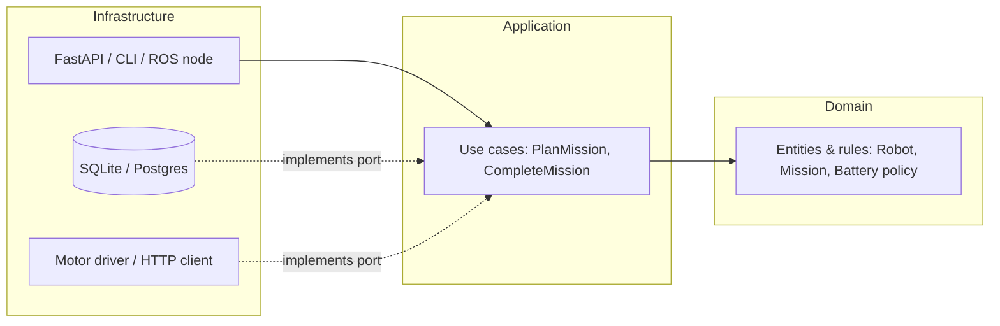

# Clean Architecture

As a codebase grows, the biggest risk isn't a slow algorithm but **coupling**: business rules tangled with web frameworks, SQL and ROS calls, so nothing can be tested or changed in isolation. *Clean Architecture* (Robert C. Martin), *Hexagonal Architecture / Ports and Adapters* (Alistair Cockburn) and *Onion Architecture* share one idea: **put the domain at the centre and make dependencies point inward**. This lesson covers the layers, the dependency rule, ports as `Protocol`s, adapters, use cases, dependency injection and composition roots, testing with fakes, and how this applies to robotics software.

## 1. The dependency rule



> [!KEY]
> **Source-code dependencies point only inward.** The domain imports nothing from the application or infrastructure layers. The application defines **ports** (interfaces) for what it needs: storing missions, sending commands, knowing the time. Infrastructure **adapters** implement those ports. Frameworks, databases and hardware are details plugged in at the edge.

| Layer | Contains | Depends on |
|---|---|---|
| **Domain** | entities, value objects, invariants, pure business rules | nothing (the standard library only) |
| **Application** | use cases that orchestrate the domain, and port definitions | domain |
| **Adapters / infrastructure** | web controllers, ORM repositories, ROS nodes, HTTP clients, the CLI | application ports, frameworks |
| **Composition root** (`main`) | wires concrete adapters into use cases | everything |

## 2. Domain: rich, pure, framework-free

```python
from dataclasses import dataclass, field
from enum import Enum

class MissionStatus(str, Enum):
    PLANNED = "planned"; ACTIVE = "active"; DONE = "done"; ABORTED = "aborted"

class DomainError(Exception): ...

@dataclass
class Robot:
    id: str
    battery: float                     # 0..1
    busy: bool = False

    def can_accept(self, distance_m: float) -> bool:
        return not self.busy and self.battery - distance_m * 0.001 >= 0.2   # keep a 20% reserve

@dataclass
class Mission:
    id: str
    robot_id: str
    distance_m: float
    status: MissionStatus = MissionStatus.PLANNED

    def start(self) -> None:
        if self.status is not MissionStatus.PLANNED:
            raise DomainError(f"cannot start mission in state {self.status.value}")
        self.status = MissionStatus.ACTIVE
```

The rules ("keep a 20% reserve", "only planned missions start") live in the entities, are trivial to unit test, and don't know whether storage is Postgres or a dict.

## 3. Ports: `typing.Protocol`

```python
from typing import Protocol

class RobotRepository(Protocol):
    def get(self, robot_id: str) -> Robot | None: ...
    def save(self, robot: Robot) -> None: ...

class MissionRepository(Protocol):
    def add(self, mission: Mission) -> None: ...
    def get(self, mission_id: str) -> Mission | None: ...

class Notifier(Protocol):
    def mission_started(self, mission: Mission) -> None: ...

class Clock(Protocol):
    def now(self) -> float: ...
```

Protocols are **structural**: adapters don't import or inherit from them. A class with matching methods satisfies the port, and mypy or pyright checks it.

## 4. Use cases (application services)

```python
class PlanMission:
    def __init__(self, robots: RobotRepository, missions: MissionRepository, notifier: Notifier, ids):
        self.robots, self.missions, self.notifier, self.ids = robots, missions, notifier, ids

    def __call__(self, robot_id: str, distance_m: float) -> Mission:
        robot = self.robots.get(robot_id)
        if robot is None:
            raise DomainError("unknown robot")
        if not robot.can_accept(distance_m):
            raise DomainError("robot cannot accept mission")
        mission = Mission(next(self.ids), robot_id, distance_m)
        mission.start()
        robot.busy = True
        self.missions.add(mission)
        self.robots.save(robot)
        self.notifier.mission_started(mission)
        return mission
```

A use case is a single application action. It loads entities through ports, applies domain rules, persists the results and triggers side effects. It knows nothing about HTTP status codes or ROS messages.

## 5. Adapters and the composition root

```python
class InMemoryRobots:                                  # adapter for tests and simulation
    def __init__(self): self._d: dict[str, Robot] = {}
    def get(self, rid): return self._d.get(rid)
    def save(self, r): self._d[r.id] = r

class SqliteRobots:                                    # adapter for production
    def __init__(self, con): self.con = con
    def get(self, rid):
        row = self.con.execute("SELECT id, battery, busy FROM robots WHERE id = ?", (rid,)).fetchone()
        return Robot(row[0], row[1], bool(row[2])) if row else None
    def save(self, r):
        with self.con:
            self.con.execute("INSERT INTO robots VALUES (?, ?, ?) ON CONFLICT(id) DO UPDATE SET battery=excluded.battery, busy=excluded.busy",
                             (r.id, r.battery, int(r.busy)))

# composition root (main.py): the only place that knows every concrete class
def build_app(con):
    plan = PlanMission(SqliteRobots(con), SqliteMissions(con), RosNotifier(node), itertools.count(1))
    return create_fastapi_app(plan)                   # the web adapter calls plan(...)
```

The **web adapter** translates HTTP into use-case calls and `DomainError` into 409/404 responses. A **ROS adapter** does the same for topics and actions. Both reuse the identical use case.

## 6. Testing pays off

```python
def test_plan_rejects_low_battery():
    robots = InMemoryRobots(); robots.save(Robot("r1", battery=0.25))
    plan = PlanMission(robots, InMemoryMissions(), FakeNotifier(), iter(["m1"]))
    with pytest.raises(DomainError, match="cannot accept"):
        plan("r1", distance_m=100)
```

The tests run in milliseconds with no database, network or robot. Fakes (working in-memory implementations) are usually better than mocks, because they test behaviour rather than call sequences.

## 7. Pragmatism

- Don't create four layers for a 200-line script. Introduce ports where change or testing pressure exists: databases, external services, hardware, time.
- **Time and randomness are dependencies too.** Inject a clock and seeds.
- Avoid an **anaemic domain** of data-only classes with all the logic in services. Put invariants in entities.
- Robotics examples: ROS 2 nodes are adapters. Keep planning and control algorithms in plain, ROS-free libraries (Nav2 and MoveIt are structured this way), and they become testable without launching ROS.

> [!EXAM]
> **State the dependency rule of Clean Architecture and explain how ports and adapters implement it.**
> Source-code dependencies must point inward, toward higher-level policy: the domain depends on nothing, the application layer only on the domain, and infrastructure (web frameworks, databases, hardware drivers) on the application. When a use case needs something external, such as persistence, notifications or the time, the application defines a port (an interface, in Python a `Protocol`) expressed in domain terms, and the infrastructure provides adapters implementing it. A composition root wires concrete adapters into the use cases at startup. Business rules can then be tested with in-memory fakes, and frameworks or databases can be swapped without touching them.
