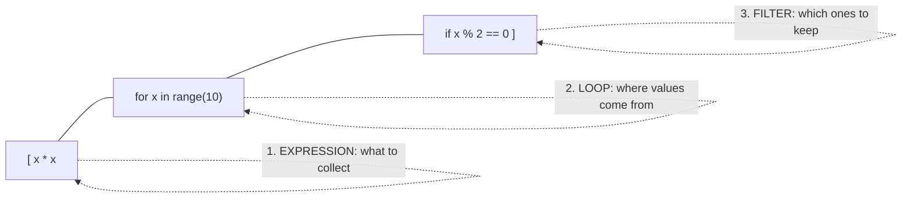

# Comprehensions

A comprehension builds a list, set or dict (or a lazy generator) from an iterable in **one expression**. Comprehensions read like set-builder notation from mathematics (*{ x² | x ∈ S, x even }*). They're usually faster than the equivalent loop, and they're what experienced Python code looks like. The other half of the skill is knowing **when not** to use one.

## 1. From loop to comprehension

The mechanical translation:

```python
# loop form
squares = []
for x in range(10):
    if x % 2 == 0:
        squares.append(x * x)

# comprehension form: the same parts, reordered
squares = [x * x for x in range(10) if x % 2 == 0]
print(squares)    # [0, 4, 16, 36, 64]
```



> [!SYNTAX]
> `[expression for target in iterable if condition]`
> - The **expression** comes first: what each element of the result is.
> - Then one or more `for` clauses, **in the same order as nested loops**.
> - Then optional `if` filters.

## 2. Filter `if` vs conditional expression

Two different things that both use `if`:

```python
nums = [-2, 5, -1, 3]
print([x for x in nums if x > 0])            # FILTER: [5, 3]: drops elements
print([x if x > 0 else 0 for x in nums])     # TRANSFORM: [0, 5, 0, 3]: keeps every element
```

| Form | Position | Effect |
|---|---|---|
| `[e for x in xs if cond]` | **after** the `for` | filter: keep only the matching elements |
| `[a if cond else b for x in xs]` | **before** the `for` | conditional expression: choose a value for every element |

`[x for x in xs if cond else 0]` is a `SyntaxError`. A filter can't have an `else`.

## 3. Multiple `for` clauses = nested loops

The clauses read **left to right as outer to inner**, exactly as you'd write the nested loops:

```python
pairs = [(i, j) for i in range(3) for j in range(i)]
# is the same as:
pairs = []
for i in range(3):
    for j in range(i):
        pairs.append((i, j))
print(pairs)    # [(1, 0), (2, 0), (2, 1)]
```

**Flatten** a 2D list:

```python
m = [[1, 2], [3, 4], [5, 6]]
flat = [x for row in m for x in row]       # [1, 2, 3, 4, 5, 6]
```

Memory aid: say it as English. "x, for each row in m, for each x in that row."

## 4. Nested comprehensions build nested structures

A comprehension *inside* the expression produces a list of lists:

```python
table = [[i * j for j in range(3)] for i in range(3)]
# [[0, 0, 0], [0, 1, 2], [0, 2, 4]]

grid = [[0] * cols for _ in range(rows)]   # the CORRECT way to make a 2D grid

transpose = [[row[i] for row in m] for i in range(len(m[0]))]
# [[1, 3, 5], [2, 4, 6]]   (also: [list(col) for col in zip(*m)])
```

| You write | You get |
|---|---|
| `[x for row in m for x in row]` | flat list (two `for` clauses) |
| `[[f(x) for x in row] for row in m]` | nested list (a comprehension inside the expression) |

## 5. Set and dict comprehensions

```python
words = ["apple", "bob", "kayak", "apple"]
lengths = {w: len(w) for w in words}            # dict: {'apple': 5, 'bob': 3, 'kayak': 5}
unique_lengths = {len(w) for w in words}        # set:  {3, 5}
palindromes = {w for w in words if w == w[::-1]}  # {'bob', 'kayak'}
inverted = {v: k for k, v in {"a": 1, "b": 2}.items()}   # {1: 'a', 2: 'b'}
```

There is **no tuple comprehension**. `(x for x in xs)` is a generator expression (next section). Use `tuple(x for x in xs)` for a tuple.

## 6. Generator expressions: lazy comprehensions

Round brackets produce a **generator**, which computes values one at a time on demand instead of building the whole list:

```python
total = sum(x * x for x in range(1_000_000))    # no million-element list is built
g = (x * x for x in range(3))
print(next(g), list(g), list(g))                # 0 [1, 4] []: a generator is single-use
```

```python
import sys
print(sys.getsizeof([i for i in range(1000)]))   # 8856 bytes
print(sys.getsizeof(i for i in range(1000)))     # 200 bytes, whatever the size
```

> [!KEY]
> When the result is passed straight to a function that consumes an iterable, such as `sum`, `max`, `min`, `any`, `all`, `"".join`, `set` or `sorted`, use a generator expression. As the only argument, it needs no extra brackets: `sum(x for x in xs)`. `any`/`all` can then also **stop early**.

## 7. Scope: the loop variable doesn't leak

In Python 3, a comprehension has its **own scope**. Its loop variable doesn't overwrite an outer variable with the same name:

```python
x = "outer"
squares = [x * x for x in range(3)]
print(x)        # outer
```

(A plain `for` loop *does* leave its variable behind. That's one more reason comprehensions are cleaner.)

> [!DANGER]
> **Late binding in lambdas created in a comprehension:**
> ```python
> fs = [lambda: i for i in range(3)]
> print([f() for f in fs])     # [2, 2, 2], not [0, 1, 2]
> ```
> Each lambda looks up `i` when it's **called**, after the loop has finished. Fix it with a default argument: `[lambda i=i: i for i in range(3)]`. The Closures lesson explains why.

## 8. The walrus inside comprehensions

`:=` computes a value once and uses it in both the filter and the expression:

```python
data = [1, 2, 3]
print([y for x in data if (y := x * 10) > 15])   # [20, 30]: x * 10 computed once
```

## 9. When NOT to use a comprehension

- **Side effects**: `[print(x) for x in xs]` builds a useless list of `None`s. Use a `for` loop for actions.
- **Complex logic**: more than two `for`s or a multi-condition filter becomes unreadable. A loop with named steps is better code.
- **Early exit**: you can't `break` out of a comprehension. Use a loop, or `next(x for x in xs if cond)` / `any(...)`.
- **Huge results you only iterate once**: use a generator expression, not a list.

> [!TIP]
> Rule of thumb: if it doesn't fit comfortably on one or two lines, or you have to explain it to yourself, write the loop.

## 10. Performance

Comprehensions are typically 20–50% faster than an equivalent `append` loop, because the iteration runs in an optimised bytecode path with no repeated `.append` attribute lookups. But `[f(x) for x in xs]` still calls `f` n times, so it's O(n) like the loop. Comprehensions are cleaner and faster, but they never change the complexity.

## 11. Exam-ready answers

> [!EXAM]
> **List comprehensions.** A list comprehension is a concise expression that constructs a new list by evaluating an expression for each element of one or more iterables, optionally filtered by conditions: `[expr for x in iterable if cond]`. Multiple `for` clauses correspond to nested loops written left to right. Analogous syntax builds sets (`{expr for …}`) and dictionaries (`{k: v for …}`), while parentheses create a generator expression, which yields values lazily instead of building the whole collection in memory. In Python 3 the comprehension's loop variables are local to it.

> [!EXAM]
> **Generator expression vs list comprehension.** A list comprehension evaluates eagerly and stores all results in a list, using O(n) memory and allowing repeated iteration and indexing. A generator expression evaluates lazily, producing one item at a time, using O(1) memory. It can be iterated only once and is preferred when the values are consumed immediately, for example by `sum()` or `any()`.

## 12. Cheat sheet

| Need | Comprehension |
|---|---|
| transform | `[f(x) for x in xs]` |
| filter | `[x for x in xs if p(x)]` |
| map with a choice | `[a if p(x) else b for x in xs]` |
| flatten | `[x for row in m for x in row]` |
| matrix | `[[0] * c for _ in range(r)]` |
| transpose | `[list(c) for c in zip(*m)]` |
| dict from pairs | `{k: v for k, v in pairs}` |
| count with a condition | `sum(1 for x in xs if p(x))` |
| first match | `next((x for x in xs if p(x)), None)` |

> [!INTERVIEW]
> **"What's the difference between `[x for x in range(5)]` and `(x for x in range(5))`, and when does it matter?"** The first builds a list immediately and can be indexed and reused. The second is a lazy generator: constant memory, single pass, no `len`. It matters for large data (streaming a file with `(line for line in f)`) and for short-circuiting (`any(heavy(x) for x in xs)` stops at the first `True`, while `any([heavy(x) for x in xs])` computes every one first).
