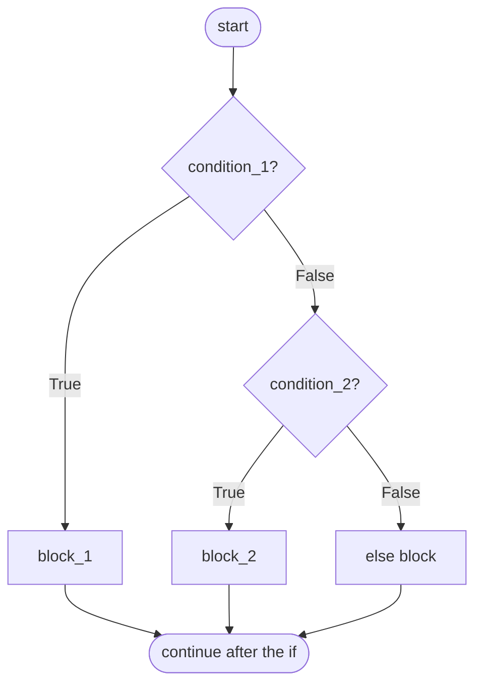

# Conditionals

Conditionals let a program choose. The syntax is short, `if`, `elif`, `else`, but writing *correct* decision logic is a skill: ordering conditions, covering boundaries, avoiding overlapping branches and keeping nesting shallow. This lesson covers the syntax precisely, then the design habits that keep branching code bug-free.

## 1. The `if` statement

> [!SYNTAX]
> ```python
> if condition_1:
>     block_1
> elif condition_2:        # zero or more elif clauses
>     block_2
> else:                    # optional, at most one, always last
>     block_3
> ```

- Conditions are tested **top to bottom**.
- The **first** true condition's block runs, and then the whole statement is finished. Later conditions are not even evaluated.
- `else` runs only if every condition was false.
- A condition can be **any expression**. Its truthiness decides (previous lesson).



Example: a grading scale.

```python
score = 83
if score >= 90:
    grade = "A"
elif score >= 80:
    grade = "B"
elif score >= 70:
    grade = "C"
else:
    grade = "F"
print(grade)    # B
```

The `elif score >= 80` branch doesn't need `and score < 90`, because reaching it already **implies** `score < 90`. The order of the branches carries information.

## 2. `elif` chain vs separate `if`s

This is one of the most common logic bugs:

```python
score = 95
# WRONG: independent ifs, all evaluated
if score >= 90:
    print("A")
if score >= 80:
    print("B")      # also prints!
```

```output
A
B
```

Use `elif` when the cases are **mutually exclusive** (exactly one should happen). Use separate `if`s when the checks are **independent** and several may apply, for example validating each field of a form and reporting every error.

## 3. Ordering conditions: specific before general

When conditions overlap, put the **most specific** one first, or it will never be reached:

```python
n = 15
# WRONG: the general case hides the specific one
if n % 3 == 0:
    print("Fizz")
elif n % 15 == 0:      # unreachable: anything divisible by 15 is divisible by 3
    print("FizzBuzz")

# RIGHT
if n % 15 == 0:
    print("FizzBuzz")
elif n % 3 == 0:
    print("Fizz")
```

For ranges, either go **descending with `>=`** (as in the grade example) or **ascending with `<`**, and be consistent. Mixing directions creates gaps and overlaps.

## 4. Boundaries: where most bugs live

For every threshold, ask: *what happens exactly at the boundary value?*

```python
# "Children under 12 pay 5; 12 to 59 pay 10; 60 and over pay 7"
def ticket(age):
    if age < 12:
        return 5
    elif age < 60:     # 12..59
        return 10
    else:              # 60+
        return 7
```

Test with the boundaries **and their neighbours**: 11, 12, 59, 60, plus extremes like 0 and 120. Judges deliberately include these, and so do interviewers.

## 5. Nested conditionals vs guard clauses

Deep nesting is hard to read:

```python
def can_withdraw(account, amount):
    if account is not None:
        if account["active"]:
            if amount > 0:
                if amount <= account["balance"]:
                    return True
    return False
```

**Guard clauses** reject the invalid cases early and keep the main path flat:

```python
def can_withdraw(account, amount):
    if account is None:
        return False
    if not account["active"]:
        return False
    if amount <= 0:
        return False
    return amount <= account["balance"]
```

Or combine them, since `and` short-circuits:

```python
def can_withdraw(account, amount):
    return (account is not None and account["active"]
            and 0 < amount <= account["balance"])
```

> [!TIP]
> If your code is drifting right past three levels of indentation, look for an early `return`, `continue` or `break` that flattens it.

## 6. Combining conditions: De Morgan's laws

To negate a compound condition, flip each part **and** swap `and` ↔ `or`:

| Original | Negation |
|---|---|
| `not (a and b)` | `(not a) or (not b)` |
| `not (a or b)` | `(not a) and (not b)` |

```python
# "outside the range 10..20"
if not (10 <= x <= 20): ...
if x < 10 or x > 20: ...          # the same, by De Morgan
```

A classic bug is `if x != 1 or x != 2:`, which is **always** true (every x differs from at least one of them). The intended meaning, "neither 1 nor 2", is `x != 1 and x != 2`, or better, `x not in (1, 2)`.

## 7. Membership tests replace long `or` chains

```python
if day == "Sat" or day == "Sun": ...      # verbose
if day in ("Sat", "Sun"): ...             # idiomatic
if ch in "aeiou": ...                     # substring membership
```

> [!DANGER]
> `if day == "Sat" or "Sun":` is **always true**. It parses as `(day == "Sat") or ("Sun")`, and the non-empty string `"Sun"` is truthy. Python won't warn you.

## 8. Assignment `=` vs comparison `==`

In C, `if (x = 5)` is legal and a famous bug. In Python, `if x = 5:` is a **SyntaxError**, so the language protects you. (The walrus `if (x := 5):` is legal, and deliberately looks different.)

## 9. Conditional expressions and dictionary dispatch

For simple value selection, the ternary is cleaner:

```python
sign = "negative" if n < 0 else "zero" if n == 0 else "positive"   # max one nesting!
```

When you map many discrete values to results, a **dictionary** often beats a long `elif` chain:

```python
roman = {"I": 1, "V": 5, "X": 10, "L": 50}
value = roman.get(symbol, 0)          # 0 if the symbol is unknown
```

Python 3.10+ also has `match`/`case` for structural pattern matching, with its own lesson in the Advanced module. It isn't simply a C-style `switch`.

## 10. Exam-ready answers

> [!EXAM]
> **The if–elif–else statement.** The `if` statement executes a block conditionally. Its conditions are evaluated in order from top to bottom; the block of the first condition that evaluates to true is executed, and the remaining clauses are skipped. If no condition is true, the optional `else` block runs. Python has no separate `switch` statement in the C sense; chains of `elif` clauses, dictionary lookups or (from Python 3.10) the `match` statement are used instead. Each clause header ends with a colon, and its block is defined by indentation.

> [!EXAM]
> **De Morgan's laws.** The negation of a conjunction is the disjunction of the negations, `not (A and B) ≡ (not A) or (not B)`, and the negation of a disjunction is the conjunction of the negations, `not (A or B) ≡ (not A) and (not B)`. They are used to simplify and correctly invert compound conditions.

## 11. Cheat sheet

| Situation | Pattern |
|---|---|
| exactly one of several cases | `if / elif / elif / else` |
| several independent checks | separate `if`s |
| overlapping conditions | most specific first |
| numeric ranges | one direction (`>=` descending or `<` ascending) |
| equals one of several | `x in (a, b, c)` |
| reject bad input early | guard clause with `return` / `continue` |
| choose a value | `a if cond else b` |
| many fixed mappings | `dict.get(key, default)` |

> [!INTERVIEW]
> **"Find the bug: `if x > 0: ... elif x > 10: ...`"** The second branch is unreachable, because every `x > 10` already satisfied `x > 0`. Reviewers look for conditions ordered from general to specific, and for boundaries that fall into the wrong branch.
