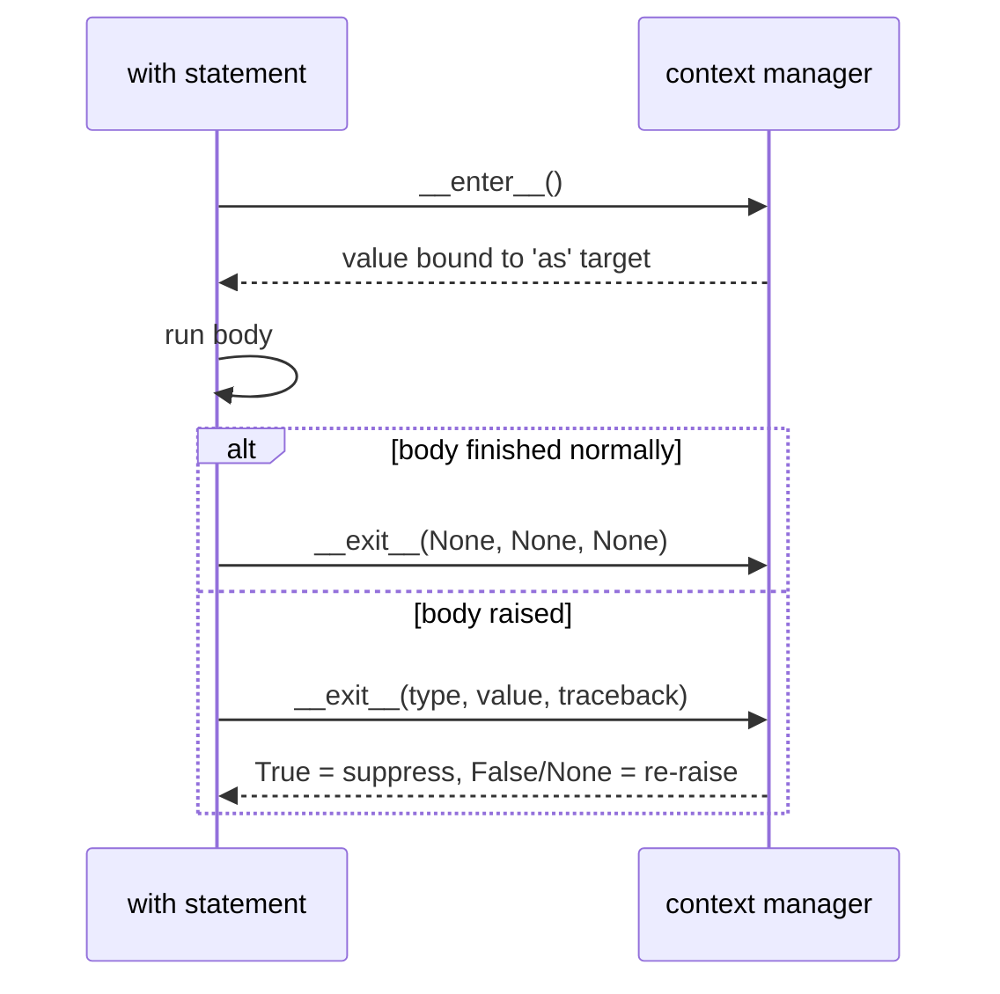

# Context Managers

Some resources must always be released: files closed, locks unlocked, database transactions committed or rolled back, network connections closed, and in robotics, **motors stopped** even when the control code crashes. A **context manager** pairs a setup action with a guaranteed teardown, and the `with` statement runs that pairing for you. It's Python's version of C++'s RAII. It replaces fragile `try`/`finally` blocks and is one of the most visible marks of professional Python.

## 1. The problem `with` solves

```python
# fragile: if process() raises, the file is never closed
f = open("data.txt")
process(f)
f.close()

# correct but noisy
f = open("data.txt")
try:
    process(f)
finally:
    f.close()

# idiomatic: guaranteed close, even on exceptions or return
with open("data.txt") as f:
    process(f)
```

> [!SYNTAX]
> ```python
> with EXPRESSION as NAME:      # "as NAME" is optional
>     body
> with A() as a, B() as b:      # several managers; exited in REVERSE order
>     body
> with (                        # parenthesised form (3.10+) for long lines
>     open("in.txt") as src,
>     open("out.txt", "w") as dst,
> ):
>     ...
> ```

## 2. The protocol: `__enter__` and `__exit__`

`with EXPR as x: body` is executed roughly as:

```python
manager = EXPR
x = manager.__enter__()          # setup; its RETURN VALUE is bound to x
try:
    body
except BaseException as e:
    if not manager.__exit__(type(e), e, e.__traceback__):   # True → swallow the exception
        raise
else:
    manager.__exit__(None, None, None)
```



> [!KEY]
> - The `as` target receives what `__enter__` **returns**, which isn't necessarily the manager itself. (`open()` returns the file, whose `__enter__` returns itself.)
> - `__exit__` **always** runs.
> - If `__exit__` returns a **truthy** value, the exception is **suppressed**. Returning `None` or `False` lets it propagate. Suppress only deliberately.

## 3. Writing a class-based context manager

```python
import time

class Timer:
    def __enter__(self):
        self.start = time.perf_counter()
        return self                         # so `with Timer() as t:` gives us the object
    def __exit__(self, exc_type, exc, tb):
        self.elapsed = time.perf_counter() - self.start
        print(f"took {self.elapsed:.4f}s")
        return False                        # don't suppress exceptions

with Timer() as t:
    sum(range(10**6))
print(t.elapsed)                            # still available after the block
```

A robotics-flavoured example where cleanup really matters:

```python
class MotorSession:
    def __init__(self, motor):
        self.motor = motor
    def __enter__(self):
        self.motor.enable()
        return self.motor
    def __exit__(self, exc_type, exc, tb):
        self.motor.set_speed(0)     # ALWAYS stop, even if control code crashed
        self.motor.disable()
        return False

# with MotorSession(left_motor) as m:
#     run_trajectory(m)            # an exception here still stops the motor
```

## 4. `contextlib.contextmanager`: a generator does it in a few lines

Everything **before** `yield` is `__enter__`, the yielded value is the `as` target, and everything **after** is `__exit__`. Wrap the `yield` in `try`/`finally` so cleanup runs even when the body raises:

```python
from contextlib import contextmanager

@contextmanager
def tag(name):
    print(f"<{name}>")
    try:
        yield name.upper()          # the body of the with-block runs here
    finally:
        print(f"</{name}>")

with tag("b") as v:
    print("inside", v)
```

```output
<b>
inside B
</b>
```

> [!DANGER]
> Without the `try`/`finally`, an exception in the body is re-raised **at the `yield`**, and the cleanup code after it never runs. Always use `try`/`finally` (or `except` for selective handling) around the `yield`.

## 5. Ready-made context managers

| Manager | Purpose |
|---|---|
| `open(...)` | file closed on exit |
| `threading.Lock()` | acquired on enter, released on exit |
| `contextlib.suppress(*excs)` | ignore the listed exceptions: `with suppress(FileNotFoundError): os.remove(p)` |
| `contextlib.redirect_stdout(f)` | capture prints into `f` |
| `contextlib.closing(obj)` | call `obj.close()` on exit |
| `contextlib.nullcontext(x)` | a do-nothing manager (useful for an optional `with`) |
| `contextlib.ExitStack()` | manage a **dynamic** number of contexts |
| `tempfile.TemporaryDirectory()` | creates a temp dir, deletes it on exit |
| `sqlite3` connection | commits on success, rolls back on exception |
| `decimal.localcontext()` | temporary precision settings |
| `torch.no_grad()` | disables gradient tracking inside the block (PyTorch) |

### `ExitStack` for an unknown number of resources

```python
from contextlib import ExitStack

paths = ["a.txt", "b.txt", "c.txt"]
with ExitStack() as stack:
    files = [stack.enter_context(open(p)) for p in paths]
    ...                              # all files are closed on exit, in reverse order
```

## 6. Order of exit

Multiple managers in one `with` (or nested `with`s) exit in **reverse** order of entry, like a stack:

```python
with tag("a"), tag("c"):
    print("two")
```

```output
<a>
<c>
two
</c>
</a>
```

## 7. Context managers and OOP design

A context manager encodes an **invariant** ("the motor is never left running", "the lock is always released") in one reusable place, instead of trusting every caller to remember. Whenever you see a pair like `connect()`/`disconnect()`, `start()`/`stop()` or `begin()`/`commit()`, consider offering a context manager.

## 8. Exam-ready answers

> [!EXAM]
> **Context managers and the `with` statement.** A context manager is an object that defines setup and teardown actions for a block of code through the methods `__enter__` and `__exit__`. The `with` statement calls `__enter__` before executing the block, binding its return value to the variable after `as`, and guarantees that `__exit__` is called when the block is left, whether normally, by `return`/`break`, or by an exception. `__exit__` receives the exception type, value and traceback (or three `None`s) and can suppress the exception by returning a true value. Context managers ensure reliable resource management (files, locks, connections, transactions). They can also be written as generator functions decorated with `contextlib.contextmanager`, where the code before `yield` is the setup and the code after it is the teardown.

## 9. Cheat sheet

| Need | Code |
|---|---|
| file | `with open(p, encoding="utf-8") as f:` |
| class-based | `__enter__(self)` returns a value; `__exit__(self, t, v, tb)` returns bool |
| generator-based | `@contextmanager` + `try: yield x finally: cleanup` |
| ignore an error | `with suppress(KeyError):` |
| many resources | `with ExitStack() as s: s.enter_context(cm)` |
| capture output | `with redirect_stdout(buf):` |
| several in one | `with A() as a, B() as b:` |

> [!INTERVIEW]
> **"Implement a context manager that times a block and works even if the block raises."** Either form works: a class with `__enter__` storing `perf_counter()` and `__exit__` computing elapsed time and returning `False`, or a `@contextmanager` generator with the timing in a `finally` around `yield`. The follow-up "how would you suppress only `TimeoutError`?" is answered by `return exc_type is TimeoutError` in `__exit__`, or `except TimeoutError: pass` around the `yield`.
