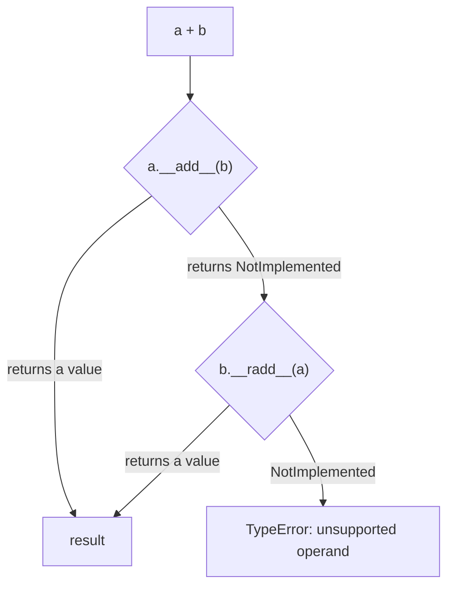

# The Python Data Model

Why does `len(x)` work on lists, strings and your own classes? Why can `for` loop over a file? Why does `a + b` work for numbers, strings and NumPy arrays? Because of the **data model**: a set of special ("dunder") methods that Python's syntax and built-ins call behind the scenes. Implementing them makes your objects behave like built-in types. That's how NumPy, pandas, PyTorch tensors and SQLAlchemy expressions feel native. This lesson goes beyond the basics: the container, numeric, comparison and callable protocols, and the rules (`NotImplemented`, reflected operators, hash consistency) that make them correct.

## 1. Syntax → special method

| You write | Python calls |
|---|---|
| `len(x)` | `x.__len__()` |
| `x[i]`, `x[i] = v`, `del x[i]` | `__getitem__`, `__setitem__`, `__delitem__` |
| `v in x` | `__contains__` (falls back to iteration) |
| `for v in x` | `iter(x)` → `__iter__` (or the old `__getitem__` protocol) |
| `a + b` | `a.__add__(b)`, then maybe `b.__radd__(a)` |
| `a += b` | `a.__iadd__(b)` (falls back to `__add__`) |
| `a == b`, `a < b` | `__eq__`, `__lt__`, … |
| `hash(x)` | `__hash__` |
| `bool(x)`, `if x:` | `__bool__`, else `__len__` |
| `x(args)` | `__call__` |
| `str(x)` / `repr(x)` / `format(x, spec)` | `__str__` / `__repr__` / `__format__` |
| `with x:` | `__enter__` / `__exit__` |
| `x.attr` (missing) | `__getattr__` |

> [!KEY]
> Special methods are looked up **on the type, not the instance**: `len(x)` effectively calls `type(x).__len__(x)`. Assigning `x.__len__ = ...` on an instance has no effect on `len(x)`. This is also why the data model is fast: CPython stores these methods in C-level slots on the type.

## 2. A numeric type done right

```python
class Vec:
    __slots__ = ("x", "y")
    def __init__(self, x, y):
        self.x, self.y = x, y
    def __repr__(self):
        return f"Vec({self.x}, {self.y})"
    def __add__(self, other):
        if not isinstance(other, Vec):
            return NotImplemented          # NOT raise: let Python try other.__radd__
        return Vec(self.x + other.x, self.y + other.y)
    def __mul__(self, k):
        if not isinstance(k, (int, float)):
            return NotImplemented
        return Vec(self.x * k, self.y * k)
    __rmul__ = __mul__                    # makes 2 * v work, not just v * 2
    def __neg__(self):
        return Vec(-self.x, -self.y)
    def __abs__(self):
        return (self.x ** 2 + self.y ** 2) ** 0.5
    def __bool__(self):
        return bool(self.x or self.y)
    def __eq__(self, other):
        return isinstance(other, Vec) and (self.x, self.y) == (other.x, other.y)
    def __hash__(self):
        return hash((self.x, self.y))      # consistent with __eq__

print(Vec(1, 2) + Vec(3, 4), 2 * Vec(1, 2), abs(Vec(3, 4)))   # Vec(4, 6) Vec(2, 4) 5.0
```

### How `a + b` is resolved



(If `type(b)` is a subclass of `type(a)` that overrides `__radd__`, Python tries `b.__radd__(a)` **first**, so subclasses can take control.)

> [!WARNING]
> Return the special singleton `NotImplemented` (not `NotImplementedError`, and don't raise) when you can't handle an operand type. That's what lets Python try the reflected method of the other operand, and lets other libraries interoperate with your type.

## 3. Equality and hashing

- Defining `__eq__` **without** `__hash__` sets `__hash__ = None`, making instances **unhashable** (they can't go in sets or be dict keys). That's deliberate, because the default identity hash would be inconsistent with value equality.
- Rule: **if `a == b`, then `hash(a) == hash(b)`**, and the hash must never change while the object is in a set or dict, so only hash immutable state.

`functools.total_ordering` fills in the remaining comparisons from `__eq__` plus one of `__lt__`/`__le__`/`__gt__`/`__ge__`.

## 4. Container protocols

```python
class Squares:
    """A virtual sequence: 0, 1, 4, 9, ... computed on demand."""
    def __init__(self, n):
        self.n = n
    def __len__(self):
        return self.n
    def __getitem__(self, i):
        if isinstance(i, slice):
            return [self[j] for j in range(*i.indices(self.n))]
        if i < 0:
            i += self.n
        if not 0 <= i < self.n:
            raise IndexError(i)           # IndexError is what ends the old iteration protocol
        return i * i

sq = Squares(5)
list(sq), sq[-1], sq[1:4], 9 in sq, list(reversed(sq))
# ([0, 1, 4, 9, 16], 16, [1, 4, 9], True, [16, 9, 4, 1, 0])
```

With just `__len__` and `__getitem__`, Python gives you iteration, `in`, `reversed` and slicing support. Inheriting from `collections.abc.Sequence` adds `index`, `count` and `__contains__` as **mixin methods**, and makes `isinstance(sq, Sequence)` true (next lessons).

## 5. Callables and `__getattr__`

```python
class Polynomial:
    def __init__(self, *coeffs):
        self.coeffs = coeffs                  # c0 + c1 x + c2 x^2 ...
    def __call__(self, x):
        return sum(c * x ** i for i, c in enumerate(self.coeffs))

p = Polynomial(1, 0, 2)                       # 1 + 2x²
p(3)                                          # 19: instances can act like functions

class Proxy:
    def __init__(self, target):
        self._t = target
    def __getattr__(self, name):              # called ONLY when normal lookup fails
        print(f"forwarding {name}")
        return getattr(self._t, name)
```

`__getattr__` (only for *missing* attributes) is safe for proxies and lazy loading. `__getattribute__` intercepts **every** attribute access: it's powerful, slow, and easy to recurse into infinitely.

## 6. Exam-ready answers

> [!EXAM]
> **The Python data model.** The data model defines the interfaces through which objects integrate with the language: special methods with double-underscore names are invoked implicitly by syntax and built-in functions, for example `__len__` by `len()`, `__getitem__` by indexing, `__iter__` by iteration, `__add__` by `+`, `__eq__` by `==` and `__call__` by calling an instance. They are looked up on the object's type. Binary operators first try the left operand's method; if it returns `NotImplemented`, Python tries the right operand's reflected method (such as `__radd__`) before raising `TypeError`. Defining `__eq__` without `__hash__` makes instances unhashable, and objects that compare equal must have equal hashes. Implementing these protocols lets user-defined classes behave like built-in types (operator overloading and duck typing).

## 7. Cheat sheet

| Goal | Implement |
|---|---|
| `len`, indexing, iteration | `__len__`, `__getitem__` (or `__iter__`) |
| `+` with your type on either side | `__add__` + `__radd__`, returning `NotImplemented` |
| `+=` in place | `__iadd__` returning `self` |
| value equality + set/dict keys | `__eq__` + `__hash__` over immutable fields |
| all comparisons | `__eq__` + `__lt__` + `@functools.total_ordering` |
| callable objects | `__call__` |
| truthiness | `__bool__` |
| forwarding missing attributes | `__getattr__` |

> [!INTERVIEW]
> **"Why does `NotImplemented` exist instead of just raising `TypeError` in `__add__`?"** It's how operand dispatch is negotiated. Returning `NotImplemented` tells Python "I don't know how to handle this right operand", and Python then tries the right operand's reflected method (`__radd__`). That lets a new library's type support `builtin + new_type` without modifying the built-in. Raising immediately would make `1 + MyType()` impossible even if `MyType.__radd__` handles it. Only after both sides return `NotImplemented` does Python raise `TypeError`.
