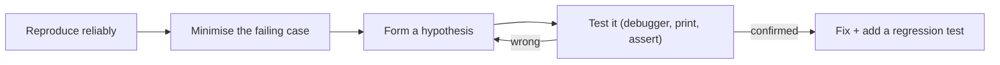

# Debugging

Every programmer spends a large share of their time debugging. The difference between beginners and experts isn't making fewer bugs, it's **finding them systematically**: reading the traceback properly, forming a hypothesis, reproducing the bug minimally, using a debugger instead of guessing, and bisecting when a regression appeared. This lesson covers tracebacks, `pdb` and `breakpoint()`, logging-based debugging, `git bisect`, and the debugging mindset.

## 1. Read the traceback, bottom-up

```text
Traceback (most recent call last):
  File "main.py", line 12, in <module>
    report(load("data.csv"))
  File "main.py", line 8, in report
    print(f"mean = {total / len(rows):.2f}")
                    ~~~~~~^~~~~~~~~~~
ZeroDivisionError: division by zero
```

- The **last line** is the exception type and message: *what* happened.
- The frame just above it is *where* it happened. Python 3.11+ underlines the exact sub-expression (`~~~^~~~`).
- Read upward to see *how* you got there: the call chain.
- `raise ... from err`, and "During handling of the above exception, another exception occurred", show **chained** exceptions. The original cause is printed first.

> [!KEY]
> The line that raised is often not the line that's wrong. Here the division failed, but the real bug is **upstream**: `load` returned an empty list. Ask: "what value made this fail, and where did that value come from?"

## 2. The scientific method for bugs



1. **Reproduce:** a bug you can't trigger on demand can't be verified as fixed. Capture the inputs, the seed and the environment.
2. **Minimise:** shrink the input and the code until removing anything more makes the bug disappear.
3. **Hypothesise and test:** one change at a time. Check assumptions with `assert`.
4. **Fix the cause, not the symptom**, then add a test.

## 3. pdb and `breakpoint()`

```python
def mean_speed(samples):
    total = 0
    for s in samples:
        breakpoint()            # drops into pdb here (Python 3.7+)
        total += s.speed
    return total / len(samples)
```

| Command | Action |
|---|---|
| `n` (next) | run the current line, stepping over calls |
| `s` (step) | step into a function call |
| `c` (continue) | run until the next breakpoint |
| `r` (return) | run until the current function returns |
| `p expr` / `pp expr` | print / pretty-print an expression |
| `l` / `ll` | list the source around the line / the whole function |
| `w` / `u` / `d` | where (the stack) / move up / move down a frame |
| `b file:line` / `b func` | set a breakpoint (`b 42, x > 3` is conditional) |
| `interact` | open a Python REPL in the current scope |
| `q` | quit |

```bash
python -m pdb script.py        # start under the debugger
python -m pdb -c continue script.py    # run until a crash, then inspect (post-mortem)
PYTHONBREAKPOINT=0 python app.py        # disable every breakpoint() call
```

**Post-mortem debugging** is the most underused superpower: after an uncaught exception, `import pdb; pdb.pm()` (or `python -m pdb`, or `pytest --pdb`) lets you inspect the variables in the frame where it failed, with no need to reproduce the bug again. IDE debuggers (VS Code, PyCharm) offer the same with a GUI.

## 4. Logging as a debugging tool

`print` debugging works, but **logging** stays useful in production and in timing-sensitive code where a debugger would disturb behaviour (robots, concurrency, network protocols):

```python
import logging
log = logging.getLogger(__name__)
logging.basicConfig(level=logging.DEBUG, format="%(asctime)s %(threadName)s %(name)s %(levelname)s %(message)s")

log.debug("pose=%s target=%s err=%.3f", pose, target, err)   # lazy formatting
try:
    send(cmd)
except OSError:
    log.exception("send failed for %r", cmd)                  # includes the traceback
```

Use structured context (IDs, thread names, timestamps), switch levels via configuration, and keep debug logs in the code, turned off.

## 5. Finding regressions: `git bisect`

When "it worked last week", binary search the history:

```bash
git bisect start
git bisect bad                 # the current commit is broken
git bisect good v1.4.0         # this release worked
# git checks out the midpoint: test it, then report
git bisect good                # or: git bisect bad
# ...repeat about log2(n) times, until git names the first bad commit
git bisect run pytest tests/test_nav.py -x    # fully automatic, with a test script
git bisect reset
```

Hundreds of commits narrow down to one in about 8 steps, which is very effective for "who broke the build".

## 6. Common bug patterns in Python

| Symptom | Likely cause |
|---|---|
| a function "remembers" values between calls | mutable default argument |
| a list changes "by itself" | aliasing: two names for the same list (`b = a`) |
| `NoneType has no attribute` | a function returned `None` (forgot `return`, or an in-place method like `list.sort()`) |
| late-binding closures all print the last value | a lambda in a loop captures the variable, not its value |
| float comparisons fail | binary floating point: use `math.isclose` |
| works locally, fails in CI | relative paths and the working directory, timezones, unseeded randomness, dict/set ordering assumptions, environment variables |
| intermittent failures | race conditions, timing assumptions, test-order dependence |

## 7. Exam-ready answers

> [!EXAM]
> **Debugging Python programs.** Debugging begins with reading the traceback, whose last line gives the exception type and message and whose frames, read from the bottom up, show where the error occurred and the chain of calls leading to it; the actual defect is often upstream of the failing line. A systematic approach reproduces the failure reliably, minimises the failing case, and tests hypotheses one at a time. The `pdb` debugger, entered with `breakpoint()`, `python -m pdb` or post-mortem after an exception, supports stepping (`n`, `s`), continuing (`c`), inspecting variables (`p`), navigating the stack (`w`, `u`, `d`) and conditional breakpoints. Logging provides persistent, configurable diagnostics suitable for production and timing-sensitive code, and `git bisect` uses binary search over the commit history to find the change that introduced a regression.

## 8. Cheat sheet

| Need | Tool |
|---|---|
| stop here | `breakpoint()` |
| inspect after a crash | `pytest --pdb`, `python -m pdb script.py`, `pdb.pm()` |
| step over / into / out | `n` / `s` / `r` |
| show a variable | `p x`, `pp obj` |
| move through the stack | `w`, `u`, `d` |
| conditional break | `b file.py:42, speed > 3` |
| persistent diagnostics | `logging` at DEBUG level, `log.exception` |
| find the commit that broke it | `git bisect run <test command>` |

> [!INTERVIEW]
> **"A function intermittently returns wrong results in production but never locally. How do you debug it?"** First gather evidence: logs with context around the failures (inputs, thread or worker IDs, timestamps), and the exact versions and configuration. Look for differences between the environments: data volume, concurrency (race conditions only appear under parallel load), timezones and locale, missing environment variables, unseeded randomness, caching. Try to reproduce by replaying the production inputs, increasing concurrency or adding sleeps to widen race windows. Add targeted assertions and structured logging, and use a sampling profiler or `py-spy dump` on a live process if it hangs. Once it's reproduced, minimise it, fix the cause, and add a regression test, ideally one that runs under the concurrency that exposed it.
