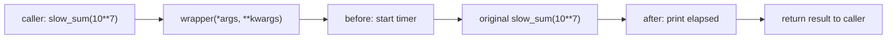

# Decorators

A decorator **wraps a function to add behaviour around it**, such as logging, timing, caching, access control, retries or registration, without touching the function's code. You've used them already: `@functools.cache`, `@property`, `@staticmethod`, `@dataclass`, and in frameworks `@app.get("/")` (FastAPI) and `@pytest.fixture`. Decorators combine three ideas you now know: **functions are objects**, **closures**, and **`*args, **kwargs` forwarding**. Once you see how those three fit together, decorators stop looking like magic.

## 1. The `@` syntax is just assignment

```python
@decorator
def greet():
    ...
```

is **exactly** the same as:

```python
def greet():
    ...
greet = decorator(greet)
```

> [!KEY]
> A decorator is any callable that **takes a function and returns a replacement** (usually a wrapper around the original). The `@` line runs **once, at definition time**, and rebinds the name to whatever the decorator returned.

## 2. Writing your first decorator

```python
import functools
import time

def timed(func):
    @functools.wraps(func)                 # copy the name, docstring etc. (section 4)
    def wrapper(*args, **kwargs):          # accept ANY arguments
        start = time.perf_counter()
        result = func(*args, **kwargs)     # call the original, forwarding everything
        elapsed = time.perf_counter() - start
        print(f"{func.__name__} took {elapsed:.4f}s")
        return result                      # don't forget to return the result!
    return wrapper                         # return the wrapper, not wrapper()

@timed
def slow_sum(n):
    return sum(range(n))

slow_sum(10_000_000)      # slow_sum took 0.1532s
```



The name `slow_sum` now refers to `wrapper`, a **closure** that remembers the original `func`.

> [!DANGER]
> The three classic decorator bugs:
> 1. `return wrapper()` instead of `return wrapper`: this calls it once at definition time.
> 2. Forgetting `return result` inside the wrapper: the decorated function then returns `None`.
> 3. Writing `def wrapper():` with no `*args, **kwargs`: the decorated function then rejects every argument.

## 3. The decorator template (memorise it)

```python
import functools

def my_decorator(func):
    @functools.wraps(func)
    def wrapper(*args, **kwargs):
        # ... before ...
        result = func(*args, **kwargs)
        # ... after ...
        return result
    return wrapper
```

Nearly every decorator you write is this shape with something in the "before" and "after" slots.

## 4. `functools.wraps`: preserving identity

Without `wraps`, the decorated function takes on the wrapper's identity:

```python
def plain(func):
    def wrapper(*args, **kwargs):
        return func(*args, **kwargs)
    return wrapper

@plain
def hello():
    """Say hi."""
print(hello.__name__, hello.__doc__)    # wrapper None
```

`@functools.wraps(func)` copies `__name__`, `__doc__`, `__module__`, `__qualname__` and `__annotations__`, and sets `__wrapped__` to the original. That matters for debugging, tracebacks, `help()`, documentation tools, pytest, FastAPI (which reads signatures) and stacking decorators.

## 5. Decorators with arguments: three levels

`@repeat(3)` first **calls** `repeat(3)`, which must **return a decorator**. So there are three nested functions:

```python
def repeat(times):                 # 1. takes the decorator's arguments
    def decorator(func):           # 2. takes the function
        @functools.wraps(func)
        def wrapper(*args, **kwargs):  # 3. replaces the function
            return [func(*args, **kwargs) for _ in range(times)]
        return wrapper
    return decorator

@repeat(3)
def roll():
    return 4

print(roll())       # [4, 4, 4]
```

`@repeat(3)` desugars to `roll = repeat(3)(roll)`.

| You write | Python does |
|---|---|
| `@deco` | `f = deco(f)` |
| `@deco(arg)` | `f = deco(arg)(f)` |
| `@a` then `@b` above `def f` | `f = a(b(f))` |

## 6. Stacking decorators

Decorators apply **bottom-up** (the one closest to `def` wraps first) and run **top-down** at call time:

```python
def a(f):
    def w(): return "a(" + f() + ")"
    return w
def b(f):
    def w(): return "b(" + f() + ")"
    return w

@a
@b
def x():
    return "x"

print(x())          # a(b(x))
```

Order matters: `@cache` above `@timed` caches the timed function, so the timer only prints on cache misses. The other order times every call, including cache hits.

## 7. Practical decorators

**Counting calls** (state on the wrapper):

```python
def count_calls(func):
    @functools.wraps(func)
    def wrapper(*args, **kwargs):
        wrapper.calls += 1
        return func(*args, **kwargs)
    wrapper.calls = 0
    return wrapper
```

**Retry** (decorator with arguments, for flaky I/O such as network calls or robot hardware):

```python
def retry(times=3, exceptions=(Exception,)):
    def decorator(func):
        @functools.wraps(func)
        def wrapper(*args, **kwargs):
            for attempt in range(1, times + 1):
                try:
                    return func(*args, **kwargs)
                except exceptions:
                    if attempt == times:
                        raise
        return wrapper
    return decorator
```

**Registration** (doesn't wrap at all; records the function and returns it unchanged). This is how plugin systems and web routes work:

```python
HANDLERS = {}
def command(name):
    def decorator(func):
        HANDLERS[name] = func
        return func                 # the original, unchanged
    return decorator

@command("greet")
def greet(who):
    return f"hi {who}"

print(HANDLERS["greet"]("Ada"))     # hi Ada
```

**Validation / access control**:

```python
def require_positive(func):
    @functools.wraps(func)
    def wrapper(x):
        if x <= 0:
            raise ValueError(f"{func.__name__} needs a positive number")
        return func(x)
    return wrapper
```

## 8. Built-in and standard decorators

| Decorator | Purpose |
|---|---|
| `@functools.cache` / `@lru_cache(maxsize=…)` | memoization |
| `@functools.wraps` | preserve metadata in your own decorators |
| `@property`, `@x.setter` | managed attributes (OOP) |
| `@staticmethod`, `@classmethod` | method kinds (OOP) |
| `@dataclasses.dataclass` | generate `__init__`, `__repr__`, `__eq__` (a *class* decorator) |
| `@functools.singledispatch` | overload by argument type |
| `@contextlib.contextmanager` | build context managers from generators |
| `@abc.abstractmethod` | mark methods that subclasses must implement |

Decorators can also be **classes** (an instance with `__call__`) or apply to **classes** (`@dataclass`). The Advanced Decorators topic covers both.

## 9. Exam-ready answers

> [!EXAM]
> **Decorators.** A decorator is a callable that takes a function (or class) and returns a replacement, typically a wrapper that adds behaviour before and/or after calling the original. The syntax `@decorator` placed above a definition is equivalent to `f = decorator(f)` and is executed once, when the function is defined. A typical decorator defines an inner wrapper function accepting `*args, **kwargs`, forwards them to the original function and returns its result; the wrapper is a closure over the original function. `functools.wraps` copies the original's metadata (`__name__`, `__doc__`, and so on) to the wrapper. Decorators that take arguments are implemented as a function returning a decorator, and stacked decorators are applied from the bottom up.

## 10. Cheat sheet

| Need | Pattern |
|---|---|
| simple decorator | `def d(f): @wraps(f) def w(*a, **k): ...; return f(*a, **k) ... return w` |
| with arguments | `def d(arg): def deco(f): ... return w; return deco` |
| keep metadata | `@functools.wraps(func)` |
| state | an attribute on the wrapper, or `nonlocal` |
| register only | `def d(f): REG.append(f); return f` |
| reach the original | `decorated.__wrapped__` |

> [!INTERVIEW]
> **"Write a decorator that caches results, and explain when caching is wrong."** A dict in the closure keyed by `args` (plus `frozenset(kwargs.items())`). It's wrong for impure functions (results depend on time, I/O or global state), for unhashable arguments, and for unbounded inputs that leak memory. That last one is why `lru_cache(maxsize=…)` exists, evicting least-recently-used entries.
