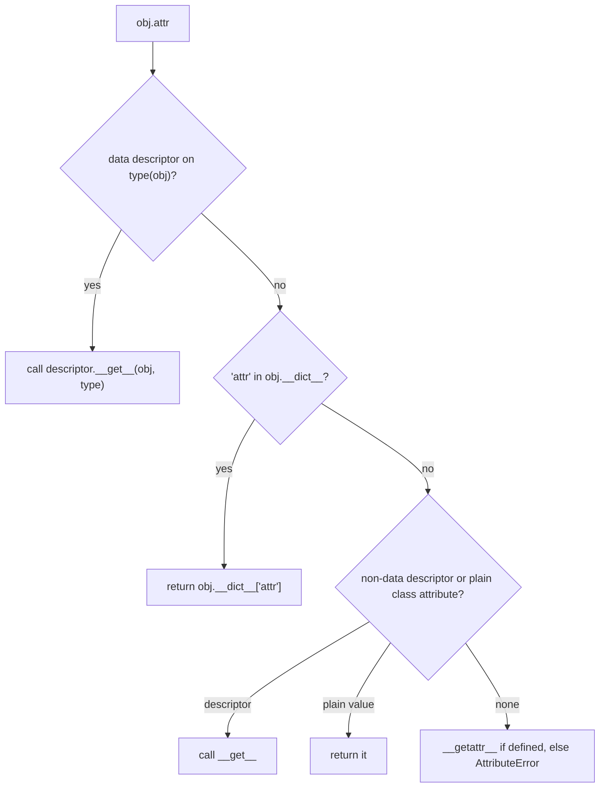

# Descriptors

A **descriptor** is an object that customises what happens when an attribute is accessed **on another class**. It's one of the deepest mechanisms in Python, and also one of the most used, invisibly: **`property`, methods, `staticmethod`, `classmethod`, `__slots__`, and ORM fields (Django, SQLAlchemy) are all descriptors**. Understanding descriptors explains how `obj.method` becomes a bound method, why `property` works, and how to build reusable validated fields.

## 1. The protocol

Any object whose class defines at least one of these is a descriptor:

```python
class Descriptor:
    def __get__(self, obj, objtype=None): ...   # obj.attr   (obj is None when accessed on the class)
    def __set__(self, obj, value): ...          # obj.attr = value
    def __delete__(self, obj): ...              # del obj.attr
    def __set_name__(self, owner, name): ...    # called when the owner class is created (3.6+)
```

It only takes effect when the descriptor is a **class attribute** of the owner class.

## 2. A reusable validated field

```python
class NonNegative:
    def __set_name__(self, owner, name):
        self.private = "_" + name                 # learn our own attribute name automatically
    def __get__(self, obj, objtype=None):
        if obj is None:
            return self                           # accessed on the class: return the descriptor itself
        return getattr(obj, self.private)
    def __set__(self, obj, value):
        if value < 0:
            raise ValueError(f"{self.private[1:]} must be >= 0")
        setattr(obj, self.private, value)

class Box:
    width = NonNegative()                         # one descriptor instance per FIELD, shared by all Boxes
    height = NonNegative()
    def __init__(self, w, h):
        self.width = w                            # goes through NonNegative.__set__
        self.height = h

b = Box(2, 3)
b.width                                           # 2
b.width = -1                                      # ValueError: width must be >= 0
```

Compare that to writing two near-identical `@property` getter/setter pairs. A descriptor encapsulates the logic once and reuses it for any number of fields and classes. This is exactly how Django's `models.IntegerField()` works.

> [!WARNING]
> The descriptor object is **shared by all instances** of the owner class. Per-instance data must be stored **on the instance** (`obj._width` or `obj.__dict__`), never on the descriptor (`self.value = v` would make every Box share one width).

## 3. Data vs non-data descriptors: lookup precedence

| Kind | Defines | Precedence vs the instance `__dict__` |
|---|---|---|
| **data descriptor** | `__set__` and/or `__delete__` | **wins** over the instance dict |
| **non-data descriptor** | only `__get__` | **loses** to the instance dict |

`obj.attr` lookup order, as implemented by `object.__getattribute__`:



That's why a `property` (a data descriptor) can't be shadowed by assigning to the instance, while a **method** (a non-data descriptor) **can** be shadowed per instance: `obj.method = lambda: 42` works.

## 4. Methods are descriptors

Functions implement `__get__`. Accessing a function through an instance calls `function.__get__(obj, type)`, which returns a **bound method** that remembers `obj`:

```python
class F:
    def m(self): ...
f = F()
F.__dict__["m"]              # <function F.m>: the plain function stored in the class
f.m                          # <bound method F.m of <F object>>: created by __get__ on each access
f.m.__func__ is F.__dict__["m"], f.m.__self__ is f     # True True
```

That's where `self` comes from: there's no magic in the `def`, just the descriptor protocol. `staticmethod.__get__` returns the raw function (no binding), and `classmethod.__get__` binds the **class** instead of the instance.

### `property` is a descriptor

A simplified pure-Python `property`:

```python
class my_property:
    def __init__(self, fget=None, fset=None):
        self.fget, self.fset = fget, fset
    def __get__(self, obj, objtype=None):
        if obj is None:
            return self
        return self.fget(obj)
    def __set__(self, obj, value):
        if self.fset is None:
            raise AttributeError("read-only")
        self.fset(obj, value)
    def setter(self, fset):
        return type(self)(self.fget, fset)
```

## 5. Lazy computed attributes

A **non-data** descriptor that stores its result in the instance dict computes a value only once. After the first access, the instance attribute shadows the descriptor:

```python
class cached:
    def __init__(self, func):
        self.func = func
    def __set_name__(self, owner, name):
        self.name = name
    def __get__(self, obj, objtype=None):
        if obj is None:
            return self
        value = self.func(obj)
        obj.__dict__[self.name] = value      # next access finds it in the instance dict first
        return value
```

The standard library's `functools.cached_property` does exactly this.

## 6. Exam-ready answers

> [!EXAM]
> **Descriptors.** A descriptor is an object defining any of `__get__`, `__set__` or `__delete__` that is stored as a class attribute; attribute access on instances of that class is then delegated to these methods. Data descriptors (defining `__set__` or `__delete__`) take precedence over entries in an instance's `__dict__`, whereas non-data descriptors (defining only `__get__`) are overridden by instance attributes. `__set_name__` informs a descriptor of the attribute name it was assigned to. Descriptors underpin core features: functions are non-data descriptors whose `__get__` produces bound methods, and `property`, `staticmethod`, `classmethod` and `__slots__` are implemented as descriptors. They enable reusable managed attributes such as validated fields, lazy computed values and ORM columns, with per-instance state stored on the instance rather than on the shared descriptor.

## 7. Cheat sheet

| Need | Tool |
|---|---|
| a single computed or validated attribute | `@property` |
| the same validation for many fields | a descriptor class with `__set_name__` |
| compute once, then cache | `functools.cached_property` (non-data descriptor) |
| learn the field name | `__set_name__(self, owner, name)` |
| return the descriptor when accessed on the class | `if obj is None: return self` |
| store per-instance values | `obj.__dict__[name]` or `setattr(obj, "_" + name, v)` |

> [!INTERVIEW]
> **"How does `obj.method()` get `self` automatically?"** Functions are non-data descriptors. When `method` is found on the class during `obj.method` lookup, Python calls `function.__get__(obj, type(obj))`, which returns a bound method object holding both the function and `obj`. Calling it calls `function(obj, *args)`. Accessing through the class (`Cls.method`) passes `obj=None`, so you get the plain function. `staticmethod` and `classmethod` are descriptors that change what `__get__` returns.
