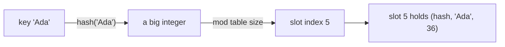

# Dictionaries

A dictionary maps **keys to values** with average **O(1)** lookup, insertion and deletion. It's the most important data structure for writing efficient Python. A huge share of interview problems ("two sum", "group anagrams", "first unique character", "LRU cache") are really the question *"can you see that a hash map makes this O(n)?"* Python itself is built on dicts: module namespaces, object attributes and keyword arguments are all dicts.

## 1. Creating dictionaries

```python
ages = {"Ada": 36, "Linus": 54}             # literal
empty = {}                                  # an empty DICT (not a set!)
from_pairs = dict([("x", 1), ("y", 2)])     # from (key, value) pairs
from_kwargs = dict(x=1, y=2)                # keyword form (string keys only)
zipped = dict(zip("abc", [1, 2, 3]))        # {'a': 1, 'b': 2, 'c': 3}
defaults = dict.fromkeys(["a", "b"], 0)     # {'a': 0, 'b': 0}
squares = {n: n * n for n in range(4)}      # comprehension: {0: 0, 1: 1, 2: 4, 3: 9}
```

## 2. How a dict works: the hash table



1. Python computes `hash(key)`, an integer.
2. That hash picks a **slot** in an internal array.
3. The (hash, key, value) entry lives there. On lookup, Python jumps straight to the slot and compares keys, with no scanning.
4. If two keys land in the same slot (a **collision**), CPython probes other slots in a pseudo-random sequence (**open addressing**).
5. When the table gets about 2/3 full, it's **resized** and every key is re-inserted. That keeps operations O(1) on average, amortised.

Since Python 3.7, dicts **preserve insertion order**: iteration returns keys in the order they were first added. (CPython keeps a compact entries array plus a separate sparse index table.)

> [!KEY]
> **Keys must be hashable**: immutable built-ins (`int`, `float`, `str`, `tuple` of hashables, `frozenset`, `None`, `bool`). Lists, dicts and sets can't be keys. Values can be anything.

Two keys that compare **equal** must have equal hashes, so `1`, `1.0` and `True` are the **same key**:

```python
d = {1: "int", 1.0: "float", True: "bool"}
print(d)          # {1: 'bool'}: one key, the last value wins, the first key object is kept
```

## 3. Reading values

```python
ages = {"Ada": 36, "Linus": 54}
print(ages["Ada"])            # 36
# ages["Bob"]                 → KeyError: 'Bob'
print(ages.get("Bob"))        # None: no error
print(ages.get("Bob", 0))     # 0: with a default
print("Ada" in ages)          # True: membership tests KEYS, O(1)
print(36 in ages)             # False: values are not searched
```

> [!TIP]
> Use `d[key]` when a missing key is a **bug** (you want the `KeyError`). Use `d.get(key, default)` when missing is **normal**.

## 4. Writing, updating, deleting

```python
d = {"a": 1}
d["b"] = 2                  # insert a new key
d["a"] = 10                 # overwrite an existing key
d.update({"c": 3}, d=4)     # merge in several at once
merged = d | {"e": 5}       # Python 3.9+: new merged dict (right side wins)
d |= {"f": 6}               # in-place merge

v = d.pop("a")              # remove and return (KeyError if missing)
v = d.pop("zzz", None)      # with a default: no error
k, v = d.popitem()          # remove and return the LAST inserted pair (LIFO)
del d["b"]                  # delete (KeyError if missing)
d.clear()                   # empty it
```

### `setdefault`: get, or insert a default and return it

```python
groups = {}
groups.setdefault("fruits", []).append("apple")
groups.setdefault("fruits", []).append("pear")
print(groups)               # {'fruits': ['apple', 'pear']}
```

`collections.defaultdict` (Standard Library module) makes this even cleaner.

## 5. Iterating

```python
scores = {"Ada": 90, "Bob": 72, "Cy": 85}
for name in scores:                     # keys (the default)
    print(name)
for score in scores.values():           # values
    print(score)
for name, score in scores.items():      # (key, value) pairs: the most common form
    print(f"{name}: {score}")
```

`keys()`, `values()` and `items()` return **views**: live windows onto the dict that reflect later changes. `keys()` and `items()` also support set operations:

```python
a = {"x": 1, "y": 2}
b = {"y": 3, "z": 4}
print(a.keys() & b.keys())     # {'y'}: keys in both
print(a.keys() - b.keys())     # {'x'}
```

> [!DANGER]
> Adding or removing keys **while iterating** over a dict raises `RuntimeError: dictionary changed size during iteration`. Iterate over a snapshot instead: `for k in list(d):`. Changing the *values* of existing keys during iteration is fine.

## 6. The four essential dict patterns

**Counting**

```python
words = "the cat and the hat and the bat".split()
counts = {}
for w in words:
    counts[w] = counts.get(w, 0) + 1
print(counts)
# {'the': 3, 'cat': 1, 'and': 2, 'hat': 1, 'bat': 1}
print(max(counts, key=counts.get))      # the: the key with the largest value
```

**Grouping**

```python
names = ["ada", "alan", "bob", "barbara", "cy"]
by_letter = {}
for n in names:
    by_letter.setdefault(n[0], []).append(n)
# {'a': ['ada', 'alan'], 'b': ['bob', 'barbara'], 'c': ['cy']}
```

**Lookup table / memo**: replace an O(n) search with O(1):

```python
# Two Sum: indices of two numbers adding to target, in one pass
def two_sum(nums, target):
    seen = {}                       # value → index
    for i, x in enumerate(nums):
        if target - x in seen:
            return seen[target - x], i
        seen[x] = i
```

**Inverting a mapping**

```python
code = {"a": 1, "b": 2}
decode = {v: k for k, v in code.items()}    # {1: 'a', 2: 'b'}  (values must be unique and hashable)
```

## 7. Sorting a dict's contents

Dicts keep insertion order, but you can produce sorted views:

```python
counts = {"the": 3, "cat": 1, "and": 2}
print(sorted(counts))                                    # keys alphabetically
print(sorted(counts.items(), key=lambda kv: kv[1]))      # by value ascending
print(sorted(counts.items(), key=lambda kv: (-kv[1], kv[0])))  # by count desc, then key
```

## 8. Complexity

| Operation | Average | Worst case |
|---|---|---|
| `d[k]`, `d[k] = v`, `del d[k]`, `k in d` | **O(1)** | O(n) (pathological collisions) |
| iteration | O(n) | O(n) |
| `len(d)` | O(1) | O(1) |
| copy | O(n) | O(n) |

The O(n) worst case needs many keys with colliding hashes. CPython randomises string hashes per process (`PYTHONHASHSEED`) to make deliberate collision attacks hard.

## 9. Nested dictionaries

```python
users = {
    "ada": {"age": 36, "langs": ["python", "c"]},
    "linus": {"age": 54, "langs": ["c"]},
}
print(users["ada"]["langs"][0])          # python
users["ada"]["age"] += 1
print(users.get("bob", {}).get("age"))   # None: safe chained lookup
```

## 10. Exam-ready answers

> [!EXAM]
> **Dictionaries.** A dictionary is a mutable mapping from unique, hashable keys to arbitrary values, implemented as a hash table. The hash of a key determines where its entry is stored, so lookup, insertion and deletion take constant time on average. Since Python 3.7 dictionaries preserve insertion order. Keys must be hashable (immutable built-in types such as `int`, `str` and tuples of hashables), and keys that compare equal must have equal hash values. Common operations include `d[k]` (raises `KeyError` if absent), `get(k, default)`, `setdefault`, `update`, `pop`, `popitem`, and iteration via the views `keys()`, `values()` and `items()`.

> [!EXAM]
> **Why must dictionary keys be immutable?** The position of an entry in the hash table is determined by the key's hash value. If a key could change after insertion, its hash would change too, and the entry would be stored in the wrong slot and could no longer be found. Hashable objects therefore have a hash that never changes during their lifetime, and equal objects must have equal hashes.

## 11. Cheat sheet

| Need | Code |
|---|---|
| safe read | `d.get(k, default)` |
| count | `d[k] = d.get(k, 0) + 1` |
| group | `d.setdefault(k, []).append(v)` |
| key with max value | `max(d, key=d.get)` |
| iterate pairs | `for k, v in d.items():` |
| delete while iterating | `for k in list(d): ...` |
| merge | `a \| b` or `{**a, **b}` |
| invert | `{v: k for k, v in d.items()}` |
| sort by value | `sorted(d.items(), key=lambda kv: kv[1])` |

> [!INTERVIEW]
> **"How would you find the first non-repeating character in a string in O(n)?"** One pass counts the characters in a dict, and a second pass over the **string** returns the first character with count 1. Insertion order preservation would also let you scan the dict itself. Two O(n) passes beat the O(n²) nested loop, and that's the whole point of the question.
