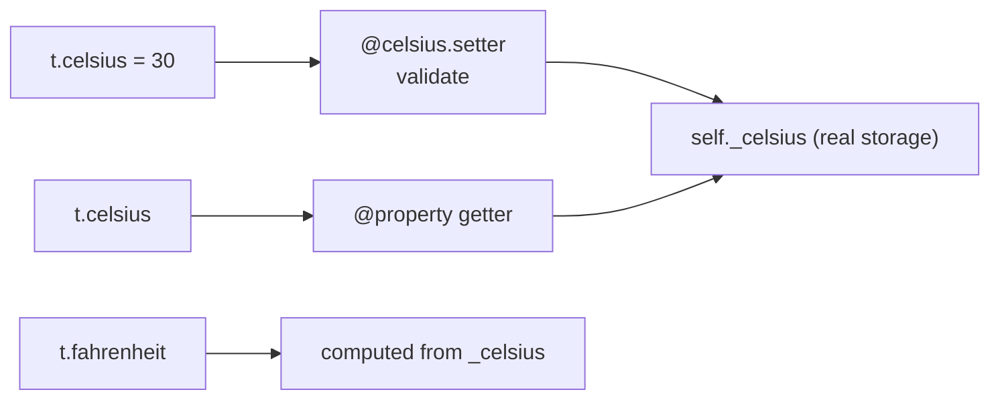

# Encapsulation and Properties

**Encapsulation** means an object controls access to its own state: outsiders use a small public interface, and the internals stay free to change. It's what keeps a large system from becoming a web where every part pokes at every other part's data. Python does it differently from Java or C++: there are no enforced `private` fields, just **naming conventions** plus **properties**, which let you add validation or computation behind plain attribute syntax without breaking callers.

## 1. Why encapsulate?

An object has **invariants**: conditions that must always hold. A `Temperature` is never below −273.15 °C. A `BankAccount` balance is never negative. A `Motor`'s rpm stays within its limits. If any code can assign any attribute, any line anywhere can break an invariant, and the bug appears far from its cause.

```python
m = Motor("left", 3000)
m.rpm = 99999          # nothing stops this, and the hardware gets an impossible command
```

Encapsulation funnels changes through code that **checks**.

## 2. Python's access conventions

| Name | Meaning | Enforced? |
|---|---|---|
| `speed` | public: part of the interface | — |
| `_speed` | **internal**: "don't touch from outside; may change without notice" | no, a convention (linters and IDEs warn) |
| `__speed` | **name-mangled**: becomes `_ClassName__speed` | partially: avoids clashes in subclasses |
| `__speed__` | special ("dunder") names reserved for Python | — |

```python
class Account:
    def __init__(self):
        self._balance = 0          # internal
        self.__pin = "1234"        # mangled

a = Account()
print(a._balance)                  # works, but you're breaking the contract
print(a._Account__pin)             # the mangled name: "private" isn't secret
# a.__pin                          → AttributeError
```

> [!KEY]
> Python's philosophy is "**we're all consenting adults**". A single underscore says "internal", and well-behaved code respects it. Use the double underscore **only** to avoid accidental name clashes with subclasses, not as security. Name mangling isn't access control.

## 3. Properties: attribute syntax, method power

Suppose `Temperature` started with a plain attribute and callers write `t.celsius = 25`. Later you need validation. In Java you'd have had to write `getCelsius()`/`setCelsius()` from day one. In Python you **upgrade the attribute to a property**, and callers don't change at all:

```python
class Temperature:
    def __init__(self, celsius):
        self.celsius = celsius            # goes through the setter below!

    @property
    def celsius(self):                    # getter: t.celsius
        return self._celsius

    @celsius.setter
    def celsius(self, value):             # setter: t.celsius = value
        if value < -273.15:
            raise ValueError("below absolute zero")
        self._celsius = value

    @property
    def fahrenheit(self):                 # computed, read-only property
        return self._celsius * 9 / 5 + 32

t = Temperature(25)
print(t.fahrenheit)       # 77.0: looks like an attribute, runs a method
t.celsius = 30            # validated
# t.celsius = -300        → ValueError: below absolute zero
# t.fahrenheit = 1        → AttributeError: property 'fahrenheit' of 'Temperature' object has no setter
```



> [!KEY]
> - The property and its storage need **different names** (`celsius` vs `_celsius`). Writing `self.celsius = value` inside the setter calls the setter again → infinite recursion → `RecursionError`.
> - Assigning `self.celsius = celsius` in `__init__` (the public name) is deliberate: the setter validates the initial value too.
> - A property without a setter is **read-only**. `@x.deleter` also exists (rarely used).

## 4. When to use properties

| Use a property for | Example |
|---|---|
| validation on assignment | non-negative balance, speed limits |
| computed / derived values | `area` of a rectangle, `fahrenheit` |
| read-only public data | `id` that must never change after creation |
| lazy or cached values | `@functools.cached_property` |
| keeping a stable API while internals change | storing radians internally but exposing degrees |

> [!WARNING]
> Don't write trivial getters and setters (`get_x()`, `set_x()`, or properties that only return and set the field). Start with a plain public attribute. Python lets you switch to a property later **without changing callers**. That's exactly why the Java habit is unnecessary here. Properties should also be **cheap**: callers expect attribute access to be fast and free of side effects. Expensive operations should look like method calls.

## 5. Encapsulating collections

Returning an internal list lets callers mutate your state behind your back:

```python
class Playlist:
    def __init__(self):
        self._songs = []

    def add(self, song):
        if song in self._songs:
            raise ValueError("duplicate")
        self._songs.append(song)

    @property
    def songs(self):
        return tuple(self._songs)        # read-only snapshot: callers can't append duplicates
```

## 6. Encapsulation in other languages (for later)

| | Python | C++ | C |
|---|---|---|---|
| Private data | `_name` convention | `private:` (enforced by the compiler) | opaque struct pointer in the header |
| Getters/setters | properties | member functions | functions taking `Struct*` |

In the C module you'll implement encapsulation **by hand** with opaque pointers. That makes the idea concrete.

## 7. Exam-ready answers

> [!EXAM]
> **Encapsulation.** Encapsulation is the bundling of data with the methods that operate on it, together with restricting direct external access to the internal state so that objects can maintain their invariants. Python does not enforce access control; by convention, attributes prefixed with a single underscore are internal, and a double-underscore prefix triggers name mangling (`__x` becomes `_ClassName__x`) to avoid clashes in subclasses. Controlled access is provided through methods and properties.

> [!EXAM]
> **Properties.** A property, created with the `@property` decorator, turns a method into a managed attribute: reading the attribute calls the getter, and with `@name.setter` assignment calls a setter that can validate or transform the value. Properties allow computed and read-only attributes and allow a plain attribute to be replaced by managed access later without changing client code.

## 8. Cheat sheet

| Need | Code |
|---|---|
| internal attribute | `self._x` |
| avoid subclass clash | `self.__x` |
| read-only | `@property def x(self): return self._x` |
| validated | `@x.setter def x(self, v): check; self._x = v` |
| computed | `@property def area(self): return self.w * self.h` |
| safe collection view | `return tuple(self._items)` |

> [!INTERVIEW]
> **"Python has no private keyword. How do you achieve encapsulation?"** By convention (`_internal`), name mangling for clash avoidance (`__x`), properties for controlled access and validation, and by designing a small public interface of methods that preserves invariants (returning copies or read-only views of internal collections). Explain the "consenting adults" philosophy, and that the goal of encapsulation is protecting invariants and freedom to change internals, not secrecy.
