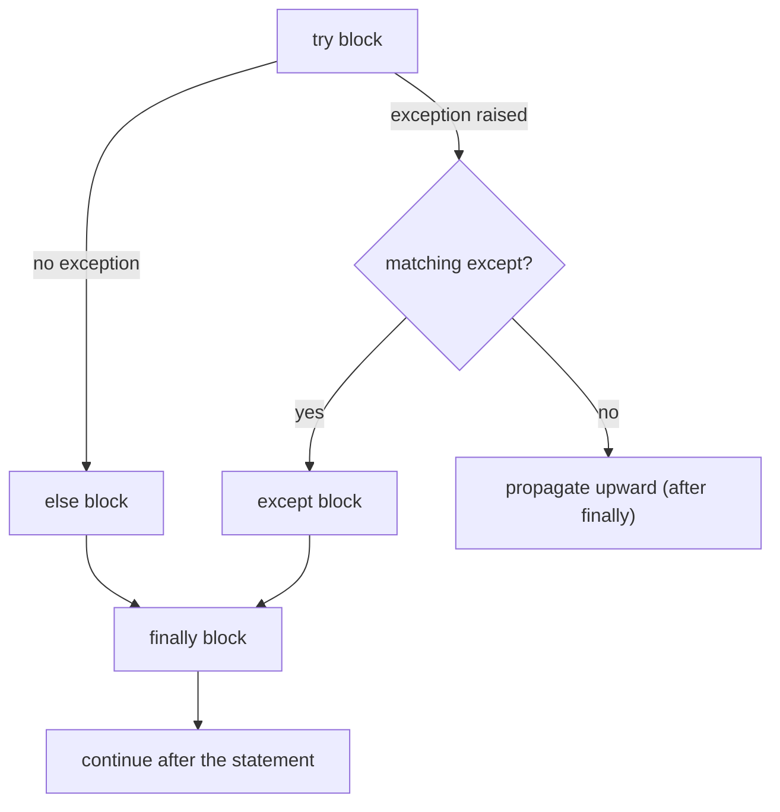

# Exceptions

Programs meet bad input, missing files, network drops and sensors that return garbage. **Exceptions** are Python's mechanism for signalling and handling these situations without cluttering every line with error checks. Good exception handling separates software that fails clearly and recoverably from software that crashes cryptically, or worse, silently produces wrong results. In robotics, an unhandled exception in a control loop can stop a motor mid-motion. Knowing *where* to catch matters as much as knowing *how*.

## 1. What an exception is

When an operation can't complete, Python **raises** an exception object. Normal execution stops and Python unwinds the call stack, looking for a matching handler. If none is found, the program terminates and prints a **traceback**:

```python
def parse_age(text):
    return int(text)

def main():
    print(parse_age("abc"))

main()
```

```output
Traceback (most recent call last):
  File "main.py", line 7, in <module>
    main()
  File "main.py", line 5, in main
    print(parse_age("abc"))
  File "main.py", line 2, in parse_age
    return int(text)
ValueError: invalid literal for int() with base 10: 'abc'
```

**Read tracebacks bottom-up**: the last line is the exception type and message, and the frames above show the call path that led there (most recent call last).

## 2. `try` / `except` / `else` / `finally`

> [!SYNTAX]
> ```python
> try:
>     risky()                     # code that might raise
> except ValueError as e:         # handle one specific type; e is the exception object
>     handle(e)
> except (KeyError, IndexError):  # several types in one clause
>     ...
> else:                           # runs only if the try block raised NOTHING
>     use_result()
> finally:                        # ALWAYS runs: success, exception, return or break
>     cleanup()
> ```



```python
for text in ["42", "abc"]:
    try:
        n = int(text)
    except ValueError:
        print(f"{text!r} is not a number")
    else:
        print("parsed", n)          # only when int() succeeded
    finally:
        print("checked", text)
```

```output
parsed 42
checked 42
'abc' is not a number
checked abc
```

Why `else`? It keeps the `try` block as **small** as possible: only the line that might fail goes inside, so you don't accidentally catch exceptions from code you didn't mean to guard.

`finally` runs even if the `try` block `return`s:

```python
def f():
    try:
        return "try"
    finally:
        print("finally runs")    # printed before the caller receives "try"
```

> [!DANGER]
> A `return` inside `finally` **overrides** any return or exception from the `try`, silently swallowing errors. Python 3.14 emits a `SyntaxWarning` for it (PEP 765). Never return from `finally`.

## 3. The exception hierarchy

All built-in exceptions inherit from `BaseException`. Catch from **specific to general**: the first matching `except` wins.

```text
BaseException
 ├── SystemExit, KeyboardInterrupt, GeneratorExit   ← don't catch these normally
 └── Exception                                      ← catch from here down
      ├── ArithmeticError → ZeroDivisionError, OverflowError
      ├── LookupError → IndexError, KeyError
      ├── ValueError → UnicodeError …
      ├── TypeError, NameError → UnboundLocalError
      ├── AttributeError, ImportError → ModuleNotFoundError
      ├── OSError → FileNotFoundError, PermissionError, TimeoutError, ConnectionError …
      ├── RuntimeError → RecursionError, NotImplementedError
      └── StopIteration …
```

| Exception | Typical cause |
|---|---|
| `ValueError` | right type, bad value: `int("abc")` |
| `TypeError` | wrong type: `"a" + 1`, wrong number of arguments |
| `KeyError` / `IndexError` | missing dict key / index out of range |
| `AttributeError` | `None.append`, a typo in an attribute name |
| `FileNotFoundError` | open a missing path |
| `ZeroDivisionError` | `x / 0` |
| `NameError` | undefined variable |

> [!DANGER]
> **Never write a bare `except:` or `except Exception: pass`.** A bare `except:` also catches `KeyboardInterrupt` (Ctrl+C stops working) and `SystemExit`. `pass` hides the bug entirely. Catch the **specific** exceptions you expect and can actually handle. Let everything else propagate.

## 4. Raising exceptions

```python
def set_speed(rpm):
    if not 0 <= rpm <= 3000:
        raise ValueError(f"rpm must be in [0, 3000], got {rpm}")
    ...
```

- `raise ExceptionType("message")` raises a new exception.
- A bare `raise` inside an `except` block **re-raises** the current exception with its original traceback, for "log it and pass it on".
- Messages should say **what** was wrong and **what was expected**, with the offending value.

### Exception chaining: `raise … from …`

When you translate a low-level error into a higher-level one, keep the cause:

```python
class ConfigError(Exception):
    pass

def load_port(text):
    try:
        return int(text)
    except ValueError as e:
        raise ConfigError(f"invalid port {text!r}") from e   # sets __cause__
```

The traceback then shows both: "*The above exception was the direct cause of the following exception*". Raising inside `except` **without** `from` still records the original as `__context__` ("*During handling of the above exception, another exception occurred*"). `raise X from None` suppresses the chain.

## 5. Custom exceptions

Define a small hierarchy for your application or library, so callers can catch your errors precisely:

```python
class RobotError(Exception):
    """Base class for all robot errors."""

class SensorError(RobotError):
    def __init__(self, sensor, reading):
        super().__init__(f"sensor {sensor} returned invalid reading {reading}")
        self.sensor = sensor
        self.reading = reading

class MotorStall(RobotError):
    pass

try:
    raise SensorError("lidar", -1)
except RobotError as e:            # catches any robot error
    print(e, e.sensor)
```

Rules: inherit from `Exception` (never `BaseException`), name them `…Error`, and add attributes that help the handler decide what to do.

## 6. EAFP vs LBYL

Two styles of dealing with possible failure:

```python
# LBYL: Look Before You Leap (common in C)
if key in config:
    port = config[key]
else:
    port = 8080

# EAFP: Easier to Ask Forgiveness than Permission (idiomatic Python)
try:
    port = config[key]
except KeyError:
    port = 8080
```

EAFP avoids **race conditions** (a file can be deleted between `os.path.exists()` and `open()`) and duplicated lookups. It's preferred in Python when failure is the exception rather than the rule. If failure is common, an `if` (or `dict.get`) is clearer and faster, because raising an exception costs more than a comparison.

## 7. Where to handle exceptions

> [!KEY]
> Handle an exception **at the level that can do something meaningful about it**: retry, use a default, ask the user again, or log and abort cleanly. Low-level functions usually **raise**. Top-level code (the main loop, a request handler, a UI event handler) **catches**, reports and keeps the program alive.

```python
def read_config(path):          # low level: just raises, with a clear message
    ...

def main():
    try:
        cfg = read_config("robot.toml")
    except FileNotFoundError:
        print("config missing; using defaults")
        cfg = DEFAULTS
    run(cfg)
```

## 8. Modern extras (3.11+)

- **Notes**: `e.add_note("hint: check units")` attaches extra lines shown in the traceback.
- **ExceptionGroup and `except*`**: raise and handle several unrelated exceptions at once (for example from concurrent tasks):

```python
try:
    raise ExceptionGroup("many", [ValueError(1), TypeError(2)])
except* ValueError as eg:
    print("value errors:", eg.exceptions)
except* TypeError as eg:
    print("type errors:", eg.exceptions)
```

## 9. Exam-ready answers

> [!EXAM]
> **Exception handling in Python.** An exception is an object representing an error or unusual condition that interrupts the normal flow of a program. When an exception is raised, Python searches the call stack for an enclosing `try` statement with a matching `except` clause. If one is found, its handler runs; otherwise the program terminates with a traceback. The `try` statement may include several `except` clauses (matched in order, so specific types must precede general ones), an `else` clause that runs only if no exception occurred, and a `finally` clause that always runs and is used for cleanup. Exceptions are raised explicitly with `raise`, can be chained with `raise … from …`, and user-defined exceptions are created by subclassing `Exception`.

> [!EXAM]
> **Errors vs exceptions.** A syntax error is detected when the program is parsed and prevents it from running. Exceptions occur during execution when an operation fails, such as division by zero or a missing file, and can be caught and handled with `try`/`except`.

## 10. Cheat sheet

| Need | Code |
|---|---|
| catch one type | `except ValueError as e:` |
| catch several | `except (KeyError, IndexError):` |
| run only on success | `else:` |
| always clean up | `finally:` (or better: `with`) |
| raise | `raise ValueError("why")` |
| re-raise | `raise` (inside `except`) |
| translate and keep the cause | `raise AppError("…") from e` |
| custom exception | `class MyError(Exception): pass` |
| default on a missing key | `d.get(k, default)` instead of try/except |
| never | bare `except:` or `except Exception: pass` |

> [!INTERVIEW]
> **"What's the difference between `else` and `finally` in a try statement?"** `else` runs only when the `try` block completed **without** raising: it's where code that depends on the success goes, kept outside the guarded region. `finally` runs **always**, after success, after a handled exception, after an unhandled one and after a `return`, so it's for releasing resources. In practice, `with` statements (next lesson) replace most `finally` blocks.
