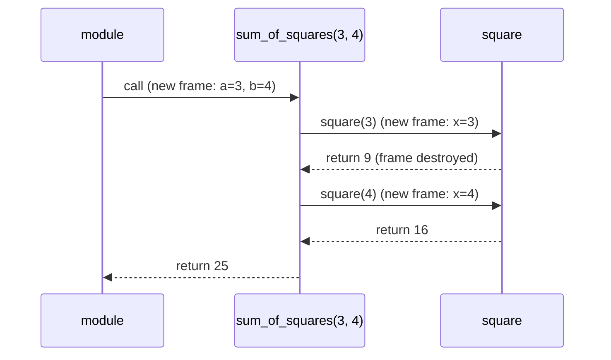

# Defining and Calling Functions

A function is a **named, reusable block of code** that takes inputs, does one job and gives back a result. Functions are the first and most important tool for breaking a problem into pieces, and that same skill later becomes "breaking a project into classes". This lesson covers the mechanics precisely: `def`, calling, `return`, what happens on the call stack, and functions as objects. It also covers the habits that make functions good: one job, clear inputs, clear output.

## 1. Defining a function

> [!SYNTAX]
> ```python
> def function_name(param1, param2):
>     """Docstring: what it does, in one line."""
>     body
>     return value          # optional
> ```

```python
def area_of_rectangle(width, height):
    """Return the area of a width × height rectangle."""
    return width * height

print(area_of_rectangle(3, 4))    # 12
```

Vocabulary that matters in exams:

| Term | Meaning | In the example |
|---|---|---|
| **parameter** (formal parameter) | the name in the definition | `width`, `height` |
| **argument** (actual parameter) | the value passed in a call | `3`, `4` |
| **return value** | the result handed back | `12` |
| **signature** | name + parameter list | `area_of_rectangle(width, height)` |
| **body** | the indented block | `return width * height` |

> [!KEY]
> `def` is an **executable statement**. When Python runs it, it creates a **function object** and binds it to the name. The body does **not** run until the function is **called** with `()`. A function must therefore be defined (its `def` executed) before the line that calls it runs.

## 2. Calling and the call stack

When you call a function, Python:

1. evaluates the arguments,
2. creates a new **frame** (a local namespace) on the **call stack**,
3. binds each parameter to its argument object,
4. runs the body until `return` (or the end),
5. destroys the frame and hands the return value back to the caller.

```python
def square(x):
    return x * x

def sum_of_squares(a, b):
    return square(a) + square(b)

print(sum_of_squares(3, 4))     # 25
```



Each call gets its **own** local variables. Two calls to `square` don't share `x`. That's what makes recursion possible (Recursion lesson).

## 3. `return`

- `return expr` ends the function **immediately** and sends back the value.
- `return` with no value, or falling off the end of the body, returns **`None`**.
- A function can have several `return` statements. The first one executed wins.
- To return several values, return a **tuple**: `return lo, hi`.

```python
def classify(n):
    if n < 0:
        return "negative"       # early return: the function stops here
    if n == 0:
        return "zero"
    return "positive"

def greet(name):
    print("Hello", name)        # no return statement

result = greet("Ada")           # prints Hello Ada
print(result)                   # None
```

> [!DANGER]
> **`print` is not `return`.** A function that prints its answer can't have that answer used by other code: `total = add(2, 3) * 10` fails if `add` only prints. Compute and **return**. Let the caller decide what to print. Judges calling your function through a driver need the *returned* value.

## 4. Docstrings

The first statement of a function body, if it's a string literal, becomes `func.__doc__`, which `help(func)` shows. Good docstrings say **what** the function returns and any important preconditions, not how it works:

```python
def mean(values):
    """Return the arithmetic mean of a non-empty sequence of numbers."""
    return sum(values) / len(values)
```

## 5. Functions are objects (first-class)

A function is a value like any other. You can bind it to another name, store it in a list or dict, pass it as an argument and return it from another function:

```python
def double(x): return x * 2
def triple(x): return x * 3

f = double                  # no parentheses: the function object itself
print(f(5))                 # 10
ops = {"d": double, "t": triple}
print(ops["t"](5))          # 15: dispatch table
print(list(map(double, [1, 2, 3])))   # [2, 4, 6]: passed as an argument
print(double.__name__, callable(double))   # double True
```

> [!WARNING]
> `f = double()` **calls** the function. `f = double` refers to it. Forgetting or adding `()` is a frequent bug when passing callbacks (`button.on_click(handler)` vs `button.on_click(handler())`).

## 6. Pure functions and side effects

A **pure function** returns a value computed only from its arguments and changes nothing outside itself: no printing, no mutating its inputs, no globals.

```python
def pure_add(a, b):
    return a + b                 # same inputs → same output, always

total = 0
def impure_add(x):
    global total
    total += x                   # side effect: modifies global state
```

Pure functions are easy to test, reason about, reuse and run in parallel. Real programs need side effects (I/O, saving data), but good design **pushes them to the edges** and keeps the core logic pure. That idea carries straight into OOP design.

## 7. Designing good functions

1. **One job.** If the name needs "and" (`read_and_parse_and_save`), split it.
2. **Name it by what it returns or does**: `is_prime(n)`, `parse_line(s)`, `send_email(...)`.
3. **Few parameters.** More than about 4 suggests a missing concept, often a class.
4. **Return values, don't print them.**
5. **Don't mutate arguments** unless that's the documented purpose.
6. **Short.** If it doesn't fit on a screen, extract helper functions.

Decomposition example: a messy script becomes small functions.

```python
def read_scores(lines):
    return [int(x) for x in lines if x.strip()]

def summarize(scores):
    return min(scores), max(scores), sum(scores) / len(scores)

def format_report(lo, hi, avg):
    return f"min={lo} max={hi} avg={avg:.2f}"

def main():
    scores = read_scores(["90", "72", "", "85"])
    print(format_report(*summarize(scores)))

main()          # min=72 max=90 avg=82.33
```

Each function can be understood, tested and replaced on its own. `main` reads like a table of contents.

## 8. Functions in C vs Python (preview)

| | C | Python |
|---|---|---|
| Declaration | must be declared (prototype) before use | `def` must have *run* before the call executes |
| Types | parameter and return types required | optional hints |
| Multiple returns | via pointers or a struct | return a tuple |
| Functions as values | function pointers | first-class objects |
| Overloading | not in C (yes in C++) | no; use defaults or `*args` instead |

## 9. Exam-ready answers

> [!EXAM]
> **Functions.** A function is a named block of reusable code defined with the `def` statement, which creates a function object and binds it to a name. Parameters listed in the definition receive the arguments supplied at the call. Each call creates a new local namespace (stack frame), executes the body, and returns a value with the `return` statement; if no `return` is executed, the function returns `None`. Functions are first-class objects: they can be assigned to variables, stored in data structures, passed as arguments and returned from other functions. Functions support modularity, reuse, abstraction and easier testing.

> [!EXAM]
> **Parameter vs argument.** A parameter is a variable named in a function definition; an argument is the value passed to the function when it is called. In `def f(x): ...` and `f(5)`, `x` is a parameter and `5` is an argument.

## 10. Cheat sheet

| Need | Code |
|---|---|
| define | `def name(a, b):` |
| return several values | `return x, y` |
| no result | `return` / nothing → `None` |
| docstring | `"""One line."""` first in the body |
| refer without calling | `f` |
| call | `f(args)` |
| dispatch by key | `{"op": func}[key](x)` |
| entry point | `def main(): ...` + `if __name__ == "__main__": main()` |

> [!INTERVIEW]
> **"What does a function without a return statement return, and why is that useful to know?"** It returns `None`. The bug it explains: `result = my_list.sort()` sets `result` to `None`, because in-place methods follow the convention of returning `None` to signal "I mutated, I didn't build something new". Likewise, `x = print(...)` makes `x` `None`.
