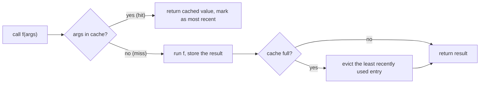

# functools

`functools` is the standard-library toolbox for **higher-order functions**: tools that take, return or modify functions. You've met `reduce`, `wraps` and `cmp_to_key`. This lesson covers the rest of the essential kit: **caching** (`lru_cache`, `cache`, `cached_property`), **partial application** (`partial`), **ordering** (`total_ordering`) and **type-based dispatch** (`singledispatch`). These show up constantly in real code and in "make this faster" interview follow-ups.

## 1. `lru_cache` and `cache`: memoization in one line

```python
import functools

@functools.lru_cache(maxsize=128)
def expensive(n):
    ...

@functools.cache              # Python 3.9+: unbounded cache (= lru_cache(maxsize=None))
def fib(n):
    return n if n < 2 else fib(n - 1) + fib(n - 2)

print(fib(200))               # instant
```

**LRU** = *Least Recently Used*. When the cache is full, the entry unused for the longest time is evicted.

```python
@functools.lru_cache(maxsize=2)
def sq(x):
    return x * x

sq(1); sq(2); sq(1); sq(3); sq(2)
print(sq.cache_info())   # CacheInfo(hits=1, misses=4, maxsize=2, currsize=2)
sq.cache_clear()         # empty it
```

Trace: 1 miss → {1}; 2 miss → {1, 2}; 1 **hit** (now most recent); 3 miss evicts 2 → {1, 3}; 2 miss evicts 1 → {3, 2}.



> [!KEY]
> Requirements and caveats:
> - Arguments must be **hashable**: `f([1, 2])` raises `TypeError: unhashable type: 'list'`. Pass tuples.
> - Only cache **pure** functions. Caching something that reads the clock, files or globals returns stale results.
> - `cache` is **unbounded**: a long-running process calling it with ever-new arguments leaks memory. Choose a `maxsize` for services.
> - On methods, the cache holds a reference to `self`, keeping objects alive. Prefer `cached_property` or a per-instance cache.

## 2. `cached_property`: compute once per object

```python
class Dataset:
    def __init__(self, path):
        self.path = path

    @functools.cached_property
    def stats(self):              # computed on first access, then stored on the instance
        print("computing…")
        return {"rows": 1_000_000}

d = Dataset("data.csv")
d.stats; d.stats                  # "computing…" printed once
```

It stores the result in the instance's `__dict__` under the same name, so later accesses are plain attribute lookups. Delete it (`del d.stats`) to force a recompute.

## 3. `partial`: pre-filling arguments

`partial(func, *args, **kwargs)` returns a new callable with some arguments fixed:

```python
from functools import partial

parse_binary = partial(int, base=2)
print(parse_binary("1011"))       # 11

power_of_two = partial(pow, 2)
print(power_of_two(10))           # 1024: pow(2, 10)
```

Uses: adapting a function to a callback that expects fewer arguments (`button.on_click(partial(select, item_id))`), creating specialised versions, and avoiding lambda late-binding bugs in loops (`[partial(f, i) for i in range(3)]` captures each `i` correctly).

## 4. `total_ordering`: write two methods, get six

Define `__eq__` plus **one** of `__lt__`, `__le__`, `__gt__`, `__ge__`, and the decorator fills in the rest:

```python
@functools.total_ordering
class Version:
    def __init__(self, major, minor):
        self.key = (major, minor)
    def __eq__(self, other):
        return self.key == other.key
    def __lt__(self, other):
        return self.key < other.key

print(Version(1, 2) <= Version(1, 3), Version(2, 0) > Version(1, 9))   # True True
```

(`@dataclass(order=True)` is often simpler for data classes.)

## 5. `singledispatch`: overloading by type

Python has no function overloading by signature. `singledispatch` gives you one generic function whose implementation is chosen by the **type of its first argument**:

```python
@functools.singledispatch
def describe(x):
    return "thing"                         # fallback

@describe.register
def _(x: int):                             # chosen by annotation
    return "int"

@describe.register(list)                   # or by an explicit type
def _(x):
    return f"list of {len(x)}"

print(describe(5), describe([1, 2]), describe("s"), describe(True))
# int list of 2 thing int   ← bool is a subclass of int, so it dispatches to int
```

Dispatch follows the class hierarchy (MRO). For methods there's `functools.singledispatchmethod`. This is the functional cousin of polymorphism, an alternative to `isinstance` chains when you can't modify the types (say, serialising library objects to JSON).

## 6. The rest of the toolbox (recap)

| Tool | Purpose |
|---|---|
| `reduce(f, it, init)` | fold a sequence into one value |
| `wraps(f)` | preserve metadata in decorators |
| `cmp_to_key(cmp)` | use an old-style comparison function as a sort key |
| `update_wrapper` | the function form of `wraps` (used for class-based decorators) |

## 7. Exam-ready answers

> [!EXAM]
> **`functools.lru_cache`.** `lru_cache(maxsize)` is a decorator that memoizes a function. It stores results in a dictionary keyed by the call arguments and returns the stored result for repeated calls. When `maxsize` entries are stored, the least recently used entry is discarded. `functools.cache` is the unbounded variant. Arguments must be hashable, and only deterministic functions without side effects should be cached. The wrapper provides `cache_info()` and `cache_clear()`.

> [!EXAM]
> **`functools.partial`.** `partial(func, *args, **kwargs)` returns a callable that behaves like `func` with the given positional and keyword arguments pre-filled. Calling it with additional arguments appends them to the stored ones. It is used to specialise general functions and to adapt functions to interfaces that expect fewer parameters.

## 8. Cheat sheet

| Need | Code |
|---|---|
| memoize, unbounded | `@functools.cache` |
| memoize, bounded | `@functools.lru_cache(maxsize=1024)` |
| cache stats | `f.cache_info()` |
| lazy attribute | `@functools.cached_property` |
| fix arguments | `partial(f, x, key=v)` |
| full comparisons | `@functools.total_ordering` + `__eq__` + `__lt__` |
| overload by type | `@singledispatch` + `@f.register` |

> [!INTERVIEW]
> **"Design an LRU cache with O(1) get and put"** (LeetCode 146). This is what `lru_cache` does internally: a **hash map** for O(1) lookup plus a **doubly linked list** ordered by recency for O(1) move-to-front and evict-from-back. In Python, `collections.OrderedDict` with `move_to_end` and `popitem(last=False)` gives the same in a few lines. The interviewer wants to hear both data structures and why each one is needed.
