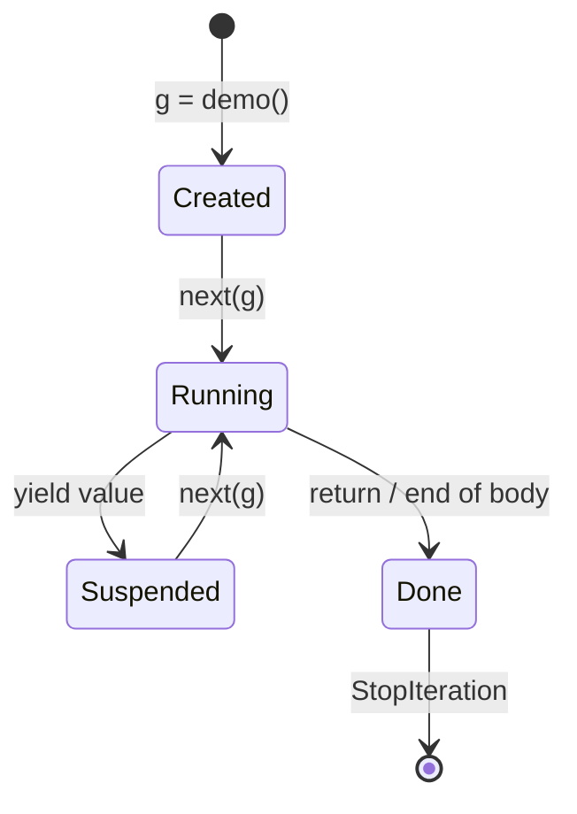
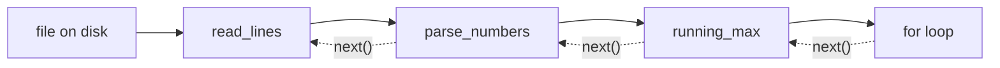

# Generators and yield

A **generator** is the easiest way to write an iterator. You write an ordinary-looking function that uses `yield` instead of `return`, and Python handles `__iter__`, `__next__`, `StopIteration` and remembering where you were. Generators make streaming data pipelines, infinite sequences and memory-efficient processing almost effortless. They're also the machinery underneath `async`/`await`, PyTorch's data loaders and `contextlib.contextmanager`.

## 1. `yield` turns a function into a generator factory

```python
def countdown(n):
    while n > 0:
        yield n          # produce a value and PAUSE here
        n -= 1

for x in countdown(3):
    print(x)             # 3 2 1
```

> [!KEY]
> Calling a function that contains `yield` **does not run its body**. It returns a **generator object** (an iterator). The body runs only when `next()` is called, and only up to the next `yield`, where it **pauses with all its local variables intact**. The next `next()` resumes right after that `yield`.

```python
def demo():
    print("start")
    yield 1
    print("middle")
    yield 2
    print("end")

g = demo()           # nothing printed yet!
print(next(g))       # start, then 1
print(next(g))       # middle, then 2
next(g)              # end, then StopIteration (the function returned)
```



## 2. Generator vs list-returning function

```python
def squares_list(n):          # eager: builds everything, O(n) memory
    result = []
    for i in range(n):
        result.append(i * i)
    return result

def squares_gen(n):           # lazy: one value at a time, O(1) memory
    for i in range(n):
        yield i * i
```

| | List function | Generator |
|---|---|---|
| Memory | O(n), all at once | O(1), one item at a time |
| First item available | after all n are computed | immediately |
| Reusable | yes | no (single pass) |
| `len`, indexing | yes | no |
| Infinite sequences | impossible | natural |

The Iterators lesson's `Countdown` needed two classes and about 15 lines. As a generator it's 3 lines, with the same behaviour.

## 3. Infinite generators

```python
def fibonacci():
    a, b = 0, 1
    while True:              # never ends, and that's fine
        yield a
        a, b = b, a + b

import itertools
print(list(itertools.islice(fibonacci(), 10)))   # [0, 1, 1, 2, 3, 5, 8, 13, 21, 34]
```

The **consumer** decides how much to take (`islice`, `zip` with something finite, `break` in a loop).

## 4. Generator pipelines

Chain generators like Unix pipes. Each stage pulls one item at a time from the previous one, so nothing is ever fully materialised:

```python
def read_lines(path):
    with open(path, encoding="utf-8") as f:
        for line in f:
            yield line.rstrip("\n")

def parse_numbers(lines):
    for line in lines:
        if line.strip():
            yield float(line)

def running_max(values):
    best = float("-inf")
    for v in values:
        best = max(best, v)
        yield best

# for m in running_max(parse_numbers(read_lines("sensor.log"))):
#     print(m)
```



A sensor log of any size goes through in constant memory. Generator expressions are the inline version: `total = sum(float(l) for l in open(p) if l.strip())`.

## 5. `yield from`: delegating to a sub-generator

```python
def flatten(nested):
    for item in nested:
        if isinstance(item, list):
            yield from flatten(item)      # yield every item the sub-generator yields
        else:
            yield item

print(list(flatten([1, [2, [3, 4]], 5])))   # [1, 2, 3, 4, 5]
```

`yield from it` is roughly `for x in it: yield x`. It also forwards `send()` and `throw()` calls and captures the sub-generator's **`return` value**:

```python
def inner():
    yield 1
    yield 2
    return "done"          # a return value in a generator travels inside StopIteration

def outer():
    result = yield from inner()
    yield result

print(list(outer()))       # [1, 2, 'done']
```

## 6. Two-way communication: `send()`, `throw()`, `close()` (advanced)

`yield` is also an **expression**. `value = yield x` produces `x`, then receives whatever the caller passes in with `gen.send(value)`:

```python
def averager():
    total = count = 0
    average = None
    while True:
        x = yield average        # hand out the current average; receive the next number
        total += x
        count += 1
        average = total / count

avg = averager()
next(avg)                        # "prime" it: run up to the first yield
print(avg.send(10))              # 10.0
print(avg.send(20))              # 15.0
```

- `gen.send(v)`: resume, making the paused `yield` evaluate to `v`. The first call must be `next(gen)` or `send(None)`.
- `gen.throw(exc)`: raise `exc` at the paused `yield`.
- `gen.close()`: raise `GeneratorExit` at the paused `yield`, so `finally` blocks run.

```python
def resource():
    try:
        yield 1
        yield 2
    finally:
        print("cleanup")       # runs on close(), on exhaustion, or when garbage collected

g = resource()
next(g)
g.close()                      # prints: cleanup
```

These **coroutine** features were the historical basis of `asyncio`. Modern code uses `async def` and `await`, which are built on the same suspension mechanism.

## 7. Generators in methods: easy `__iter__`

```python
class Playlist:
    def __init__(self, songs):
        self.songs = list(songs)

    def __iter__(self):              # a generator function as __iter__
        for song in self.songs:
            yield song               # each loop gets a NEW generator → reusable

for s in Playlist(["a", "b"]):
    print(s)
```

That's the idiomatic way to make your classes iterable.

## 8. Common pitfalls

> [!DANGER]
> - **Single pass**: `g = gen(); list(g); list(g)` gives the data, then `[]`.
> - **Calling isn't running**: `gen()` on its own line does nothing visible. You must iterate it.
> - **`return value` in a generator** doesn't "return a list". It ends the generator, and the value lands in `StopIteration.value`.
> - **Debugging**: printing a generator shows `<generator object ...>`. Use `list(g)` only on finite generators, and remember that consumes it.
> - **Late errors**: an exception in a generator body appears when it's **iterated**, possibly far from where it was created.

## 9. Exam-ready answers

> [!EXAM]
> **Generators.** A generator function is a function containing `yield`. Calling it returns a generator object, an iterator, without executing the body. Each call to `next()` runs the body until the next `yield` expression, which produces a value and suspends execution while preserving the local state; the following `next()` resumes from that point. When the function returns, `StopIteration` is raised. Generators produce values lazily, so they can represent large or infinite sequences in constant memory and can be chained into pipelines. `yield from` delegates to a sub-generator, and the methods `send()`, `throw()` and `close()` allow two-way communication with a suspended generator.

> [!EXAM]
> **`return` vs `yield`.** `return` terminates a function and sends back a single value. `yield` produces a value but suspends the function, which can later be resumed to produce further values. A function containing `yield` therefore defines a generator, which produces a sequence of values over time.

## 10. Cheat sheet

| Need | Code |
|---|---|
| lazy sequence | `def g(): ... yield x` |
| inline lazy | `(f(x) for x in xs)` |
| take the first n | `itertools.islice(g, n)` |
| delegate | `yield from sub()` |
| infinite | `while True: yield ...` |
| iterable class | `def __iter__(self): yield from self.items` |
| cleanup | `try: yield ... finally: ...` |
| coroutine input | `x = yield out`, then `g.send(v)` |

> [!INTERVIEW]
> **"Implement a generator that yields batches of size k from any iterable, including infinite ones."** Use `it = iter(iterable)`, then loop: `batch = list(itertools.islice(it, k))`, stop if it's empty, otherwise yield it. It runs in O(k) memory and works on streams. Python 3.12 added it to the standard library as `itertools.batched`. Data loaders in ML frameworks use this exact pattern.
