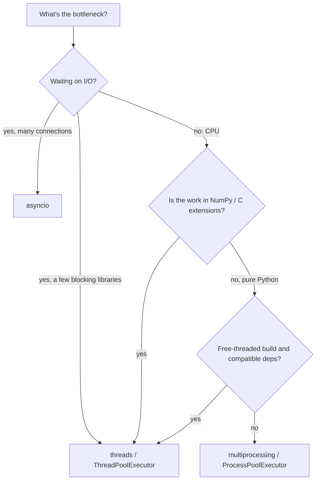

# The GIL and Free-Threaded Python

CPython has long had a **Global Interpreter Lock (GIL)**: a mutex that lets only **one thread execute Python bytecode at a time**. It's the single most important fact for choosing a concurrency strategy in Python, and it's changing. **PEP 703** made the GIL optional, and **free-threaded builds** (3.13 experimental, officially supported from 3.14) run Python code truly in parallel. This lesson explains what the GIL protects, why it exists, how it affects CPU-bound vs I/O-bound work, and what free threading changes.

## 1. What the GIL is and why it exists

CPython's internals, most importantly **reference counts** and the internal state of built-in objects like `dict` and `list`, aren't individually thread-safe. Rather than locking every object, CPython historically used **one big lock**: a thread must hold the GIL to run bytecode or touch Python objects.

- It made the interpreter simpler and **single-threaded code faster** (no per-object locking).
- It made **C extensions** easy to write safely.
- The cost: **threads can't execute Python code in parallel** on multiple cores.

The interpreter forces the running thread to release the GIL periodically (every `sys.getswitchinterval()` seconds, 5 ms by default) so other threads get a turn, and **releases it during blocking I/O and in many C extensions** (NumPy, hashing, compression, file and socket operations).

## 2. CPU-bound vs I/O-bound

```python
import threading, time

def cpu_task(n=10_000_000):          # pure Python arithmetic: holds the GIL
    s = 0
    for i in range(n):
        s += i
    return s

def io_task():                       # waiting on I/O releases the GIL
    time.sleep(1)                    # or requests.get(...), socket.recv(...)
```

| Workload | With threads (GIL build) | Best tool |
|---|---|---|
| **I/O-bound** (network, disk, sleeps, waiting on a robot's serial port) | **speeds up**: threads overlap their waiting | `threading`, `ThreadPoolExecutor`, **`asyncio`** |
| **CPU-bound in pure Python** (loops, parsing, algorithms) | **no speed-up**, often slightly slower (contention) | `multiprocessing`, `ProcessPoolExecutor`, or a free-threaded build |
| **CPU-bound in C extensions that release the GIL** (NumPy, OpenCV, PyTorch ops) | speeds up | threads are fine |

> [!KEY]
> The GIL doesn't make *your* code thread-safe. It protects the interpreter's internals, not your invariants. `counter += 1` is several bytecodes (load, add, store), and a thread switch can happen between them, so concurrent increments **lose updates**. You still need `threading.Lock` for shared mutable state (the Threading lesson).

## 3. Measuring the effect

```python
from concurrent.futures import ThreadPoolExecutor, ProcessPoolExecutor
import time

def bench(executor_cls, work, n=4):
    t0 = time.perf_counter()
    with executor_cls(max_workers=n) as ex:
        list(ex.map(work, [5_000_000] * n))
    return time.perf_counter() - t0

# On a standard (GIL) build with 4+ cores, typically:
#   threads  + cpu_task: ≈ the same as running sequentially
#   processes + cpu_task: ≈ 4× faster (each process has its own interpreter and GIL)
```

Processes sidestep the GIL but pay for **separate memory** and **pickling** of arguments and results across process boundaries (the Multiprocessing lesson).

## 4. Free-threaded Python (PEP 703)

Python 3.13 shipped an experimental **free-threaded build** (`python3.13t`), and 3.14 makes it officially supported, though still optional and not the default. It removes the GIL by making the interpreter itself thread-safe:

- **Biased reference counting** (cheap counts for the owning thread, atomic ones for others), **immortal objects** (`None`, small ints and interned strings never change their counts), and **per-object locks** inside `dict`/`list` operations.
- **mimalloc** as the thread-safe allocator.
- Pure-Python CPU-bound threads now **scale across cores**.
- Single-threaded performance costs a few percent, and C extensions must declare that they support free threading (otherwise the GIL is re-enabled at import, with a warning).

```python
import sys, sysconfig
sysconfig.get_config_var("Py_GIL_DISABLED")   # 1 on a free-threaded build, 0 otherwise
sys._is_gil_enabled()                          # False when actually running without the GIL (3.13+)
```

```bash
python3.14t -X gil=0 script.py                 # run free-threaded (PYTHON_GIL=0 also works)
```

> [!WARNING]
> Free threading exposes **real data races** in code that "worked" under the GIL by accident: unsynchronised shared counters, check-then-act on dicts, lazy initialisation without locks. The standard library's built-in containers stay internally consistent (no crashes), but your multi-step logic still needs locks. Treat any shared mutable state as you would in C++ or Java.

## 5. Choosing a concurrency model in 2026



## 6. Exam-ready answers

> [!EXAM]
> **The Global Interpreter Lock.** In CPython, the GIL is a mutex that allows only one thread at a time to execute Python bytecode, protecting interpreter internals such as reference counts and built-in object state that are not otherwise thread-safe. It simplifies the implementation and C extensions and benefits single-threaded performance, but prevents threads from running Python code in parallel on multiple cores. Threads therefore improve throughput for I/O-bound workloads, because the GIL is released during blocking I/O and in many C extensions, but not for CPU-bound pure-Python code, for which multiprocessing is used. The GIL does not make application code thread-safe, since thread switches can occur between bytecodes. PEP 703 introduced free-threaded builds of CPython (experimental in 3.13, supported in 3.14) that remove the GIL using biased reference counting, immortal objects and per-object locking, allowing true parallel execution of threads.

## 7. Cheat sheet

| Situation | Choice |
|---|---|
| thousands of concurrent network connections | `asyncio` |
| a few blocking calls (requests, serial, DB) | threads / `ThreadPoolExecutor` |
| heavy pure-Python computation | processes, or the free-threaded build |
| NumPy/OpenCV/PyTorch number-crunching | threads are fine (the GIL is released inside) |
| check the build | `sysconfig.get_config_var("Py_GIL_DISABLED")` |
| shared mutable state | always a `Lock`, GIL or not |

> [!INTERVIEW]
> **"Why doesn't multithreading speed up CPU-bound Python code, and what are your options?"** In standard CPython, the GIL allows one thread to execute bytecode at a time, so CPU-bound threads just take turns. Total throughput stays about the same as one thread, with extra switching overhead. Options: use processes (`multiprocessing` / `ProcessPoolExecutor`), each with its own interpreter and GIL, paying pickling and memory costs; move the hot loop into code that releases the GIL (NumPy vectorisation, Cython with `nogil`, a C/C++/Rust extension); or run on a free-threaded CPython build (3.13t/3.14t) where threads truly run in parallel, if your dependencies support it. For I/O-bound work, threads or asyncio already work well.
