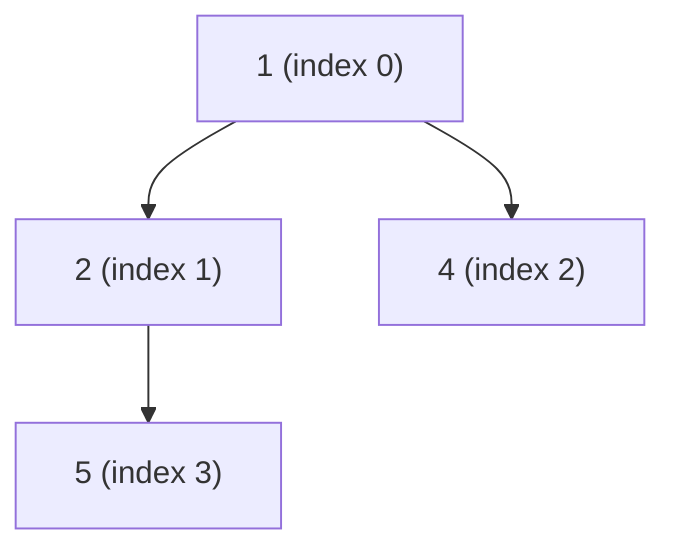
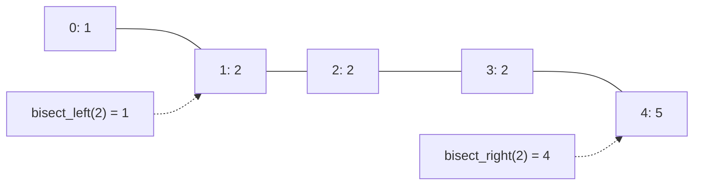

# heapq and bisect

Two small modules implement two of the most important algorithmic tools on plain lists. **`heapq`** turns a list into a **binary min-heap**: O(log n) insert and remove-smallest. That's the engine behind priority queues, Dijkstra, A* path planning, event simulation, top-k and merge-k-sorted. **`bisect`** does **binary search** on a sorted list in O(log n). Both appear constantly in interviews and in robotics (A* on an occupancy grid is a heap loop).

## 1. The binary heap

A min-heap is a complete binary tree stored in an array where **every parent ≤ its children**. For index `i`, the children are `2i+1` and `2i+2`, and the parent is `(i-1)//2`. The smallest element is always `h[0]`.



```python
import heapq

h = [5, 1, 4, 2]
heapq.heapify(h)            # O(n) in place: [1, 2, 4, 5]
heapq.heappush(h, 3)        # O(log n): sift up
smallest = heapq.heappop(h) # O(log n): remove h[0], move the last element up, sift down
print(smallest, h[0])       # 1 2: peek at the minimum without removing it
```

| Function | Cost | Meaning |
|---|---|---|
| `heapify(list)` | O(n) | rearrange in place into a heap |
| `heappush(h, x)` | O(log n) | insert |
| `heappop(h)` | O(log n) | remove and return the smallest |
| `h[0]` | O(1) | peek at the smallest |
| `heappushpop(h, x)` | O(log n) | push then pop (faster than both) |
| `heapreplace(h, x)` | O(log n) | pop then push |
| `nlargest(k, it, key=)` / `nsmallest` | O(n log k) | top-k |
| `merge(*sorted_iters)` | lazy, O(N log k) | merge k sorted sequences |

> [!KEY]
> A heap is **not sorted**. Only `h[0]` is guaranteed to be the minimum, and `h[1]` isn't necessarily the second smallest. Iterating over a heap doesn't give sorted order. Pop repeatedly for that (which is heapsort, O(n log n)).

### Max-heaps

`heapq` is a min-heap. The classic trick for a max-heap is to **negate** the keys: `heappush(h, -x)`, then `-heappop(h)`. Python 3.14 added dedicated max-heap functions (`heapq.heappush_max`, `heappop_max`, `heapify_max`), but negation works in every version and is what you'll see in existing code.

### Priority queues with tuples

```python
tasks = []
heapq.heappush(tasks, (2, "write report"))
heapq.heappush(tasks, (1, "fix bug"))
heapq.heappush(tasks, (2, "email"))
while tasks:
    prio, name = heapq.heappop(tasks)
    print(prio, name)       # 1 fix bug / 2 email / 2 write report
```

Tuples compare element by element, so equal priorities fall through to comparing the **second** field. If that field isn't comparable (dicts, custom objects), you get `TypeError`. The standard fix is a **tie-breaking counter**: `(priority, next(counter), item)`, which also makes equal priorities FIFO.

## 2. Classic heap patterns

```python
# top-k largest in O(n log k) with a size-k MIN-heap
def top_k(nums, k):
    h = []
    for x in nums:
        if len(h) < k:
            heapq.heappush(h, x)
        elif x > h[0]:
            heapq.heapreplace(h, x)   # evict the smallest of the current top-k
    return sorted(h, reverse=True)

# Dijkstra's shortest paths
def dijkstra(graph, src):          # graph: {u: [(v, w), ...]}
    dist = {src: 0}
    pq = [(0, src)]
    while pq:
        d, u = heapq.heappop(pq)
        if d > dist.get(u, float("inf")):
            continue                # stale entry: "lazy deletion" instead of decrease-key
        for v, w in graph[u]:
            nd = d + w
            if nd < dist.get(v, float("inf")):
                dist[v] = nd
                heapq.heappush(pq, (nd, v))
    return dist
```

> [!TIP]
> **Running median**: keep two heaps, a max-heap (negated) for the lower half and a min-heap for the upper half, rebalanced so their sizes differ by at most 1. The median is at one or both tops, giving O(log n) per insert. It's a famous interview problem.

## 3. `bisect`: binary search on sorted lists

```python
import bisect

a = [1, 2, 2, 2, 5]
bisect.bisect_left(a, 2)     # 1: first index where 2 could be inserted (the leftmost 2)
bisect.bisect_right(a, 2)    # 4: just past the last 2 (bisect.bisect is the same thing)
bisect.bisect_left(a, 3)     # 4: where 3 would go
bisect.insort(a, 3)          # a == [1, 2, 2, 2, 3, 5]: insert keeping it sorted
```



| Question | Expression |
|---|---|
| is `x` present? | `i = bisect_left(a, x); i < len(a) and a[i] == x` |
| how many `x`? | `bisect_right(a, x) - bisect_left(a, x)` |
| how many `< x`? | `bisect_left(a, x)` |
| how many `<= x`? | `bisect_right(a, x)` |
| first element `>= x` | `a[bisect_left(a, x)]` (check bounds first) |
| grade lookup | `"FDCBA"[bisect_right([60, 70, 80, 90], score)]` |

Since Python 3.10, `key=` works on the elements: `bisect_left(records, "b", key=lambda r: r[0])`.

> [!WARNING]
> `insort` finds the position in O(log n), but inserting into a list is **O(n)** because elements shift. For many insertions into a large sorted collection, use a heap (if you only need the minimum) or the third-party `sortedcontainers.SortedList` (O(log n) inserts).

### Binary search on the answer

`bisect` is for sorted lists. The broader pattern, **binary search over a monotonic predicate**, solves problems like "minimum capacity to ship in D days" or "smallest speed to finish in time". Search the smallest `x` for which `ok(x)` is true:

```python
def first_true(lo, hi, ok):        # assumes ok is False...False True...True on [lo, hi]
    while lo < hi:
        mid = (lo + hi) // 2
        if ok(mid):
            hi = mid
        else:
            lo = mid + 1
    return lo
```

## 4. Exam-ready answers

> [!EXAM]
> **Heaps and `heapq`.** A binary min-heap is a complete binary tree, stored in an array, in which every node is less than or equal to its children, so the minimum is at the root (index 0); the children of index i are at 2i+1 and 2i+2. Python's `heapq` module implements a min-heap on a list: `heapify` builds a heap in O(n), `heappush` and `heappop` run in O(log n) by sifting elements up or down, and `nlargest`/`nsmallest` find the top k elements in O(n log k). Heaps implement priority queues, used in Dijkstra's and A* algorithms, scheduling, and merging sorted sequences. A max-heap can be simulated by negating keys.

> [!EXAM]
> **`bisect`.** The `bisect` module performs binary search on sorted lists in O(log n): `bisect_left` returns the leftmost insertion point for a value (the index of its first occurrence if present) and `bisect_right` the position after any existing equal elements; `insort` inserts while preserving order, though the insertion itself costs O(n).

## 5. Cheat sheet

| Need | Code |
|---|---|
| min-heap | `heapify(h)`, `heappush(h, x)`, `heappop(h)`, `h[0]` |
| max-heap | push `-x`, negate when popping |
| priority queue | `(priority, counter, item)` tuples |
| top-k | `heapq.nlargest(k, xs, key=...)` |
| merge sorted | `heapq.merge(a, b, c)` |
| position in sorted | `bisect_left` / `bisect_right` |
| count in range [lo, hi] | `bisect_right(a, hi) - bisect_left(a, lo)` |
| insert sorted | `bisect.insort(a, x)` |

> [!INTERVIEW]
> **"Find the k-th largest element in an unsorted array."** Option 1: a size-k min-heap, O(n log k) time and O(k) space, and it works on streams. Option 2: `heapq.nlargest(k, nums)[-1]`. Option 3: quickselect, O(n) average and O(n²) worst. Mention that sorting is O(n log n) and that the heap wins when k ≪ n or the data arrives as a stream.
