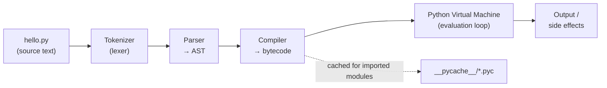
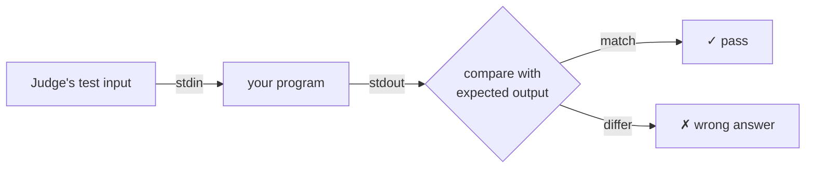

# How Python Runs Your Code

Before you learn a single keyword, you need a correct mental model of *what happens when you press Run*. Most syntax confusion comes from not knowing which part of the system is complaining: the parser, the compiler or the running program. By the end of this lesson you will be able to say precisely which stage produced an error, explain the difference between a compiled and an interpreted language without hand-waving, and write a correct exam answer on "How is a Python program executed?"

## 1. Source code is just text

A Python program is a plain text file, conventionally ending in `.py`. It contains **statements**: instructions written in Python's grammar.

```python
# hello.py
name = "Ada"
print("Hello,", name)
```

```output
Hello, Ada
```

The computer's CPU cannot execute this text. A CPU only understands **machine code**, numeric instructions specific to its architecture (x86-64, ARM64…). Something must translate. *How* and *when* that translation happens is what separates languages.

## 2. Compiled vs interpreted — the honest version

| | Ahead-of-time compiled (C, C++) | Interpreted on a virtual machine (CPython) |
|---|---|---|
| Translation | Whole program → machine code **before** running | Source → **bytecode**, then a VM executes the bytecode |
| Output file | Native executable (`a.out`, `.exe`) | Cached bytecode (`.pyc`), still needs the interpreter |
| Error timing | Type and syntax errors found at compile time | Syntax errors before running; most other errors only when that line runs |
| Speed | Fast; runs directly on the CPU | Slower; every bytecode instruction is dispatched by the VM |
| Portability | Recompile for each platform | Same `.py` runs anywhere an interpreter exists |

> [!KEY]
> "Python is interpreted" is a simplification. The reference implementation, **CPython**, first **compiles** your source into **bytecode**, then **interprets** that bytecode on a stack-based virtual machine. Both steps happen automatically when you run `python3 file.py`.

**Python** is a language specification. **CPython** is the official implementation, written in C. Others exist: **PyPy** (JIT-compiles hot code to machine code and is often much faster), **MicroPython** (for microcontrollers, which matters for robotics), Jython (JVM) and IronPython (.NET). In this course, "Python" means CPython 3.

## 3. The execution pipeline



1. **Tokenizing.** The text is broken into tokens: `name`, `=`, `"Ada"`, `NEWLINE`, `INDENT`… Python's indentation becomes explicit `INDENT`/`DEDENT` tokens here, which is why bad indentation is a *syntax* error.
2. **Parsing.** Tokens are checked against the grammar and arranged into an **Abstract Syntax Tree (AST)**, a tree that represents the program's structure. A missing `)` or `:` fails here, with `SyntaxError`.
3. **Compiling.** The AST is turned into **bytecode**: compact instructions for the Python VM, stored in *code objects*.
4. **Executing.** The **Python Virtual Machine** (a big loop in C, `ceval.c`) reads one bytecode instruction at a time and carries it out, using an internal stack.

You can watch steps 2 and 3 happen yourself:

```python
import ast, dis

src = "x = 2 + 3 * y"
print(ast.dump(ast.parse(src), indent=2))   # the tree
dis.dis(src)                                 # the bytecode
```

```output
Module(
  body=[
    Assign(
      targets=[
        Name(id='x', ctx=Store())],
      value=BinOp(
        left=Constant(value=2),
        op=Add(),
        right=BinOp(
          left=Constant(value=3),
          op=Mult(),
          right=Name(id='y', ctx=Load()))))])
  0           RESUME                   0

  1           LOAD_SMALL_INT           2
              LOAD_SMALL_INT           3
              LOAD_NAME                0 (y)
              BINARY_OP                5 (*)
              BINARY_OP                0 (+)
              STORE_NAME               1 (x)
              LOAD_CONST               1 (None)
              RETURN_VALUE
```

(Output from Python 3.14; opcode names change between versions, so focus on the shape.) Look at the tree: `3 * y` sits *below* `+`. Operator precedence was decided by the **parser**, not at run time. The bytecode is a **stack machine** program: push 2, push 3, push y, multiply the top two, add the top two, store into `x`.

<div class="figure">
<svg viewBox="0 0 640 170" width="640" xmlns="http://www.w3.org/2000/svg" font-family="ui-monospace, monospace" font-size="13">
  <g fill="none" stroke="currentColor" stroke-opacity=".5">
    <rect x="20" y="40" width="90" height="100" rx="6"/><rect x="140" y="40" width="90" height="100" rx="6"/>
    <rect x="260" y="40" width="90" height="100" rx="6"/><rect x="380" y="40" width="90" height="100" rx="6"/>
    <rect x="500" y="40" width="110" height="100" rx="6"/>
  </g>
  <g fill="currentColor">
    <text x="30" y="30">push 2</text><text x="150" y="30">push 3</text><text x="270" y="30">push y(=4)</text>
    <text x="390" y="30">MULT</text><text x="510" y="30">ADD → x</text>
    <text x="55" y="130">2</text>
    <text x="175" y="130">2</text><text x="175" y="110">3</text>
    <text x="295" y="130">2</text><text x="295" y="110">3</text><text x="295" y="90">4</text>
    <text x="415" y="130">2</text><text x="410" y="110">12</text>
    <text x="535" y="130">14</text><text x="515" y="160" font-size="11" fill-opacity=".7">stack empty, x = 14</text>
  </g>
</svg>
<figcaption>The VM's value stack while evaluating <code>2 + 3 * y</code> with y = 4.</figcaption>
</div>

## 4. When do errors happen?

Because of the pipeline, Python errors come in two families. Telling them apart is half of debugging.

**Compile-time (before anything runs): `SyntaxError`, `IndentationError`.** The file can't be parsed, so *no line runs*, not even the first `print`.

```python
print("start")
if True
    print("inside")
```

```output
  File "main.py", line 2
    if True
           ^
SyntaxError: expected ':'
```

`start` was never printed. Parsing failed before execution began.

**Run-time: exceptions** (`NameError`, `TypeError`, `ZeroDivisionError`…). The program is valid Python; it fails only when the faulty line is *reached*.

```python
print("start")
if False:
    print(undefined_name)   # never reached: no error
print(10 / 0)
```

```output
start
Traceback (most recent call last):
  File "main.py", line 4, in <module>
    print(10 / 0)
          ~~~^~~
ZeroDivisionError: division by zero
```

> [!DANGER]
> A typo inside a branch that never runs will **not** be caught. In C++ the compiler would reject an undeclared name everywhere; Python only discovers `undefined_name` if that line executes. This is why testing every branch matters so much in Python, and why tools like `mypy` and `ruff` exist.

## 5. Ways to run Python

| Mode | Command | Use it for |
|---|---|---|
| Script | `python3 main.py` | Real programs |
| Interactive REPL | `python3` | Trying one-liners; shows each expression's value |
| Module as script | `python3 -m http.server` | Running a library module or package |
| One-off command | `python3 -c "print(2**100)"` | Shell one-liners |
| Script then REPL | `python3 -i main.py` | Inspecting variables after a script ends |

The **REPL** (Read-Eval-Print Loop) prints the value of every bare expression; a script does not:

```python
>>> 2 + 3
5
>>> "hi".upper()
'HI'
```

In a script, a line `2 + 3` is computed and silently thrown away. You must `print()` it.

## 6. `.pyc` files and `__pycache__`

When a module is **imported**, CPython saves its bytecode in `__pycache__/module.cpython-314.pyc`. On the next import, if the source hasn't changed, the cached bytecode is loaded and parsing is skipped. Two facts to remember:

- The **main script** you run directly is *not* cached, only imported modules.
- A `.pyc` file still needs the interpreter. It is not a native executable, and it is **not** a way to hide source code.

## 7. Standard input and output: how this platform judges you

Every coding problem here works like an online judge (LeetCode, Codeforces): your program reads **standard input (stdin)** and writes to **standard output (stdout)**, and the judge compares your output with the expected output.

```python
a = int(input())          # reads one line, e.g. "7"
b = int(input())          # next line, e.g. "5"
print(a + b)              # writes "12\n" to stdout
```



Many problems give you a function to complete and do the reading and printing for you in hidden *driver* code. Others ask you to write the whole program yourself.

> [!WARNING]
> Print **exactly** what is asked. Extra text like `print("Answer:", x)` makes the output differ and the test fails. Trailing spaces at line ends are ignored by this judge; extra words are not.

## 8. Exam-ready summary

> [!EXAM]
> **How is a Python program executed?** Python source code is first **compiled** by the interpreter (CPython) into an intermediate, platform-independent form called **bytecode**. The source is tokenized, parsed into an abstract syntax tree, and compiled into bytecode instructions held in code objects. The bytecode is then executed by the **Python Virtual Machine**, a stack-based interpreter loop that dispatches each instruction. For imported modules the bytecode is cached in `.pyc` files inside `__pycache__` to skip recompilation. Python is therefore usually described as an *interpreted* language, although compilation to bytecode is an internal step. Syntax errors are detected before execution starts; most other errors are raised as exceptions at run time, when the faulty statement executes.

> [!EXAM]
> **Compiler vs interpreter.** A *compiler* translates the entire source program into machine code before execution, producing a standalone executable (e.g. C with `gcc`). An *interpreter* executes the program directly, statement by statement or via an intermediate representation, without producing a native executable. Compiled programs generally run faster; interpreted programs are more portable and give faster edit-run cycles.

## 9. Cheat sheet

| Term | Meaning |
|---|---|
| CPython | Reference Python implementation, written in C |
| Bytecode | Low-level, platform-independent instructions for the Python VM |
| AST | Tree representation of the program's syntax |
| PVM | Python Virtual Machine, the loop that executes bytecode |
| `.pyc` | Cached bytecode of an imported module |
| REPL | Interactive prompt: Read, Evaluate, Print, Loop |
| `SyntaxError` | Raised before execution; the file cannot be parsed |
| Exception | Raised during execution when a statement fails |

> [!INTERVIEW]
> **"Is Python compiled or interpreted?"** Strong answer: "Both. CPython compiles source to bytecode, then a virtual machine interprets the bytecode. There is no ahead-of-time native compilation in CPython, which is one reason it is slower than C++. PyPy adds a JIT compiler, and CPython 3.13+ ships an experimental JIT too. The language is defined separately from any implementation."
