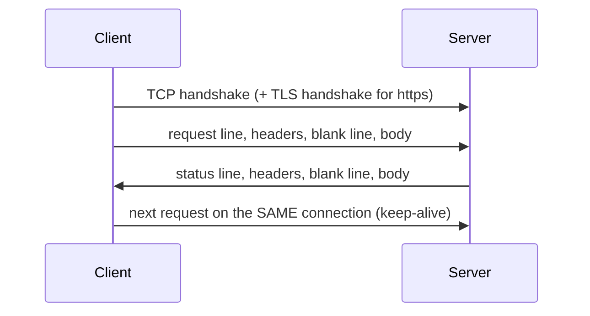
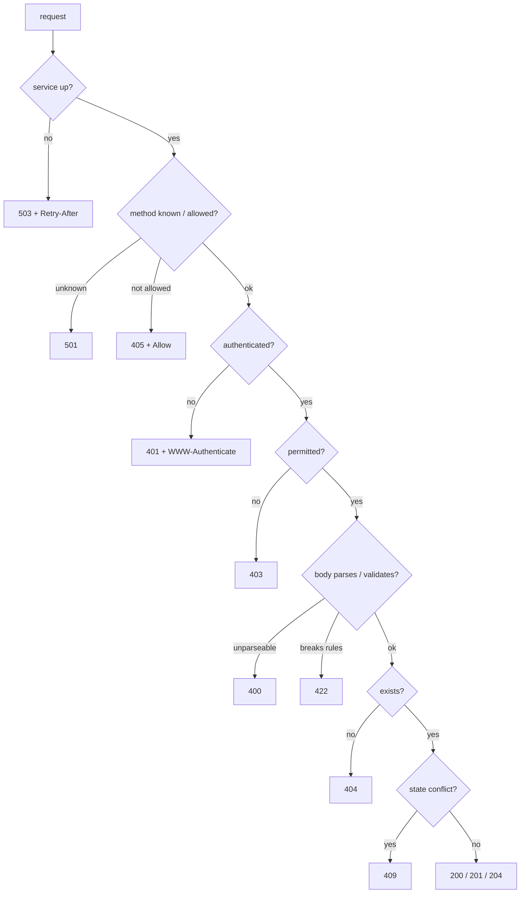

# HTTP from First Principles, REST and httpx

Every web app, mobile backend, ML model server and robot fleet manager speaks HTTP. Frameworks such as Flask and FastAPI hide the protocol, but the moment something goes wrong (a request that hangs, a cache that serves stale data, a 401 loop, a proxy that disagrees with your server about where a request ends) you need to know what is really on the wire. This lesson builds HTTP up from the bytes: message anatomy, methods and their guarantees, status codes, headers, cookies, caching, REST vs RPC, content negotiation, and then robust clients with `httpx`, tested without a network.

## 1. Why this matters

- **Debugging.** "It works in the browser but not in my script" is nearly always a header (`Content-Type`, `Accept`, `Authorization`, a cookie) or a redirect. Reading the raw exchange answers it in a minute.
- **Correctness.** Choosing 409 instead of 500, or making a `PUT` idempotent, decides whether clients can retry safely.
- **Performance.** Connection reuse, `Cache-Control` and `ETag` revalidation remove whole round trips.
- **Security.** Request smuggling, cookie flags and TLS verification are protocol-level issues.
- **Interviews.** "What happens when you type a URL?", "PUT vs PATCH", "401 vs 403" and "how does HTTP caching work?" are standard questions.

## 2. Anatomy of an HTTP/1.1 exchange

HTTP/1.1 is text over a TCP connection. Lines end with CRLF (`\r\n`). A request is a **request line**, **header lines**, an **empty line**, then an optional **body**:

```text
POST /api/robots?dry_run=1 HTTP/1.1\r\n        <- method, target, version
Host: fleet.example\r\n                         <- required in HTTP/1.1
Content-Type: application/json\r\n
Content-Length: 27\r\n                          <- exactly how many body bytes follow
Authorization: Bearer eyJhbGciOi...\r\n
\r\n                                            <- end of the head
{"name":"rover","speed":1.5}                    <- body (27 bytes)
```

The response has the same shape with a **status line**:

```text
HTTP/1.1 201 Created\r\n
Content-Type: application/json\r\n
Location: /api/robots/7\r\n
Content-Length: 39\r\n
\r\n
{"id":7,"name":"rover","speed":1.5}
```



Key facts:

- **Framing.** The server learns where the body ends from `Content-Length`, or from `Transfer-Encoding: chunked` (a sequence of size-prefixed chunks). If a proxy and a server read the framing differently (for example two different `Content-Length` values), an attacker can hide a second request inside the first. That's **request smuggling**, and it's why strict parsers reject conflicting lengths.
- **Keep-alive.** HTTP/1.1 connections stay open by default, so many requests share one TCP+TLS setup. A client `Session`/`Client` object keeps that pool for you.
- **HTTP/2 and HTTP/3** keep the same semantics (methods, status codes, headers) but use binary frames, multiplex many requests over one connection, and compress headers. HTTP/3 runs over QUIC (UDP). Your application code rarely changes.

### Dry run: parsing a request

Take `GET /search?q=http+basics HTTP/1.1\r\nHost: example.com\r\nAccept: */*\r\n\r\n`:

| Step | Action | Result |
|---|---|---|
| 1 | find first `\r\n\r\n` | head = everything before it, body starts 4 bytes later |
| 2 | split head on `\r\n` | `["GET /search?q=http+basics HTTP/1.1", "Host: example.com", "Accept: */*"]` |
| 3 | split request line on single spaces | method `GET`, target `/search?q=http+basics`, version `HTTP/1.1` |
| 4 | each header: partition at the first `:` | `host → example.com`, `accept → */*` (names lower-cased) |
| 5 | `Content-Length` absent | body is empty |
| 6 | split target at `?`, decode query | path `/search`, query `[("q", "http basics")]` (`+` is a space) |

A complete parser for exactly this is the problem *Raw HTTP/1.1 Request Parser*. Here is the core idea:

```python
from urllib.parse import parse_qsl

def parse_head(raw: bytes):
    end = raw.find(b"\r\n\r\n")
    if end < 0:
        raise ValueError("incomplete headers")       # a server would keep reading the socket
    lines = raw[:end].decode("latin-1").split("\r\n")
    method, target, version = lines[0].split(" ")
    headers = {}
    for line in lines[1:]:
        name, _, value = line.partition(":")         # first colon only: "Host: a:8080"
        headers[name.lower()] = value.strip(" \t")
    path, _, qs = target.partition("?")
    length = int(headers.get("content-length", 0))
    body = raw[end + 4:end + 4 + length]
    return method, path, parse_qsl(qs, keep_blank_values=True), version, headers, body

print(parse_head(b"GET /search?q=http+basics HTTP/1.1\r\nHost: example.com\r\n\r\n"))
```

## 3. Methods: safe, idempotent, cacheable

| Method | Meaning | Safe | Idempotent | Body |
|---|---|---|---|---|
| `GET` | read a representation | yes | yes | no |
| `HEAD` | `GET` without the body (check size, ETag) | yes | yes | no |
| `POST` | create a subordinate resource, or run an action | no | **no** | yes |
| `PUT` | replace the resource at this URL (create it if absent) | no | yes | yes |
| `PATCH` | partial update | no | not guaranteed | yes |
| `DELETE` | remove | no | yes | rarely |
| `OPTIONS` | which methods are allowed (CORS preflight) | yes | yes | no |

- **Safe** means "no intended side effects": crawlers and prefetchers may call it freely.
- **Idempotent** means "doing it N times has the same effect as once". `DELETE /robots/7` twice leaves robot 7 deleted (the second call may return 404, but the *state* is the same). `POST /orders` twice makes two orders.
- **Only idempotent requests are safe to retry blindly** after a timeout. For `POST`, the client sends an `Idempotency-Key` header, and the server stores the first result under that key and returns it again for duplicates.

> [!KEY]
> PUT vs PATCH: `PUT` sends the *whole* new representation (missing fields are cleared), so repeating it is harmless. `PATCH` sends a *change* (`{"op": "increment"}` is not idempotent, `{"speed": 2}` is).

## 4. Status codes as a decision procedure

| Class | Codes you must know |
|---|---|
| 1xx informational | 100 Continue, 101 Switching Protocols (WebSocket upgrade) |
| 2xx success | **200** OK, **201** Created (+`Location`), 202 Accepted (queued), **204** No Content |
| 3xx redirection | 301/308 permanent, 302/307 temporary (307/308 keep the method), **304** Not Modified |
| 4xx client error | **400** malformed, **401** unauthenticated, **403** forbidden, **404**, **405** (+`Allow`), 406 not acceptable, **409** conflict, 412 precondition failed, 415 unsupported media type, **422** validation failed, **429** rate limited (+`Retry-After`) |
| 5xx server error | **500**, 501 not implemented, **502** bad gateway, **503** unavailable (+`Retry-After`), **504** gateway timeout |

Servers pick a status by running checks in a fixed order. The order matters: you can't say "404" before you know the caller is allowed to know whether the thing exists.



- **401 vs 403.** 401 means "I don't know who you are" (send credentials). 403 means "I know who you are, and you may not". Some APIs return 404 instead of 403 to avoid revealing that a private resource exists.
- **400 vs 422.** 400 means the request can't even be parsed (bad JSON). 422 means it parsed, but the content breaks the rules (a negative speed). FastAPI uses 422 for validation errors.
- **502 vs 504.** Both come from a proxy or gateway. 502 means the backend returned garbage or refused the connection. 504 means it didn't answer in time.

The problem *Status Code Decision Table* turns this flowchart into code.

## 5. Headers that matter

| Header | Direction | Purpose |
|---|---|---|
| `Host` | request | which site (many sites share one IP) |
| `Content-Type` | both | media type of the body: `application/json`, `text/html; charset=utf-8`, `multipart/form-data` |
| `Content-Length` | both | body size in bytes |
| `Accept`, `Accept-Language`, `Accept-Encoding` | request | content negotiation |
| `Authorization` | request | `Bearer <token>`, `Basic <base64>` |
| `Location` | response | URL of a new resource (201) or a redirect target (3xx) |
| `Cache-Control`, `ETag`, `Last-Modified`, `Age` | response | caching (section 7) |
| `If-None-Match`, `If-Modified-Since`, `If-Match` | request | conditional requests |
| `Retry-After` | response | seconds to wait (429, 503) |
| `Set-Cookie` / `Cookie` | response / request | state on top of a stateless protocol |

Header names are **case-insensitive** (`content-type` equals `Content-Type`). Repeated headers can be combined with `", "`, except `Set-Cookie`, which must stay separate lines.

## 6. Cookies

HTTP is stateless. Cookies add state: the server sends `Set-Cookie`, and the browser returns the value in `Cookie` on later requests to the same site.

```text
Set-Cookie: session=8f3a...; Path=/; HttpOnly; Secure; SameSite=Lax; Max-Age=3600
```

- `HttpOnly`: JavaScript can't read it, which limits damage from XSS.
- `Secure`: only sent over HTTPS.
- `SameSite=Lax|Strict|None`: controls sending on cross-site requests, the main CSRF defence today.
- `Max-Age`/`Expires`: without them it's a session cookie that dies with the browser.

APIs used by programs usually prefer **tokens in `Authorization`** over cookies. Browsers send cookies automatically, which is convenient and also exactly what CSRF exploits. More in the authentication and web security lessons.

## 7. Caching: freshness and validation

Two questions decide whether a cache may reuse a stored response:

1. **Is it fresh?** `Cache-Control: max-age=60` means it can be reused for 60 seconds with no request at all. `Age: 50` says it was already 50 seconds old when it arrived (it sat in a CDN), so `current_age = Age + time since received`.
2. **If stale, is it still valid?** Ask the origin with a **conditional request**: `If-None-Match: "<etag>"` (or `If-Modified-Since: <date>`). If nothing changed, the origin answers **304 Not Modified** with no body, and the cache reuses its copy.

| Directive | Meaning |
|---|---|
| `max-age=N` | fresh for N seconds |
| `no-cache` | may store, but must revalidate before **every** use |
| `no-store` | never store (secrets, personal data) |
| `private` / `public` | only the end client may cache / shared caches (CDNs) may too |
| `s-maxage=N` | `max-age` for shared caches only |
| `must-revalidate` | never serve stale, even if the origin is down |
| `stale-while-revalidate=N`, `stale-if-error=N` | serve stale while refreshing in the background, or while the origin fails |

### Dry run: a cached resource with `max-age=60` and `ETag: "v1"`

| t (s) | Stored age | Fresh? | Network | Result |
|---|---|---|---|---|
| 0 | — | no entry | `GET` → 200 `"v1"` | store, network |
| 30 | 30 | 30 < 60 | none | cache |
| 60 | 60 | no | `GET` + `If-None-Match: "v1"` → 304 | revalidated, timer reset |
| 100 | 40 | yes | none | cache |
| 121 | 61 | no | conditional → 200 `"v2"` (changed) | replace entry |

**Weak ETags.** `W/"v1"` means "semantically the same", not byte-identical (for example the same JSON with different whitespace or compression). `If-None-Match` uses weak comparison, so `W/` is ignored on both sides. `If-Match` (used to prevent lost updates on `PUT`) uses strong comparison. The problem *A Private HTTP Cache* builds this whole table.

## 8. REST vs RPC, and content negotiation

**REST** models the API as **resources** (nouns with URLs) manipulated with the uniform methods:

```text
GET    /robots              list           POST   /robots            create
GET    /robots/7            read           PUT    /robots/7          replace
PATCH  /robots/7            update         DELETE /robots/7          remove
GET    /robots/7/missions   sub-collection
```

**RPC** models it as **actions**: `POST /rpc {"method": "robot.dock", "params": {...}}` (JSON-RPC, gRPC, many internal APIs). RPC fits verbs that aren't CRUD ("recalibrate the arm"). REST fits CRUD-heavy domains and gets HTTP caching and standard tooling for free. Many real APIs mix the two: `POST /robots/7/dock` is an action endpoint on a resource.

**Content negotiation**: the client says what it can handle (`Accept: application/json`, `Accept-Language: de, en;q=0.8`), and the server chooses (and sets `Vary: Accept` so caches keep the variants apart). If it can't satisfy `Accept`, the answer is 406. If it can't read the request's `Content-Type`, the answer is 415.

## 9. Clients: requests and httpx

```python
import httpx

client = httpx.Client(
    base_url="https://fleet.example/api",
    headers={"Accept": "application/json", "User-Agent": "fleet-client/1.0"},
    timeout=httpx.Timeout(10.0, connect=3.0),   # ALWAYS bound waiting time
)
# r = client.get("/robots", params={"status": "active"})   # params are URL-encoded for you
# r.raise_for_status()                                     # HTTPStatusError on 4xx/5xx
# robots = r.json()
client.close()
```

- One long-lived `Client` (or `requests.Session`) reuses connections and shares headers and cookies.
- `params=` encodes the query string correctly. Never build query strings with f-strings: a value like `a b&c` would break the URL or inject parameters.
- `json=` serialises the body and sets `Content-Type: application/json`.
- `requests` has no default timeout (it can wait forever). `httpx` defaults to 5 seconds.
- `httpx.AsyncClient` has the same API with `await`, for many concurrent requests.

### Custom auth: the `auth_flow` generator

`httpx.Auth` lets one object add credentials and react to the response. The client sends what you `yield` and passes the response back in:

```python
import httpx

class TokenAuth(httpx.Auth):
    def __init__(self, fetch_token):
        self.fetch_token, self.token = fetch_token, None

    def auth_flow(self, request):
        if self.token is None:
            self.token = self.fetch_token()
        request.headers["Authorization"] = f"Bearer {self.token}"
        response = yield request              # the client sends it and resumes us with the response
        if response.status_code == 401:       # expired: refresh ONCE and resend
            self.token = self.fetch_token()
            request.headers["Authorization"] = f"Bearer {self.token}"
            yield request
```

### Pagination as a generator

```python
def iter_items(client, path, page_size):
    params = {"limit": page_size}
    while True:
        r = client.get(path, params=params)
        r.raise_for_status()
        page = r.json()
        yield from page["items"]              # lazy: the next page is fetched only when needed
        if page["next_cursor"] is None:
            return
        params = {"limit": page_size, "cursor": page["next_cursor"]}
```

Styles: **offset** (`?page=3`, simple, but items shift under inserts), **cursor/keyset** (`?after=<opaque>`, stable and fast), and **`Link` headers** (`<...>; rel="next"`, read with `response.links`).

### Retries with backoff

Retry only **transient** failures (connection errors, timeouts, 429, 502, 503, 504), honour `Retry-After`, back off exponentially with jitter, and cap the attempts. Never retry 400/401/403/404/422: they'll fail the same way again.

```python
import random
import time

import httpx

RETRYABLE = {429, 502, 503, 504}

def get_with_retry(client, url, attempts=4, base=0.5, sleep=time.sleep):
    for k in range(attempts):
        try:
            r = client.get(url)
        except httpx.TransportError:
            if k == attempts - 1:
                raise
            delay = base * 2 ** k
        else:
            if r.status_code not in RETRYABLE or k == attempts - 1:
                return r
            ra = r.headers.get("Retry-After", "")
            delay = float(ra) if ra.isdigit() else base * 2 ** k
        sleep(delay * random.uniform(0.5, 1.0))      # jitter de-synchronises many clients
```

## 10. Testing without a network: `httpx.MockTransport`

A transport is the layer that actually sends bytes. `MockTransport` replaces it with a Python function, so tests are fast, deterministic and offline:

```python
import httpx

calls = []

def handler(request: httpx.Request) -> httpx.Response:
    calls.append((request.method, request.url.path, request.headers.get("authorization")))
    if request.headers.get("authorization") != "Bearer good":
        return httpx.Response(401, json={"detail": "bad token"})
    if request.url.path == "/robots/r1":
        return httpx.Response(200, json={"id": "r1", "battery": 0.8})
    return httpx.Response(404, json={"detail": "not found"})

client = httpx.Client(transport=httpx.MockTransport(handler), base_url="https://fleet.test",
                      headers={"Authorization": "Bearer good"})
assert client.get("/robots/r1").json()["battery"] == 0.8
assert client.get("/robots/zz").status_code == 404
print(calls)
```

The handler can return 503 storms, raise `httpx.ConnectError` or `httpx.ReadTimeout`, serve malformed JSON, or record what the client sent (headers, query, body) for assertions. Inject `sleep` and a clock the same way, so a test of a 30-second backoff runs in a millisecond.

## 11. Complexity and cost

- Parsing a request is O(n) in its size. Header lookup in a dict is O(1).
- The dominant costs are **round trips**: TCP handshake (1 RTT), TLS 1.3 (1 RTT), then the request (1 RTT). Keep-alive removes the first two for later requests, a fresh cache hit removes all three, and a 304 keeps the RTT but drops the body transfer.
- Pagination with `page_size` p over N items costs ⌈N/p⌉ requests (plus one for an empty last page with some APIs) and O(p) memory with a generator.

## 12. Pattern recognition

| You see… | Think… |
|---|---|
| "safe to retry?" | idempotency; `Idempotency-Key` for POST |
| "client says it's slow / downloads every time" | `Cache-Control`, `ETag`, 304 |
| "who are you" vs "may you" | 401 vs 403 |
| "body is valid JSON but wrong" | 422 |
| "two requests merged / desync behind a proxy" | framing, `Content-Length` vs chunked, smuggling |
| "token expired mid-session" | `httpx.Auth` with refresh-on-401 |
| "list endpoint returns thousands of items" | cursor pagination + generator |
| "test without hitting the real API" | `MockTransport`, injected clock and sleep |

## 13. Common mistakes

- **No timeout.** A hung server hangs your worker thread forever.
- **Retrying non-idempotent requests** without an idempotency key: double charges, duplicate orders.
- **Retrying 4xx errors.** They're permanent. You just multiply the load.
- **Building URLs by string concatenation.** Use `params=` and `urllib.parse.quote`.
- **Comparing header names case-sensitively** or splitting `Host: a:8080` at every colon.
- **Treating `no-cache` as "don't cache".** It means "revalidate every time". `no-store` means "don't cache".
- **Infinite 401 loops**: refreshing and retrying without a limit.
- **`verify=False`** to "fix" a TLS error. You've just disabled server authentication.
- **Returning 200 with `{"error": ...}`.** Clients, caches and monitoring all read the status code.

## 14. Interview questions

> [!INTERVIEW] "What happens when you type https://example.com/a into a browser?"
> DNS resolves the name to an IP. The browser opens TCP (or QUIC) and does a TLS handshake, verifying the certificate chain. It sends `GET /a HTTP/1.1` (or the HTTP/2 equivalent) with `Host`, `Accept` and cookies. Caches may answer first (browser cache, then CDN). The server routes the request, runs the handler, and returns status, headers and body. The browser parses the HTML, fetches sub-resources over the same connection, and runs scripts.

> [!INTERVIEW] "Which HTTP methods are idempotent and why does it matter?"
> GET, HEAD, PUT, DELETE, OPTIONS (and TRACE). POST isn't, and PATCH isn't guaranteed. Idempotency is what makes automatic retries after a timeout safe: you don't know whether the first attempt reached the server, so repeating it must not change the outcome.

> [!EXAM] Explain how an ETag-based conditional GET saves bandwidth.
> The server labels each version of a resource with an ETag. The client stores the response with its ETag. When the stored copy is stale, the client sends `If-None-Match: <etag>`. If the current version has the same tag, the server replies 304 with no body, and the client reuses its copy. Only headers cross the network.

> [!INTERVIEW] "REST or RPC for a new internal API?"
> REST when the domain is resource-shaped (CRUD on robots, missions) and you want HTTP caching, standard status codes and broad tooling. RPC (gRPC) when the calls are actions, you want a strict schema, streaming and high performance between services. Mention that public APIs are mostly REST/JSON, and internal service meshes often use gRPC.

## Check your understanding

1. A request contains `Content-Length: 5` twice, once as `5` and once as `6`. Why should the server reject it?
2. Which status fits each case: (a) JSON with a negative `speed`; (b) a valid token for a user who isn't an admin; (c) `PUT` to a URL that doesn't exist yet?
3. A response has `Cache-Control: max-age=60` and `Age: 50`. How long can a client reuse it without asking?
4. What's the difference between `no-cache` and `no-store`?
5. Why must an `auth_flow` refresh the token at most once per request?
6. Why is `client.get(f"/search?q={term}")` a bug, and what's the fix?

<details><summary>Answers</summary>

1. Different copies mean different body boundaries. A proxy and the server might choose different values and disagree about where the next request starts, which is request smuggling. Identical copies are harmless, conflicting ones are rejected with 400.
2. (a) 422: it parses but breaks validation rules. (b) 403: authenticated but not permitted. (c) 201 Created: `PUT` creates the resource at the client-chosen URL.
3. 10 seconds: the response was already 50 seconds old, so it stays fresh only until its age reaches 60.
4. `no-cache` allows storing but forces revalidation (a conditional request) before each use. `no-store` forbids storing at all.
5. If the server rejects every token (revoked account, clock skew), unlimited refresh-and-retry loops forever and hammers the token endpoint. One retry handles expiry, and a second 401 is a real failure.
6. `term` isn't URL-encoded: a space, `&` or `#` breaks the URL or injects extra parameters. Use `client.get("/search", params={"q": term})`.

</details>
