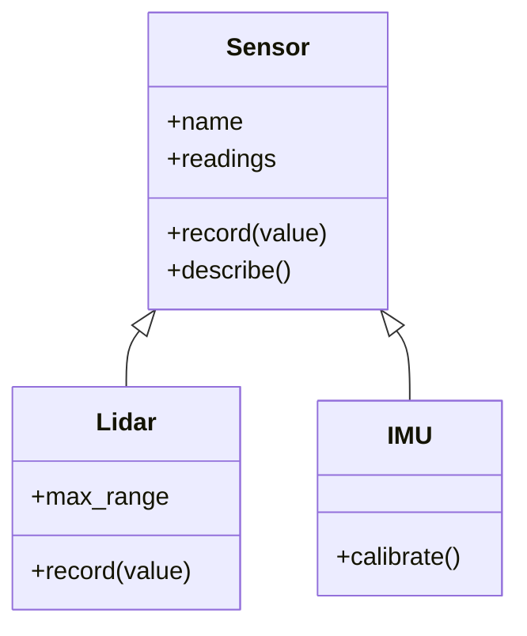
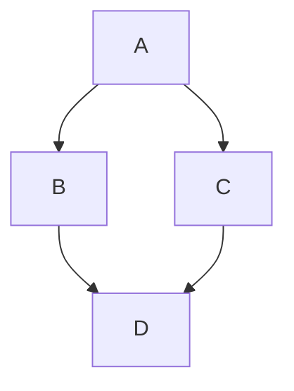

# Inheritance and super()

**Inheritance** defines a new class in terms of an existing one: the subclass gets everything the base class has, then adds or changes behaviour. It models an **is-a** relationship: a `Lidar` *is a* `Sensor`, a `SavingsAccount` *is a* `BankAccount`. Used well, it removes duplication and enables polymorphism. Used badly, it creates rigid, fragile hierarchies, so the Master OOP module teaches "composition over inheritance". First you need to know exactly how inheritance works in Python, including `super()` and the **MRO** that decides which method runs.

## 1. Basic inheritance

```python
class Sensor:                                   # base class (parent / superclass)
    def __init__(self, name):
        self.name = name
        self.readings = []

    def record(self, value):
        self.readings.append(value)

    def describe(self):
        return f"{self.name} ({len(self.readings)} readings)"


class Lidar(Sensor):                            # subclass (child / derived class)
    def __init__(self, name, max_range):
        super().__init__(name)                  # let the base class set up its part
        self.max_range = max_range

    def record(self, value):                    # OVERRIDE: specialise behaviour
        if 0 <= value <= self.max_range:
            super().record(value)               # reuse the base implementation

l = Lidar("front", 30.0)
l.record(12.5)
l.record(99)                                    # ignored: out of range
print(l.describe())                             # front (1 readings): inherited unchanged
print(isinstance(l, Sensor), issubclass(Lidar, Sensor))   # True True
```

A subclass can:

1. **inherit** methods unchanged (`describe`)
2. **override** them, replacing the behaviour (`record`)
3. **extend** them, overriding and calling the base version through `super()`
4. **add** new attributes and methods (`max_range`)



## 2. `super()` and initialisation

> [!KEY]
> If a subclass defines `__init__`, the base class's `__init__` is **not** called automatically. Call `super().__init__(...)` yourself, or the inherited attributes (`self.name`, `self.readings`) won't exist, and methods using them fail with `AttributeError`.

`super()` returns a proxy that finds the **next class in the MRO** (below). In single inheritance that's simply the parent. Prefer `super()` over hard-coding `Sensor.__init__(self, name)`: it's shorter, survives renames, and is required for cooperative multiple inheritance.

## 3. Method resolution order (MRO)

When you call `obj.method()`, Python searches the class, then its bases, in a fixed order: the MRO.

```python
print(Lidar.__mro__)   # (Lidar, Sensor, object)
```

Every class ultimately inherits from `object`, which provides defaults like `__repr__`, `__eq__` (identity) and `__init__`.

### Multiple inheritance and the diamond

Python allows several base classes. The MRO is computed with the **C3 linearization** algorithm, which guarantees that a class comes before its bases, base order is preserved, and each class appears once:

```python
class A:
    def who(self): return "A"
class B(A):
    def who(self): return "B+" + super().who()
class C(A):
    def who(self): return "C+" + super().who()
class D(B, C):
    def who(self): return "D+" + super().who()

print(D().who())                         # D+B+C+A
print([k.__name__ for k in D.__mro__])   # ['D', 'B', 'C', 'A', 'object']
```



Note that `super()` in `B` called `C`, not `A`: **`super()` means "next in the MRO of the actual object"**, not "my parent". That's what lets the diamond call `A.who` exactly once (**cooperative multiple inheritance**). For this to work, every class in the chain must call `super()` and accept compatible arguments (often `**kwargs`).

> [!WARNING]
> Multiple inheritance of **state** gets complicated fast. Its sane uses in Python are **mixins**: small classes adding one capability with no `__init__` state (e.g. `class JSONMixin: def to_json(self): ...`), and interfaces / abstract base classes (later lesson).

## 4. `isinstance`, `issubclass` and type checks

```python
isinstance(l, Lidar)        # True
isinstance(l, Sensor)       # True: a subclass instance IS-A base instance
type(l) is Sensor           # False: type() is exact
isinstance(True, int)       # True: bool subclasses int
```

Prefer `isinstance` over `type(x) == C`, because it respects inheritance. Even better, prefer polymorphism (next lesson) to type checks altogether.

## 5. Liskov Substitution Principle (preview)

A subclass must be usable **anywhere** its base class is expected, without surprises: same method signatures, no stronger preconditions, no weaker guarantees. The classic violation is `Square(Rectangle)`: setting the width of a "rectangle" unexpectedly changes its height. If a subclass can't honour the base class's contract, inheritance is the wrong tool. The SOLID lesson covers this properly.

## 6. When to inherit (and when not)

| Inherit when | Prefer composition when |
|---|---|
| there's a true **is-a** relationship | it's really **has-a** (a Robot *has* Motors) |
| the subclass honours the whole base contract | you only want to reuse some code |
| you want polymorphism over a family of types | the behaviour varies independently along several dimensions |
| frameworks expect it (`Exception`, `logging.Handler`) | the hierarchy would grow deep (more than 2–3 levels) |

## 7. Exam-ready answers

> [!EXAM]
> **Inheritance.** Inheritance is a mechanism by which a class (the subclass or derived class) acquires the attributes and methods of another class (the base class or superclass), modelling an "is-a" relationship. The subclass may use inherited members unchanged, override them to provide specialised behaviour, extend them by calling the base implementation through `super()`, and add new members. In Python, if a subclass defines `__init__`, it must explicitly call `super().__init__(...)` to initialise the inherited part. Python supports multiple inheritance; the method resolution order (MRO), computed by C3 linearization and available as `Class.__mro__`, determines the order in which classes are searched for attributes, and `super()` delegates to the next class in that order.

> [!EXAM]
> **Method overriding.** Overriding occurs when a subclass defines a method with the same name as a method in its base class. Calls on instances of the subclass use the subclass version, enabling specialised behaviour, while the base version remains accessible through `super()`. (Python has no overloading by signature; a later definition with the same name simply replaces an earlier one in the same class.)

## 8. Cheat sheet

| Need | Code |
|---|---|
| subclass | `class Lidar(Sensor):` |
| initialise the base | `super().__init__(name)` in the subclass `__init__` |
| extend a method | `def record(self, v): ...; super().record(v)` |
| check | `isinstance(obj, Base)`, `issubclass(Sub, Base)` |
| lookup order | `Cls.__mro__` / `Cls.mro()` |
| mixin | `class LoggingMixin: def log(self, m): ...` then `class X(LoggingMixin, Base):` |

> [!INTERVIEW]
> **"In a diamond `D(B, C)` where both B and C inherit A, how many times does `A.__init__` run if everyone calls `super().__init__()`? What if they call `A.__init__(self)` directly?"** With `super()`, once, because the MRO D → B → C → A visits A once, and each `super()` call moves to the next class in D's MRO (so B's `super()` goes to C). With explicit `A.__init__(self)` calls in B and C, it runs **twice**, which is the classic diamond problem that C3 plus cooperative `super()` solves. (C++ solves it with virtual inheritance.)
