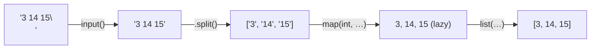

# Input/Output and f-strings

Every program talks to the outside world. In this course (and in every coding interview and online judge) that means reading **standard input** and writing **standard output** in an exact format. This lesson makes you fluent in `input()`, `print()` and the **format-spec mini-language** inside f-strings, which is the syntax people most often look up. Learn the mini-language once and you can produce any output format from memory.

## 1. Reading input with `input()`

`input()` reads **one line** from stdin and returns it as a **`str`**, without the trailing newline. If no input is left, it raises `EOFError`.

```python
name = input()            # "Ada"
age = int(input())        # "21" → 21
height = float(input())   # "1.68" → 1.68
```

`input("prompt: ")` prints a prompt first. Don't use prompts in judge problems: the prompt text goes to stdout and makes your output wrong.

### The patterns you will use constantly

```python
# one integer per line
n = int(input())

# several values on one line
a, b = map(int, input().split())        # "3 4"   → a=3, b=4
x, y, z = input().split()               # three strings

# a whole line of numbers into a list
nums = list(map(int, input().split()))  # "5 1 4" → [5, 1, 4]

# n lines that follow
n = int(input())
rows = [input() for _ in range(n)]

# a grid of numbers
grid = [list(map(int, input().split())) for _ in range(n)]
```



> [!KEY]
> `str.split()` with **no argument** splits on any run of whitespace (spaces, tabs) and ignores leading and trailing whitespace. `split(" ")` splits on *each single space* and produces empty strings for double spaces. Use the no-argument form for input.

### Reading everything at once (and fast)

For huge inputs (10⁵+ lines) `input()` is slow. Read through `sys.stdin`:

```python
import sys
data = sys.stdin.read().split()      # every token in the input, as strings
n = int(data[0])
nums = list(map(int, data[1:1 + n]))

# or line by line, faster than input()
readline = sys.stdin.readline
n = int(readline())                  # readline keeps the '\n'; int() ignores it
```

Reading until the input ends (an unknown number of lines):

```python
import sys
for line in sys.stdin:
    line = line.rstrip("\n")
    ...
```

## 2. Writing output with `print()`

> [!SYNTAX]
> `print(*objects, sep=' ', end='\n', file=sys.stdout, flush=False)`

- Every argument is converted with `str()`.
- Arguments are joined with `sep` (default: one space).
- `end` is written at the end (default: newline).

```python
print("a", "b", "c")                 # a b c
print("a", "b", "c", sep="-")        # a-b-c
print("no newline", end="")          # next print continues on this line
print()                              # just a newline
nums = [1, 2, 3]
print(*nums)                         # 1 2 3   (unpack the list as arguments)
print(*nums, sep=", ")               # 1, 2, 3
print(nums)                          # [1, 2, 3] (the list's repr; usually NOT what a judge wants)
```

> [!DANGER]
> `print(nums)` prints `[1, 2, 3]` with brackets and commas. Judges usually want `1 2 3`. Use `print(*nums)` or `print(" ".join(map(str, nums)))`.

Printing many lines fast: build one string and print once.

```python
print("\n".join(map(str, results)))
```

Print errors to stderr, which judges don't compare:

```python
import sys
print("debug:", value, file=sys.stderr)
```

## 3. f-strings

An **f-string** (formatted string literal, Python 3.6+) is a string prefixed with `f`. Any expression inside `{}` is evaluated and inserted:

```python
name, score = "Ada", 93.456
print(f"{name} scored {score}")         # Ada scored 93.456
print(f"{name.upper()} has {len(name)} letters, 2+2={2 + 2}")
print(f"{{braces}} are doubled")        # {braces} are doubled
```

> [!SYNTAX]
> Replacement field: `{expression!conversion:format_spec}`
> - `!conversion` (optional): `!r` → `repr()`, `!s` → `str()`, `!a` → `ascii()`
> - `:format_spec` (optional): how to lay out the value (next section)
> - `{expression=}` (debug form) prints `expression=value`

```python
x = 3.14159
print(f"{x=}")         # x=3.14159   handy for debugging
print(f"{name!r}")     # 'Ada'
```

## 4. The format-spec mini-language

This is the part worth memorising. The full grammar is:

> [!SYNTAX]
> `[[fill]align][sign][#][0][width][grouping][.precision][type]`
>
> Read it left to right: **fill & align** → **sign** → **alternate form** → **zero-pad** → **width** → **thousands separator** → **precision** → **presentation type**.

<div class="figure">
<svg viewBox="0 0 640 150" width="640" xmlns="http://www.w3.org/2000/svg" font-family="ui-monospace, monospace" font-size="22">
  <text x="40" y="60" fill="currentColor">{ value : * &gt; + 12 , .2 f }</text>
  <g font-family="sans-serif" font-size="12">
    <text x="150" y="100" fill="#d29922">fill</text><line x1="160" y1="66" x2="160" y2="88" stroke="#d29922"/>
    <text x="180" y="120" fill="#d29922">align</text><line x1="192" y1="66" x2="192" y2="108" stroke="#d29922"/>
    <text x="215" y="100" fill="#3fb950">sign</text><line x1="228" y1="66" x2="228" y2="88" stroke="#3fb950"/>
    <text x="250" y="120" fill="#2f81f7">width</text><line x1="275" y1="66" x2="275" y2="108" stroke="#2f81f7"/>
    <text x="300" y="100" fill="#a371f7">grouping</text><line x1="320" y1="66" x2="320" y2="88" stroke="#a371f7"/>
    <text x="350" y="120" fill="#f85149">precision</text><line x1="365" y1="66" x2="365" y2="108" stroke="#f85149"/>
    <text x="400" y="100" fill="currentColor">type</text><line x1="408" y1="66" x2="408" y2="88" stroke="currentColor"/>
  </g>
  <text x="40" y="145" font-size="13" fill="currentColor" fill-opacity=".7">f"{1234.5:*>+12,.2f}"  →  "***+1,234.50"</text>
</svg>
<figcaption>Each part of the spec is optional, but the parts that are present must appear in this order.</figcaption>
</div>

### Width and alignment

| Spec | Meaning | `f"[{'Ada':SPEC}]"` |
|---|---|---|
| `>8` | right-align in 8 columns | `[     Ada]` |
| `<8` | left-align | `[Ada     ]` |
| `^8` | centre | `[  Ada   ]` |
| `*^9` | centre, fill with `*` | `[***Ada***]` |

Defaults: strings are left-aligned, numbers right-aligned. The width is a **minimum**: longer values are never cut.

```python
w = 6
print(f"[{'Ada':>{w}}]")     # width taken from a variable: [   Ada]
```

### Numbers

| Spec | Meaning | Example → output |
|---|---|---|
| `d` | decimal integer | `f"{42:d}"` → `42` |
| `05d` / `05` | zero-pad to width 5 | `f"{7:03d}"` → `007` |
| `,` / `_` | thousands separator | `f"{1234567:,}"` → `1,234,567` |
| `+` | always show sign | `f"{5:+d}"` → `+5` |
| `.2f` | fixed point, 2 decimals | `f"{3.14159:.2f}"` → `3.14` |
| `8.3f` | width 8, 3 decimals | `f"{3.14159:8.3f}"` → `   3.142` |
| `.2e` | scientific | `f"{12345.678:.2e}"` → `1.23e+04` |
| `.3g` | 3 significant digits | `f"{1234.5:.3g}"` → `1.23e+03` |
| `.1%` | percentage | `f"{0.256:.1%}"` → `25.6%` |
| `b` `o` `x` `X` | binary/octal/hex | `f"{255:x}"` → `ff` |
| `#x` | with prefix | `f"{255:#x}"` → `0xff` |

> [!KEY]
> `:.2f` **rounds** to 2 decimals (using the exact binary value, so `f"{2.675:.2f}"` is `2.67`). It does not truncate. "Print the answer to 6 decimal places" in a judge means `f"{ans:.6f}"`.

### A formatted table

```python
rows = [("Python", 1991, 0.287), ("C", 1972, 0.105), ("C++", 1985, 0.094)]
print(f"{'Language':<10}{'Year':>6}{'Share':>9}")
for lang, year, share in rows:
    print(f"{lang:<10}{year:>6}{share:>9.1%}")
```

```output
Language    Year    Share
Python      1991    28.7%
C           1972    10.5%
C++         1985     9.4%
```

## 5. Older formatting styles (you'll meet them in old code)

```python
"{} and {}".format(1, 2)          # '1 and 2'   str.format, same mini-language
"{0}{1}{0}".format("a", "b")      # 'aba'       positional indices
"%d items, %.2f" % (3, 2.5)       # '3 items, 2.50'   printf-style, like C
```

The `%` style mirrors C's `printf` (`%d`, `%s`, `%.2f`, `%5d`), so it's worth recognising. For new code, use f-strings. They're the fastest and the most readable.

## 6. Exam-ready answers

> [!EXAM]
> **`input()` and `print()`.** `input([prompt])` reads one line from standard input and returns it as a string with the newline removed; numeric input must be converted explicitly with `int()` or `float()`. `print(*objects, sep=' ', end='\n', file=sys.stdout)` converts each argument with `str()`, separates them with `sep`, writes `end` after the last one, and sends the result to the given file (standard output by default).

> [!EXAM]
> **f-strings.** A formatted string literal is a string prefixed with `f` in which expressions enclosed in braces are evaluated at run time and formatted into the string. A replacement field has the form `{expression!conversion:format_spec}`. The format specification controls fill, alignment, sign, width, grouping, precision and type. For example, `f"{x:>10.2f}"` right-aligns `x` in ten columns with two decimal places.

## 7. Cheat sheet

| Need | Code |
|---|---|
| two ints on one line | `a, b = map(int, input().split())` |
| list of ints | `list(map(int, input().split()))` |
| n lines | `[input() for _ in range(n)]` |
| all tokens fast | `sys.stdin.read().split()` |
| print list space-separated | `print(*lst)` |
| print one per line | `print("\n".join(map(str, lst)))` |
| no newline | `print(x, end="")` |
| 2 decimals | `f"{x:.2f}"` |
| pad to width 5 with zeros | `f"{n:05d}"` |
| thousands separator | `f"{n:,}"` |
| right-align in 10 | `f"{s:>10}"` |
| debug | `f"{var=}"` |

> [!INTERVIEW]
> **"Your solution is correct but times out on 10⁶ lines of input. Why?"** `input()` has per-call overhead, and `print()` called a million times is slow too. Read everything with `sys.stdin.read().split()` (or `sys.stdin.readline`), and collect the output in a list, then print it once with `"\n".join(...)`. This alone can make Python I/O ten times faster.
