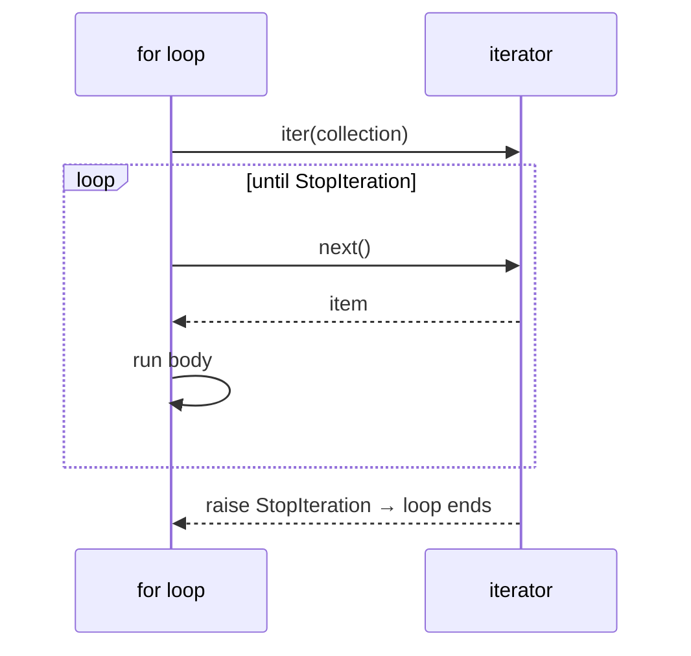

# Iterables and Iterators

Every `for` loop, comprehension, `sum()`, `zip()`, unpacking and `in` test in Python runs on one small protocol: the **iterator protocol**. Understanding it explains why a `map` object can be used only once, why you can loop over a file line by line without loading it, why `range(10**12)` costs nothing, and how to make your own objects work in a `for` loop. It's also the foundation for generators, the next lesson.

## 1. Two roles: iterable and iterator

| | **Iterable** | **Iterator** |
|---|---|---|
| What it is | something you *can* loop over | the object that *does* the looping and remembers the position |
| Protocol | has `__iter__()` returning an iterator | has `__next__()` returning the next item **and** `__iter__()` returning itself |
| Reusable? | yes: each `iter()` call starts fresh | **no**: single pass, then exhausted |
| Examples | `list`, `str`, `tuple`, `dict`, `set`, `range`, file objects | `iter([1,2])`, `map(...)`, `zip(...)`, `enumerate(...)`, generators, files |

> [!KEY]
> - `iter(x)` calls `x.__iter__()` and returns an iterator.
> - `next(it)` calls `it.__next__()` and returns the next item, or raises **`StopIteration`** when there are none left.
> - An iterator is itself iterable (`iter(it) is it`), which is why you can loop over a `zip` directly. That's also why it's exhausted after one loop.

```python
nums = [10, 20]
it = iter(nums)          # list → list_iterator
print(next(it))          # 10
print(next(it))          # 20
next(it)                 # StopIteration
print(next(iter([]), "default"))   # 'default': next() with a default never raises
```

## 2. What a `for` loop really does

```python
for x in collection:
    body(x)
```

is executed as:

```python
_it = iter(collection)          # 1. get an iterator ONCE
while True:
    try:
        x = next(_it)           # 2. ask for the next item
    except StopIteration:       # 3. stop cleanly when exhausted
        break
    body(x)
```



Everything that consumes iterables (`list()`, `sum()`, `sorted()`, `"".join()`, `x in it`, `a, b = it`, `*it`) uses this same `iter` + `next` dance.

## 3. Single-use iterators: the bug they cause

```python
squares = map(lambda x: x * x, [1, 2, 3])
print(list(squares))     # [1, 4, 9]
print(list(squares))     # []: exhausted
print(sum(squares))      # 0
```

```python
pairs = zip("ab", [1, 2])
for p in pairs: pass
print(list(pairs))       # []
```

> [!DANGER]
> If you need to iterate twice, materialise the data first: `squares = list(map(...))`. A function that receives an iterable and loops over it twice (say, once for `min` and once for `max`) silently breaks when given a generator. Either loop once, or convert to a list at the top.

### Iterables are fresh every time

A **container** creates a **new** iterator for each loop:

```python
data = [1, 2, 3]
print(list(data), list(data))     # [1, 2, 3] [1, 2, 3]
print(iter(data) is iter(data))   # False: two independent iterators
```

## 4. Building your own iterable class

The clean design separates the **iterable** (the collection) from the **iterator** (the cursor), so the collection can be looped over many times, even concurrently:

```python
class Countdown:
    """Iterable: for n in Countdown(3) yields 3, 2, 1."""
    def __init__(self, start):
        self.start = start
    def __iter__(self):
        return CountdownIterator(self.start)     # a NEW cursor per loop

class CountdownIterator:
    def __init__(self, current):
        self.current = current
    def __iter__(self):
        return self                              # iterators return themselves
    def __next__(self):
        if self.current <= 0:
            raise StopIteration
        self.current -= 1
        return self.current + 1

c = Countdown(3)
print(list(c), list(c))      # [3, 2, 1] [3, 2, 1]: reusable
```

If `Countdown` returned `self` from `__iter__` and kept the position itself, the second `list(c)` would be empty. Generators (next lesson) make all this boilerplate unnecessary: `def __iter__(self): yield from range(self.start, 0, -1)`.

> [!NOTE]
> The **sequence fallback**: if a class has no `__iter__` but has `__getitem__` accepting 0, 1, 2…, `iter()` still works, calling `__getitem__` until `IndexError`. That's how old-style sequences became iterable. Prefer `__iter__`.

## 5. Laziness: why iterators matter

An iterator produces items **on demand**. Nothing is computed until someone calls `next`. Consequences:

- **Constant memory**: `for line in open("huge.log")` reads one line at a time, even for a 50 GB file.
- **Infinite sequences**: `itertools.count()` never ends, and that's fine as long as the consumer stops.
- **Pipelines**: `sum(x * x for x in map(int, f) if x > 0)` streams each line through every stage, with no intermediate lists.

```python
import itertools
evens = (n for n in itertools.count() if n % 2 == 0)   # infinite and lazy
print(next(evens), next(evens), next(evens))          # 0 2 4
```

## 6. `iter(callable, sentinel)`

The two-argument form calls `callable()` repeatedly until it returns `sentinel`:

```python
import io
f = io.StringIO("a\nb\n\nc\n")
for line in iter(f.readline, "\n"):     # stop at the first blank line
    print(repr(line))                   # 'a\n'  'b\n'
```

That's handy for reading fixed-size blocks: `iter(lambda: f.read(4096), b"")`.

## 7. Iterator tools you already know (all lazy)

| Tool | Yields |
|---|---|
| `enumerate(it, start=0)` | `(index, item)` |
| `zip(a, b, …, strict=False)` | tuples of parallel items, stopping at the shortest |
| `map(f, it)` | `f(item)` |
| `filter(pred, it)` | the items where `pred` is truthy |
| `reversed(seq)` | items backwards (needs `__reversed__`, or `__len__` + `__getitem__`) |
| `range(a, b, s)` | numbers (a lazy *sequence*, reusable, with O(1) `in`) |

## 8. Exam-ready answers

> [!EXAM]
> **Iterable vs iterator.** An iterable is any object that can return an iterator through its `__iter__()` method (lists, strings, tuples, dictionaries, sets, files, ranges). An iterator is an object that represents a stream of data. Its `__next__()` method returns successive items and raises `StopIteration` when the stream is exhausted, and its `__iter__()` method returns the iterator itself. Iterables can be traversed repeatedly because each call to `iter()` creates a new iterator, whereas an iterator can be traversed only once. The `for` statement calls `iter()` on the iterable and then repeatedly calls `next()` until `StopIteration` is raised.

> [!EXAM]
> **Lazy evaluation.** Iterators compute their values on demand rather than storing them all in memory. This allows processing of very large or infinite data streams in constant memory and the composition of processing pipelines without intermediate collections.

## 9. Cheat sheet

| Need | Code |
|---|---|
| get an iterator | `it = iter(x)` |
| next item | `next(it)` |
| next item or a default | `next(it, None)` |
| first matching item | `next((x for x in xs if p(x)), None)` |
| iterate twice safely | `data = list(iterable)` first |
| make a class iterable | define `__iter__` (ideally as a generator) |
| loop until a sentinel | `for x in iter(func, sentinel):` |
| test whether something is iterable | `isinstance(x, collections.abc.Iterable)` (or try `iter(x)`) |

> [!INTERVIEW]
> **"Why is `for line in open(path)` better than `for line in open(path).readlines()` for a 10 GB file?"** A file object is its own iterator, yielding one line at a time from a buffer: O(1) memory. `readlines()` builds a list of every line in memory first: O(file size). The two loops look almost identical, but one of them crashes the machine.
