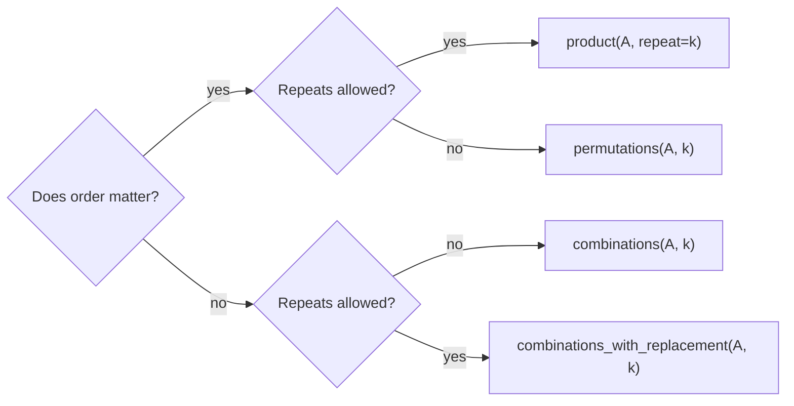

# itertools

`itertools` is a standard-library module of fast, memory-efficient building blocks for iteration, written in C. It covers combinatorics (permutations, combinations, Cartesian products), grouping runs, running totals, slicing lazy streams, chaining and cycling. In interviews, `itertools` turns 15-line nested loops into one clear line. In data work, it processes streams without loading them into memory. Every function here returns a **lazy iterator**.

```python
import itertools as it     # common alias
```

## 1. Infinite iterators

| Function | Yields | Example |
|---|---|---|
| `count(start=0, step=1)` | start, start+step, … forever | `count(10, 5)` → 10 15 20 … |
| `cycle(iterable)` | the items, repeated forever | `cycle("ab")` → a b a b … |
| `repeat(x, times=None)` | `x` forever, or `times` times | `repeat(7, 3)` → 7 7 7 |

Always pair them with something that stops: `islice`, `zip`, or a `break`.

```python
for i, colour in zip(range(5), it.cycle(["red", "green"])):
    print(i, colour)          # alternating colours, stops after 5
```

## 2. Slicing and filtering lazy streams

| Function | Yields |
|---|---|
| `islice(it, stop)` / `islice(it, start, stop, step)` | a slice of any iterator (no negative indices) |
| `takewhile(pred, it)` | items while `pred` is true, then stops for good |
| `dropwhile(pred, it)` | skips while `pred` is true, then yields everything else |
| `filterfalse(pred, it)` | items where `pred` is **false** |
| `compress(data, selectors)` | `data[i]` where `selectors[i]` is truthy |

```python
print(list(it.takewhile(lambda x: x < 3, [1, 2, 3, 1])))   # [1, 2]: stops at 3
print(list(it.dropwhile(lambda x: x < 3, [1, 2, 3, 1])))   # [3, 1]
print(list(it.compress("abcd", [1, 0, 1, 0])))             # ['a', 'c']
```

## 3. Combining iterables

| Function | Yields |
|---|---|
| `chain(a, b, …)` | all of `a`, then all of `b`, … |
| `chain.from_iterable(iter_of_iters)` | flattens **one level** lazily |
| `zip_longest(a, b, fillvalue=None)` | like `zip`, but runs to the **longest** input |
| `pairwise(it)` (3.10+) | overlapping pairs `(x0, x1), (x1, x2), …` |
| `batched(it, n)` (3.12+) | non-overlapping tuples of `n` |
| `starmap(f, iter_of_tuples)` | `f(*t)` for each tuple |
| `tee(it, n=2)` | `n` independent iterators from one (buffers internally) |

```python
print(list(it.pairwise([1, 2, 4, 7])))                    # [(1, 2), (2, 4), (4, 7)]
gaps = [b - a for a, b in it.pairwise([1, 2, 4, 7])]      # [1, 2, 3]: differences
print(list(it.zip_longest("ab", "x", fillvalue="-")))      # [('a', 'x'), ('b', '-')]
print(list(it.chain.from_iterable([[1, 2], [3]])))         # [1, 2, 3]
```

## 4. `accumulate`: running results

```python
print(list(it.accumulate([1, 2, 3, 4])))           # [1, 3, 6, 10]: prefix sums
print(list(it.accumulate([3, 1, 4, 1, 5], max)))   # [3, 3, 4, 4, 5]: running maximum
import operator
print(list(it.accumulate([1, 2, 3], operator.mul, initial=10)))   # [10, 10, 20, 60]
```

Prefix sums are a core DSA technique (range-sum queries in O(1)), and `accumulate` builds them in one line.

## 5. Combinatorics: the interview favourites

| Function | Produces | Count for n items |
|---|---|---|
| `product(A, B)` / `product(A, repeat=k)` | Cartesian product, like nested loops | n^k |
| `permutations(A, r)` | ordered arrangements of `r` distinct items | n!/(n−r)! |
| `combinations(A, r)` | unordered selections, no repeats | C(n, r) |
| `combinations_with_replacement(A, r)` | unordered, repeats allowed | C(n+r−1, r) |

```python
print(list(it.product("ab", repeat=2)))          # aa ab ba bb
print(list(it.permutations("abc", 2)))           # ab ac ba bc ca cb
print(list(it.combinations("abc", 2)))           # ab ac bc
print(list(it.combinations_with_replacement("ab", 2)))   # aa ab bb
```



> [!KEY]
> Elements are treated as unique **by position**, not by value: `permutations("aab")` yields duplicates like `('a','a','b')` twice. Use `set(...)` to deduplicate, or (better) a smarter backtracking algorithm.

> [!WARNING]
> These grow explosively: `permutations(range(10))` has 3,628,800 items and `range(13)` has 6.2 billion. They're lazy, so creating them is free, but consuming them all isn't. In interviews, generating everything is usually the brute force you're expected to improve on.

`product` replaces nested loops:

```python
# all 3-bit binary strings
print(["".join(bits) for bits in it.product("01", repeat=3)])
# ['000', '001', '010', '011', '100', '101', '110', '111']

# grid neighbours
for dr, dc in it.product((-1, 0, 1), repeat=2):
    if (dr, dc) != (0, 0):
        ...
```

## 6. `groupby`: grouping consecutive runs

`groupby(iterable, key=None)` yields `(key, group_iterator)` for each **run of consecutive** items with the same key:

```python
print([(k, len(list(g))) for k, g in it.groupby("aaabccaa")])
# [('a', 3), ('b', 1), ('c', 2), ('a', 2)]: 'a' appears twice because the runs are separate
```

> [!DANGER]
> `groupby` only groups **adjacent** items. To group by key across the whole input, **sort by the same key first**: `groupby(sorted(data, key=f), key=f)`. Also, each group iterator is invalidated when you advance to the next group, so consume it (e.g. `list(g)`) immediately.

```python
words = ["apple", "avocado", "banana", "blueberry", "cherry"]
for letter, group in it.groupby(sorted(words), key=lambda w: w[0]):
    print(letter, list(group))
# a ['apple', 'avocado']
# b ['banana', 'blueberry']
# c ['cherry']
```

Run-length encoding in one line: `"".join(f"{k}{len(list(g))}" for k, g in it.groupby(s))`.

## 7. Famous recipes (from the official docs)

```python
def sliding_window(iterable, n):
    """sliding_window('ABCDE', 3) → ABC BCD CDE"""
    from collections import deque
    iterator = iter(iterable)
    window = deque(it.islice(iterator, n - 1), maxlen=n)
    for x in iterator:
        window.append(x)
        yield tuple(window)

def flatten(list_of_lists):
    return it.chain.from_iterable(list_of_lists)

def powerset(iterable):
    """powerset([1,2,3]) → () (1,) (2,) (3,) (1,2) (1,3) (2,3) (1,2,3)"""
    s = list(iterable)
    return it.chain.from_iterable(it.combinations(s, r) for r in range(len(s) + 1))
```

## 8. Exam-ready answers

> [!EXAM]
> **The itertools module.** `itertools` provides fast, memory-efficient iterator building blocks implemented in C. It includes infinite iterators (`count`, `cycle`, `repeat`), iterators that terminate on the shortest input or by a condition (`accumulate`, `chain`, `compress`, `dropwhile`, `takewhile`, `groupby`, `islice`, `pairwise`, `starmap`, `tee`, `zip_longest`), and combinatoric iterators (`product`, `permutations`, `combinations`, `combinations_with_replacement`). All return lazy iterators, so they can process large or infinite streams in constant memory. `groupby` groups only consecutive equal keys, so the data must usually be sorted first.

## 9. Cheat sheet

| Need | itertools |
|---|---|
| nested loops over sets | `product(a, b)` |
| all orderings | `permutations(xs)` |
| choose k | `combinations(xs, k)` |
| prefix sums | `accumulate(xs)` |
| running max | `accumulate(xs, max)` |
| adjacent pairs | `pairwise(xs)` |
| chunks | `batched(xs, n)` |
| flatten one level | `chain.from_iterable(xss)` |
| first n of a stream | `islice(stream, n)` |
| count runs | `groupby(xs)` |
| group by key | `groupby(sorted(xs, key=f), key=f)` |
| alternate forever | `cycle(xs)` |

> [!INTERVIEW]
> **"Generate all subsets of a set."** Use `chain.from_iterable(combinations(s, r) for r in range(len(s) + 1))`. That's 2ⁿ subsets, so for n = 20 it's about a million, which is fine, but n = 40 is impossible. A follow-up usually asks for the bitmask method (`for mask in range(1 << n)`) or backtracking with pruning, which can skip whole branches instead of enumerating everything.
