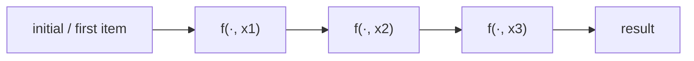

# Lambdas and Functional Tools

Because functions are objects, you can pass them into other functions. A function that takes or returns another function is called a **higher-order function**. Python's functional toolkit (`lambda`, `map`, `filter`, `functools.reduce`, `any`, `all`, `sorted(key=...)`, `operator`) lets you express "apply this to every element" or "combine these" without writing the loop by hand. This style matters well beyond Python: it's the core of NumPy/pandas vectorisation, PyTorch's functional API, Spark, and JavaScript array methods.

## 1. `lambda`: anonymous one-expression functions

> [!SYNTAX]
> `lambda parameters: expression`
>
> It creates a function object whose body is a **single expression**, whose value is returned automatically.

```python
square = lambda x: x * x            # works, but see the warning below
print(square(4))                    # 16
print((lambda a, b=2: a + b)(1))    # 3: defaults work too
```

A lambda is exactly equivalent to a `def` with one `return`, except that it has no name (`__name__` is `'<lambda>'`) and **can't contain statements**: no `=` assignment, `if` statement, `for`, `return` or `try`. A conditional *expression* is allowed:

```python
sign = lambda n: "neg" if n < 0 else "non-neg"
```

> [!WARNING]
> PEP 8: don't assign a lambda to a name (`square = lambda x: ...`). Use `def square(x): return x * x` instead, which gives a real name in tracebacks and room for a docstring. Lambdas are for **short functions used once, right where they're passed**: `sorted(..., key=lambda p: p.age)`.

## 2. `map(func, iterable, ...)`

`map` applies `func` to every item and returns a **lazy iterator**:

```python
print(list(map(str, [1, 2, 3])))                      # ['1', '2', '3']
print(list(map(lambda a, b: a * b, [1, 2, 3], [4, 5, 6])))   # [4, 10, 18]: several iterables in parallel
nums = list(map(int, "3 1 4".split()))                # the input-parsing idiom
```

## 3. `filter(predicate, iterable)`

`filter` keeps the items for which the predicate is truthy (also lazy):

```python
print(list(filter(lambda x: x % 2, range(6))))   # [1, 3, 5]
print(list(filter(None, [0, 1, "", 2, [], 3])))   # [1, 2, 3]: None means "keep truthy items"
```

### `map`/`filter` vs comprehensions

```python
list(map(lambda x: x * x, nums))          ≡   [x * x for x in nums]
list(filter(lambda x: x > 0, nums))       ≡   [x for x in nums if x > 0]
```

The Python community generally prefers comprehensions when a lambda would be needed: they're more readable and slightly faster. `map` wins when you already have a named function: `map(str, nums)`, `map(int, parts)`.

> [!DANGER]
> `map` and `filter` return **single-use iterators**. `m = map(int, "123"); list(m)` gives `[1, 2, 3]`, but a second `list(m)` gives `[]`. Convert to a list once if you need it twice.

## 4. `functools.reduce`: folding a sequence into one value

`reduce(f, iterable, initial)` combines elements pairwise from left to right: `f(f(f(initial, x0), x1), x2)…`

```python
from functools import reduce
import operator

print(reduce(lambda acc, x: acc * x, [1, 2, 3, 4]))     # 24: ((1*2)*3)*4
print(reduce(operator.add, [], 0))                     # 0: initial value for an empty input
# reduce(operator.add, [])  → TypeError: reduce() of empty iterable with no initial value
```



Most reductions have a clearer built-in: `sum`, `max`, `min`, `math.prod`, `any`, `all`, `"".join`. Use `reduce` for custom combinations, such as merging dicts, composing functions or bitwise-OR-ing flags, and **always pass an initial value** when the input might be empty.

## 5. `any` and `all` with generator expressions

```python
nums = [3, 8, -1]
print(any(x < 0 for x in nums))       # True: stops at the first True
print(all(x > 0 for x in nums))       # False: stops at the first False
```

Both short-circuit, so with a generator expression they do the minimum work.

## 6. Key functions: the most common use of lambdas

`sorted`, `min`, `max`, `heapq.nsmallest` and `itertools.groupby` all take `key=`:

```python
people = [("Ada", 36), ("Linus", 54), ("Grace", 85)]
youngest = min(people, key=lambda p: p[1])
by_name_len = sorted(people, key=lambda p: len(p[0]))
```

## 7. The `operator` module: named versions of the operators

Instead of tiny lambdas, `operator` provides fast, picklable function versions of the operators:

| Lambda | `operator` equivalent |
|---|---|
| `lambda a, b: a + b` | `operator.add` |
| `lambda a, b: a * b` | `operator.mul` |
| `lambda x: x[1]` | `operator.itemgetter(1)` |
| `lambda x: (x[0], x[2])` | `operator.itemgetter(0, 2)` |
| `lambda o: o.age` | `operator.attrgetter("age")` |
| `lambda o: o.area()` | `operator.methodcaller("area")` |

```python
from functools import reduce
import operator
print(reduce(operator.mul, range(1, 6), 1))      # 120
```

## 8. Functions returning functions

Higher-order functions can also **build** functions:

```python
def compose(f, g):
    return lambda x: f(g(x))

inc = lambda x: x + 1
square = lambda x: x * x
inc_then_square = compose(square, inc)
print(inc_then_square(3))      # 16
```

This is the basis of decorators (next lessons) and of pipelines in data and ML code.

## 9. Pure functions, immutability and the functional mindset

Functional programming treats computation as **transforming data with pure functions** instead of mutating state step by step:

```python
# imperative: mutate an accumulator
total = 0
for x in prices:
    if x > 100:
        total += x * 0.9

# functional: describe the transformation
total = sum(x * 0.9 for x in prices if x > 100)
```

Benefits: no hidden state, easy testing, easy parallelism (map steps are independent). This is exactly why MapReduce, Spark and GPU kernels are built this way. Python isn't a pure functional language, so mix the two styles pragmatically.

## 10. Exam-ready answers

> [!EXAM]
> **Lambda expressions.** A lambda expression creates an anonymous function object whose body consists of a single expression, written `lambda parameters: expression`. The value of the expression is returned automatically. Lambdas cannot contain statements such as assignments or loops. They are typically used as short throwaway arguments to higher-order functions, for example as the `key` argument of `sorted`.

> [!EXAM]
> **`map`, `filter` and `reduce`.** `map(f, iterable)` returns an iterator applying `f` to every element. `filter(pred, iterable)` returns an iterator over the elements for which `pred` is true. `functools.reduce(f, iterable, initial)` cumulatively applies the two-argument function `f` from left to right, reducing the iterable to a single value. In Python 3, `map` and `filter` are lazy, producing values on demand, and are often replaced by list comprehensions or generator expressions for readability.

> [!EXAM]
> **Higher-order function.** A function that takes one or more functions as arguments, returns a function, or both. Examples include `map`, `filter`, `sorted` with a `key`, and decorators.

## 11. Cheat sheet

| Need | Code |
|---|---|
| sort by field | `sorted(xs, key=lambda x: x.f)` |
| convert all | `list(map(int, parts))` |
| keep matching | `[x for x in xs if p(x)]` (or `filter`) |
| drop falsy | `list(filter(None, xs))` |
| product | `math.prod(xs)` or `reduce(operator.mul, xs, 1)` |
| any / all match | `any(p(x) for x in xs)` |
| compose | `lambda x: f(g(x))` |
| field getter | `operator.itemgetter(i)`, `attrgetter("a")` |

> [!INTERVIEW]
> **"Why might `map(lambda x: x * 2, data)` be slower than `[x * 2 for x in data]`?"** Every element pays for a Python-level function call to the lambda (frame setup, argument binding). The comprehension evaluates `x * 2` inline in its own loop, with no per-element call. `map` with a **built-in** function written in C (`map(str, data)`) avoids that overhead and is often the fastest option.
