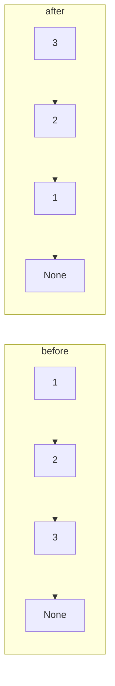

# Linked Lists

A **linked list** stores elements in nodes, each holding a value and a reference to the next node. Unlike a Python `list` (a contiguous dynamic array), it supports O(1) insertion and removal at a known node, but O(n) access by index and poor cache locality. In everyday Python, you rarely need one, because `list` and `deque` cover most uses. But linked lists are the canonical exercise in **pointer manipulation**, and their techniques (dummy heads, fast/slow pointers, in-place reversal) appear in interviews constantly and carry over directly to C and C++, to OS kernels (intrusive lists), and to LRU caches.

## 1. The node

```python
class ListNode:
    __slots__ = ("val", "next")
    def __init__(self, val, next=None):
        self.val = val
        self.next = next

def from_list(xs):
    dummy = tail = ListNode(None)
    for x in xs:
        tail.next = ListNode(x)
        tail = tail.next
    return dummy.next

def to_list(head):
    out = []
    while head:
        out.append(head.val)
        head = head.next
    return out
```

| Operation | Singly linked list | Python `list` |
|---|---|---|
| access the i-th element | O(n) | O(1) |
| insert/delete at the head | O(1) | O(n) |
| insert/delete after a known node | O(1) | O(n) |
| append | O(1) with a tail pointer | amortised O(1) |
| memory per element | node object (~56+ bytes) | 8-byte pointer |

## 2. The dummy (sentinel) head

Operations that might change the head (deletion, merging, partitioning) get messy with special cases. A **dummy node** in front of the real head removes them all:

```python
def remove_all(head, target):
    dummy = ListNode(None, head)
    prev = dummy
    while prev.next:
        if prev.next.val == target:
            prev.next = prev.next.next      # unlink: no special case for the head
        else:
            prev = prev.next
    return dummy.next
```

## 3. In-place reversal

The most important pointer exercise. Three references, `prev`, `cur` and `nxt`, and each node's `next` is flipped once:

```python
def reverse(head):
    prev = None
    cur = head
    while cur:
        nxt = cur.next      # 1. save the rest
        cur.next = prev     # 2. flip
        prev = cur          # 3. advance prev
        cur = nxt           # 4. advance cur
    return prev             # the new head
```



That's O(n) time and O(1) space. Variants include reversing a sublist `[m, n]` (find the node before m, reverse n − m + 1 nodes, reconnect both ends), reversing in groups of k, and checking whether a list is a palindrome (reverse the second half and compare).

## 4. Fast and slow pointers

```python
def middle(head):                 # the second middle for even lengths
    slow = fast = head
    while fast and fast.next:
        slow = slow.next
        fast = fast.next.next
    return slow

def has_cycle(head):              # Floyd's algorithm
    slow = fast = head
    while fast and fast.next:
        slow, fast = slow.next, fast.next.next
        if slow is fast:
            return True
    return False

def cycle_start(head):
    slow = fast = head
    while fast and fast.next:
        slow, fast = slow.next, fast.next.next
        if slow is fast:
            slow = head                     # restart one pointer from the head
            while slow is not fast:
                slow, fast = slow.next, fast.next
            return slow
    return None
```

> [!KEY]
> **Why phase 2 finds the cycle start.** Let μ be the distance from the head to the cycle start and λ the cycle length. When they meet, slow has walked μ + a and fast 2(μ + a), and the difference μ + a is a multiple of λ. So walking μ more steps from the meeting point lands exactly on the cycle start, and μ is also the distance from the head. That's why the two pointers meet there.

**k-th from the end**: advance a lead pointer k steps, then move both until the lead hits the end. That's one pass.

## 5. Merging and sorting

```python
def merge(a, b):                   # two sorted lists → one, O(n + m), O(1) extra
    dummy = tail = ListNode(None)
    while a and b:
        if a.val <= b.val:         # <= keeps it stable
            tail.next, a = a, a.next
        else:
            tail.next, b = b, b.next
        tail = tail.next
    tail.next = a or b
    return dummy.next

def sort_list(head):               # merge sort: O(n log n), stable, no random access needed
    if not head or not head.next:
        return head
    slow, fast = head, head.next   # split: slow ends at the first middle
    while fast and fast.next:
        slow, fast = slow.next, fast.next.next
    right = slow.next
    slow.next = None
    return merge(sort_list(head), sort_list(right))
```

Merging **k** sorted lists uses a heap of `(value, index, node)` and costs O(N log k). The index breaks ties, so nodes themselves never get compared.

## 6. Doubly linked lists and the LRU cache

With `prev` and `next`, a node can unlink itself in O(1). Pair it with a dict from key to node and you have an **LRU cache** with O(1) get and put:

```python
class Node:
    __slots__ = ("key", "val", "prev", "next")
    def __init__(self, key=None, val=None):
        self.key, self.val, self.prev, self.next = key, val, None, None

class LRUCache:
    def __init__(self, capacity):
        self.cap, self.map = capacity, {}
        self.head, self.tail = Node(), Node()          # sentinels: head.next = most recent
        self.head.next, self.tail.prev = self.tail, self.head

    def _unlink(self, n):
        n.prev.next, n.next.prev = n.next, n.prev

    def _push_front(self, n):
        n.prev, n.next = self.head, self.head.next
        self.head.next.prev = n
        self.head.next = n

    def get(self, key):
        if key not in self.map:
            return -1
        n = self.map[key]
        self._unlink(n); self._push_front(n)
        return n.val

    def put(self, key, val):
        if key in self.map:
            self._unlink(self.map[key])
        n = self.map[key] = Node(key, val)
        self._push_front(n)
        if len(self.map) > self.cap:
            lru = self.tail.prev
            self._unlink(lru)
            del self.map[lru.key]
```

In production Python, `collections.OrderedDict` (`move_to_end`, `popitem(last=False)`) or `functools.lru_cache` do the same job.

## 7. Pitfalls

> [!WARNING]
> - Save `cur.next` **before** you overwrite it, or you lose the rest of the list.
> - Compare nodes with `is` (identity), not `==`, when checking whether two references are the same node.
> - Recursive solutions on 10⁵-node lists exceed Python's recursion limit. Write them iteratively.
> - Garbage collection handles unlinked nodes in Python. In C, they'd leak.

## 8. Exam-ready answers

> [!EXAM]
> **Linked lists vs arrays.** A linked list stores elements in separately allocated nodes connected by references, so inserting or deleting at a known position takes O(1) time without moving other elements, but reaching the i-th element requires O(i) traversal and nodes have poor memory locality and per-node overhead. A dynamic array stores elements contiguously, giving O(1) indexed access and cache-friendly iteration, with amortised O(1) appends but O(n) insertion or deletion in the middle. Doubly linked lists allow O(1) removal of a node given only a reference to it, which, combined with a hash map, yields O(1) LRU caches.

## 9. Cheat sheet

| Task | Technique |
|---|---|
| head might change | dummy node |
| reverse | prev/cur/nxt loop |
| middle / cycle / k-th from the end | fast/slow or lead pointers |
| cycle start | Floyd phase 2 |
| merge / sort | merge with a dummy tail; merge sort |
| merge k lists | heap of (val, i, node) |
| O(1) get/put by key with recency | dict + doubly linked list |

> [!INTERVIEW]
> **"Reverse a linked list."** Write the iterative three-pointer version and state O(n) time and O(1) space. Then offer the recursive version (`new_head = reverse(head.next); head.next.next = head; head.next = None`) and note that it uses O(n) stack, which overflows on long lists in Python. Interviewers often follow up with "reverse nodes in k-groups". Reuse the same loop on k-node segments and reconnect the segment ends.
