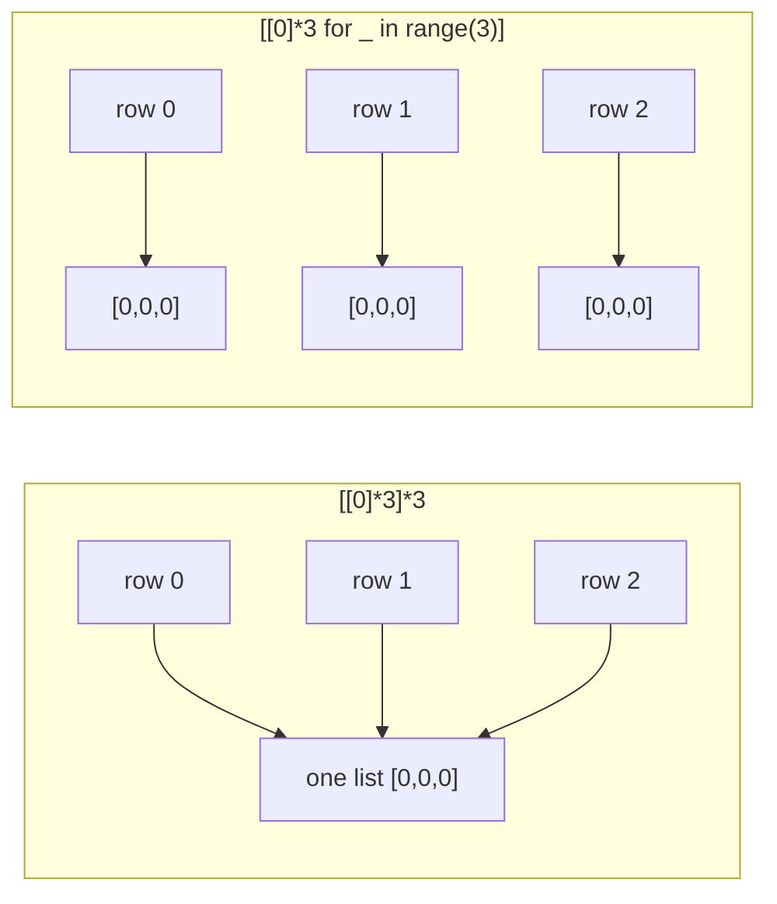

# Lists

The `list` is Python's workhorse: an **ordered, mutable sequence** that can hold objects of any type. Under the hood it's a **dynamic array**, the same data structure as C++'s `std::vector`. Knowing that one fact tells you which operations are fast (indexing, appending) and which are slow (inserting at the front, searching), and that's what interviewers probe. This lesson covers every list operation you need, with its cost.

## 1. Creating lists

```python
empty = []
nums = [3, 1, 4, 1, 5]
mixed = [1, "two", 3.0, [4, 5], None]   # any types, even other lists
chars = list("hey")                      # ['h', 'e', 'y']   from any iterable
evens = list(range(0, 10, 2))            # [0, 2, 4, 6, 8]
zeros = [0] * 5                          # [0, 0, 0, 0, 0]
squares = [x * x for x in range(5)]      # comprehension (own lesson later)
```

## 2. How a list is stored: a dynamic array

A list object holds a **contiguous array of pointers** to its element objects, plus a length and a capacity.

<div class="figure">
<svg viewBox="0 0 620 210" width="620" xmlns="http://www.w3.org/2000/svg" font-family="ui-monospace, monospace" font-size="13">
  <defs><marker id="la" markerWidth="8" markerHeight="8" refX="7" refY="4" orient="auto"><path d="M0,0 L8,4 L0,8 z" fill="currentColor"/></marker></defs>
  <rect x="20" y="20" width="150" height="80" rx="6" fill="none" stroke="#2f81f7" stroke-width="2"/>
  <text x="32" y="42" fill="currentColor">list object</text>
  <text x="32" y="62" fill="currentColor">len = 3</text>
  <text x="32" y="82" fill="currentColor">capacity = 4</text>
  <g fill="none" stroke="currentColor" stroke-opacity=".6">
    <rect x="230" y="40" width="60" height="40"/><rect x="290" y="40" width="60" height="40"/><rect x="350" y="40" width="60" height="40"/><rect x="410" y="40" width="60" height="40" stroke-dasharray="4 3"/>
  </g>
  <text x="243" y="30" fill="currentColor" font-size="11">[0]</text><text x="303" y="30" fill="currentColor" font-size="11">[1]</text><text x="363" y="30" fill="currentColor" font-size="11">[2]</text><text x="418" y="30" fill="currentColor" font-size="11">spare</text>
  <line x1="170" y1="60" x2="226" y2="60" stroke="currentColor" marker-end="url(#la)"/>
  <g fill="none" stroke="#3fb950" stroke-width="1.5"><circle cx="260" cy="160" r="22"/><circle cx="330" cy="160" r="22"/><circle cx="400" cy="160" r="26"/></g>
  <text x="252" y="165" fill="currentColor">3</text><text x="315" y="165" fill="currentColor">"hi"</text><text x="380" y="165" fill="currentColor">[4,5]</text>
  <line x1="260" y1="62" x2="260" y2="134" stroke="currentColor" marker-end="url(#la)"/><line x1="320" y1="62" x2="328" y2="134" stroke="currentColor" marker-end="url(#la)"/><line x1="380" y1="62" x2="398" y2="130" stroke="currentColor" marker-end="url(#la)"/>
  <text x="480" y="165" fill="currentColor" font-size="11" font-family="sans-serif" fill-opacity=".7">element objects</text>
</svg>
<figcaption>A list stores references (pointers), not the objects themselves. That's why one list can hold mixed types.</figcaption>
</div>

Consequences:

- **Indexing `a[i]` is O(1).** The address is `base + i × pointer_size`.
- **`append` is amortised O(1).** CPython **over-allocates**: when the array is full it grows to a bigger block (about 1.125× plus a constant), copies the pointers, and leaves spare slots for future appends. You can watch the capacity jump:

```python
import sys
a, prev = [], sys.getsizeof([])
for i in range(20):
    a.append(i)
    if sys.getsizeof(a) != prev:
        prev = sys.getsizeof(a)
        print(f"len {len(a):2} → {prev} bytes")
```

```output
len  1 → 88 bytes
len  5 → 120 bytes
len  9 → 184 bytes
len 17 → 248 bytes
```

Most appends just fill a spare slot. The occasional expensive copy is spread over many cheap appends, which is what **amortised O(1)** means.

- **Inserting or deleting at the front is O(n)**, because every later pointer must shift by one. Use `collections.deque` when you need fast operations at both ends.

## 3. Indexing and slicing

Lists use the same zero-based and negative indexing as strings:

```python
a = [10, 20, 30, 40, 50]
print(a[0], a[-1], a[1:3], a[::-1])   # 10 50 [20, 30] [50, 40, 30, 20, 10]
a[0] = 99                              # lists are MUTABLE: item assignment works
nested = [[1, 2], [3, 4]]
print(nested[1][0])                    # 3: index the outer list, then the inner one
```

Indexing past the end raises `IndexError`. Slicing never does (the Slicing lesson goes deeper).

## 4. The methods, with their costs

| Method | Does | Returns | Time |
|---|---|---|---|
| `a.append(x)` | add `x` at the end | `None` | O(1) amortised |
| `a.extend(it)` | append every item of iterable `it` | `None` | O(k) |
| `a.insert(i, x)` | insert before index `i` | `None` | O(n) |
| `a.pop()` | remove and return the last item | the item | O(1) |
| `a.pop(i)` | remove and return item `i` | the item | O(n) |
| `a.remove(x)` | remove the **first** item equal to `x` (`ValueError` if absent) | `None` | O(n) |
| `a.index(x)` | position of the first `x` (`ValueError` if absent) | int | O(n) |
| `a.count(x)` | number of occurrences | int | O(n) |
| `a.sort()` | sort **in place** | `None` | O(n log n) |
| `a.reverse()` | reverse **in place** | `None` | O(n) |
| `a.copy()` | shallow copy | new list | O(n) |
| `a.clear()` | remove everything | `None` | O(n) |
| `del a[i]`, `del a[i:j]` | delete by index or slice | — | O(n) |
| `x in a` | linear search | bool | O(n) |
| `len(a)` | length (stored) | int | O(1) |

```python
a = [1, 2, 3]
a.append([4, 5])     # [1, 2, 3, [4, 5]]: adds ONE element, a list
a = [1, 2, 3]
a.extend([4, 5])     # [1, 2, 3, 4, 5]: adds each element
a.insert(0, "start") # ['start', 1, 2, 3, 4, 5]
last = a.pop()       # 5
first = a.pop(0)     # 'start'
```

> [!DANGER]
> **In-place methods return `None`.** `a = a.sort()` destroys your list: `a` becomes `None`. Use `a.sort()` alone to sort in place, or `b = sorted(a)` to get a new sorted list and keep the original. The same goes for `append`, `extend`, `insert`, `reverse` and `clear`.

> [!WARNING]
> `a.extend("ab")` adds `'a'` and `'b'`, because a string is an iterable of characters. `a.append("ab")` adds the single string `'ab'`.

## 5. Operators and built-ins

```python
print([1, 2] + [3])        # [1, 2, 3]: new list
print([1, 2] * 2)          # [1, 2, 1, 2]
print(3 in [1, 2, 3])      # True
print(len([1, [2, 3]]))    # 2: the inner list is ONE element
print(min([4, 2, 8]), max([4, 2, 8]), sum([4, 2, 8]))   # 2 8 14
print(sorted([3, 1, 2], reverse=True))                  # [3, 2, 1]
print(list(reversed([1, 2, 3])))                        # [3, 2, 1]
```

Comparison is lexicographic: `[1, 2, 3] < [1, 3]` is `True`.

## 6. The 2D-list trap

```python
grid = [[0] * 3] * 3      # WRONG
grid[0][0] = 1
print(grid)
```

```output
[[1, 0, 0], [1, 0, 0], [1, 0, 0]]
```

`[row] * 3` copies the **reference** to the same inner list three times, so all three rows *are the same object*. Create each row separately:

```python
grid = [[0] * 3 for _ in range(3)]   # RIGHT: a new inner list each iteration
grid[0][0] = 1
print(grid)                           # [[1, 0, 0], [0, 0, 0], [0, 0, 0]]
```

`[0] * 3` on its own is fine, because ints are immutable and you can only ever rebind a slot, never mutate the shared `0`.



## 7. Lists as stacks (and why not as queues)

A list is a perfect **stack** (LIFO): `append` pushes and `pop()` pops, both O(1) at the end.

```python
stack = []
stack.append("a"); stack.append("b")
print(stack.pop(), stack.pop())   # b a
```

As a **queue** (FIFO), `pop(0)` is O(n). Use `collections.deque` with `popleft()`, which is O(1).

## 8. Common list algorithms by hand

```python
nums = [5, 3, 8, 1]

# reverse in place with two pointers, no slicing
i, j = 0, len(nums) - 1
while i < j:
    nums[i], nums[j] = nums[j], nums[i]
    i += 1
    j -= 1
print(nums)                   # [1, 8, 3, 5]

# remove duplicates, keeping order
seen, unique = set(), []
for x in [3, 1, 3, 2, 1]:
    if x not in seen:
        seen.add(x)
        unique.append(x)
print(unique)                 # [3, 1, 2]
```

## 9. Exam-ready answers

> [!EXAM]
> **Lists in Python.** A list is an ordered, mutable, heterogeneous sequence, written with square brackets. It is implemented as a dynamic array of references to objects, so indexing and assignment by index take constant time, appending takes amortised constant time thanks to over-allocation, and inserting or deleting at arbitrary positions takes linear time because subsequent elements must be shifted. Lists support indexing, slicing, concatenation, repetition, membership testing, and methods such as `append`, `extend`, `insert`, `pop`, `remove`, `sort` and `reverse`, most of which modify the list in place and return `None`.

> [!EXAM]
> **`append` vs `extend`.** `append(x)` adds its argument as a single element at the end of the list, so appending a list creates a nested list. `extend(iterable)` iterates over its argument and appends each item. For example, `[1].append([2, 3])` gives `[1, [2, 3]]`, while `[1].extend([2, 3])` gives `[1, 2, 3]`.

## 10. Cheat sheet

| Need | Code | Cost |
|---|---|---|
| push / pop at end | `a.append(x)`, `a.pop()` | O(1) |
| add many | `a.extend(xs)` or `a += xs` | O(k) |
| sorted copy | `sorted(a)` | O(n log n) |
| sort in place | `a.sort(key=..., reverse=...)` | O(n log n) |
| reversed copy | `a[::-1]` | O(n) |
| last element | `a[-1]` | O(1) |
| index of x | `a.index(x)` | O(n) |
| matrix n×m | `[[0] * m for _ in range(n)]` | O(nm) |
| queue | `collections.deque` | O(1) ends |

> [!INTERVIEW]
> **"Why is `list.append` amortised O(1) and not O(1)?"** An individual append may trigger a resize that copies all n pointers, which is O(n). Because the capacity grows *proportionally* (geometrically), resizes happen rarely: the total cost of n appends is O(n), so the average per append is O(1). If capacity grew by a *fixed* amount instead, n appends would cost O(n²).
