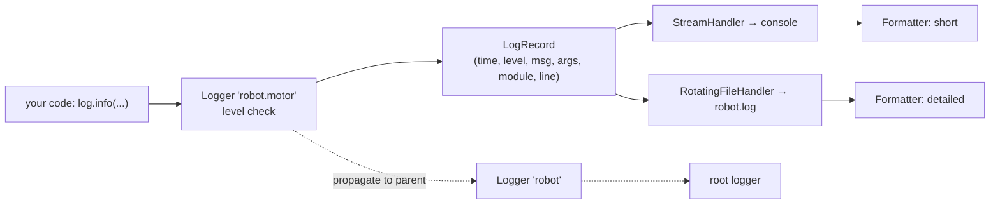

# Logging

`print` is fine for a 20-line script. Real programs (servers, data pipelines, robot control stacks) need to record what happened **with timestamps, severity levels and source**, be quieter in production and verbose while debugging, and send messages to files, the console or a central log server. That is the job of the standard `logging` module. Python libraries you use (requests, urllib3, asyncio, PyTorch Lightning) all log through it, so understanding it also lets you see what they're doing.

## 1. Why not print?

| `print` | `logging` |
|---|---|
| always on; remove by editing code | switch levels on/off by configuration |
| no timestamp, level or source | format includes time, level, module, line |
| goes to stdout only | console, files, rotating files, syslog, network |
| mixes with program output | separate stream (stderr by default) |
| no context per module | hierarchical named loggers |

## 2. Levels

| Level | Value | Use for |
|---|---|---|
| `DEBUG` | 10 | detailed diagnostic information for developers |
| `INFO` | 20 | confirmation that things work as expected ("connected to arm") |
| `WARNING` | 30 | something unexpected, but the program continues (the **default threshold**) |
| `ERROR` | 40 | an operation failed |
| `CRITICAL` | 50 | the program may not be able to continue |

A logger only emits records **at or above** its effective level. With the default `WARNING`, `info()` and `debug()` calls produce nothing.

## 3. The standard pattern

```python
import logging

log = logging.getLogger(__name__)      # one logger per module, named after the module

def connect(port):
    log.info("connecting on port %d", port)       # lazy %-formatting: see below
    try:
        ...
    except OSError:
        log.exception("connection failed")        # ERROR level + full traceback
        raise

if __name__ == "__main__":
    logging.basicConfig(
        level=logging.INFO,
        format="%(asctime)s %(levelname)-8s %(name)s: %(message)s",
    )
    connect(8080)
```

```output
2026-10-24 14:02:11,532 INFO     __main__: connecting on port 8080
```

> [!KEY]
> - **Libraries** get a logger with `logging.getLogger(__name__)` and just call it. They never configure handlers.
> - **The application entry point** configures logging **once** (`basicConfig` or `dictConfig`).
> - Pass arguments separately, `log.info("x=%s", x)`, instead of f-strings. Formatting then happens only if the record is actually emitted, and log aggregators can group messages by template.

## 4. The architecture: loggers, handlers, formatters



- **Logger**: what your code calls. Loggers form a tree by dotted names: `robot.motor` is a child of `robot`, which is a child of the root logger.
- **Handler**: where records go (console, file, network). Each handler has its own level.
- **Formatter**: how a record is turned into text.
- **Propagation**: after its own handlers, a logger passes the record up to its parent's handlers. Usually only the root logger has handlers, and the rest propagate to it.

```python
import logging, logging.handlers

root = logging.getLogger()
root.setLevel(logging.DEBUG)

console = logging.StreamHandler()
console.setLevel(logging.INFO)
console.setFormatter(logging.Formatter("%(levelname)s %(name)s: %(message)s"))

file = logging.handlers.RotatingFileHandler("robot.log", maxBytes=1_000_000, backupCount=3)
file.setLevel(logging.DEBUG)
file.setFormatter(logging.Formatter("%(asctime)s %(name)s:%(lineno)d %(levelname)s %(message)s"))

root.addHandler(console)
root.addHandler(file)

logging.getLogger("urllib3").setLevel(logging.WARNING)   # silence a chatty library
```

Now the console shows INFO and up, while the file keeps everything including DEBUG, rotating at 1 MB with 3 backups.

## 5. Useful format fields

| Field | Meaning |
|---|---|
| `%(asctime)s` | timestamp |
| `%(levelname)s` | DEBUG, INFO… |
| `%(name)s` | logger name (the module) |
| `%(message)s` | the formatted message |
| `%(filename)s:%(lineno)d` | source location |
| `%(funcName)s` | function name |
| `%(threadName)s` / `%(process)d` | concurrency debugging |

## 6. Logging exceptions

```python
try:
    risky()
except ValueError:
    log.exception("risky failed")          # inside except: ERROR + traceback
    # or: log.error("risky failed", exc_info=True)
```

> [!DANGER]
> Common mistakes:
> - Calling `logging.info(...)` (the module-level functions) in library code. They use the root logger and may auto-configure it. Use `getLogger(__name__)`.
> - Calling `basicConfig` in a library, or calling it twice. Only the first call takes effect unless you pass `force=True`.
> - Logging secrets (passwords, tokens) or huge objects at INFO level.
> - Using `log.error(e)` and losing the traceback. Use `log.exception`.

## 7. Structured logging (production)

Large systems ship logs to tools like ELK, Loki or Datadog, which search JSON records. You can attach extra fields with `log.info("moved", extra={"robot_id": 7})` and use a JSON formatter (e.g. the `python-json-logger` package or a small custom `Formatter.format`). ROS 2's `rclpy` loggers follow the same level model.

## 8. Exam-ready answers

> [!EXAM]
> **The logging module.** Python's `logging` module provides a flexible event-logging system. Code obtains named loggers with `logging.getLogger(name)`, conventionally `__name__`, and records messages at severity levels DEBUG, INFO, WARNING, ERROR and CRITICAL. A logger emits a record only if its level is at or above the logger's effective level. Records are passed to handlers, which send them to destinations such as the console, files or the network, each with its own level and a formatter that controls the output text. Loggers are arranged hierarchically by dotted names and propagate records to their ancestors. Libraries should only create and use loggers, while applications configure handlers once at start-up.

## 9. Cheat sheet

| Need | Code |
|---|---|
| module logger | `log = logging.getLogger(__name__)` |
| quick setup | `logging.basicConfig(level=logging.INFO, format=...)` |
| message with data | `log.info("speed=%.2f", v)` |
| error with traceback | `log.exception("failed")` |
| quieter library | `logging.getLogger("lib").setLevel(logging.WARNING)` |
| log to a file | `logging.FileHandler("app.log")` / `RotatingFileHandler` |
| reconfigure | `basicConfig(..., force=True)` |

> [!INTERVIEW]
> **"Your service logs too much in production but you need DEBUG detail when something breaks. What do you do?"** Set the root level to INFO (or WARNING) in production configuration, keep DEBUG calls in the code (they're cheap when disabled because arguments are formatted lazily), and enable DEBUG for one subsystem at a time (`logging.getLogger("robot.nav").setLevel(logging.DEBUG)`), ideally via config or an environment variable, without redeploying code. Mention rotating file handlers and structured JSON logs for aggregation.
