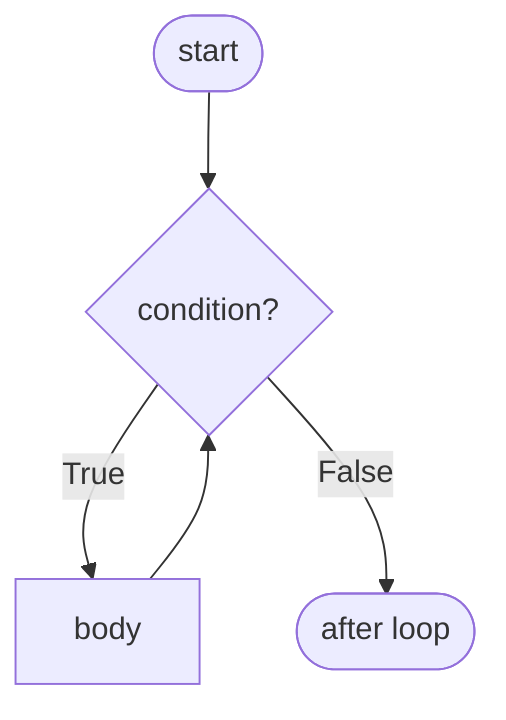

# Loops: while and for

Loops repeat work, and almost every algorithm is a loop around a small idea. Python has two loops: **`while`**, which repeats as long as a condition is true, and **`for`**, which visits each item of an iterable. It also has two tools that C programmers don't expect: `range()` instead of the three-part C `for`, and an **`else` clause on loops**. This lesson covers the syntax exactly, then the loop patterns you'll reuse in every DSA problem.

## 1. The `while` loop

> [!SYNTAX]
> ```python
> while condition:
>     body
> else:              # optional: runs if the loop ended WITHOUT break
>     after_body
> ```

The condition is checked **before** each iteration. If it's false at the start, the body never runs.

```python
n = 5
while n > 0:
    print(n, end=" ")
    n -= 1          # make progress toward stopping!
print("liftoff")
```

```output
5 4 3 2 1 liftoff
```



Use `while` when you **don't know the number of iterations in advance**: reading until a sentinel, repeating until convergence, game loops, or the digit loop `while n > 0: n //= 10`.

> [!DANGER]
> If nothing in the body moves the condition toward `False`, the loop never ends. An **infinite loop** with no output looks like a hang (or TLE in a judge). Always ask: *what changes each iteration, and why must it eventually stop?*

### `while True` with `break`

When the exit test naturally sits in the middle of the body, loop forever and `break` out:

```python
while True:
    line = input()
    if line == "quit":
        break
    print("echo:", line)
```

Python has no `do … while`. `while True: …; if not cond: break` is the idiom, and it guarantees at least one iteration.

## 2. The `for` loop

> [!SYNTAX]
> ```python
> for target in iterable:
>     body
> else:              # optional: runs if the loop ended WITHOUT break
>     after_body
> ```

Python's `for` is a **for-each**. It takes the next item from any iterable (list, string, tuple, dict, set, file, range, generator…) and binds it to `target`:

```python
for ch in "abc":
    print(ch)

for name in ["Ada", "Linus"]:
    print("Hello", name)
```

There is no index unless you ask for one. This is the biggest difference from C's `for (int i = 0; i < n; i++)`.

## 3. `range()`: counting loops

> [!SYNTAX]
> `range(stop)` · `range(start, stop)` · `range(start, stop, step)`
>
> Produces `start, start+step, …` up to but **not including** `stop`. Defaults: `start=0`, `step=1`.

| Call | Values |
|---|---|
| `range(5)` | 0 1 2 3 4 |
| `range(2, 8)` | 2 3 4 5 6 7 |
| `range(10, 0, -3)` | 10 7 4 1 |
| `range(5, 2)` | (nothing; empty) |
| `range(n - 1, -1, -1)` | n−1 down to 0 |

```python
for i in range(1, 11):        # 1..10 inclusive
    print(i * i, end=" ")
```

> [!KEY]
> `range` is **lazy**: it doesn't build a list. `range(10**12)` uses almost no memory, and `len`, indexing and `in` are O(1) on it. Write `list(range(5))` to see the values.

| C | Python |
|---|---|
| `for (i = 0; i < n; i++)` | `for i in range(n):` |
| `for (i = a; i <= b; i++)` | `for i in range(a, b + 1):` |
| `for (i = n-1; i >= 0; i--)` | `for i in range(n - 1, -1, -1):` or `reversed(range(n))` |
| `for (i = 0; i < n; i += 2)` | `for i in range(0, n, 2):` |

The exclusive `stop` means `range(a, b)` has exactly `b - a` elements, and consecutive ranges `range(0, k)` and `range(k, n)` join with no overlap and no gap. That's why Python chose half-open intervals, and slicing uses the same convention.

## 4. `enumerate` and `zip`: the idiomatic way to get indices and pairs

```python
# need the index too?  NOT: for i in range(len(names)): name = names[i]
names = ["Ada", "Linus", "Grace"]
for i, name in enumerate(names, start=1):
    print(i, name)
```

```output
1 Ada
2 Linus
3 Grace
```

```python
# walk two sequences in parallel
scores = [90, 72, 85]
for name, score in zip(names, scores):
    print(f"{name}: {score}")
```

`zip` stops at the **shortest** input. Use `zip(a, b, strict=True)` (Python 3.10+) to raise an error when the lengths differ.

## 5. `break`, `continue` and `pass`

| Statement | Effect |
|---|---|
| `break` | leave the **innermost** loop immediately |
| `continue` | skip the rest of this iteration; go to the next one |
| `pass` | do nothing (a placeholder) |

```python
for n in range(1, 20):
    if n % 2 == 0:
        continue        # skip evens
    if n > 9:
        break           # stop entirely
    print(n, end=" ")   # 1 3 5 7 9
```

## 6. The loop `else` clause

A loop's `else` block runs **only if the loop finished normally**, meaning it was not ended by `break`. Read it as "no break". It's built for **search** loops:

```python
nums = [3, 5, 7]
for n in nums:
    if n % 2 == 0:
        print("found even:", n)
        break
else:
    print("no even number")    # runs: the loop never hit break
```

Without `else` you'd need a `found = False` flag. The prime test is the textbook example:

```python
n = 29
for d in range(2, int(n ** 0.5) + 1):
    if n % d == 0:
        print(n, "is composite")
        break
else:
    print(n, "is prime")
```

> [!WARNING]
> `else` on a `while` loop works the same way: it runs when the condition becomes false, but not after a `break`. Many developers find it confusing, so add a short comment like `# no break` when you use it.

## 7. Nested loops

The inner loop runs **completely** for each iteration of the outer loop, so the total work multiplies:

```python
for i in range(1, 4):
    for j in range(1, 4):
        print(i * j, end=" ")
    print()
```

```output
1 2 3
2 4 6
3 6 9
```

Two nested loops over `n` items each is **O(n²)**: 10⁴ items means 10⁸ steps, too slow in Python. You'll learn to spot and remove nested loops in the DSA module.

`break` only exits the **inner** loop. To exit both, put the loops in a function and `return`, or use a flag.

## 8. Essential loop patterns

```python
nums = [4, -2, 9, 0, 9, -7]

# accumulate
total = 0
for x in nums:
    total += x

# count matches
negatives = 0
for x in nums:
    if x < 0:
        negatives += 1

# track the maximum (and where it was)
best, best_i = nums[0], 0
for i, x in enumerate(nums):
    if x > best:
        best, best_i = x, i      # strict > keeps the FIRST maximum

# build a new list
squares = []
for x in nums:
    squares.append(x * x)

# linear search
target, pos = 0, -1
for i, x in enumerate(nums):
    if x == target:
        pos = i
        break
```

Most have built-in shortcuts: `sum(nums)`, `max(nums)`, `nums.index(0)`, `[x*x for x in nums]`. Write the loops by hand now so you understand what those shortcuts do and can write them in C.

## 9. Classic loop bugs

**Off-by-one errors**: is the end inclusive or exclusive? `range(1, n)` stops at `n - 1`. Test the smallest inputs: `n = 0`, `1` and `2`.

**Modifying a list while iterating over it** skips elements:

```python
nums = [2, 4, 6, 7]
for x in nums:
    if x % 2 == 0:
        nums.remove(x)      # shifts later items left; the loop's index skips one
print(nums)                 # [4, 7]: 4 survived!
```

Iterate over a copy (`for x in nums[:]`), or better, build a new list: `nums = [x for x in nums if x % 2 != 0]`.

**Rebinding the loop variable doesn't change the list**:

```python
nums = [1, 2, 3]
for x in nums:
    x *= 10          # rebinds the name x only
print(nums)          # [1, 2, 3]
for i in range(len(nums)):
    nums[i] *= 10    # modifies the list itself
```

**The loop variable survives the loop**: after `for i in range(3): pass`, `i` is `2`. (After an empty loop it was never assigned, and using it raises `NameError`.)

## 10. Exam-ready answers

> [!EXAM]
> **`for` vs `while`.** A `while` loop repeatedly executes its body as long as its condition is true; it is used when the number of iterations is not known in advance. A `for` loop iterates over the items of an iterable such as a list, string or `range`, binding each item in turn to the loop variable; it is used for definite iteration. Python's `for` is a for-each loop, and counting loops are written with `range(start, stop, step)`, which yields values up to but excluding `stop`.

> [!EXAM]
> **`break`, `continue` and loop `else`.** `break` terminates the innermost enclosing loop immediately. `continue` skips the remainder of the current iteration and proceeds with the next one. A loop may have an `else` clause, which executes when the loop terminates normally (the iterable is exhausted or the `while` condition becomes false) but not when it is exited by `break`. This is useful for search loops, such as reporting that a number is prime when no divisor was found.

## 11. Cheat sheet

| Need | Code |
|---|---|
| repeat n times | `for _ in range(n):` |
| 1..n inclusive | `range(1, n + 1)` |
| countdown | `range(n, 0, -1)` |
| index + value | `for i, x in enumerate(seq):` |
| two lists together | `for a, b in zip(xs, ys):` |
| reverse | `for x in reversed(seq):` |
| loop until condition | `while not done:` |
| exit test mid-body | `while True: … if cond: break` |
| "not found" branch | `for … : … break` + `else:` |
| filter safely | `[x for x in xs if keep(x)]` |

> [!INTERVIEW]
> **"What's the output, and why?"** `for i in range(3): print(i); i = 10`. It prints `0 1 2`. Assigning to `i` inside the body doesn't affect the iteration, because `for` takes the next value from the `range` iterator each time and rebinds `i`. In C, changing `i` inside a `for` *does* change the loop.
