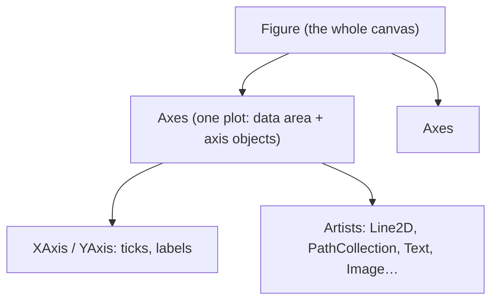

# Data Visualization with Matplotlib

Plots are how you debug algorithms and communicate results. A trajectory overlay reveals a drifting estimator instantly, a histogram exposes sensor noise, a heat map shows where the planner wastes time. Matplotlib is Python's foundational plotting library: pandas, seaborn and many robotics tools build on it. This lesson teaches the **object-oriented Figure/Axes model** (the right way to write plotting code), the essential plot types, layout with subplots, styling for reports and papers, and saving figures programmatically, including headless servers and CI where no display exists.

## 1. Figure and Axes: the mental model



```python
import matplotlib
matplotlib.use("Agg")                        # headless backend: render to files (servers, CI, judges)
import matplotlib.pyplot as plt
import numpy as np

t = np.linspace(0, 2 * np.pi, 200)
fig, ax = plt.subplots(figsize=(6, 3.5))     # a Figure with one Axes
ax.plot(t, np.sin(t), label="sin")
ax.plot(t, np.cos(t), linestyle="--", label="cos")
ax.set(xlabel="time [s]", ylabel="amplitude", title="Signals")
ax.legend()
ax.grid(alpha=0.3)
fig.tight_layout()
fig.savefig("signals.png", dpi=150)
plt.close(fig)                               # free memory when making many figures
```

> [!KEY]
> Prefer the **object-oriented API** (`fig, ax = plt.subplots()`, then `ax.plot`, `ax.set_xlabel`) over the implicit `plt.plot` state machine. It's explicit about which axes you're drawing on, and it scales to multi-panel figures and to functions that receive an `ax` argument.

## 2. Essential plot types

| Data question | Method |
|---|---|
| trend over time / x | `ax.plot(x, y)` |
| relationship between two variables | `ax.scatter(x, y, c=z, s=size)` |
| distribution | `ax.hist(data, bins=50)`, `ax.boxplot`, `ax.violinplot` |
| category comparison | `ax.bar(names, values)`, `ax.barh` |
| 2-D field / image / grid map | `ax.imshow(arr, origin="lower", cmap="viridis")` + `fig.colorbar` |
| contour of f(x, y) | `ax.contourf(X, Y, Z, levels=20)` |
| vector field | `ax.quiver(X, Y, U, V)` |
| uncertainty band | `ax.fill_between(x, lo, hi, alpha=0.3)` |
| error bars | `ax.errorbar(x, y, yerr=e)` |

```python
rng = np.random.default_rng(0)
fig, axs = plt.subplots(2, 2, figsize=(8, 6), constrained_layout=True)
axs[0, 0].scatter(rng.normal(size=200), rng.normal(size=200), s=8, alpha=0.6)
axs[0, 1].hist(rng.normal(0, 0.05, 1000), bins=40, color="tab:orange")
im = axs[1, 0].imshow(rng.random((50, 50)), origin="lower", cmap="magma")
fig.colorbar(im, ax=axs[1, 0], label="occupancy")
x = np.linspace(0, 10, 50); y = np.sin(x); e = 0.2 + 0.1 * rng.random(50)
axs[1, 1].plot(x, y); axs[1, 1].fill_between(x, y - e, y + e, alpha=0.3)
fig.savefig("panel.png", dpi=120)
```

## 3. Robotics plots

```python
def plot_trajectory(ax, xy_true, xy_est, landmarks=None):
    ax.plot(*xy_true.T, "k-", lw=1.5, label="ground truth")
    ax.plot(*xy_est.T, "r--", lw=1.2, label="estimate")
    if landmarks is not None:
        ax.scatter(*landmarks.T, marker="^", c="tab:green", label="landmarks")
    ax.set_aspect("equal")                    # metres in x and y must look the same
    ax.set(xlabel="x [m]", ylabel="y [m]")
    ax.legend(loc="best")
```

- `ax.set_aspect("equal")` is essential for maps and trajectories: without it, circles look like ellipses.
- Use `origin="lower"` with `imshow` when row 0 is the bottom of the map (world coordinates), and `extent=[xmin, xmax, ymin, ymax]` to label the axes in metres.

## 4. Styling for reports and papers

```python
plt.rcParams.update({"font.size": 10, "axes.spines.top": False, "axes.spines.right": False})
with plt.style.context("seaborn-v0_8-whitegrid"):
    fig, ax = plt.subplots()
```

- Label every axis **with units**, and don't let the legend cover the data.
- Use perceptually uniform colormaps (`viridis`, `cividis`, `magma`) and avoid `jet`. Diverging maps (`coolwarm`) suit signed data.
- Vector output (`.pdf`, `.svg`) for papers, PNG at 150–300 dpi for slides.
- `fig.savefig(path, bbox_inches="tight")` trims margins.
- Log scales (`ax.set_yscale("log")`) for errors spanning orders of magnitude.

## 5. Inspecting figures programmatically

Figures are object trees, so tests can verify a plot without looking at it:

```python
fig, ax = plt.subplots()
line, = ax.plot([0, 1, 2], [3, 1, 2], label="err")
assert ax.get_xlabel() == "" and line.get_label() == "err"
np.asarray(line.get_ydata())            # array([3, 1, 2])
fig.canvas.draw()
rgba = np.asarray(fig.canvas.buffer_rgba())   # the rendered pixels (H, W, 4) as an array
```

This is how plotting code gets unit-tested in CI, and how this platform's judge can check a figure you build.

## 6. Exam-ready answers

> [!EXAM]
> **Matplotlib's object model.** In Matplotlib, a Figure is the top-level container representing the whole image, and it holds one or more Axes, each of which is a plotting region with its own x and y Axis objects, data limits and artists such as lines, collections, images and text. The object-oriented interface creates them explicitly, for example with `fig, ax = plt.subplots()`, and calls methods on specific axes, which makes multi-panel figures and reusable plotting functions reliable; the pyplot state-machine interface implicitly targets the current figure and axes. Backends determine rendering: interactive backends draw to windows, while non-interactive ones such as Agg render to files, which is required on headless systems.

## 7. Cheat sheet

| Need | Code |
|---|---|
| figure + axes | `fig, ax = plt.subplots(figsize=(w, h))` |
| grid of plots | `plt.subplots(r, c, constrained_layout=True)` |
| line / scatter | `ax.plot(x, y)`, `ax.scatter(x, y, c=z)` |
| histogram | `ax.hist(d, bins=50)` |
| image / grid map | `ax.imshow(a, origin="lower", extent=...)` + `fig.colorbar` |
| labels | `ax.set(xlabel=, ylabel=, title=)` |
| equal metres | `ax.set_aspect("equal")` |
| save headless | `matplotlib.use("Agg")`; `fig.savefig(p, dpi=150)` |
| free memory | `plt.close(fig)` |

> [!INTERVIEW]
> **"Your script generates 10 000 plots in a loop and runs out of memory. Why?"** Pyplot keeps a reference to every figure it creates until it's closed, so figures accumulate. Call `plt.close(fig)` after `savefig`, or create figures with `matplotlib.figure.Figure()` directly (not tracked by pyplot). On a server, also use the Agg backend, so no GUI resources are allocated.
