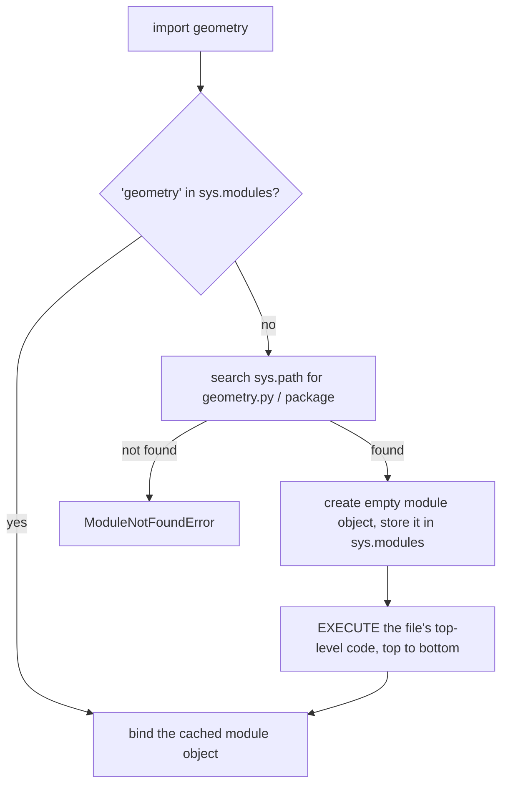

# Modules and Imports

As soon as a program grows past a few hundred lines, it must be split into files. In Python every `.py` file is a **module**, and `import` connects them. This is the mechanical foundation of everything in the Master OOP module: putting each class or concept in its own file and wiring files together without circular-import tangles. Knowing exactly what `import` does at run time removes the mystery from errors like `ModuleNotFoundError`, `ImportError: cannot import name`, and "partially initialized module".

## 1. A module is a file, and a namespace

```python
# geometry.py
PI = 3.14159

def area(r):
    return PI * r * r
```

```python
# main.py
import geometry
print(geometry.area(2))        # 12.56636
print(geometry.PI)
```

Every module has its own **global namespace**. `PI` inside `geometry.py` doesn't clash with a `PI` in `main.py`. You reach it through the module object, `geometry.PI`.

## 2. The forms of import

| Statement | Binds in your namespace | Use |
|---|---|---|
| `import geometry` | `geometry` (the module) | the default: clear where names come from |
| `import numpy as np` | `np` | conventional aliases |
| `from geometry import area, PI` | `area`, `PI` | a few frequently used names |
| `from geometry import area as a` | `a` | resolve name clashes |
| `from geometry import *` | every public name | **avoid** (pollutes the namespace, hides origins) |

> [!WARNING]
> `from module import name` copies the **binding at import time**. If `module.name` is later rebound, your name still points at the old object. `import module` + `module.name` always sees the current value. Use the module form for mutable module-level state and configuration.

## 3. What `import` actually does



> [!KEY]
> 1. A module's code runs **only once**, on the first import. Later imports reuse the cached object in `sys.modules`, so importing in ten files doesn't execute the file ten times.
> 2. Importing **executes** the file. Any top-level `print`, file access or heavy computation happens at import time. Keep top-level code to definitions, constants and imports.

### The search path: `sys.path`

Python looks for modules in the directories listed in `sys.path`, in order:

1. the directory of the script being run (or the current directory for `-m` and the REPL)
2. directories in the `PYTHONPATH` environment variable
3. the standard library
4. `site-packages` (third-party packages installed with pip/uv)

> [!DANGER]
> **Shadowing**: naming your own file `random.py`, `json.py`, `math.py` or `test.py` puts it ahead of the standard library on `sys.path`. `import random` then imports *your* file, and you get baffling errors like `module 'random' has no attribute 'randint'`. Never name files after standard or installed modules.

## 4. `if __name__ == "__main__":`

Each module has a `__name__` attribute. When a file is **run directly**, its `__name__` is `"__main__"`. When it's **imported**, `__name__` is the module name (`"geometry"`).

```python
# geometry.py
def area(r):
    return 3.14159 * r * r

def _self_test():
    assert round(area(1), 2) == 3.14
    print("ok")

if __name__ == "__main__":     # only when run as a script, not on import
    _self_test()
```

This lets one file be both an importable module and a runnable script, and it stops demo code from running when someone imports your module. Running `python3 -m package.module` also sets `__name__ == "__main__"`.

## 5. Circular imports

```python
# a.py
import b
x = 1

# b.py
import a
print(a.x)       # AttributeError: partially initialized module 'a' has no attribute 'x'
```

Running `import a`: Python creates module `a` in `sys.modules` and starts executing it. Line 1 imports `b`, which runs `import a`, and gets the **half-finished** `a` from the cache, where `x` doesn't exist yet.

How to fix circular imports (in order of preference):

1. **Restructure**: move the shared code into a third module both can import (dependencies should form a tree or DAG).
2. Import the module, not names (`import a`, then use `a.x` inside functions, after both modules have loaded).
3. Import inside the function that needs it (a local, deferred import).
4. For type hints only: `from typing import TYPE_CHECKING; if TYPE_CHECKING: import a` (with 3.14's lazy annotations this needs no quotes).

> [!TIP]
> A circular import is usually a **design smell**: two modules that each need the other are really one concept, or a third concept is hiding inside them. The Master OOP module returns to dependency direction in detail.

## 6. Inspecting modules

```python
import geometry
print(geometry.__name__, geometry.__file__)
print(dir(geometry))                 # names defined in the module
import sys
print("geometry" in sys.modules)
import importlib
importlib.reload(geometry)           # re-execute (useful in a REPL or notebook)
```

Names starting with an underscore (`_helper`) are **private by convention**. `from m import *` skips them, and readers know not to depend on them. A module can define `__all__ = ["area", "PI"]` to list exactly what `import *` exports.

## 7. Exam-ready answers

> [!EXAM]
> **Modules and the import system.** A module is a file containing Python definitions and statements; its name is the file name without `.py`, and it provides its own global namespace. The `import` statement finds the module by searching the directories in `sys.path`, creates a module object, registers it in `sys.modules`, executes its top-level code once, and binds a name to it. Subsequent imports return the cached module. `import m` binds the module, while `from m import x` binds selected names directly. The variable `__name__` equals `"__main__"` when a module is run as a script, so code guarded by `if __name__ == "__main__":` runs only in that case.

> [!EXAM]
> **Circular imports.** A circular import occurs when two modules import each other. Because a module is registered in `sys.modules` before its code finishes executing, the second module receives a partially initialised module object, and accessing names not yet defined raises `AttributeError` or `ImportError`. It is resolved by restructuring shared code into a separate module, deferring imports into functions, or importing the module rather than individual names.

## 8. Cheat sheet

| Need | Code |
|---|---|
| import a module | `import m` |
| alias | `import numpy as np` |
| specific names | `from m import f, g` |
| script entry | `if __name__ == "__main__": main()` |
| where Python looks | `import sys; print(sys.path)` |
| is it loaded? | `"m" in sys.modules` |
| re-run a module | `importlib.reload(m)` |
| public API list | `__all__ = [...]` |
| private by convention | `_name` |

> [!INTERVIEW]
> **"If ten modules all `import config`, how many times does config.py run?"** Once. After the first import the module object is cached in `sys.modules`, and every later import binds the same object. That's why a module is a natural **singleton**: module-level state is shared across the whole program (which is both handy and a source of hidden coupling).
