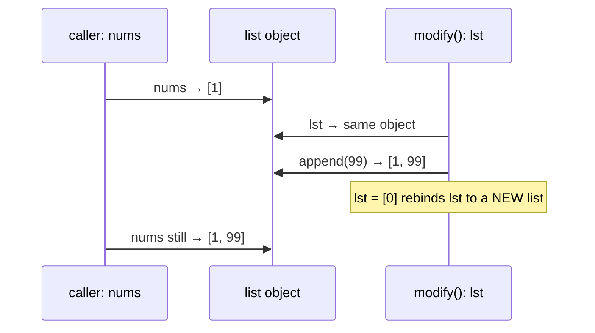

# Mutability and Copying

You've met the pieces separately: names are references, some objects are mutable, and assignment never copies. This lesson puts them together into the rules that matter in real programs. How do function arguments really work? What exactly does a copy copy? And why does Python's most famous gotcha, the **mutable default argument**, behave the way it does? Get this right and a whole class of "my data changed by itself" bugs disappears.

## 1. Recap: three operations, three outcomes

| Code | What happens | Effect on other names |
|---|---|---|
| `b = a` | `b` refers to the **same object** | sees every mutation |
| `b = a.copy()` | `b` refers to a **new outer object** whose elements are the **same objects** | sees mutations of shared *inner* objects only |
| `b = copy.deepcopy(a)` | `b` refers to a **fully independent** clone | sees nothing |

## 2. Shallow copy

A shallow copy creates a new container and fills it with **references to the same elements**.

Ways to shallow-copy:

| Type | Shallow copy |
|---|---|
| list | `a.copy()`, `a[:]`, `list(a)`, `[*a]` |
| dict | `d.copy()`, `dict(d)`, `{**d}` |
| set | `s.copy()`, `set(s)` |
| any | `copy.copy(obj)` |

```python
a = [[1, 2], [3, 4]]
b = a.copy()
b.append([5])        # changes only b's outer list
b[0].append(9)       # mutates an INNER list shared by both
print(a)             # [[1, 2, 9], [3, 4]]
print(b)             # [[1, 2, 9], [3, 4], [5]]
```

<div class="figure">
<svg viewBox="0 0 640 230" width="640" xmlns="http://www.w3.org/2000/svg" font-family="ui-monospace, monospace" font-size="13">
  <defs><marker id="ma" markerWidth="8" markerHeight="8" refX="7" refY="4" orient="auto"><path d="M0,0 L8,4 L0,8 z" fill="currentColor"/></marker></defs>
  <text x="20" y="20" fill="currentColor" font-family="sans-serif" font-size="13" font-weight="bold">Shallow: b = a.copy()</text>
  <rect x="20" y="40" width="40" height="28" rx="4" fill="none" stroke="#2f81f7" stroke-width="2"/><text x="35" y="59" fill="currentColor">a</text>
  <rect x="20" y="140" width="40" height="28" rx="4" fill="none" stroke="#2f81f7" stroke-width="2"/><text x="35" y="159" fill="currentColor">b</text>
  <rect x="100" y="36" width="90" height="36" rx="4" fill="none" stroke="currentColor"/><text x="110" y="59" fill="currentColor">outer A</text>
  <rect x="100" y="136" width="90" height="36" rx="4" fill="none" stroke="currentColor"/><text x="110" y="159" fill="currentColor">outer B</text>
  <rect x="240" y="60" width="90" height="30" rx="4" fill="none" stroke="#3fb950" stroke-width="2"/><text x="248" y="80" fill="currentColor">[1,2,9]</text>
  <rect x="240" y="115" width="90" height="30" rx="4" fill="none" stroke="#3fb950" stroke-width="2"/><text x="252" y="135" fill="currentColor">[3,4]</text>
  <line x1="60" y1="54" x2="96" y2="54" stroke="currentColor" marker-end="url(#ma)"/><line x1="60" y1="154" x2="96" y2="154" stroke="currentColor" marker-end="url(#ma)"/>
  <line x1="190" y1="50" x2="236" y2="72" stroke="currentColor" marker-end="url(#ma)"/><line x1="190" y1="62" x2="236" y2="125" stroke="currentColor" marker-end="url(#ma)"/>
  <line x1="190" y1="148" x2="236" y2="80" stroke="currentColor" marker-end="url(#ma)"/><line x1="190" y1="160" x2="236" y2="132" stroke="currentColor" marker-end="url(#ma)"/>
  <text x="360" y="20" fill="currentColor" font-family="sans-serif" font-size="13" font-weight="bold">Deep: c = copy.deepcopy(a)</text>
  <rect x="360" y="40" width="90" height="36" rx="4" fill="none" stroke="currentColor"/><text x="370" y="63" fill="currentColor">outer A</text>
  <rect x="360" y="140" width="90" height="36" rx="4" fill="none" stroke="currentColor"/><text x="370" y="163" fill="currentColor">outer C</text>
  <rect x="500" y="30" width="80" height="26" rx="4" fill="none" stroke="#3fb950" stroke-width="2"/><text x="508" y="48" fill="currentColor">[1,2]</text>
  <rect x="500" y="64" width="80" height="26" rx="4" fill="none" stroke="#3fb950" stroke-width="2"/><text x="508" y="82" fill="currentColor">[3,4]</text>
  <rect x="500" y="130" width="80" height="26" rx="4" fill="none" stroke="#d29922" stroke-width="2"/><text x="508" y="148" fill="currentColor">[1,2]</text>
  <rect x="500" y="164" width="80" height="26" rx="4" fill="none" stroke="#d29922" stroke-width="2"/><text x="508" y="182" fill="currentColor">[3,4]</text>
  <line x1="450" y1="52" x2="496" y2="44" stroke="currentColor" marker-end="url(#ma)"/><line x1="450" y1="64" x2="496" y2="76" stroke="currentColor" marker-end="url(#ma)"/>
  <line x1="450" y1="152" x2="496" y2="143" stroke="currentColor" marker-end="url(#ma)"/><line x1="450" y1="164" x2="496" y2="176" stroke="currentColor" marker-end="url(#ma)"/>
  <text x="20" y="215" fill="currentColor" fill-opacity=".7" font-family="sans-serif" font-size="12">Shallow copies share inner objects; deep copies clone everything recursively.</text>
</svg>
<figcaption>After a shallow copy, mutating <code>b[0]</code> changes <code>a[0]</code>, because it's the same list.</figcaption>
</div>

> [!KEY]
> A shallow copy is enough when the elements are **immutable** (numbers, strings, tuples of immutables). `[1, 2, 3].copy()` is effectively independent, because nobody can mutate an int. You need a deep copy only when the elements are themselves mutable and you plan to mutate them.

## 3. Deep copy

`copy.deepcopy(obj)` recursively copies every mutable object reachable from `obj`:

```python
import copy
a = [[1, 2], [3, 4]]
c = copy.deepcopy(a)
c[0].append(7)
print(a)   # [[1, 2], [3, 4]]: untouched
print(c)   # [[1, 2, 7], [3, 4]]
```

Details worth knowing:

- Immutable atoms (ints, strings) aren't copied. Sharing them is safe, so `deepcopy("abc") is "abc"`.
- It handles **shared references and cycles** using a memo dictionary: an object referenced twice is copied once, and a list that contains itself is copied without infinite recursion.
- It's **slow** compared to a shallow copy (it walks the whole structure). Don't deepcopy in hot loops.
- Classes can customise it with `__copy__` and `__deepcopy__`.

```python
x = [1]
x.append(x)               # a list that contains itself
y = copy.deepcopy(x)
print(y[1] is y)          # True: the cycle is reproduced, not infinite
```

## 4. How function arguments work: pass by object reference

Python is neither "pass by value" nor "pass by reference" in the C++ sense. The parameter name is **bound to the same object** the caller passed. Call it *pass by assignment* or *pass by object reference*. So:

- **Mutating** the object inside the function is visible to the caller.
- **Rebinding** the parameter inside the function is not.

```python
def modify(lst):
    lst.append(99)     # mutation: the caller sees it
    lst = [0]          # rebinding: only the local name changes
    return lst

nums = [1]
result = modify(nums)
print(nums, result)    # [1, 99] [0]
```



With an immutable argument (int, str, tuple), the function can't affect the caller at all, because every "change" is a rebinding.

> [!TIP]
> If a function should not modify its input, either copy it first (`items = list(items)`) or document that it mutates. Functions that both mutate *and* return the same object confuse readers. The standard library convention is that in-place methods return `None` (`list.sort()`).

## 5. The mutable default argument trap

```python
def add_item(item, bucket=[]):
    bucket.append(item)
    return bucket

print(add_item(1))
print(add_item(2))
```

```output
[1]
[1, 2]
```

**Why:** default values are evaluated **once, when the `def` statement runs**, not on each call. The same list object is stored in `add_item.__defaults__` and reused by every call that doesn't pass `bucket`:

```python
print(add_item.__defaults__)    # ([1, 2],): the default object has been mutated
```

**The fix, used everywhere:** default to `None` and create a fresh object inside.

```python
def add_item(item, bucket=None):
    if bucket is None:
        bucket = []
    bucket.append(item)
    return bucket
```

> [!DANGER]
> Never use a mutable object (`[]`, `{}`, `set()`, or an instance of your own class) as a default parameter value unless you deliberately want state shared between calls. Linters (ruff rule B006) flag it.

The same "evaluated once" rule explains why `def log(msg, when=datetime.now()):` stamps every call with the time the function was **defined**.

## 6. Mutability inside immutable containers, and hashing

```python
t = (1, [2, 3])
t[1].append(4)          # allowed: the list is mutable
# hash(t)               → TypeError: unhashable type: 'list'
```

A frozen container is only *deeply* immutable if everything inside it is immutable. Only then is it hashable and usable as a dict key.

## 7. Defensive copying in classes (preview)

When an object stores a list it received, the caller can still mutate it from outside:

```python
class Team:
    def __init__(self, members):
        self.members = list(members)    # defensive copy: our own list
    def get_members(self):
        return tuple(self.members)      # return an immutable view
```

You'll use this pattern in the OOP modules to protect an object's **invariants**.

## 8. Exam-ready answers

> [!EXAM]
> **Shallow vs deep copy.** A shallow copy creates a new compound object and inserts references to the objects found in the original, so nested mutable objects are shared between the copy and the original. A deep copy (`copy.deepcopy`) creates a new compound object and recursively copies the objects found in the original, producing a fully independent structure. Deep copying keeps a memo of already-copied objects to preserve shared references and handle recursive structures. Shallow copies are made with `copy.copy()`, slicing `[:]`, or `.copy()` methods.

> [!EXAM]
> **Parameter passing in Python.** Arguments are passed by object reference (also called pass-by-assignment): the parameter becomes a new name bound to the same object as the argument. If the object is mutable, changes made through the parameter, such as `lst.append(x)`, are visible to the caller. Rebinding the parameter (`lst = [...]`) only changes the local name and does not affect the caller. Immutable arguments therefore cannot be changed by the called function.

> [!EXAM]
> **Mutable default arguments.** Default parameter values are evaluated once, when the function definition is executed, and the same object is reused on every call. If that object is mutable and the function modifies it, the changes persist across calls. The idiom is to use `None` as the default and create a new object inside the function body.

## 9. Cheat sheet

| Need | Code |
|---|---|
| independent flat list | `b = a.copy()` |
| independent nested structure | `b = copy.deepcopy(a)` |
| don't mutate the caller's list | `items = list(items)` at the top of the function |
| optional list parameter | `def f(x, items=None): items = [] if items is None else items` |
| freeze for hashing | `tuple(lst)`, `frozenset(s)` |
| check aliasing | `a is b` |

> [!INTERVIEW]
> **"What does `[[]] * 3` give, and how is it different from `[[] for _ in range(3)]`?"** The first is a shallow repetition: three references to **one** empty list, so appending to one row appends to "all" of them. The second evaluates `[]` three times, giving three independent lists. Same root cause as shallow copies and mutable defaults: an object being shared by several references without you noticing.
