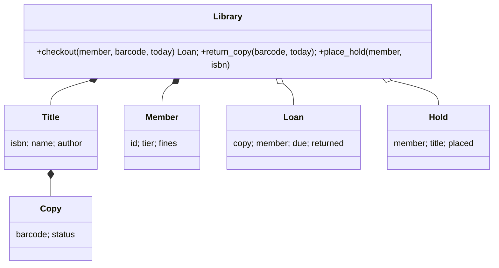

# Case Study: Library Management System

The library system is a classic object-oriented design exercise because it has **entities with lifecycles** (copies that are lent and returned), **business rules** (loan limits, due dates, fines, holds), **queues** (waiting lists) and **time**. This case study goes from requirements to a tested design, with an emphasis on putting each rule in the right object and making time injectable.

## 1. Requirements

- A **title** (ISBN, title, author) has one or more physical **copies**, each with a barcode.
- **Members** have a tier: `standard` borrows at most 3 items for 14 days, `premium` at most 10 for 28 days.
- **Checkout**: the member must be under their limit and have no unpaid fines of 5.00 or more, and the copy must be available. If the title has **holds**, only the first member in the queue may take a copy.
- **Return**: a late return accrues a fine of 0.25 per day late, capped at 10.00 per item. Returning a copy of a title with holds marks it "on hold shelf" for the next member in the queue.
- **Holds**: a FIFO queue per title. A member can't hold a title they currently have on loan.
- Queries: a member's loans, overdue loans as of a date, and a title's availability.

## 2. Model



| Object | Responsibility |
|---|---|
| `Tier` (enum or value) | loan limit and loan period |
| `Copy` | its status (available, on loan, on hold shelf) and valid transitions |
| `Member` | its loans and fines balance, `can_borrow()` |
| `Loan` | due date, `days_late(today)`, `fine(today)` |
| `Library` (aggregate root) | coordinates everything and keeps the indices (barcode → copy, isbn → holds deque) |

## 3. Key rules in code

```python
from dataclasses import dataclass, field
from datetime import date, timedelta
from decimal import Decimal
from enum import Enum

class Tier(Enum):
    STANDARD = (3, 14)
    PREMIUM = (10, 28)
    def __init__(self, limit, days): self.limit, self.days = limit, days

FINE_PER_DAY, FINE_CAP = Decimal("0.25"), Decimal("10.00")

@dataclass
class Loan:
    barcode: str
    member_id: str
    due: date
    returned: date | None = None

    def days_late(self, today: date) -> int:
        end = self.returned or today
        return max(0, (end - self.due).days)

    def fine(self, today: date) -> Decimal:
        return min(FINE_CAP, FINE_PER_DAY * self.days_late(today))
```

- **Money is `Decimal`.** `0.25 * 3` must be exactly `0.75`.
- **Time is a parameter** (`today`), never `date.today()` deep inside, so tests can simulate months instantly.
- **The aggregate root** (`Library`) is the only entry point that changes state, so invariants spanning several objects (a copy on loan if and only if there's an active loan for it) are maintained in one place.

## 4. Error handling

Define domain exceptions such as `LimitReached`, `FinesOutstanding`, `NotAvailable`, `ReservedForAnother`, `UnknownItem` and `AlreadyOnLoan`, all subclasses of `LibraryError`. Callers (a CLI, a web API) translate them into messages or HTTP status codes. The domain stays independent of the interface.

## 5. Testing scenarios

1. Borrow up to the limit, and the next checkout raises `LimitReached`.
2. A return 5 days late gives a fine of 1.25. A return 60 days late is capped at 10.00.
3. Holds: A borrows the last copy, B and C place holds, A returns. The copy goes to the hold shelf for B, C can't take it, and B can.
4. Fines of 5.00 or more block checkout until paid.

> [!EXAM]
> **Why should the `Library` act as the aggregate root, instead of letting callers modify `Copy` and `Member` objects directly?**
> Several business invariants span multiple objects. A copy is on loan if and only if an active loan references it, a member's loan count must respect their tier limit, and a copy returned while holds exist must be reserved for the first member in the queue. If callers could change a copy's status or a member's loan list directly, they could update one object and not the others, breaking these invariants. Routing every state change through the aggregate root's methods (`checkout`, `return_copy`, `place_hold`) keeps the rules in one place, makes them atomic from the caller's perspective, and keeps the model testable.

## Worked example: one borrowing rule, end to end

Take one rule from the requirements, "a member may hold at most 3 books, and can't borrow while they owe fines", and implement it where the data lives:

```python
from dataclasses import dataclass, field

class LibraryError(Exception): ...

@dataclass
class Member:
    name: str
    fines: int = 0
    loans: set[str] = field(default_factory=set)
    MAX_LOANS = 3                                    # class constant, not a dataclass field

    def can_borrow(self) -> bool:
        return self.fines == 0 and len(self.loans) < self.MAX_LOANS

@dataclass
class Library:
    copies: dict[str, int]                           # isbn -> available copies
    members: dict[str, Member] = field(default_factory=dict)

    def borrow(self, member_name: str, isbn: str) -> None:
        m = self.members[member_name]
        if not m.can_borrow():
            raise LibraryError(f"{m.name} cannot borrow (fines={m.fines}, loans={len(m.loans)})")
        if self.copies.get(isbn, 0) == 0:
            raise LibraryError(f"{isbn} unavailable")
        self.copies[isbn] -= 1
        m.loans.add(isbn)

lib = Library({"978-0": 1})
lib.members["asha"] = Member("asha")
lib.borrow("asha", "978-0")
try:
    lib.borrow("asha", "978-0")
except LibraryError as e:
    print("error:", e)
print(lib.copies, lib.members["asha"].loans)
```

```output
error: 978-0 unavailable
{'978-0': 0} {'978-0'}
```

**Check everything, then change anything.** The checks happen first, and the two updates happen only after every check has passed. A failed borrow leaves no half-finished state behind.

## Common mistakes

- **Returning `False` or `None` for errors**, which callers forget to check. Raise a domain exception with a clear message.
- **Rules scattered across the UI and the service.** Keep each rule (`can_borrow`) in exactly one domain method.
- **Testing only the happy path.** Every rule needs a test that breaks it: 4th book, fines owed, no copies left, returning a book that was never borrowed.

## Check your understanding

1. Where should the "fine per late day" calculation live?
2. How would you add reservations (a queue per book)?

<details><summary>Answers</summary>

1. In a policy object or a `Loan` method (`loan.fine(today, rate)`), because it depends on loan dates rather than on the member.
2. Keep a `deque` of member names per ISBN. When a copy is returned, hold it for the first member in the queue instead of putting it back on the shelf.

</details>
