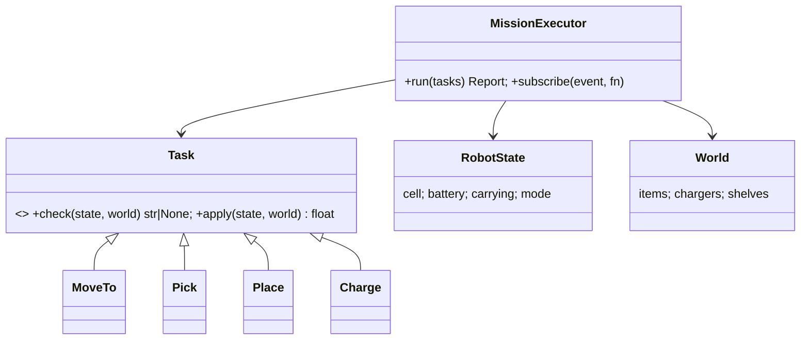

# Case Study: Robot Controller

This case study designs the mission layer of a warehouse robot in Python:
- a **mission executor** that runs a queue of tasks (move, pick, place, charge) against a **world model**;
- tasks as **command objects** with preconditions and effects;
- **events** for observers (UI, logging, fleet manager);
- a simple **state machine** for robot modes;
- **injected time and hardware**, so everything runs deterministically in tests.

It combines the module's principles into a structure similar to real fleet software.

## 1. Requirements

- The robot has a position on a grid (cell coordinates), a battery fraction, an optional carried item, and a mode: `IDLE`, `EXECUTING`, `CHARGING`, `FAULT`.
- Tasks:
  - `MoveTo(cell)` costs Manhattan distance × 0.01 battery and takes 1 s per cell;
  - `Pick(item)` requires an empty gripper, with the item at the robot's cell;
  - `Place(cell)` requires carrying an item, at the robot's cell;
  - `Charge(target)` raises the battery to the target at 0.05 per second, and must happen at a charger cell.
- Before each task, check its **preconditions**. A failure stops the mission with a reason, and the robot returns to `IDLE` (or `FAULT` for hardware errors).
- If the battery would drop below 0.15 during a `MoveTo`, insert a detour to the nearest charger, plus a `Charge(0.9)`, automatically. That's a planning rule.
- Emit events: `task_started`, `task_done`, `mission_failed` and `mission_done`, with timestamps from the injected clock.

## 2. Design



- **Command pattern**: each task knows how to check its preconditions (`check` returns `None` or a reason) and how to apply its effects (`apply` returns the elapsed seconds). The executor doesn't care which task it's running.
- **The world model is separate from the robot state**, because items and chargers belong to the warehouse.
- **Observer**: `subscribe(event_name, callback)`. The executor publishes, and the UI, logger and fleet manager listen without coupling.
- **Time** comes from a clock that the executor advances by the seconds each task reports. A wall clock in production, simulated in tests.

## 3. The executor loop

```python
def run(self, tasks: list[Task]) -> Report:
    queue = deque(self._plan(tasks))                 # planning step: inserts charging detours
    self.state.mode = Mode.EXECUTING
    while queue:
        task = queue.popleft()
        reason = task.check(self.state, self.world)
        if reason:
            self.state.mode = Mode.IDLE
            self._emit("mission_failed", task=task, reason=reason)
            return Report(ok=False, reason=reason)
        self._emit("task_started", task=task)
        self.clock.advance(task.apply(self.state, self.world))
        self._emit("task_done", task=task)
    self.state.mode = Mode.IDLE
    self._emit("mission_done")
    return Report(ok=True)
```

**Planning** before execution is a separate, testable step. It simulates battery use along the task list and inserts `MoveTo(charger)` plus `Charge(0.9)` before any move that would breach the reserve, which keeps the execution logic simple.

## 4. Testing

Every scenario is deterministic:
- a pick-and-place mission succeeds, and the event log equals the expected sequence;
- picking with a full gripper fails with a precise reason;
- a long route triggers exactly one detour, and the battery never drops below the reserve;
- subscribers that raise exceptions don't break the executor (errors are isolated).

> [!EXAM]
> **Why model robot tasks as command objects with separate `check` and `apply` methods?**
> Command objects make each task a self-contained unit that the executor can queue, plan, log, retry or reorder without knowing its type, which is open/closed: new task types don't change the executor. Separating `check` (preconditions, which inspect state without changing it) from `apply` (effects) lets the executor validate a task before committing to it, report precise failure reasons, and lets a planner simulate a mission ahead of time, such as inserting charging detours, using the same model. Injected time and world state keep the whole mission deterministic and testable.
