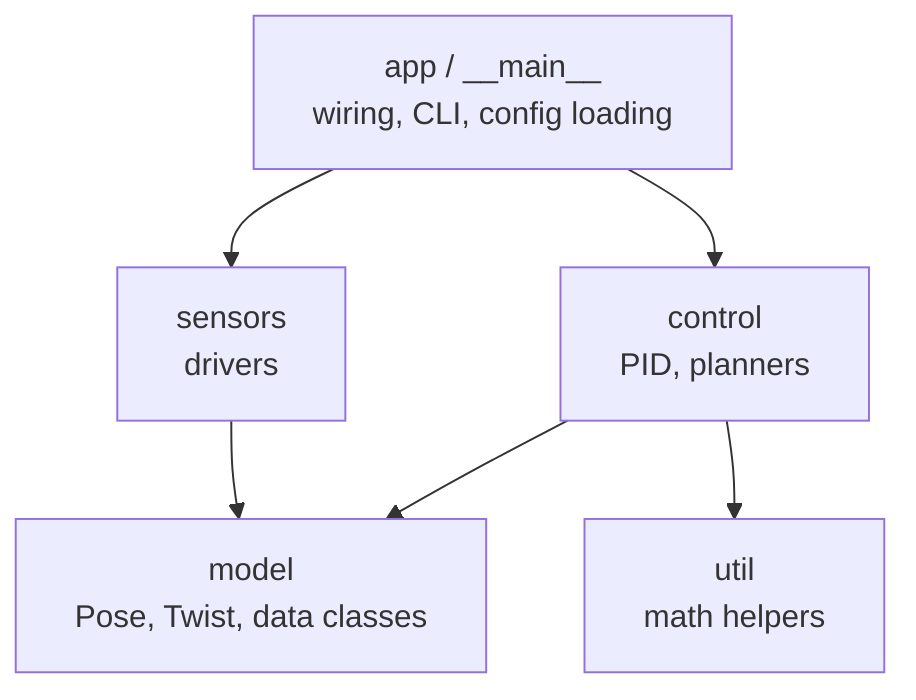

# Packages and Project Structure

A **package** is a directory of modules, Python's way of organising a project into a hierarchy (`robot.sensors.lidar`, `robot.control.pid`). Every serious codebase you'll read, from NumPy and PyTorch to Django and ROS 2 nodes, is a package tree. Knowing how packages, `__init__.py`, relative imports and `python -m` work is the practical skill behind "my friend splits projects into many files and connects them easily". It's mostly a handful of rules applied consistently.

## 1. From module to package

```text
robot/                    ← a package (directory)
├── __init__.py           ← runs when `robot` is imported; may be empty
├── config.py             ← module robot.config
├── sensors/              ← subpackage robot.sensors
│   ├── __init__.py
│   ├── lidar.py          ← robot.sensors.lidar
│   └── imu.py
└── control/
    ├── __init__.py
    └── pid.py            ← robot.control.pid
```

```python
import robot.sensors.lidar                  # full dotted path
from robot.control.pid import PID           # import a name from a submodule
from robot.sensors import imu               # import a submodule as a name
```

> [!KEY]
> Importing `robot.sensors.lidar` first imports `robot` (running `robot/__init__.py`), then `robot.sensors` (running its `__init__.py`), then `lidar.py`. Every parent package is initialised before its children.

## 2. `__init__.py`: the package's front door

`__init__.py` runs when the package is imported, and its namespace **is** the package's namespace. Common uses:

```python
# robot/sensors/__init__.py
"""Sensor drivers."""
from .lidar import Lidar          # re-export, so users can write:
from .imu import IMU              #   from robot.sensors import Lidar, IMU
__all__ = ["Lidar", "IMU"]
```

This creates a clean **public API**: users import from `robot.sensors` without knowing the internal file layout, and you can reorganise files later without breaking them.

> [!WARNING]
> Keep `__init__.py` light. Heavy imports in it run whenever *anything* in the package is imported, which slows start-up and makes circular imports more likely.

Without `__init__.py`, a directory is a **namespace package** (PEP 420): importable, but intended for splitting one package across several directories. For your own projects, include `__init__.py`.

## 3. Absolute vs relative imports

Inside a package you can import siblings relative to the current module:

```python
# robot/control/pid.py
from ..config import GAINS        # .. = parent package (robot), then its config module
from . import filters             # . = this package (robot.control)
from .filters import lowpass
```

| Form | Meaning |
|---|---|
| `from . import x` | from the current package |
| `from .mod import x` | from a sibling module |
| `from .. import x` | from the parent package |
| `from robot.config import x` | absolute: always works, clearer for readers |

> [!DANGER]
> Relative imports only work inside a package that was **imported as a package**. Running a file inside the package directly, `python3 robot/control/pid.py`, gives `ImportError: attempted relative import with no known parent package`, because `__name__` is `"__main__"` and there's no parent package. Run it as a module instead, **from the project root**:
> ```bash
> python3 -m robot.control.pid
> ```

PEP 8 recommends absolute imports for clarity. Explicit relative imports are fine inside a package's internals.

## 4. Running packages: `-m` and `__main__.py`

- `python3 -m robot.control.pid` runs that module as `__main__`, with the **current directory** added to `sys.path`, so package imports resolve.
- A package can be made runnable with a `__main__.py` file: `python3 -m robot` executes `robot/__main__.py`.

```python
# robot/__main__.py
from robot.app import main
main()
```

## 5. A professional project layout: the `src` layout

```text
robot-project/
├── pyproject.toml           ← metadata, dependencies, tool config (next lesson)
├── README.md
├── src/
│   └── robot/               ← the importable package
│       ├── __init__.py
│       ├── __main__.py
│       ├── config.py
│       ├── sensors/ ...
│       └── control/ ...
└── tests/
    ├── test_pid.py
    └── test_lidar.py
```

Putting the package under `src/` stops tests from accidentally importing the local folder instead of the installed package, which catches packaging mistakes early. Install it in editable mode during development (`uv pip install -e .`), and then `import robot` works from anywhere, including tests.

## 6. How to split code into modules (the design skill)



Guidelines that keep a package tree healthy:

1. **One responsibility per module**: `pid.py` does PID control and nothing else.
2. **Dependencies point one way**: from high-level (app, control) toward low-level (model, util). Low-level modules never import high-level ones. That rule alone prevents circular imports.
3. **Data types in a shared module** (`model.py`), imported by everyone, importing no one.
4. **A thin entry point**: `main()` builds objects and wires them together. All the logic lives in importable modules (so it can be tested).
5. **Re-export the public API** in `__init__.py` and keep internals underscore-prefixed.

## 7. Exam-ready answers

> [!EXAM]
> **Packages.** A package is a directory that groups related modules into a hierarchical namespace, addressed with dotted names such as `robot.sensors.lidar`. A regular package contains an `__init__.py` file, which is executed when the package is first imported and defines the package namespace; it is often used to expose a public API by re-exporting names from submodules. Importing a submodule first initialises all its parent packages. Within a package, explicit relative imports (`from . import x`, `from ..config import y`) refer to modules relative to the current package; they work only when the module is imported as part of the package, for example via `python -m package.module`.

## 8. Cheat sheet

| Need | Do |
|---|---|
| make a package | a directory + `__init__.py` |
| public API | re-export in `__init__.py`, set `__all__` |
| sibling import | `from .sibling import X` |
| parent import | `from ..module import Y` |
| run a module inside a package | `python3 -m pkg.module` (from the project root) |
| runnable package | `pkg/__main__.py`, then `python3 -m pkg` |
| layout | `src/pkg/...`, `tests/...`, `pyproject.toml` |

> [!INTERVIEW]
> **"Why does `python3 pkg/tool.py` fail with 'attempted relative import with no known parent package' while `python3 -m pkg.tool` works?"** Running a file path makes it the top-level `__main__` module with no package context, so `from . import x` has nothing to be relative to, and `sys.path[0]` is `pkg/`, not the project root. `-m` imports it as `pkg.tool` with the current directory on `sys.path`, so the package hierarchy exists.
