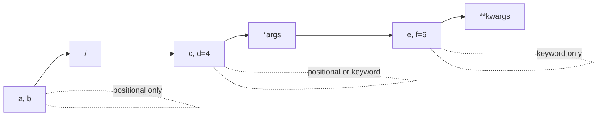

# Parameters: defaults, *args, **kwargs

Python has the richest parameter system of the mainstream languages: positional, keyword, default values, variable positional (`*args`), variable keyword (`**kwargs`), keyword-only and positional-only parameters. They exist so that functions can be called clearly, can evolve without breaking callers, and can forward arguments. This is also the syntax people forget most often. After this lesson you should be able to read any signature, such as `def f(a, b=2, /, c=3, *args, d, e=5, **kwargs)`, and know exactly which calls are legal.

## 1. Positional and keyword arguments

At the **call site**, an argument is either:

- **positional**: matched by position, `area(3, 4)`
- **keyword**: matched by name, `area(width=3, height=4)` or `area(height=4, width=3)`

```python
def area(width, height):
    return width * height

print(area(3, 4))                  # 12
print(area(height=4, width=3))     # 12: keyword order doesn't matter
print(area(3, height=4))           # 12: mixing is fine...
# area(width=3, 4)                 → SyntaxError: positional argument follows keyword argument
# area(3, width=4)                 → TypeError: area() got multiple values for argument 'width'
```

> [!KEY]
> At a call: **positional arguments first, then keyword arguments**. Each parameter may receive a value only **once**.

Keyword arguments make calls self-documenting: `connect(host, timeout=5, retries=3)` reads better than `connect(host, 5, 3)`.

## 2. Default parameter values

```python
def power(base, exp=2):
    return base ** exp

print(power(5))        # 25: exp defaults to 2
print(power(5, 3))     # 125
print(power(exp=0, base=9))   # 1
```

Rules:

- Parameters with defaults must come **after** those without, in the positional part of the signature: `def f(a=1, b):` is a `SyntaxError`.
- Defaults are evaluated **once**, at definition time. Never use mutable defaults (see the Mutability lesson). Use `None` and create the object inside.

## 3. `*args`: any number of positional arguments

A parameter prefixed with `*` collects all **extra positional arguments into a tuple**:

```python
def total(*nums):
    return sum(nums)

print(total())            # 0: nums == ()
print(total(1, 2, 3))     # 6: nums == (1, 2, 3)
print(total(*[4, 5]))     # 9: spreading at the call (Unpacking lesson)
```

The name `args` is only a convention. `*nums` or `*paths` is fine and often clearer.

## 4. `**kwargs`: any number of keyword arguments

A parameter prefixed with `**` collects all **extra keyword arguments into a dict**:

```python
def make_tag(name, **attrs):
    attr_text = " ".join(f'{k}="{v}"' for k, v in attrs.items())
    return f"<{name} {attr_text}>"

print(make_tag("img", src="a.png", alt="logo"))   # 
```

## 5. Keyword-only parameters

Any parameter **after** `*args`, or after a bare `*`, can **only** be passed by keyword:

```python
def sort_items(items, *, reverse=False, key=None):
    return sorted(items, reverse=reverse, key=key)

sort_items([3, 1, 2], reverse=True)    # OK
# sort_items([3, 1, 2], True)          → TypeError: takes 1 positional argument but 2 were given
```

Why: boolean flags passed positionally are unreadable (`sort_items(x, True, None)`). Forcing keywords keeps call sites clear and lets you reorder or add options later without breaking callers. The built-in `sorted(iterable, *, key=None, reverse=False)` is defined exactly this way.

## 6. Positional-only parameters (Python 3.8+)

Parameters **before** a `/` can **only** be passed positionally:

```python
def divide(a, b, /):
    return a / b

divide(10, 2)          # OK
# divide(a=10, b=2)    → TypeError: got some positional-only arguments passed as keyword arguments
```

Why: the parameter names become an implementation detail you're free to rename, and they can't clash with `**kwargs` keys. Many built-ins work this way: `len(obj, /)`, so `len(obj=[1])` fails.

## 7. The full signature grammar

> [!SYNTAX]
> ```python
> def f(pos_only, /, pos_or_kw, *args, kw_only, **kwargs):
> ```
> In this order:
> 1. positional-only parameters, then `/`
> 2. normal (positional-or-keyword) parameters
> 3. `*args` (or a bare `*`)
> 4. keyword-only parameters (each may have a default, in any order)
> 5. `**kwargs` (always last)



How Python binds a call, step by step:

1. Positional arguments fill positional parameters left to right.
2. Leftover positional arguments go into `*args` (or raise `TypeError` if there's no `*args`).
3. Keyword arguments fill the parameters with matching names (except positional-only ones).
4. Leftover keyword arguments go into `**kwargs` (or raise `TypeError`).
5. Unfilled parameters take their defaults. If one has no default, `TypeError: missing required argument`.

```python
def f(a, b=2, *args, c, d=4, **kw):
    return a, b, args, c, d, kw

print(f(1, c=3))                    # (1, 2, (), 3, 4, {})
print(f(1, 5, 6, 7, c=3, e=9))      # (1, 5, (6, 7), 3, 4, {'e': 9})
```

## 8. Forwarding arguments: the wrapper pattern

`*args, **kwargs` together accept **anything** and pass it on unchanged. This is how decorators and wrappers work:

```python
def logged(func):
    def wrapper(*args, **kwargs):
        print(f"calling {func.__name__} with {args} {kwargs}")
        return func(*args, **kwargs)     # spread them back out
    return wrapper
```

You'll build this properly in the Decorators lesson.

## 9. Arguments are bound by object reference

Parameters are names bound to the caller's objects (Mutability lesson). Mutating a mutable argument affects the caller; rebinding the parameter doesn't. `*args` is a **new tuple**, but its elements are the caller's objects.

## 10. Common errors and what they mean

| Error message | Cause |
|---|---|
| `missing 1 required positional argument: 'x'` | a parameter with no default was not supplied |
| `takes 2 positional arguments but 3 were given` | too many positional arguments and no `*args` (remember `self` counts in methods!) |
| `got an unexpected keyword argument 'z'` | no parameter named `z` and no `**kwargs` |
| `got multiple values for argument 'x'` | `x` was filled positionally **and** by keyword |
| `positional argument follows keyword argument` | a `SyntaxError` at the call site: keywords must come last |
| `non-default argument follows default argument` | a `SyntaxError` in the definition |

## 11. Exam-ready answers

> [!EXAM]
> **Kinds of parameters.** Python functions may declare positional-or-keyword parameters (`def f(a, b)`), parameters with default values (`b=2`), a variable positional parameter `*args`, which collects extra positional arguments in a tuple, keyword-only parameters, which appear after `*` or `*args` and can be passed only by name, positional-only parameters, which appear before `/`, and a variable keyword parameter `**kwargs`, which collects extra keyword arguments in a dictionary. At a call, positional arguments must precede keyword arguments, and each parameter may be bound only once. Default values are evaluated once when the function is defined.

> [!EXAM]
> **`*args` and `**kwargs`.** In a function definition, `*args` gathers any number of additional positional arguments into a tuple and `**kwargs` gathers any number of additional keyword arguments into a dictionary. In a function call, `*iterable` and `**mapping` do the reverse, unpacking a sequence into positional arguments and a mapping into keyword arguments. Together, `def wrapper(*args, **kwargs): return func(*args, **kwargs)` forwards arbitrary arguments, which is the basis of decorators.

## 12. Cheat sheet

| Want | Signature |
|---|---|
| optional parameter | `def f(x, y=0)` |
| optional list parameter | `def f(x, items=None)` |
| any number of values | `def f(*values)` |
| arbitrary options | `def f(**options)` |
| force keyword for flags | `def f(data, *, verbose=False)` |
| hide parameter names | `def f(x, y, /)` |
| forward everything | `def w(*args, **kwargs): return g(*args, **kwargs)` |

> [!INTERVIEW]
> **"Why does `def f(a, b=[])` get flagged in code review, and why does `sorted` make `reverse` keyword-only?"** The first is the mutable default trap: one list is shared across calls. The second is API design: `sorted(xs, True)` would be unreadable and fragile, while forcing `reverse=True` makes call sites self-documenting and leaves the parameter order free to change.
