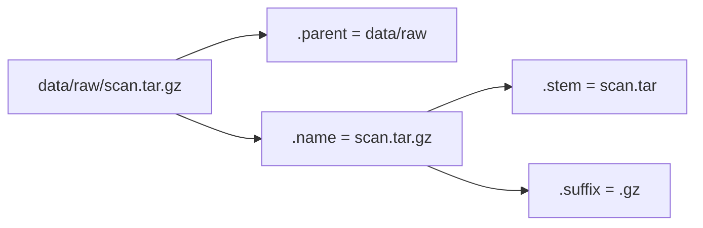

# pathlib, os and shutil

Real programs work with **many** files: datasets spread across folders, logs rotated daily, model checkpoints, robot bag recordings. You need to build paths portably, list and search directories, create and delete folders, copy and move files, and read environment variables. Modern Python does this with **`pathlib`**, an object-oriented path API, plus `os` for environment and process details and `shutil` for high-level file operations.

## 1. `Path` objects

```python
from pathlib import Path

p = Path("data") / "raw" / "scan.tar.gz"      # the / operator joins paths
print(p)                                      # data/raw/scan.tar.gz (data\raw\... on Windows)
```

> [!KEY]
> Never build paths by string concatenation (`"data/" + name`). The `/` operator on `Path` uses the right separator for the OS, handles extra or missing slashes, and gives you methods for every common job.

### Taking a path apart

| Attribute | `Path("data/raw/scan.tar.gz")` |
|---|---|
| `.name` | `scan.tar.gz` |
| `.stem` | `scan.tar` (name without the **last** suffix) |
| `.suffix` | `.gz` |
| `.suffixes` | `['.tar', '.gz']` |
| `.parent` | `data/raw` |
| `.parents[1]` | `data` |
| `.parts` | `('data', 'raw', 'scan.tar.gz')` |
| `.with_suffix(".zip")` | `data/raw/scan.tar.zip` |
| `.with_name("x.txt")` | `data/raw/x.txt` |



### Absolute paths and the script's own folder

```python
Path.cwd()                         # current working directory
Path.home()                        # the user's home directory
Path("a/b/../c").resolve()         # absolute, with symlinks and .. resolved
HERE = Path(__file__).resolve().parent     # the folder containing this script
config = HERE / "config.toml"              # works whatever the CWD is
```

## 2. Querying the filesystem

| Method | Answer |
|---|---|
| `p.exists()` | does it exist? |
| `p.is_file()` / `p.is_dir()` | the kind of entry |
| `p.stat().st_size` | size in bytes |
| `p.stat().st_mtime` | modification time (Unix timestamp) |

## 3. Reading and writing in one call

```python
p = Path("notes.txt")
p.write_text("hello\n", encoding="utf-8")     # create or overwrite
text = p.read_text(encoding="utf-8")
data = Path("img.png").read_bytes()
```

These open and close the file for you. Use `open()` when you need streaming or appending.

## 4. Directories

```python
out = Path("results") / "run_01"
out.mkdir(parents=True, exist_ok=True)   # like mkdir -p: create parents, no error if present

for entry in Path("results").iterdir():  # direct children (order not guaranteed)
    print(entry.name, entry.is_dir())

list(Path("src").glob("*.py"))           # *.py directly inside src
list(Path("src").rglob("*.py"))          # recursive: every .py in the whole tree
list(Path("data").glob("**/*.csv"))      # the same as rglob("*.csv")
```

Glob patterns: `*` matches any characters except `/`, `?` matches one character, `[abc]` matches a character class, and `**` means "any number of directories".

> [!TIP]
> Sort when the order matters: `sorted(Path("logs").glob("*.log"))`. Directory listing order depends on the filesystem.

### Walking a tree with `os.walk`

```python
import os
for root, dirs, files in os.walk("project"):
    dirs[:] = [d for d in dirs if d != ".git"]    # prune: don't descend into .git
    for name in files:
        print(os.path.join(root, name))
```

Modifying `dirs` **in place** controls which subdirectories get visited. (`Path.walk()`, added in 3.12, works the same way.)

## 5. Moving, copying, deleting

| Task | Code |
|---|---|
| rename / move | `p.rename(new)` or `shutil.move(src, dst)` (works across disks) |
| replace atomically | `p.replace(new)` / `os.replace` |
| delete a file | `p.unlink(missing_ok=True)` |
| delete an empty directory | `p.rmdir()` |
| delete a whole tree | `shutil.rmtree(p)` ⚠️ permanent |
| copy a file | `shutil.copy2(src, dst)` (keeps metadata) |
| copy a tree | `shutil.copytree(src, dst)` |
| disk usage | `shutil.disk_usage("/")` |

> [!DANGER]
> `shutil.rmtree` and `unlink` don't use a recycle bin: deletion is immediate and permanent. Print the paths before deleting them in a new script, and never build the path from unvalidated input.

## 6. `os`: environment and process information

```python
import os
os.environ.get("HOME")                 # read an environment variable
os.environ.get("ROBOT_PORT", "8080")   # with a default
os.getpid()                            # process id
os.cpu_count()                         # number of CPUs
os.sep, os.linesep                     # '/' and '\n' on Linux
```

Environment variables are the standard way to configure programs without code changes: API keys, ports, `ROS_DOMAIN_ID` in ROS 2. Don't hard-code secrets in source. Read them from the environment.

`os.path` (the older string-based API: `join`, `exists`, `splitext`, `basename`) is still common in existing code. Recognise it, but prefer `pathlib` in new code.

| os.path | pathlib |
|---|---|
| `os.path.join(a, b)` | `Path(a) / b` |
| `os.path.basename(p)` | `p.name` |
| `os.path.splitext(p)[1]` | `p.suffix` |
| `os.path.exists(p)` | `p.exists()` |
| `os.listdir(d)` | `d.iterdir()` |
| `glob.glob("*.py")` | `Path().glob("*.py")` |

## 7. Exam-ready answers

> [!EXAM]
> **pathlib.** The `pathlib` module provides an object-oriented representation of filesystem paths. `Path` objects are joined with the `/` operator in an OS-independent way and expose components such as `name`, `stem`, `suffix` and `parent`. They provide methods for querying (`exists`, `is_file`, `is_dir`, `stat`), reading and writing (`read_text`, `write_text`, `open`), directory operations (`mkdir`, `iterdir`, `glob`, `rglob`) and manipulation (`rename`, `unlink`, `resolve`). It largely replaces the string-based `os.path` functions, while `shutil` provides high-level operations such as copying and removing whole directory trees.

## 8. Cheat sheet

| Need | Code |
|---|---|
| join | `Path("a") / "b" / "c.txt"` |
| the script's folder | `Path(__file__).resolve().parent` |
| make dirs | `p.mkdir(parents=True, exist_ok=True)` |
| list | `sorted(p.iterdir())` |
| find recursively | `p.rglob("*.csv")` |
| extension | `p.suffix`, `p.with_suffix(".json")` |
| read / write quickly | `p.read_text(encoding="utf-8")`, `p.write_text(s, encoding="utf-8")` |
| delete | `p.unlink(missing_ok=True)` / `shutil.rmtree(d)` |
| copy | `shutil.copy2(a, b)` |
| environment variable | `os.environ.get("KEY", default)` |

> [!INTERVIEW]
> **"Find the 5 largest files under a directory."** Use `heapq.nlargest(5, (p for p in root.rglob("*") if p.is_file()), key=lambda p: p.stat().st_size)`. That's a generator, so memory stays constant, and `nlargest` is O(n log 5). Interviewers like to see you combine `pathlib` with lazy evaluation and a heap instead of sorting everything.
