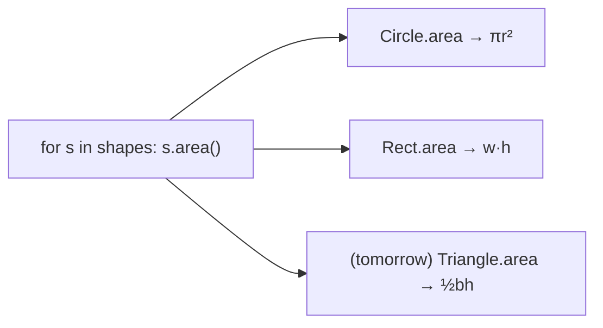

# Polymorphism and Duck Typing

**Polymorphism** ("many forms") means **one interface, many implementations**: code written against an operation like `sensor.read()` or `shape.area()` works with any object that provides it, without knowing the concrete class. It's the pillar that makes systems *extensible*. You can add a new sensor type tomorrow without editing the control loop that reads sensors. Python achieves it in two ways: through inheritance (overriding), and more broadly through **duck typing**.

## 1. Polymorphism through inheritance

```python
import math

class Shape:
    def area(self):
        raise NotImplementedError        # "subclasses must provide this"

class Circle(Shape):
    def __init__(self, r): self.r = r
    def area(self): return math.pi * self.r ** 2

class Rect(Shape):
    def __init__(self, w, h): self.w, self.h = w, h
    def area(self): return self.w * self.h

shapes = [Circle(1), Rect(2, 3), Circle(0.5)]
total = sum(s.area() for s in shapes)    # one call site, different implementations
print(round(total, 3))                   # 9.927
```

The line `s.area()` is **dynamically dispatched**: which `area` runs is decided at run time from the object's actual class, not from the variable.



## 2. Duck typing: "if it walks like a duck…"

Python doesn't require a common base class at all. Any object with the right methods works:

```python
class Lidar:
    def read(self): return 2.5

class FakeSensor:                 # unrelated class, e.g. for tests
    def read(self): return 0.0

def log_all(sensors):
    for s in sensors:
        print(s.read())           # only requires that s has read()

log_all([Lidar(), FakeSensor()])
```

> [!KEY]
> In Python, a type is defined by **what it can do** (its methods and protocols), not by what it inherits from. That's duck typing. It's why `for` works on lists, files, generators and your own classes: they all implement `__iter__`. The `len()` built-in works on anything with `__len__`.

Built-in polymorphism you already use:

```python
print(len("abc"), len([1, 2]), len({"a": 1}))   # len dispatches to __len__
print(1 + 2, "a" + "b", [1] + [2])              # + dispatches to __add__
```

## 3. EAFP: try it, don't check the type

Duck-typed code avoids `isinstance` checks:

```python
# LBYL with type checks: closed to extension
def total_area(shapes):
    t = 0
    for s in shapes:
        if isinstance(s, Circle):
            t += math.pi * s.r ** 2
        elif isinstance(s, Rect):
            t += s.w * s.h
        # adding Triangle means editing this function!
    return t

# polymorphic: open to extension
def total_area(shapes):
    return sum(s.area() for s in shapes)
```

> [!TIP]
> A long `if isinstance(...) elif isinstance(...)` chain is a classic **code smell** in OOP code. Each branch usually belongs in a method of the corresponding class. Moving it there is the refactoring "replace conditional with polymorphism".

## 4. Making the contract explicit

Duck typing is flexible but implicit. When you want the interface **documented and checked**, use:

- **Abstract base classes** (`abc.ABC` + `@abstractmethod`): subclasses that don't implement the methods can't even be instantiated.
- **`typing.Protocol`**: structural typing that static checkers verify, with no inheritance required.

```python
from abc import ABC, abstractmethod

class Sensor(ABC):
    @abstractmethod
    def read(self) -> float: ...

class Broken(Sensor):
    pass

# Broken()  → TypeError: Can't instantiate abstract class Broken without an implementation for abstract method 'read'
```

Both are covered in depth in "Abstract Base Classes and Protocols" (Advanced module).

## 5. Overloading vs overriding

| | Overriding | Overloading |
|---|---|---|
| What | a subclass redefines a base method with the same name | several functions with the same name but different parameter types or counts |
| Python | yes (normal polymorphism) | **no**: a later `def` with the same name replaces the earlier one |
| Python alternatives to overloading | — | default parameters, `*args`, `functools.singledispatch`, `typing.overload` (for type hints only) |

**Operator overloading**, on the other hand, Python fully supports through special methods (`__add__`, `__eq__`…). That's the next lesson.

## 6. Polymorphism in system design

```python
class Controller:
    def __init__(self, sensor, actuator):     # any objects with read() / apply()
        self.sensor = sensor
        self.actuator = actuator

    def step(self, target):
        error = target - self.sensor.read()
        self.actuator.apply(0.5 * error)
```

The `Controller` works with a real `Lidar`, a simulated sensor, or a recorded-data replayer, and with a real motor or a logger. You can test it without hardware and swap components freely. That's the payoff of polymorphism, and the foundation of **dependency injection**, covered in Master OOP.

## 7. Exam-ready answers

> [!EXAM]
> **Polymorphism.** Polymorphism is the ability of different classes to be used through a common interface, so that the same operation invokes behaviour appropriate to each object's actual type. In Python it arises from method overriding in subclasses, with the method chosen at run time by dynamic dispatch, and more generally from duck typing, where any object providing the required methods can be used regardless of its class. Built-in functions and operators are polymorphic through special methods (for example `len` calls `__len__` and `+` calls `__add__`). Polymorphism allows code to be extended with new types without modification.

> [!EXAM]
> **Duck typing.** Duck typing is a style of dynamic typing in which an object's suitability is determined by the presence of the methods and attributes it provides, rather than by its class or inheritance ("if it walks like a duck and quacks like a duck, it is a duck"). Python code typically just calls the needed methods and handles failures (EAFP) instead of checking types.

## 8. Cheat sheet

| Need | Approach |
|---|---|
| common operation over many types | give each class the same method name |
| force subclasses to implement | `ABC` + `@abstractmethod` |
| structural type hints | `typing.Protocol` |
| avoid | `isinstance` chains for behaviour |
| "overloading" | defaults, `*args`, `singledispatch` |

> [!INTERVIEW]
> **"How does Python achieve polymorphism without interfaces like Java's?"** Through duck typing and dynamic dispatch: any object with the required methods works, and the method is looked up on the object's class at call time. For explicit contracts, Python offers ABCs (nominal: you must inherit, and instantiation is blocked if methods are missing) and Protocols (structural: checked by static type checkers, no inheritance). Mention that special methods make built-ins like `len`, `iter` and `+` polymorphic too.
