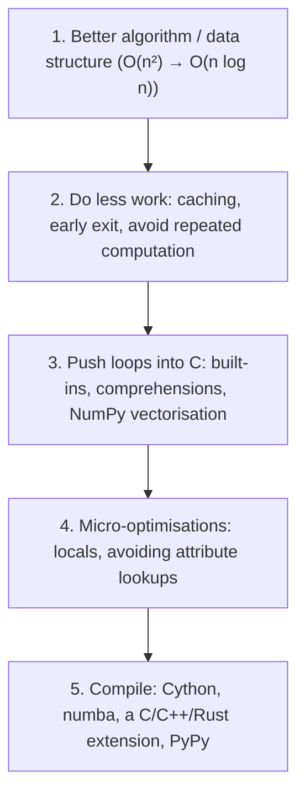

# Profiling and Optimization

"Premature optimization is the root of all evil" (Knuth), but so is shipping code that's 100× too slow. The professional workflow is: **make it correct, measure, find the actual bottleneck, fix the algorithm first, then micro-optimise only the hot spots, and measure again.** This lesson covers the measuring tools (`timeit`, `cProfile`, `pstats`, line profilers, sampling profilers like `py-spy`, and memory profilers) and the optimisations that actually matter in Python.

## 1. Timing small snippets: `timeit`

```python
import timeit
timeit.timeit("sum(range(1000))", number=10_000)            # total seconds for 10,000 runs
timeit.repeat("sorted(data)", setup="import random; data = [random.random() for _ in range(1000)]",
              number=100, repeat=5)                         # use min() of the repeats
```

```bash
python -m timeit -s "xs = list(range(1000))" "sum(xs)"
# 50000 loops, best of 5: 4.1 usec per loop
```

> [!TIP]
> Report the **minimum** of several repeats: the noise (other processes, CPU frequency changes) only ever makes things slower. Use `time.perf_counter()` for ad-hoc timing of larger blocks, never `time.time()`.

## 2. Where does the time go? `cProfile`

```bash
python -m cProfile -s cumulative my_script.py
```

```python
import cProfile, pstats
with cProfile.Profile() as pr:
    run_pipeline()
stats = pstats.Stats(pr).sort_stats("cumulative")
stats.print_stats(10)          # the top 10 entries
```

```output
   ncalls  tottime  percall  cumtime  percall filename:lineno(function)
        1    0.002    0.002    3.104    3.104 pipeline.py:40(run_pipeline)
    10000    2.851    0.000    2.851    0.000 pipeline.py:12(distance)
```

| Column | Meaning |
|---|---|
| `ncalls` | number of calls |
| `tottime` | time spent **in** the function itself (excluding callees) |
| `cumtime` | time including everything it called |

Look for high `tottime` (the function itself is slow) and high `cumtime` with a high `ncalls` (called too often). `cProfile` adds overhead to every call, which inflates the cost of tiny functions. Visualise the output with `snakeviz` or as flame graphs.

### Sampling and line-level profilers

| Tool | How | Best for |
|---|---|---|
| `py-spy` | samples a **running** process from outside, near-zero overhead | production services, robot nodes, flame graphs: `py-spy top --pid N` |
| `line_profiler` (`@profile`, `kernprof -l`) | times each line | inside one hot function |
| `scalene` | CPU + memory + GPU, separates Python from native time | finding "is this Python or C time?" |
| `memray` / `tracemalloc` | allocation tracking | memory growth |

## 3. Optimisations ranked by impact



### 1. Algorithms and data structures, by far the biggest win

```python
# O(n·m): `x in list` is a linear scan
common = [x for x in a if x in b_list]
# O(n + m): set membership is O(1)
b_set = set(b_list)
common = [x for x in a if x in b_set]           # 100,000 × 100,000: hours become milliseconds
```

| Slow | Fast |
|---|---|
| `x in list` inside a loop | `x in set` |
| `list.pop(0)` / `insert(0, ...)` | `collections.deque` |
| repeated `s += piece` in a loop | `"".join(pieces)` |
| sorting to find the top k | `heapq.nlargest(k, ...)` |
| recomputing pure function results | `functools.cache` |
| reading a file line by line with `readline()` calls | iterate the file object |

### 2. Let C do the looping

```python
total = 0
for x in xs: total += x            # interpreted bytecode per element
total = sum(xs)                    # one C loop: often 5–10× faster

squares = [x * x for x in xs]      # comprehension: faster than append in a loop
import numpy as np
arr = np.asarray(xs)
squares = arr * arr                # vectorised: 10–100× faster for large numeric arrays
```

### 3. Micro-optimisations: only in proven hot loops

- Bind frequently used globals and attributes to locals (`append = out.append`).
- Avoid creating objects in tight loops. Prefer built-ins (`map`, `sorted(key=...)`, `str.translate`).
- Use `__slots__` for many small objects (memory → cache efficiency).

> [!WARNING]
> Measure before **and** after. Many "optimisations" make no difference, or make code slower, on modern CPython's specialising interpreter. Readability is a cost too.

## 4. Exam-ready answers

> [!EXAM]
> **Profiling and optimisation in Python.** Optimisation should be guided by measurement: `timeit` times small code snippets reliably by repeating them and reporting the best time; `cProfile` with `pstats` reports, for each function, the number of calls, the time spent in the function itself (`tottime`) and including callees (`cumtime`), identifying bottlenecks; line profilers time individual lines; sampling profilers such as `py-spy` inspect running processes with low overhead; and `tracemalloc` tracks memory allocations. The largest gains usually come from better algorithms and data structures (for example, replacing list membership tests with sets), then from reducing redundant work through caching, then from moving loops into optimised C code via built-in functions, comprehensions or NumPy vectorisation, and only lastly from micro-optimisations or compiling hot spots with Cython, Numba or native extensions.

## 5. Cheat sheet

| Need | Tool |
|---|---|
| time a snippet | `python -m timeit -s "setup" "stmt"` |
| whole-program hotspots | `python -m cProfile -s cumulative script.py` |
| profile a live process | `py-spy top --pid <pid>` / `py-spy record -o flame.svg` |
| per-line timing | `line_profiler` (`kernprof -l -v`) |
| memory | `tracemalloc`, `memray` |
| fast membership | `set` / `dict` |
| fast numeric loops | NumPy, Numba |
| memoisation | `functools.cache` |

> [!INTERVIEW]
> **"A Python data pipeline takes 2 hours. How do you speed it up?"** First measure: run `cProfile` (or `py-spy` on the running job) to find where the time actually goes, since intuition is usually wrong. Then fix in order of leverage. Algorithmic issues come first: quadratic loops, list membership tests, repeated parsing, N+1 database or API calls. Next, I/O: batching, streaming instead of loading everything, parallelising waits with threads or asyncio. Then vectorise numeric work with NumPy or pandas. Parallelise CPU-bound pure-Python stages across cores with processes. Only then consider compiling hot kernels (Numba, Cython). Re-measure after each change, and keep a correctness test so optimisations don't change the results.
