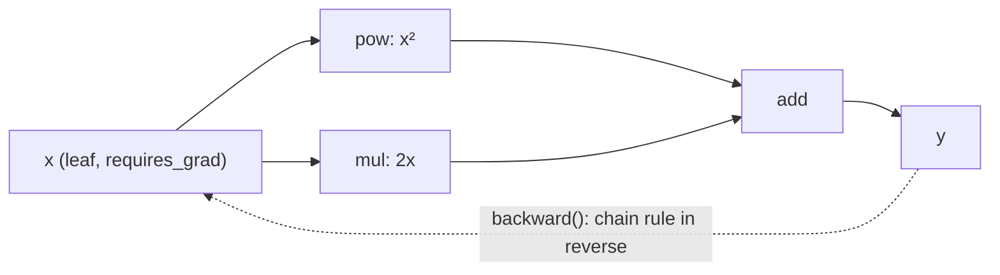

# PyTorch Tensors and Autograd

PyTorch is the dominant deep-learning framework in research and increasingly in robotics: perception networks, learned controllers, reinforcement learning, differentiable simulation. Its two foundations are **tensors** (NumPy-like n-dimensional arrays that can live on GPUs) and **autograd**, which records operations on tensors to build a computational graph and computes gradients automatically by reverse-mode differentiation (backpropagation). This lesson covers tensor creation, dtypes, devices, NumPy interop and broadcasting, then how autograd works, how to use it correctly, and its pitfalls.

## 1. Tensors

```python
import torch

a = torch.tensor([[1.0, 2.0], [3.0, 4.0]])      # from data (copies)
torch.zeros(2, 3), torch.ones(5), torch.arange(0, 10, 2), torch.linspace(0, 1, 5)
torch.randn(3, 3, generator=torch.Generator().manual_seed(0))   # reproducible random
torch.manual_seed(0)                              # global seed (also seeds CUDA)
a.shape, a.dtype, a.device                        # torch.Size([2, 2]), torch.float32, device(type='cpu')
```

| NumPy | PyTorch |
|---|---|
| `np.array` | `torch.tensor` |
| `a.reshape` | `a.reshape` / `a.view` (view needs contiguous memory) |
| `axis=` | `dim=` |
| `a.astype(np.float32)` | `a.float()` / `a.to(torch.float32)` |
| `np.concatenate` | `torch.cat` |
| `a @ b`, broadcasting, slicing | identical |

The default float dtype is **float32** (NumPy's is float64), because GPUs are fastest at 32-bit and lower precisions (`float16`, `bfloat16`) are common for training.

### Devices

```python
device = "cuda" if torch.cuda.is_available() else ("mps" if torch.backends.mps.is_available() else "cpu")
x = torch.randn(1000, 1000, device=device)       # allocate directly on the device
y = x.to("cpu")                                  # explicit transfers
```

> [!WARNING]
> Every tensor in an operation must be on the **same device**. Mixing them raises "Expected all tensors to be on the same device". GPU operations are asynchronous, so time them with `torch.cuda.synchronize()`. Moving data between CPU and GPU each step is a common performance killer: keep data on the GPU.

### NumPy interop

```python
import numpy as np
n = np.arange(3.0)
t = torch.from_numpy(n)      # SHARES memory with n (CPU only)
n[0] = 100.0
t                            # tensor([100., 1., 2.], dtype=torch.float64)
back = t.numpy()             # also shares memory; needs .detach() first if requires_grad
```

## 2. Autograd: gradients for free

Set `requires_grad=True`, compute a scalar, call `.backward()`, and read `.grad`:

```python
x = torch.tensor(3.0, requires_grad=True)
y = x ** 2 + 2 * x + 1          # y = (x + 1)^2
y.backward()                     # dy/dx = 2x + 2
x.grad                           # tensor(8.)
```



PyTorch builds the graph **dynamically** as operations execute ("define-by-run"), so ordinary Python control flow (loops, ifs, recursion) just works. Each tensor produced by an operation stores `grad_fn` (how it was made), and `backward()` walks the graph in reverse, applying the chain rule.

### Vector-valued functions and accumulation

```python
w = torch.randn(3, requires_grad=True)
x = torch.tensor([1.0, 2.0, 3.0])
loss = ((w * x).sum() - 10.0) ** 2
loss.backward()
w.grad                           # d loss / d w = 2 (w·x - 10) * x
w.grad.zero_()                   # gradients ACCUMULATE across backward calls: zero them each step
```

> [!KEY]
> - `.backward()` needs a **scalar** output (or an explicit `gradient=` argument, giving a vector–Jacobian product).
> - **Gradients accumulate** into `.grad`. Training loops call `optimizer.zero_grad()` (or `w.grad = None`) every iteration. Forgetting it is a classic bug: the effective gradient becomes the sum over all previous steps.
> - Only **leaf tensors** with `requires_grad=True` (parameters you created) get `.grad` populated by default. Intermediate results don't, unless you call `.retain_grad()`.
> - The graph is freed after `backward()`. Call it twice on the same graph only with `retain_graph=True`.

## 3. Turning autograd off

```python
with torch.no_grad():                 # inference/evaluation: no graph, less memory, faster
    pred = model(batch)

y = x.detach()                        # same data, cut out of the graph (no gradient flows back)

with torch.inference_mode():          # even cheaper than no_grad for pure inference
    ...

w = torch.randn(3, requires_grad=True)
with torch.no_grad():
    w -= 0.1 * w.grad                 # manual parameter update must not be recorded
```

## 4. Gradient descent by hand

```python
torch.manual_seed(0)
X = torch.randn(100, 2)
y = X @ torch.tensor([2.0, -3.0]) + 1.0
w = torch.zeros(2, requires_grad=True)
b = torch.zeros(1, requires_grad=True)
for step in range(200):
    loss = ((X @ w + b - y) ** 2).mean()
    loss.backward()
    with torch.no_grad():
        w -= 0.1 * w.grad
        b -= 0.1 * b.grad
    w.grad.zero_(); b.grad.zero_()
w, b                                   # ≈ [2, -3], [1]
```

This is exactly what `torch.optim.SGD` does for you (next lesson).

## 5. Jacobians, Hessians and functional transforms

```python
from torch.func import grad, vmap, jacrev

f = lambda x: (x ** 3).sum()
grad(f)(torch.tensor([1.0, 2.0]))                    # tensor([ 3., 12.])
jacrev(lambda x: x ** 2)(torch.tensor([1.0, 2.0]))   # diag([2, 4])
batched = vmap(grad(f))(torch.randn(5, 2))           # per-sample gradients without loops
```

`torch.autograd.functional.jacobian` and `hessian` serve robotics uses such as manipulator Jacobians, sensitivity analysis and second-order optimisation.

## 6. Pitfalls

| Pitfall | Symptom | Fix |
|---|---|---|
| no `zero_grad` | gradients explode or drift | zero every step |
| in-place op on a needed tensor | "a variable needed for gradient computation has been modified by an inplace operation" | avoid `+=` on such tensors |
| `.numpy()` on a tensor requiring grad | RuntimeError | `.detach().cpu().numpy()` |
| integer tensors | can't require grad | use float dtypes |
| `.item()` in the loop | GPU sync on each call | log less often |
| evaluating without `no_grad` | memory grows | `torch.no_grad()` / `model.eval()` |

## 7. Exam-ready answers

> [!EXAM]
> **Automatic differentiation in PyTorch.** PyTorch implements reverse-mode automatic differentiation. When operations are applied to tensors with `requires_grad=True`, it dynamically records a directed acyclic graph of the operations, each output holding a reference to the function that created it. Calling `backward()` on a scalar result traverses this graph in reverse topological order, applying the chain rule to compute vector–Jacobian products, and accumulates the derivative of the scalar with respect to each leaf tensor in its `.grad` attribute. Reverse mode costs a small constant multiple of the forward computation regardless of the number of parameters, which makes training networks with millions of parameters feasible. Gradients accumulate across calls, so they must be reset each iteration, and computation that shouldn't be differentiated is excluded with `torch.no_grad()` or `detach()`.

## 8. Cheat sheet

| Need | Code |
|---|---|
| tensor on a device | `torch.tensor(data, device=dev)`, `x.to(dev)` |
| NumPy ↔ torch | `torch.from_numpy(a)`, `t.detach().cpu().numpy()` |
| track gradients | `requires_grad=True` |
| compute grads | `loss.backward()`, read `p.grad` |
| reset | `p.grad.zero_()` / `optimizer.zero_grad()` |
| no tracking | `with torch.no_grad():`, `x.detach()` |
| per-sample grads | `torch.func.vmap(torch.func.grad(f))` |
| reproducibility | `torch.manual_seed(s)` |

> [!INTERVIEW]
> **"Why is reverse-mode autodiff used for neural networks rather than forward mode?"** Forward mode computes the derivatives of all outputs with respect to one input per pass, so it needs n passes for n parameters. Reverse mode computes the derivatives of one output with respect to all inputs in one backward pass. Training minimises a single scalar loss over millions of parameters, so reverse mode costs about one extra forward-pass-equivalent, versus millions of passes. The price is memory: the intermediate activations must be stored for the backward pass (mitigated with gradient checkpointing).
