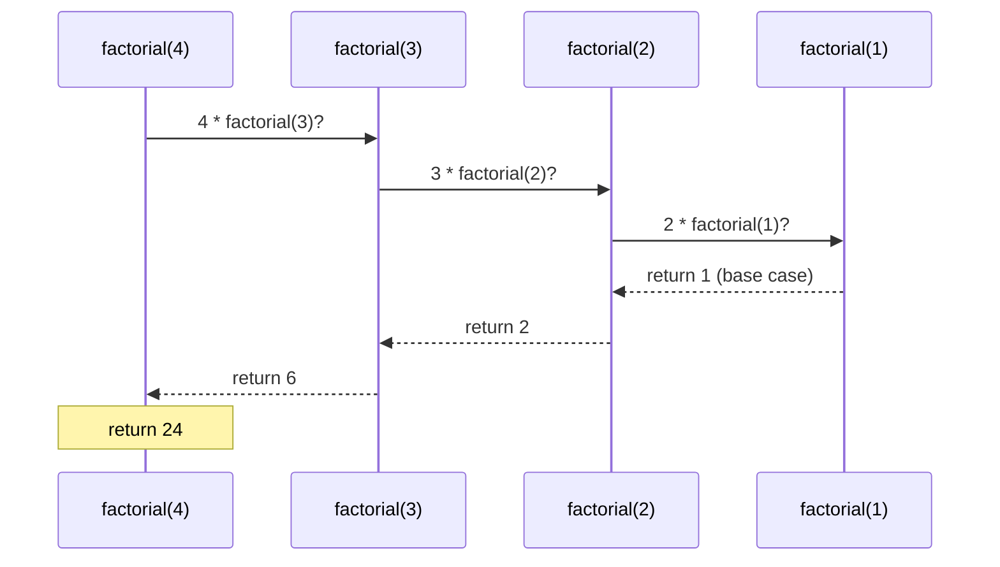
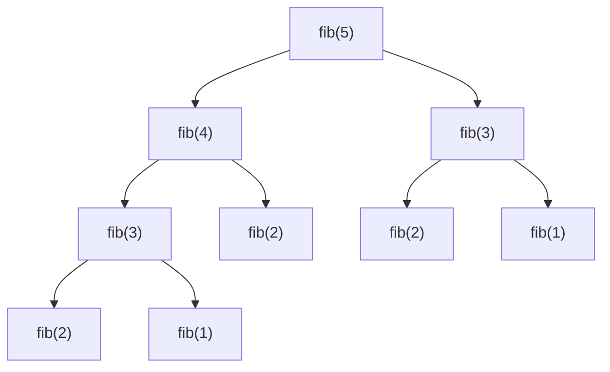

# Recursion

A recursive function solves a problem by **calling itself on a smaller version of the same problem**, until it reaches a case small enough to answer directly. Recursion is the natural way to work with recursive data such as trees, nested lists, file systems and JSON. It's also the foundation of divide-and-conquer algorithms (merge sort, quicksort, binary search), backtracking and dynamic programming. You need to be able to *trust* a recursive call rather than trace every step, while still knowing exactly what happens on the call stack.

## 1. The two parts of every recursive function

> [!SYNTAX]
> ```python
> def solve(problem):
>     if problem is small enough:        # BASE CASE: answer directly, no recursion
>         return direct_answer
>     smaller = make_smaller(problem)    # RECURSIVE CASE: shrink the problem
>     return combine(solve(smaller))     # trust the call, then combine
> ```

```python
def factorial(n):
    if n <= 1:                 # base case
        return 1
    return n * factorial(n - 1)    # recursive case: n! = n × (n-1)!

print(factorial(5))            # 120
```

Two non-negotiable requirements:

1. **A base case** that stops the recursion.
2. **Progress**: each call must move strictly toward the base case.

Miss either one and you get infinite recursion, which Python stops with `RecursionError: maximum recursion depth exceeded`.

## 2. What happens on the call stack

Each call gets its own frame with its own `n`. The calls **wind** down to the base case, then **unwind** as each frame multiplies its result and returns:



<div class="figure">
<svg viewBox="0 0 520 210" width="520" xmlns="http://www.w3.org/2000/svg" font-family="ui-monospace, monospace" font-size="13">
  <g fill="none" stroke="currentColor" stroke-opacity=".6">
    <rect x="40" y="150" width="200" height="34" rx="4"/><rect x="40" y="114" width="200" height="34" rx="4"/>
    <rect x="40" y="78" width="200" height="34" rx="4"/><rect x="40" y="42" width="200" height="34" rx="4" stroke="#3fb950" stroke-opacity="1" stroke-width="2"/>
  </g>
  <g fill="currentColor"><text x="52" y="172">factorial(4)  n=4</text><text x="52" y="136">factorial(3)  n=3</text><text x="52" y="100">factorial(2)  n=2</text><text x="52" y="64">factorial(1)  n=1 → 1</text></g>
  <text x="40" y="28" fill="currentColor" font-family="sans-serif" font-size="12" fill-opacity=".7">top of stack (most recent call)</text>
  <text x="270" y="64" fill="#3fb950" font-family="sans-serif" font-size="12">base case returns first</text>
  <text x="270" y="172" fill="currentColor" font-family="sans-serif" font-size="12" fill-opacity=".7">this frame waits for all the others</text>
  <text x="270" y="118" fill="currentColor" font-family="sans-serif" font-size="12" fill-opacity=".7">max depth = n frames → O(n) memory</text>
</svg>
<figcaption>The stack at its deepest point while computing <code>factorial(4)</code>.</figcaption>
</div>

> [!KEY]
> Recursion uses **O(depth) stack memory**. CPython's default limit is **1000 frames** (`sys.getrecursionlimit()`). A recursive solution that goes 10⁵ deep crashes even if it's logically correct. You can raise the limit with `sys.setrecursionlimit(...)` (risky: real C-stack overflow can crash the process), or convert to iteration.

## 3. Thinking recursively: the "leap of faith"

Don't trace every level in your head. Instead:

1. **Define** precisely what the function returns: "`total(xs)` returns the sum of list `xs`."
2. **Handle** the base case: "an empty list sums to 0."
3. **Assume** the function already works for smaller inputs, and use it: "the sum of `xs` is `xs[0]` + the sum of the rest."

```python
def total(xs):
    if not xs:
        return 0
    return xs[0] + total(xs[1:])
```

(This is fine for learning. `xs[1:]` copies the list each time, making it O(n²), and the depth is n. Use indices to avoid the copies.)

## 4. Recursion on recursive data

Recursion shines when the **data** is recursive. A nested list is "a list whose items are either values or nested lists":

```python
def flatten(x):
    result = []
    for item in x:
        if isinstance(item, list):
            result.extend(flatten(item))   # recursive structure → recursive call
        else:
            result.append(item)
    return result

print(flatten([1, [2, [3, [4]], 5]]))      # [1, 2, 3, 4, 5]
```

The same shape handles directory trees, JSON, HTML DOMs, expression trees and the binary trees in the DSA module.

## 5. Multiple recursion and the recursion tree

When a function calls itself **more than once**, the calls form a tree:

```python
def fib(n):
    if n < 2:
        return n
    return fib(n - 1) + fib(n - 2)
```



`fib(3)` is computed twice and `fib(2)` three times. The number of calls grows like φⁿ ≈ 1.618ⁿ: `fib(20)` makes **21,891** calls, and `fib(50)` would take hours.

### Memoization: remember the answers

The subproblems **overlap**, so cache them:

```python
from functools import cache

@cache                         # remembers fib(k) for every k it has seen
def fib(n):
    return n if n < 2 else fib(n - 1) + fib(n - 2)

print(fib(100))                # 354224848179261915075, instantly: O(n) calls
```

Recursion plus memoization is **top-down dynamic programming**. You'll formalise it in the DP topics.

## 6. Divide and conquer

Split the problem into **independent** halves, solve each recursively, and combine:

```python
def fast_power(base, exp):
    """base**exp in O(log exp) multiplications."""
    if exp == 0:
        return 1
    half = fast_power(base, exp // 2)          # solve ONE half-size problem...
    return half * half * (base if exp % 2 else 1)   # ...and reuse it

print(fast_power(2, 30))                       # 1073741824
```

Each level halves `exp`, so the depth is about log₂(exp): 30 for exp ≈ 10⁹. Merge sort (split, sort halves, merge) and binary search follow the same pattern.

### Towers of Hanoi: the classic

Move n disks from peg A to C using B, never putting a larger disk on a smaller one:

```python
def hanoi(n, src, via, dst, moves):
    if n == 0:
        return
    hanoi(n - 1, src, dst, via, moves)   # move n-1 disks out of the way
    moves.append((src, dst))             # move the biggest disk
    hanoi(n - 1, via, src, dst, moves)   # move the n-1 disks on top of it

m = []
hanoi(3, "A", "B", "C", m)
print(len(m))                            # 7 = 2³ − 1
```

The recurrence T(n) = 2T(n−1) + 1 solves to **2ⁿ − 1** moves. Writing and solving recurrences like this is how you analyse recursive algorithms.

## 7. Recursion vs iteration

Every recursive algorithm can be written iteratively, often with an **explicit stack** that replaces the call stack:

```python
def flatten_iter(x):
    stack, result = [iter(x)], []
    while stack:
        for item in stack[-1]:
            if isinstance(item, list):
                stack.append(iter(item))
                break
            result.append(item)
        else:
            stack.pop()
    return result
```

| | Recursion | Iteration |
|---|---|---|
| Readability for trees and divide & conquer | excellent | often clumsy |
| Memory | O(depth) call frames | explicit, controllable |
| Depth limit in Python | ~1000 | none (heap memory) |
| Speed in Python | function calls are expensive | usually faster |

> [!NOTE]
> **Tail recursion** means the recursive call is the very last action (`return f(n - 1, acc * n)`). Scheme and many functional languages reuse the frame for it (tail-call optimisation). **Python deliberately doesn't**: Guido van Rossum preferred complete tracebacks. So a tail-recursive function still uses O(n) stack in Python. Convert it to a loop.

## 8. Common recursion bugs

| Bug | Symptom |
|---|---|
| missing base case | `RecursionError` |
| no progress (`f(n)` calls `f(n)`) | `RecursionError` |
| base case that misses some inputs (`n == 1` but called with 0) | `RecursionError` for those inputs |
| forgetting to `return` the recursive result | returns `None` |
| overlapping subproblems without a memo | exponential time |
| slicing in every call | hidden O(n²) |

## 9. Exam-ready answers

> [!EXAM]
> **Recursion.** Recursion is a technique in which a function calls itself to solve smaller instances of the same problem. Every recursive function needs at least one base case, which is solved directly without recursion, and a recursive case that reduces the problem toward the base case. Each call creates a new stack frame holding its own local variables, so recursion consumes memory proportional to the maximum depth; CPython limits the depth (1000 by default) and raises `RecursionError` when it is exceeded. Python does not perform tail-call optimisation.

> [!EXAM]
> **Recursion vs iteration.** Recursion expresses problems with recursive structure, such as trees, nested data and divide-and-conquer algorithms, clearly and concisely, but each call adds function-call overhead and stack usage. Iteration uses loops with explicit state, is generally faster in Python and is not limited by recursion depth. Any recursive algorithm can be converted to an iterative one by using an explicit stack.

> [!EXAM]
> **Memoization.** Memoization stores the results of function calls keyed by their arguments so that repeated calls with the same arguments return the cached result. Applied to recursive functions with overlapping subproblems, such as Fibonacci, it reduces exponential time to polynomial time. In Python it is provided by `functools.lru_cache` and `functools.cache`.

## 10. Cheat sheet

| Pattern | Skeleton |
|---|---|
| linear | `f(n) = combine(n, f(n-1))` |
| on lists | `f(xs) = combine(xs[0], f(xs[1:]))` (prefer indices) |
| tree / nested | `for child in node: f(child)` |
| divide & conquer | `combine(f(left_half), f(right_half))` |
| memoize | `@functools.cache` |
| deep recursion | `sys.setrecursionlimit(10**6)` with care, or convert to a loop with a stack |

> [!INTERVIEW]
> **"What's the time complexity of naive recursive Fibonacci, and how do you fix it?"** O(φⁿ), about O(1.618ⁿ), often loosely called O(2ⁿ), because the recursion tree recomputes the same subproblems exponentially many times. Memoization makes it O(n) time and O(n) space. A bottom-up loop with two variables makes it O(n) time and O(1) space. Fast matrix exponentiation (fast doubling) does O(log n). Interviewers want all three levels.
