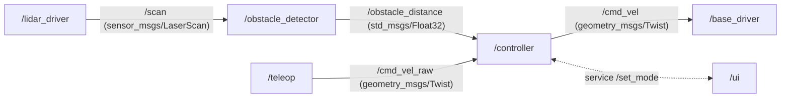

# Robotics with ROS 2 (rclpy)

**ROS 2** (Robot Operating System 2) is the standard middleware for robot software. It isn't an OS: it's a framework of processes (**nodes**) that communicate through typed messages over **topics** (publish/subscribe streams), **services** (request/response) and **actions** (long-running goals with feedback), using DDS as the transport. It comes with tools for launching systems, recording data (rosbag), visualisation (RViz), coordinate transforms (tf2) and navigation (Nav2). This lesson uses **rclpy**, the Python client library, and the code targets ROS 2 Lyrical (installed on this machine, so the judge can run real rclpy). We cover nodes, publishers, subscribers, timers, parameters, services, executors and callbacks, QoS, tf2 frames, launch files and a complete controller node.

## 1. The computation graph



| Concept | What | Example |
|---|---|---|
| node | one process role (driver, planner, controller) | `/controller` |
| topic | named, typed, many-to-many stream | `/scan` of `sensor_msgs/msg/LaserScan` |
| service | synchronous-style request/response | `/set_mode` of `std_srvs/srv/SetBool` |
| action | goal + feedback + result + cancel | `navigate_to_pose` |
| parameter | per-node configuration | `max_speed` |
| tf2 | the tree of coordinate frames over time | `map → odom → base_link → laser` |

## 2. A minimal publisher and subscriber

```python
import rclpy
from rclpy.node import Node
from std_msgs.msg import String

class Talker(Node):
    def __init__(self):
        super().__init__("talker")
        self.pub = self.create_publisher(String, "chatter", 10)     # 10 = QoS history depth
        self.count = 0
        self.timer = self.create_timer(0.1, self.tick)               # 10 Hz

    def tick(self):
        msg = String()
        msg.data = f"hello {self.count}"
        self.pub.publish(msg)
        self.count += 1

class Listener(Node):
    def __init__(self):
        super().__init__("listener")
        self.create_subscription(String, "chatter", self.on_msg, 10)

    def on_msg(self, msg):
        self.get_logger().info(f"heard: {msg.data}")

def main():
    rclpy.init()
    node = Talker()
    try:
        rclpy.spin(node)                 # process callbacks until Ctrl-C
    except KeyboardInterrupt:
        pass
    finally:
        node.destroy_node()
        rclpy.shutdown()
```

> [!KEY]
> ROS 2 nodes are **event-driven**. You register callbacks (subscriptions, timers, service handlers), and an **executor** (`rclpy.spin`) calls them as events arrive. Don't write `while True: sleep()` loops in a node: use timers. Never block inside a callback, because that stalls every other callback on that executor.

## 3. Messages

Messages are typed structures defined in `.msg` files, generated as Python classes:

```python
from geometry_msgs.msg import Twist, PoseStamped
from sensor_msgs.msg import LaserScan

cmd = Twist()
cmd.linear.x = 0.3                  # m/s forward (REP 103: x forward, y left, z up; SI units)
cmd.angular.z = 0.5                 # rad/s counter-clockwise

pose = PoseStamped()
pose.header.frame_id = "map"        # every stamped message says WHICH frame it's in
pose.pose.orientation.w = 1.0       # identity quaternion
```

Inspect types and live data from the CLI: `ros2 interface show sensor_msgs/msg/LaserScan`, `ros2 topic list`, `ros2 topic echo /scan`, `ros2 topic hz /scan`, `ros2 node info /controller`.

## 4. Executors and spinning

```python
from rclpy.executors import SingleThreadedExecutor, MultiThreadedExecutor

rclpy.init()
a, b = Talker(), Listener()
ex = SingleThreadedExecutor()
ex.add_node(a); ex.add_node(b)       # several nodes in ONE process (composition)
ex.spin_once(timeout_sec=0.1)        # process at most one ready callback; useful in tests
```

`MultiThreadedExecutor` with callback groups (`ReentrantCallbackGroup`, `MutuallyExclusiveCallbackGroup`) runs callbacks in parallel, for example so a slow service call doesn't block the 100 Hz control timer.

## 5. Parameters

```python
class Controller(Node):
    def __init__(self):
        super().__init__("controller")
        self.declare_parameter("max_speed", 0.5)
        self.declare_parameter("stop_distance", 0.4)
        self.max_speed = self.get_parameter("max_speed").value
        self.add_on_set_parameters_callback(self.on_params)     # react to runtime changes

    def on_params(self, params):
        from rcl_interfaces.msg import SetParametersResult
        for p in params:
            if p.name == "max_speed":
                if p.value < 0:
                    return SetParametersResult(successful=False, reason="max_speed must be >= 0")
                self.max_speed = p.value
        return SetParametersResult(successful=True)
```

Set parameters at launch (YAML files), from the CLI (`ros2 param set /controller max_speed 0.3`), or with `rclpy.parameter.Parameter` in tests.

## 6. Services

```python
from std_srvs.srv import SetBool

class ModeServer(Node):
    def __init__(self):
        super().__init__("mode_server")
        self.enabled = False
        self.create_service(SetBool, "set_enabled", self.on_request)

    def on_request(self, request, response):      # NOT "handle": Node already has a .handle attribute
        self.enabled = request.data
        response.success = True
        response.message = "enabled" if self.enabled else "disabled"
        return response

# client side
# cli = node.create_client(SetBool, "set_enabled")
# cli.wait_for_service(timeout_sec=1.0)
# future = cli.call_async(SetBool.Request(data=True))
# rclpy.spin_until_future_complete(node, future)   # or await it inside an async callback
```

> [!WARNING]
> Calling a service **synchronously** (`cli.call(...)`) from inside a callback on a single-threaded executor deadlocks: the executor is busy running your callback, so it can never process the response. Use `call_async` with futures, or separate callback groups on a multi-threaded executor.

**Actions** (`rclpy.action.ActionServer`/`ActionClient`) are for long tasks such as navigation goals or arm motions: they stream feedback and support cancellation.

## 7. Quality of Service

| QoS setting | Options | Typical use |
|---|---|---|
| reliability | RELIABLE / BEST_EFFORT | commands: reliable; high-rate sensors: best effort |
| durability | VOLATILE / TRANSIENT_LOCAL | maps and static config: transient local (late joiners get the last message) |
| history/depth | KEEP_LAST(n) / KEEP_ALL | n = queue size |

```python
from rclpy.qos import qos_profile_sensor_data, QoSProfile, DurabilityPolicy
self.create_subscription(LaserScan, "scan", self.on_scan, qos_profile_sensor_data)   # best effort
latched = QoSProfile(depth=1, durability=DurabilityPolicy.TRANSIENT_LOCAL)
```

Incompatible QoS (a reliable subscriber with a best-effort publisher) means **no data and no error**, beyond a warning event. Check with `ros2 topic info -v`.

## 8. tf2: coordinate frames

Every sensor reading lives in some frame. tf2 maintains the time-stamped tree (`map → odom → base_link → laser_link`) and transforms data between frames:

```python
from tf2_ros import Buffer, TransformListener, StaticTransformBroadcaster
from geometry_msgs.msg import TransformStamped

# static broadcaster: the laser is 0.2 m ahead of base_link
t = TransformStamped()
t.header.frame_id, t.child_frame_id = "base_link", "laser_link"
t.transform.translation.x = 0.2
t.transform.rotation.w = 1.0
# StaticTransformBroadcaster(node).sendTransform(t)
# buffer = Buffer(); TransformListener(buffer, node)
# tf = buffer.lookup_transform("base_link", "laser_link", rclpy.time.Time())
```

REP 105 conventions: `map` (global, may jump when localisation corrects), `odom` (continuous but drifting), `base_link` (on the robot).

## 9. Launch files

```python
# launch/robot.launch.py
from launch import LaunchDescription
from launch_ros.actions import Node

def generate_launch_description():
    return LaunchDescription([
        Node(package="my_robot", executable="controller", name="controller",
             parameters=[{"max_speed": 0.4}], remappings=[("cmd_vel", "/base/cmd_vel")]),
        Node(package="my_robot", executable="lidar_driver", output="screen"),
    ])
# ros2 launch my_robot robot.launch.py
```

Packages are built with `colcon build`. Python packages declare entry points in `setup.py` or `setup.cfg`, and `source install/setup.bash` adds them to the environment.

## 10. A complete safety controller

```python
class SafetyController(Node):
    """Forward teleop commands, but scale speed down near obstacles and stop inside stop_distance."""
    def __init__(self):
        super().__init__("safety_controller")
        self.declare_parameter("stop_distance", 0.4)
        self.declare_parameter("slow_distance", 1.0)
        self.nearest = float("inf")
        self.create_subscription(LaserScan, "scan", self.on_scan, qos_profile_sensor_data)
        self.create_subscription(Twist, "cmd_vel_raw", self.on_cmd, 10)
        self.pub = self.create_publisher(Twist, "cmd_vel", 10)

    def on_scan(self, scan):
        valid = [r for r in scan.ranges if scan.range_min <= r <= scan.range_max]
        self.nearest = min(valid, default=float("inf"))

    def on_cmd(self, cmd):
        stop = self.get_parameter("stop_distance").value
        slow = self.get_parameter("slow_distance").value
        out = Twist()
        out.angular.z = cmd.angular.z
        if self.nearest <= stop:
            out.linear.x = min(cmd.linear.x, 0.0)          # allow reversing only
        elif self.nearest < slow:
            out.linear.x = cmd.linear.x * (self.nearest - stop) / (slow - stop)
        else:
            out.linear.x = cmd.linear.x
        self.pub.publish(out)
```

## 11. Exam-ready answers

> [!EXAM]
> **ROS 2 communication patterns.** ROS 2 structures robot software as a graph of nodes that communicate through typed interfaces over a DDS-based middleware. Topics provide anonymous, many-to-many publish/subscribe streams suited to continuous data such as sensor readings and velocity commands; services provide request/response interactions for short operations; actions provide long-running goals with periodic feedback, results and cancellation. Nodes are event-driven: callbacks for subscriptions, timers and services are executed by executors, single- or multi-threaded, with callback groups controlling concurrency. Quality-of-service policies (reliability, durability, history depth) must be compatible between publishers and subscribers, and tf2 maintains time-stamped transforms between coordinate frames.

## 12. Cheat sheet

| Need | rclpy |
|---|---|
| node | `class N(Node): super().__init__("name")` |
| publish | `self.create_publisher(Type, "topic", 10)`; `.publish(msg)` |
| subscribe | `self.create_subscription(Type, "topic", cb, 10)` |
| periodic work | `self.create_timer(period_s, cb)` |
| parameter | `declare_parameter("p", default)`; `get_parameter("p").value` |
| service | `create_service(Srv, "name", handler)` (don't name methods `handle`, which shadows `Node.handle`); client `call_async` |
| run | `rclpy.init(); rclpy.spin(node); rclpy.shutdown()` |
| sensor QoS | `qos_profile_sensor_data` |
| frames | `tf2_ros.Buffer` + `TransformListener` |

> [!INTERVIEW]
> **"Your subscriber receives nothing although `ros2 topic list` shows the topic. What do you check?"**
> - QoS compatibility (`ros2 topic info -v`): a reliable subscriber with a best-effort publisher means silence.
> - The exact topic name (namespaces, remappings, a leading slash).
> - The message type.
> - That the node is actually spinning: callbacks only run inside an executor.
> - `ROS_DOMAIN_ID` and discovery range across machines.
> - That nothing blocks the executor (a long-running callback or a synchronous service call).
