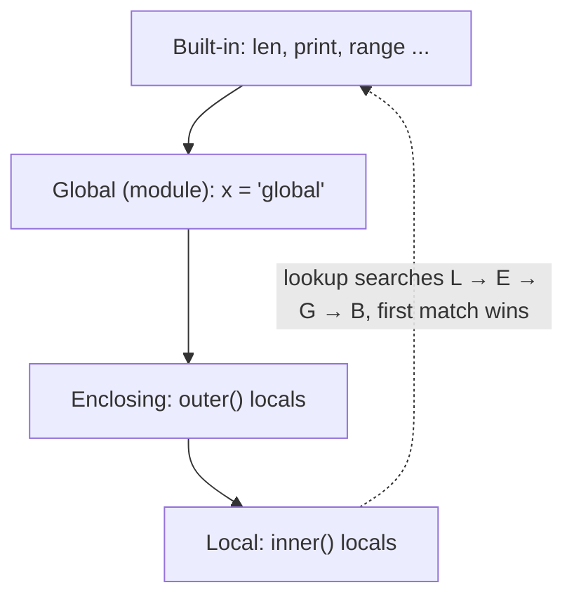

# Scope (LEGB), global, nonlocal and Closures

When Python meets a name like `x`, which `x` does it mean? The answer is decided by **scope rules**, and Python's are unusual in one key way: **assignment anywhere in a function makes the name local to the whole function**. That single rule explains `UnboundLocalError`, the need for `global` and `nonlocal`, and how **closures** (functions that remember variables) work. Closures in turn power decorators, callbacks and factories, and they're a frequent topic in senior interviews.

## 1. Namespaces and the LEGB rule

A **namespace** is a mapping from names to objects (literally a dict in most cases). Python looks names up in four nested scopes, in order:

| | Scope | Contains | Lifetime |
|---|---|---|---|
| **L** | Local | names assigned in the current function, plus its parameters | one call |
| **E** | Enclosing | locals of any enclosing `def`s (for nested functions) | while referenced |
| **G** | Global | top-level names of the current **module** | program run |
| **B** | Built-in | `len`, `print`, `range`, `ValueError`… | interpreter run |



```python
x = "global"
def outer():
    x = "enclosing"
    def inner():
        print(x)        # not local → enclosing → found: 'enclosing'
    inner()
outer()
```

If no scope has the name: `NameError`. "Global" in Python means **module-level**. There's no cross-module global scope; other modules reach your globals only through `import`.

> [!KEY]
> Blocks such as `if`, `for`, `while` and `with` **do not** create scopes in Python (unlike C/C++/Java). A variable assigned inside an `if` is visible after it in the same function. Only **modules, functions, classes and comprehensions** create scopes.

## 2. The rule that causes `UnboundLocalError`

> [!KEY]
> Python decides each name's scope **at compile time, for the whole function**. If a name is **assigned anywhere** in a function body (`=`, `+=`, `for x in`, `import x`, `def x`, `except E as x`), it is **local everywhere in that function**, even on lines **before** the assignment.

```python
count = 0
def increment():
    count += 1        # count is assigned here, so it's local in the WHOLE function
    return count

increment()
# UnboundLocalError: cannot access local variable 'count' where it is not associated with a value
```

`count += 1` means `count = count + 1`, so the read of `count` happens before the local has a value. Reading a global is fine. **Rebinding** it from inside a function needs a declaration.

## 3. `global` and `nonlocal`

```python
counter = 0
def bump():
    global counter        # "counter refers to the module-level name"
    counter += 1

bump(); bump()
print(counter)            # 2
```

`nonlocal` does the same for the nearest **enclosing function** scope:

```python
def make_accumulator():
    total = 0
    def add(value):
        nonlocal total    # rebind the enclosing 'total', not a new local
        total += value
        return total
    return add

acc = make_accumulator()
acc(5)
print(acc(10))            # 15
```

| Declaration | Lets you rebind | Must the name exist? |
|---|---|---|
| `global x` | the module-level `x` | no (creates it on assignment) |
| `nonlocal x` | `x` in the nearest enclosing function | **yes**, or it's a `SyntaxError` |

> [!WARNING]
> You only need `global`/`nonlocal` to **rebind** a name. **Mutating** an object through a name doesn't need them: `items.append(x)` works on a global list without `global items`, because `items` is only *read*.

> [!DANGER]
> Global mutable state makes code hard to test and reason about: any function might change it. Prefer passing values in and returning results, or encapsulating state in an object (OOP) or a closure.

## 4. Closures

A **closure** is a function that **remembers variables from the scope where it was created**, even after that scope has finished executing.

```python
def make_multiplier(n):
    def multiply(x):
        return x * n          # n is a FREE variable: from the enclosing scope
    return multiply           # return the function, don't call it

triple = make_multiplier(3)
double = make_multiplier(2)
print(triple(10), double(10))    # 30 20
```

`make_multiplier(3)` has returned and its frame is gone, yet `triple` still knows `n = 3`. Python keeps `n` alive in a **cell** object attached to the function:

```python
print(triple.__code__.co_freevars)            # ('n',)
print(triple.__closure__[0].cell_contents)    # 3
```

<div class="figure">
<svg viewBox="0 0 560 170" width="560" xmlns="http://www.w3.org/2000/svg" font-family="ui-monospace, monospace" font-size="13">
  <defs><marker id="ca" markerWidth="8" markerHeight="8" refX="7" refY="4" orient="auto"><path d="M0,0 L8,4 L0,8 z" fill="currentColor"/></marker></defs>
  <rect x="20" y="30" width="150" height="50" rx="6" fill="none" stroke="#2f81f7" stroke-width="2"/><text x="32" y="60" fill="currentColor">triple (function)</text>
  <rect x="230" y="30" width="120" height="50" rx="6" fill="none" stroke="#a371f7" stroke-width="2"/><text x="245" y="52" fill="currentColor">__closure__</text><text x="245" y="70" fill="currentColor">(cell,)</text>
  <rect x="410" y="30" width="120" height="50" rx="6" fill="none" stroke="#3fb950" stroke-width="2"/><text x="425" y="60" fill="currentColor">cell → 3</text>
  <line x1="170" y1="55" x2="226" y2="55" stroke="currentColor" marker-end="url(#ca)"/><line x1="350" y1="55" x2="406" y2="55" stroke="currentColor" marker-end="url(#ca)"/>
  <text x="20" y="120" fill="currentColor" font-family="sans-serif" font-size="12" fill-opacity=".75">The enclosing frame is gone, but the cell holding n survives because the closure references it.</text>
  <text x="20" y="145" fill="currentColor" font-family="sans-serif" font-size="12" fill-opacity=".75">Each call to make_multiplier creates a NEW cell, so triple and double don't interfere.</text>
</svg>
<figcaption>A closure = function code + references to the cells of its free variables.</figcaption>
</div>

Three conditions make a closure:

1. A nested function,
2. which refers to a variable of the enclosing function,
3. and the enclosing function returns (or otherwise passes out) the nested function.

### Closures carry state

With `nonlocal`, a closure is a lightweight object with private state:

```python
def make_counter():
    count = 0
    def counter():
        nonlocal count
        count += 1
        return count
    return counter

c1, c2 = make_counter(), make_counter()
c1(); c1()
print(c1(), c2())      # 3 1: independent state per closure
```

That's essentially a one-method object. Choosing between a closure and a class is a design decision: closures for one behaviour with a little state, classes when there are several operations on shared state.

## 5. Late binding: the classic closure trap

Closures capture **variables**, not **values**. The variable is looked up when the inner function **runs**:

```python
funcs = []
for i in range(3):
    funcs.append(lambda: i)
print([f() for f in funcs])     # [2, 2, 2]
```

All three lambdas share the one variable `i`, which is 2 by the time they're called. Fixes:

```python
funcs = [lambda i=i: i for i in range(3)]          # default argument captures the current VALUE
print([f() for f in funcs])                         # [0, 1, 2]

from functools import partial
funcs = [partial(lambda i: i, i) for i in range(3)] # partial binds the value now
```

The default-argument trick works because defaults are evaluated **at definition time** (the same rule behind the mutable default trap).

## 6. Where closures are used

- **Factories**: `make_multiplier`, `make_validator(min, max)`
- **Callbacks** that need context: `button.on_click(make_handler(item_id))`
- **Decorators** (the next-but-one lesson): every decorator is a closure over the decorated function
- **Memoization**: a cache dict held in the enclosing scope
- **Partial application**: `functools.partial` is closure-like

## 7. Exam-ready answers

> [!EXAM]
> **Scope and the LEGB rule.** The scope of a name is the region of code where it is visible. Python resolves a name by searching four scopes in order: Local (the current function), Enclosing (the local scopes of enclosing functions), Global (the module) and Built-in. A name assigned anywhere within a function is local to that function unless declared `global` or `nonlocal`, and this is decided at compile time for the whole function body. Referencing such a name before its assignment raises `UnboundLocalError`. Control-flow blocks do not create new scopes; only modules, classes, functions and comprehensions do.

> [!EXAM]
> **Closures.** A closure is a nested function that retains access to variables from its enclosing function's scope after the enclosing function has returned. The free variables are stored in cell objects referenced by the function's `__closure__` attribute. Closures are used to create function factories, to maintain private state between calls (with `nonlocal` for rebinding), and to implement decorators. Because closures capture variables rather than values, loop variables are bound late, a common pitfall solved by binding the current value through a default argument.

## 8. Cheat sheet

| Situation | Code |
|---|---|
| read a global | just use it |
| rebind a global | `global name` |
| rebind an enclosing variable | `nonlocal name` |
| mutate a global list or dict | no declaration needed |
| function factory | `def make(n): def f(x): ... n ...; return f` |
| capture a loop value | `lambda i=i: ...` or `functools.partial` |
| inspect the closure | `f.__closure__`, `f.__code__.co_freevars` |

> [!INTERVIEW]
> **"What does this print, and how do you fix it?"** `fs = [lambda: i for i in range(3)]; print([f() for f in fs])`. It prints `[2, 2, 2]`, because of late binding: each lambda closes over the same variable `i`, read at call time. Fix it with `lambda i=i: i`, or with `functools.partial`. Follow-up: "Why does the default fix it?" Because defaults are evaluated once, when each lambda is created, which captures the value of `i` at that moment.
