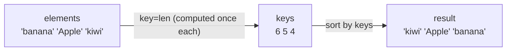

# Sorting and Key Functions

Sorting is the most common preprocessing step in algorithms. Sorted data makes binary search, two-pointer techniques, deduplication, grouping and greedy choices possible. Python makes sorting a one-liner, but expressing *exactly the order you want* (multiple keys, mixed directions, custom rules) is a skill interviewers test directly. This lesson also covers **stability** and **Timsort**, the algorithm under the hood.

## 1. `sorted()` vs `list.sort()`

| | `sorted(iterable, *, key=None, reverse=False)` | `lst.sort(*, key=None, reverse=False)` |
|---|---|---|
| Works on | **any iterable** (list, tuple, str, dict, set, generator) | lists only |
| Returns | a **new list** | `None` (sorts in place) |
| Original | unchanged | modified |

```python
nums = [3, 1, 2]
print(sorted(nums), nums)       # [1, 2, 3] [3, 1, 2]
nums.sort(reverse=True)
print(nums)                     # [3, 2, 1]
print(sorted("hello"))          # ['e', 'h', 'l', 'l', 'o']
print(sorted({"b": 1, "a": 2})) # ['a', 'b']: a dict sorts its keys
```

## 2. The default order

Elements are compared with `<`:

- numbers by value
- strings by **code point**, so uppercase letters sort before lowercase (`'Z' < 'a'`)
- tuples and lists lexicographically, element by element

Mixed incomparable types fail: `sorted([1, "a"])` raises `TypeError: '<' not supported between instances of 'str' and 'int'`.

## 3. Key functions

`key=` takes a **function of one argument**. Python calls it **once per element**, then sorts by the returned values. The elements themselves are returned unchanged.

```python
words = ["banana", "Apple", "cherry", "apple"]
print(sorted(words))                    # ['Apple', 'apple', 'banana', 'cherry']: code point order
print(sorted(words, key=str.lower))     # case-insensitive
print(sorted(words, key=len))           # by length
print(sorted([-3, 1, -2], key=abs))     # [1, -2, -3]
```



This is the **decorate-sort-undecorate** pattern done for you, and it's much faster than a comparison function because each key is computed only n times.

### Multi-key sorting with tuples

Return a **tuple** from the key. Ties on the first component are broken by the second, and so on:

```python
students = [("bob", 25), ("ada", 30), ("cy", 25)]
print(sorted(students, key=lambda s: (s[1], s[0])))
# [('bob', 25), ('cy', 25), ('ada', 30)]: by age, then name
```

**Mixed directions** (one key descending, another ascending): negate the numeric one.

```python
# score descending, then name ascending
ranked = sorted(players, key=lambda p: (-p.score, p.name))
```

### `operator.itemgetter` and `attrgetter`

Faster and more readable than lambdas for plain field access:

```python
from operator import itemgetter, attrgetter
sorted(students, key=itemgetter(1))        # by index 1
sorted(students, key=itemgetter(1, 0))     # by index 1, then index 0
sorted(people, key=attrgetter("age"))      # by attribute .age
```

## 4. Stability

> [!KEY]
> Python's sort is **stable**: elements with equal keys keep their **original relative order**.

<div class="figure">
<svg viewBox="0 0 600 160" width="600" xmlns="http://www.w3.org/2000/svg" font-family="ui-monospace, monospace" font-size="13">
  <text x="20" y="30" fill="currentColor" font-family="sans-serif" font-size="12">input (sort by number):</text>
  <g><rect x="20" y="40" width="70" height="30" rx="4" fill="#2f81f7" fill-opacity=".25"/><text x="32" y="60" fill="currentColor">2 ann</text>
  <rect x="100" y="40" width="70" height="30" rx="4" fill="#3fb950" fill-opacity=".25"/><text x="112" y="60" fill="currentColor">1 bob</text>
  <rect x="180" y="40" width="70" height="30" rx="4" fill="#2f81f7" fill-opacity=".25"/><text x="192" y="60" fill="currentColor">2 cy</text>
  <rect x="260" y="40" width="70" height="30" rx="4" fill="#3fb950" fill-opacity=".25"/><text x="272" y="60" fill="currentColor">1 dee</text></g>
  <text x="20" y="105" fill="currentColor" font-family="sans-serif" font-size="12">stable output:</text>
  <g><rect x="20" y="115" width="70" height="30" rx="4" fill="#3fb950" fill-opacity=".25"/><text x="32" y="135" fill="currentColor">1 bob</text>
  <rect x="100" y="115" width="70" height="30" rx="4" fill="#3fb950" fill-opacity=".25"/><text x="112" y="135" fill="currentColor">1 dee</text>
  <rect x="180" y="115" width="70" height="30" rx="4" fill="#2f81f7" fill-opacity=".25"/><text x="192" y="135" fill="currentColor">2 ann</text>
  <rect x="260" y="115" width="70" height="30" rx="4" fill="#2f81f7" fill-opacity=".25"/><text x="272" y="135" fill="currentColor">2 cy</text></g>
  <text x="350" y="135" fill="currentColor" font-family="sans-serif" font-size="12" fill-opacity=".75">bob stays before dee, ann before cy</text>
</svg>
<figcaption>Stability: ties keep their input order.</figcaption>
</div>

Stability enables **multi-pass sorting**: sort by the *least* important key first, then by more important keys. This is the general way to mix directions when you can't negate a key (for example, strings descending):

```python
data = [("a", 2), ("b", 1), ("c", 2), ("d", 1)]
step1 = sorted(data, key=lambda x: x[0], reverse=True)   # secondary: name descending
step2 = sorted(step1, key=lambda x: x[1])                # primary: number ascending
print(step2)    # [('d', 1), ('b', 1), ('c', 2), ('a', 2)]
```

`reverse=True` also preserves stability: equal elements are *not* reversed relative to each other.

## 5. Comparison functions: `cmp_to_key`

Some orders can't be expressed as a key, because whether `a` comes before `b` depends on *both*. Classic example (LeetCode 179, *Largest Number*): arrange numbers to form the largest concatenation. `"9"` before `"34"`, and `"3"` before `"30"`, because `"330" > "303"`.

```python
from functools import cmp_to_key

def compare(a, b):            # negative: a first, positive: b first, 0: equal
    if a + b > b + a:
        return -1
    if a + b < b + a:
        return 1
    return 0

nums = ["3", "30", "34", "5", "9"]
print("".join(sorted(nums, key=cmp_to_key(compare))))    # 9534330
```

A comparison function must define a consistent **total order** (transitive, with no contradictions), or the result is undefined.

## 6. Timsort: what Python actually runs

CPython's sort is **Timsort** (Tim Peters, 2002). Since 3.11 it uses an improved merge policy called **Powersort**. It's a hybrid of merge sort and insertion sort, tuned for real-world data:

1. Scan the list for **runs**: stretches that are already ascending (or strictly descending, which get reversed).
2. Extend short runs to a minimum length (32–64) with **binary insertion sort**.
3. **Merge** runs pairwise using a stack with balance rules, and a **galloping** mode that skips ahead quickly when one run keeps winning.

| Property | Value |
|---|---|
| Worst case | O(n log n) |
| Best case | **O(n)**, on already sorted or reverse-sorted input |
| Extra memory | O(n) |
| Stable | yes |
| Comparisons only? | yes (works on any type with `<`) |

> [!NOTE]
> No comparison-based sort can beat **Ω(n log n)** comparisons in the worst case: there are n! possible orderings, and each comparison at best halves the possibilities, so log₂(n!) ≈ n log n comparisons are needed. Counting sort and radix sort beat this only because they don't compare. They exploit the structure of the keys, such as small integer ranges.

## 7. Practical recipes

```python
sorted(words, key=str.casefold)                  # case-insensitive
sorted(d.items(), key=lambda kv: kv[1])          # dict by value
sorted(d, key=d.get, reverse=True)               # keys by value, descending
max(words, key=len)                              # min/max accept key= too
sorted(points, key=lambda p: p[0]**2 + p[1]**2)  # by distance from the origin
```

**Natural sort** (`file2` before `file10`): split the digit runs out and compare them as integers.

```python
import re
files = ["file10", "file2", "file1"]
print(sorted(files))     # ['file1', 'file10', 'file2']
print(sorted(files, key=lambda s: [int(t) if t.isdigit() else t for t in re.split(r"(\d+)", s)]))
# ['file1', 'file2', 'file10']
```

**Top-k without a full sort**: `heapq.nsmallest(k, xs, key=...)` is O(n log k), which is better than O(n log n) when k is small (heapq topic).

## 8. Exam-ready answers

> [!EXAM]
> **`sort()` vs `sorted()`.** `list.sort()` sorts a list in place and returns `None`. `sorted()` accepts any iterable and returns a new sorted list, leaving the original unchanged. Both accept a `key` function, applied once to each element to produce the values that are compared, and a `reverse` flag. Python's sorting algorithm, Timsort, is stable, runs in O(n log n) time in the worst case and O(n) on already-ordered data, and uses O(n) auxiliary memory.

> [!EXAM]
> **Stable sorting.** A sorting algorithm is stable if elements with equal keys appear in the output in the same relative order as in the input. Stability allows sorting by multiple criteria in successive passes, from the least significant key to the most significant.

## 9. Cheat sheet

| Order wanted | Code |
|---|---|
| ascending / descending | `sorted(xs)`, `sorted(xs, reverse=True)` |
| by a field | `key=itemgetter(i)` / `key=attrgetter("f")` |
| by A then B | `key=lambda x: (x.a, x.b)` |
| A descending (numeric), then B | `key=lambda x: (-x.a, x.b)` |
| A descending (string), then B | two stable passes: B first, then A with `reverse=True` |
| case-insensitive | `key=str.casefold` |
| custom pairwise rule | `key=cmp_to_key(cmp)` |
| in place | `xs.sort(...)` |

> [!INTERVIEW]
> **"Sort a list of intervals and merge the overlapping ones."** (LeetCode 56.) Sort by start, `intervals.sort(key=lambda x: x[0])`, then sweep once and extend the last merged interval while `start <= last_end`. O(n log n) overall, dominated by the sort. Many "hard-looking" problems become a sort plus one linear scan.
