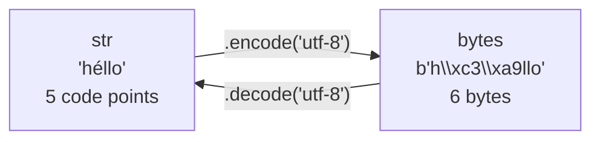

# Strings Advanced: Methods, Unicode, Bytes

You know how to index, slice and combine strings. This lesson covers the **toolbox**: the string methods you'll use daily for parsing and cleaning text, and the **text vs bytes** distinction that every file, network and serial-port program needs (talking to a robot's microcontroller over UART is all bytes). The method names are what people forget most, so they're grouped here by job.

> [!KEY]
> Every string method **returns a new string** (or a list or bool). None of them modifies the original, because strings are immutable. `s.strip()` on its own line does nothing; write `s = s.strip()`.

## 1. Cleaning: strip family and prefix/suffix

| Method | Does | Example → result |
|---|---|---|
| `s.strip()` | remove leading and trailing **whitespace** | `"  hi \n".strip()` → `"hi"` |
| `s.lstrip()` / `s.rstrip()` | only the left / right side | `"  hi ".rstrip()` → `"  hi"` |
| `s.strip(chars)` | remove any of the characters in `chars` from both ends | `"xxhixx".strip("x")` → `"hi"` |
| `s.removeprefix(p)` | remove the exact prefix if present (3.9+) | `"v1.2".removeprefix("v")` → `"1.2"` |
| `s.removesuffix(x)` | remove the exact suffix if present | `"a.pdf".removesuffix(".pdf")` → `"a"` |

> [!DANGER]
> `strip(chars)` treats its argument as a **set of characters**, not a substring. It keeps removing any of those characters from both ends until it hits one that isn't in the set. `"commit.com".strip(".com")` gives `"it"`, not `"commit"`: the characters c, o, m and `.` are stripped from both ends until a character outside that set (i, t) is reached. To remove a specific prefix or suffix, use `removeprefix` / `removesuffix`: `"commit.com".removesuffix(".com")` gives `"commit"`.

## 2. Splitting and joining

```python
print("a,b,,c".split(","))        # ['a', 'b', '', 'c']: empty fields kept
print("a  b\tc ".split())         # ['a', 'b', 'c']: no argument: any whitespace run, ends ignored
print("a b c d".split(" ", 2))    # ['a', 'b', 'c d']: maxsplit = 2
print("a b c d".rsplit(" ", 1))   # ['a b c', 'd']: split from the right
print("k=v=w".partition("="))     # ('k', '=', 'v=w'): always a 3-tuple
print("a\nb\r\nc".splitlines())   # ['a', 'b', 'c']: handles \n, \r\n, \r
print("-".join(["2026", "10", "24"]))   # 2026-10-24
```

> [!SYNTAX]
> `separator.join(iterable_of_strings)`. The method belongs to the **separator**, not to the list. The items must already be strings: `",".join(map(str, nums))`.

`join` is the **efficient** way to build a large string. It computes the total length once and copies each piece once, so it's O(total length). Repeated `+=` can be O(n²).

## 3. Searching

| Method | Returns | When not found |
|---|---|---|
| `s.find(sub)` | lowest index | `-1` |
| `s.rfind(sub)` | highest index | `-1` |
| `s.index(sub)` | lowest index | **raises `ValueError`** |
| `s.count(sub)` | number of **non-overlapping** occurrences | `0` |
| `sub in s` | `True`/`False` | — |
| `s.startswith(p)` / `s.endswith(x)` | bool; also accepts a **tuple** of options | — |

```python
s = "banana"
print(s.find("na"), s.rfind("na"), s.find("z"))   # 2 4 -1
print(s.count("ana"))                             # 1: non-overlapping ("ana" really occurs twice, overlapping)
print("main.py".endswith((".py", ".c")))          # True
```

Optional `start, end` arguments restrict the search: `s.find("a", 2)` starts at index 2.

## 4. Replacing and translating

```python
print("banana".replace("a", "o"))       # bonono
print("banana".replace("a", "o", 2))    # bonona: at most 2 replacements
table = str.maketrans("abc", "xyz", "!")   # map a→x, b→y, c→z; delete '!'
print("aabbcc!!".translate(table))         # xxyyzz
```

`translate` performs many single-character substitutions in **one pass**, much faster than chaining `replace` calls.

## 5. Case conversion

| Method | `"hELLO wORLD"` → |
|---|---|
| `upper()` | `HELLO WORLD` |
| `lower()` | `hello world` |
| `title()` | `Hello World` |
| `capitalize()` | `Hello world` |
| `swapcase()` | `Hello World` |
| `casefold()` | like `lower()` but more aggressive, for case-insensitive comparison: `"Straße".casefold()` → `"strasse"` |

Case-insensitive equality: `a.casefold() == b.casefold()`.

## 6. Testing character classes

| Method | True when every character is… (and the string is non-empty) |
|---|---|
| `isalpha()` | a letter |
| `isdigit()` | a digit (includes `²`, superscripts) |
| `isdecimal()` | a decimal digit 0–9 in some script (the strictest; best for "is this an int?") |
| `isnumeric()` | any numeric character (includes `½`, `Ⅷ`) |
| `isalnum()` | a letter or digit |
| `isspace()` | whitespace |
| `isupper()` / `islower()` | cased and upper / lower |

```python
print("42".isdigit(), "-42".isdigit(), "4.2".isdecimal())   # True False False
print("".isalpha())                                          # False: empty is never true
```

> [!WARNING]
> `"-42".isdigit()` is `False` (the sign isn't a digit) and `"3.5".isdigit()` is `False`. To check whether text is a valid number, try `int(s)` / `float(s)` and catch `ValueError` (Exceptions lesson).

## 7. Padding and alignment

```python
print("7".zfill(3), "-7".zfill(4))            # 007 -007: zero-fill, sign-aware
print("ab".center(6, "*"))                    # **ab**
print("ab".ljust(4) + "|", "ab".rjust(4))     # 'ab  |' '  ab'
```

f-strings (`f"{s:^6}"`) do the same job and usually read better.

## 8. Text vs bytes: Unicode and encodings

This is the concept that confuses everyone once, then stays clear forever.

- A **`str`** is a sequence of **Unicode code points**: abstract characters such as `'é'` (U+00E9) or `'🙂'` (U+1F642).
- A **`bytes`** object is a sequence of **integers 0–255**: raw data as it sits in a file, on the network, or on a serial line.
- An **encoding** (UTF-8, ASCII, Latin-1, UTF-16…) is the rule for converting between them.



```python
b = "héllo".encode("utf-8")
print(b, len(b), len("héllo"))   # b'h\xc3\xa9llo' 6 5
print(b.decode("utf-8"))         # héllo
print(len("🙂".encode("utf-8"))) # 4
print(b"AB"[0], list(b"AB"))     # 65 [65, 66]: indexing bytes gives INTs
```

**UTF-8** is variable-length: ASCII characters take 1 byte, `é` takes 2, `€` takes 3 and emoji take 4. It's backward-compatible with ASCII and is the default almost everywhere. Always pass `encoding="utf-8"` explicitly when opening text files.

Errors happen when a character can't be represented, or the bytes aren't valid for the codec:

```python
"é".encode("ascii")                       # UnicodeEncodeError
"é".encode("ascii", errors="replace")     # b'?'
b"\xff".decode("utf-8", errors="replace") # '�' (the � replacement character)
```

> [!KEY]
> The **Unicode sandwich**: decode bytes to `str` as soon as data comes in, work only with `str` inside your program, and encode to bytes only at the moment you write out. Mixing the two (`"a" + b"b"`) raises `TypeError` in Python 3.

### Normalization (one more Unicode gotcha)

`"é"` can be stored as one code point (U+00E9) or as `e` + a combining accent (U+0065 U+0301). The two look identical but compare unequal:

```python
import unicodedata
a, b = "é", "é"
print(a == b, len(b))                              # False 2
print(unicodedata.normalize("NFC", b) == a)        # True
```

Normalise user-entered text before comparing it.

## 9. Exam-ready answers

> [!EXAM]
> **`str` vs `bytes`.** In Python 3, `str` represents text as an immutable sequence of Unicode code points, while `bytes` represents binary data as an immutable sequence of integers in the range 0–255. Text is converted to bytes by encoding (`s.encode('utf-8')`) and bytes to text by decoding (`b.decode('utf-8')`) according to a character encoding. UTF-8 is a variable-length encoding using one to four bytes per code point and is compatible with ASCII. The two types cannot be mixed in operations; decoding at the input boundary and encoding at the output boundary keeps programs correct.

> [!EXAM]
> **Common string methods.** `split(sep)` divides a string into a list (on whitespace runs if `sep` is omitted), and `sep.join(iterable)` concatenates strings with a separator. `strip()` removes surrounding whitespace or given characters. `find()` returns the index of a substring or −1, whereas `index()` raises `ValueError`. `replace(old, new)` substitutes occurrences. `upper()`, `lower()` and `title()` change case, and `isdigit()`, `isalpha()` and similar methods test character classes. All of them return new strings because strings are immutable.

## 10. Cheat sheet

| Job | Method |
|---|---|
| trim whitespace | `strip()` |
| drop a known prefix / suffix | `removeprefix()`, `removesuffix()` |
| words | `split()` |
| fields | `split(",")`, `split(":", 1)` |
| key/value at first `=` | `k, _, v = s.partition("=")` |
| glue | `" ".join(words)` |
| find, safely | `find()` → −1 |
| count | `count()` |
| replace many characters | `translate(str.maketrans(...))` |
| case-insensitive compare | `casefold()` |
| is an unsigned integer | `isdecimal()` |
| text → bytes | `encode("utf-8")` |
| bytes → text | `decode("utf-8")` |

> [!INTERVIEW]
> **"Why does `len('naïve'.encode())` differ from `len('naïve')`?"** `len` of a `str` counts code points (5). `len` of the UTF-8 `bytes` counts bytes (6), because `ï` needs two bytes in UTF-8. A follow-up: in C, `strlen` counts **bytes**, so buffer sizes for UTF-8 text must account for multi-byte characters.
