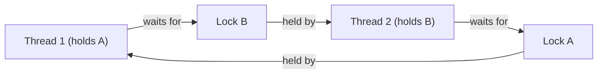

# Synchronization Primitives and Deadlocks

Locks are only the start. Concurrent programs need threads to **wait for conditions** ("queue not empty", "all workers ready", "shutdown requested"), to **limit access** to scarce resources, and to coordinate phases, all without the classic failures: **deadlock**, **livelock** and **starvation**. This lesson covers Python's `threading` primitives (`Lock`, `RLock`, `Semaphore`, `Event`, `Condition`, `Barrier`), the four conditions for deadlock, and the standard techniques to prevent it. The concepts carry over directly to C++ (`std::mutex`, `std::condition_variable`) and POSIX threads.

## 1. The primitives

| Primitive | Semantics | Typical use |
|---|---|---|
| `Lock` | one holder at a time, non-reentrant | protect shared state |
| `RLock` | reentrant: the owning thread may re-acquire it (it counts) | recursive functions that need the same lock |
| `Semaphore(n)` | a counter: `acquire` decrements (blocking at 0), `release` increments | limit concurrent users of a resource (connections, GPU slots) |
| `BoundedSemaphore(n)` | a semaphore that errors if released too often | catch release bugs |
| `Event` | a boolean flag: `set()`, `clear()`, `wait()` | one-shot signals: start, stop, ready |
| `Condition` | a lock + wait/notify on a predicate | "wait until state X" (queues, buffers) |
| `Barrier(n)` | n threads wait until all have arrived | phase-synchronised parallel steps |

All of them support `with` (acquire and release), and `acquire(timeout=...)` for bounded waits.

## 2. Condition variables

A **Condition** lets a thread sleep until another thread changes shared state and notifies it. A bounded buffer, the heart of every producer–consumer system:

```python
import threading
from collections import deque

class BoundedBuffer:
    def __init__(self, capacity):
        self.items = deque()
        self.capacity = capacity
        self.cond = threading.Condition()

    def put(self, item):
        with self.cond:
            while len(self.items) >= self.capacity:   # ALWAYS a while loop, never an if
                self.cond.wait()                      # releases the lock while sleeping, re-acquires on wake
            self.items.append(item)
            self.cond.notify_all()

    def get(self):
        with self.cond:
            self.cond.wait_for(lambda: self.items)    # the same as the while-loop pattern
            item = self.items.popleft()
            self.cond.notify_all()
            return item
```

> [!KEY]
> Always re-check the condition in a **loop** after waking. Wake-ups can be **spurious**, and another thread may have consumed the item between the notify and your wake-up. `wait()` atomically releases the lock and sleeps, which is what makes this race-free. (`queue.Queue` is implemented exactly like this.)

## 3. Deadlock

A **deadlock** happens when threads wait for each other forever. The classic case is two locks acquired in opposite orders:

```python
a, b = threading.Lock(), threading.Lock()

def t1():
    with a:
        with b: ...          # holds a, wants b

def t2():
    with b:
        with a: ...          # holds b, wants a: DEADLOCK if the two interleave
```



**Coffman conditions:** a deadlock requires **all four**, so breaking any one prevents it:

| Condition | Meaning | How to break it |
|---|---|---|
| mutual exclusion | resources can't be shared | use lock-free or immutable data where possible |
| hold and wait | holding one resource while waiting for another | acquire everything at once, or nothing |
| no preemption | locks can't be forcibly taken away | `acquire(timeout=...)`: back off and retry |
| **circular wait** | a cycle in the waits-for graph | **a global lock ordering**: always acquire in the same order |

```python
def transfer(src, dst, amount):
    first, second = sorted([src, dst], key=id)     # a consistent global order breaks the cycle
    with first.lock, second.lock:
        src.balance -= amount
        dst.balance += amount
```

## 4. Livelock and starvation

- **Livelock:** threads keep reacting to each other without progressing, like two people stepping aside in the same direction repeatedly (for example, both releasing and retrying locks in lockstep). Fix with **randomised backoff**.
- **Starvation:** a thread never gets the resource because others always win (unfair locks, readers starving writers). Fix with fair queuing and bounded waits.
- **Priority inversion:** a high-priority task waits on a lock held by a low-priority one that's pre-empted by medium-priority work. This famously reset the Mars Pathfinder rover in 1997. Real-time OSes use **priority inheritance**.

## 5. Practical rules

1. **Minimise shared mutable state.** Message passing (queues) beats locks.
2. Hold locks **briefly**. Never call unknown code (callbacks) or do I/O while holding a lock.
3. Use **one global acquisition order** when multiple locks are needed. Document it.
4. Use **timeouts** in production code so deadlocks surface as errors, not hangs.
5. Prefer higher-level tools: `queue.Queue`, `concurrent.futures`, asyncio, actors.
6. For debugging, `faulthandler.dump_traceback_later(timeout)` or `py-spy dump --pid` shows where every thread is stuck.

## 6. Exam-ready answers

> [!EXAM]
> **Synchronisation and deadlock.** Synchronisation primitives coordinate threads: a lock (mutex) provides mutual exclusion; a reentrant lock may be re-acquired by its owning thread; a semaphore maintains a counter limiting concurrent access; an event signals a condition to waiting threads; a condition variable lets threads wait, with the associated lock released, until notified that shared state has changed, re-checking the predicate in a loop to handle spurious wake-ups; and a barrier blocks threads until a given number have arrived. A deadlock is a state in which threads wait indefinitely for resources held by one another; it requires mutual exclusion, hold-and-wait, no preemption and circular wait, and is prevented by breaking one of these conditions, most commonly by acquiring locks in a consistent global order, or by using timeouts. Livelock (activity without progress) and starvation (indefinite postponement) are related liveness failures.

## 7. Cheat sheet

| Need | Primitive |
|---|---|
| protect shared data | `Lock` |
| the same thread locks again | `RLock` |
| at most N concurrent users | `Semaphore(N)` |
| a start or stop signal | `Event` |
| wait until the state changes | `Condition` + `wait_for(pred)` |
| all workers sync per phase | `Barrier(n)` |
| avoid deadlock with several locks | a fixed global order (`sorted(..., key=id)`) |
| make hangs visible | `acquire(timeout=...)` |

> [!INTERVIEW]
> **"What are the necessary conditions for deadlock, and how do you prevent it in practice?"** Mutual exclusion, hold-and-wait, no preemption and circular wait (the Coffman conditions), and all four must hold. In practice you break circular wait by imposing a global lock order (always lock account A before B, by ID). You break hold-and-wait by acquiring all needed locks at once (`std::scoped_lock` in C++, or a single coarse lock). You emulate preemption with try-lock and timeouts plus backoff. Better still, reduce shared state with message passing. Mention detection: the waits-for graph cycle detection that databases do, and tools that dump all thread stacks.
