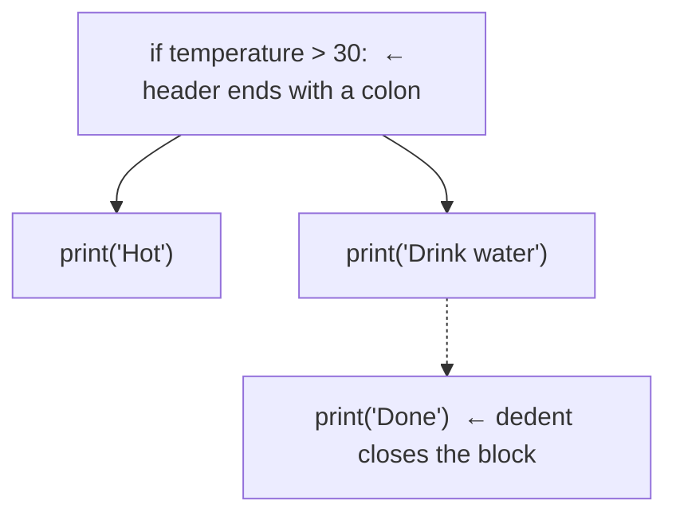

# Syntax, Indentation and Comments

Python's grammar is small, but it is strict about a few things other languages are relaxed about, above all **indentation**. This lesson gives you the exact rules for how a Python file is laid out: statements, blocks, line breaks, comments, docstrings and naming. Learn these once and most "why is this a syntax error?" moments disappear.

## 1. Statements and lines

A Python program is a sequence of **statements**. Normally **one physical line = one statement**, and the newline ends the statement. There are no semicolons to forget.

```python
x = 10
y = x * 2
print(y)
```

You *may* put several simple statements on one line with `;`, but style guides discourage it:

```python
x = 10; y = 20; print(x + y)    # legal, but avoid
```

> [!SYNTAX]
> - A **simple statement** fits on one logical line: assignment, `print(...)`, `return`, `import`, `pass`, `break`…
> - A **compound statement** has a *header* ending in `:` followed by an indented *block*: `if`, `elif`, `else`, `for`, `while`, `def`, `class`, `try`, `with`, `match`.

## 2. Blocks are defined by indentation

In C, C++ and Java, braces `{ }` mark a block and indentation is only for humans. In Python, **indentation is the block**.

```python
temperature = 31
if temperature > 30:
    print("Hot")          # inside the if-block
    print("Drink water")  # still inside
print("Done")             # back at the outer level: always runs
```

```output
Hot
Drink water
Done
```



The rules the tokenizer enforces:

1. A header line **must end with a colon** `:`.
2. The next line must be **indented more** than the header. This starts the block.
3. Every statement in the block must be indented by **exactly the same amount**.
4. A line with **less** indentation closes the block. It must line up with some enclosing level.
5. A block cannot be empty. Use `pass` as a placeholder.

```python
def todo():
    pass        # "do nothing" — keeps the block syntactically valid
```

> [!TIP]
> PEP 8 (the official style guide) says **4 spaces per level**. Never mix tabs and spaces. Python 3 raises `TabError` when a block uses them inconsistently. Every editor in this platform inserts 4 spaces when you press Tab.

### The three indentation errors

```python
if True:
print("x")          # IndentationError: expected an indented block
```

```python
x = 1
    y = 2           # IndentationError: unexpected indent
```

```python
if True:
        a = 1
    b = 2           # IndentationError: unindent does not match any outer indentation level
```

<div class="figure">
<svg viewBox="0 0 560 200" width="560" xmlns="http://www.w3.org/2000/svg" font-family="ui-monospace, monospace" font-size="13">
  <g fill="currentColor">
    <text x="20" y="30">for i in range(3):</text>
    <text x="52" y="58">if i % 2 == 0:</text>
    <text x="84" y="86">print("even", i)</text>
    <text x="52" y="114">else:</text>
    <text x="84" y="142">print("odd", i)</text>
    <text x="20" y="170">print("end")</text>
  </g>
  <g stroke-width="3" fill="none">
    <line x1="12" y1="40" x2="12" y2="150" stroke="#2f81f7"/>
    <line x1="44" y1="66" x2="44" y2="94" stroke="#3fb950"/>
    <line x1="44" y1="122" x2="44" y2="150" stroke="#3fb950"/>
  </g>
  <g font-family="sans-serif" font-size="12" fill="currentColor" fill-opacity=".7">
    <text x="330" y="60">blue: body of the for loop (level 1)</text>
    <text x="330" y="90">green: bodies of if / else (level 2)</text>
    <text x="330" y="170">dedent to level 0: runs once, after the loop</text>
  </g>
</svg>
<figcaption>Each indentation level is a nested block. The vertical bars are what Python "sees".</figcaption>
</div>

## 3. Long lines: explicit and implicit continuation

A statement can span several physical lines in two ways.

**Implicit continuation (preferred).** Inside `()`, `[]` or `{}`, newlines are ignored until the bracket closes:

```python
total = (price * quantity
         + shipping
         - discount)

primes = [
    2, 3, 5, 7,
    11, 13, 17,     # a trailing comma is allowed and makes diffs cleaner
]
```

**Explicit continuation** with a backslash at the very end of the line:

```python
total = price * quantity \
        + shipping
```

> [!DANGER]
> A backslash continuation breaks if **anything**, even a space or a comment, follows the `\`. Prefer parentheses.

## 4. Comments and docstrings

A **comment** starts with `#` and runs to the end of the line. The tokenizer throws it away.

```python
# Full-line comment explaining WHY, not WHAT
rate = 0.18   # inline comment: two spaces before the #
```

Python has no multi-line comment syntax. You comment several lines by putting `#` on each.

A **docstring** is a string literal that is the *first statement* of a module, function, class or method. Unlike a comment, it is kept at run time and becomes the object's `__doc__` attribute, which `help()` displays.

```python
def area(r):
    """Return the area of a circle with radius r."""
    return 3.14159 * r * r

print(area.__doc__)
```

```output
Return the area of a circle with radius r.
```

> [!WARNING]
> A triple-quoted string that is *not* in docstring position is just an expression statement that gets evaluated and thrown away. It works as a "block comment" in practice, but it is not a comment. Use `#` for comments.

## 5. Names (identifiers) and keywords

An **identifier** names a variable, function, class or module.

> [!SYNTAX]
> - Starts with a letter (any Unicode letter) or `_`; continues with letters, digits or `_`.
> - **Case-sensitive**: `count`, `Count` and `COUNT` are three different names.
> - Cannot be a **keyword**.

```python
valid_name = 1
_private = 2
camelCase = 3       # legal, but not Python style
café = 4            # legal (Unicode), rarely a good idea
# 2nd_place = 5     # SyntaxError: cannot start with a digit
# class = 6         # SyntaxError: 'class' is a keyword
```

Python 3.14 has 35 **hard keywords** (always reserved) and a few **soft keywords** that are reserved only in specific places:

```python
import keyword
print(len(keyword.kwlist), keyword.kwlist[:6])
print(keyword.softkwlist)
```

```output
35 ['False', 'None', 'True', 'and', 'as', 'assert']
['_', 'case', 'match', 'type']
```

`match` and `case` are soft keywords, so `match = 5` is still a legal variable name. They only act as keywords at the start of a `match` statement.

### PEP 8 naming conventions

| Kind | Convention | Example |
|---|---|---|
| Variables, functions, methods | `lower_snake_case` | `user_count`, `get_total()` |
| Classes | `CapWords` | `BankAccount`, `HttpServer` |
| Constants | `UPPER_SNAKE_CASE` | `MAX_SPEED`, `PI` |
| "Internal" names | leading underscore | `_cache` |
| Avoid clashing with keywords | trailing underscore | `class_`, `type_` |

> [!DANGER]
> Never name a variable `list`, `str`, `dict`, `max`, `sum`, `input` or `id`. It is legal, but it **shadows** the built-in, and the built-in stops working for the rest of that scope: `list = [1, 2]` then `list("abc")` raises `TypeError: 'list' object is not callable`.

## 6. Whitespace inside lines

Inside a line, spaces between tokens don't matter to the parser (`x=1+2` equals `x = 1 + 2`). PEP 8 still asks for readable spacing:

```python
x = a + b               # spaces around binary operators
items[1:3]              # no spaces inside brackets
f(a, b=2)               # no space around = for keyword arguments
```

Blank lines are ignored by the parser. Convention: two blank lines between top-level functions and classes, one between methods.

## 7. The `if __name__ == "__main__":` idiom (preview)

You will see this at the bottom of many scripts:

```python
def main():
    print("running")

if __name__ == "__main__":
    main()
```

`__name__` is `"__main__"` when the file is run directly, and the module's name when it is imported. The guard lets a file be both a runnable script and an importable module. The Modules lesson covers it fully.

## 8. Exam-ready summary

> [!EXAM]
> **Indentation in Python.** Python uses indentation, not braces, to define blocks of code. A compound statement header (`if`, `for`, `while`, `def`, `class`, etc.) ends with a colon, and the statements of its body must be indented consistently, conventionally by four spaces, relative to the header. A decrease in indentation ends the block. Incorrect indentation is a syntax-level error (`IndentationError`, or `TabError` for inconsistent tabs and spaces), detected before the program runs. This enforces readable code and removes the "dangling else" ambiguity found in C-like languages.

> [!EXAM]
> **Comment vs docstring.** A comment begins with `#` and is discarded by the tokenizer; it documents code for readers. A docstring is a string literal placed as the first statement of a module, class or function. It is retained at run time in the object's `__doc__` attribute and used by `help()` and documentation tools.

## 9. Cheat sheet

| Rule | Example |
|---|---|
| Header ends with `:` | `while n > 0:` |
| Block = consistent indent (4 spaces) | `    n -= 1` |
| Empty block placeholder | `pass` |
| Continue a line | wrap in `( )`, or `\` at end of line |
| Comment | `# text` |
| Docstring | `"""Summary line."""` as the first statement |
| Case-sensitive names | `Total` ≠ `total` |

> [!INTERVIEW]
> **"Why does Python use indentation instead of braces?"** It makes the visual structure and the actual structure the same thing. Code can't *look* nested while being parsed differently, which happens with misleading indentation in C. The cost is that copying code from sources that mangle whitespace can break it, and mixing tabs and spaces is an error.
