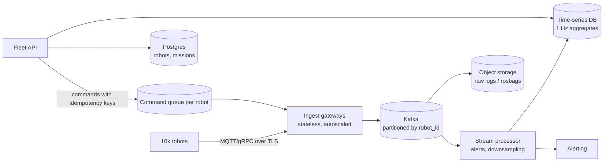

# System Design Fundamentals

System design interviews ask you to architect a service end to end, such as "design a URL shortener", "a rate limiter", or "a telemetry pipeline for 10,000 robots", reasoning about scale, reliability and trade-offs. For robotics and AI engineers the same skills apply to fleet backends, data pipelines and model serving. This lesson covers the method, back-of-the-envelope estimation, the core building blocks (load balancers, caches, databases, queues), partitioning with consistent hashing, replication and consistency (CAP/PACELC), rate limiting, idempotency, observability, and a worked robotics example.

## 1. A method for any design question

1. **Clarify requirements.** Functional: what does it do? Non-functional: QPS, latency, availability, durability, consistency, data size. Ask before designing.
2. **Estimate** load and storage (§2).
3. **Define the API** and data model.
4. **High-level design**: a box diagram of clients, gateway, services, storage and async pipelines.
5. **Deep dive** into the hardest parts: the bottlenecks, the hot keys, failure modes.
6. **Trade-offs and evolution**: what breaks at 10x, and what you'd monitor.

## 2. Back-of-the-envelope numbers

| Quantity | Rough value |
|---|---|
| L1 cache / main memory reference | 1 ns / 100 ns |
| SSD random read | 100 µs |
| Round trip within a datacenter | 0.5 ms |
| Cross-continent round trip | 100–150 ms |
| One day | ~10⁵ seconds (86,400) |
| 1 million requests/day | ~12 QPS (peak often 2–5x average) |

Example: 10,000 robots sending a 1 KB telemetry message at 10 Hz is 100,000 messages/s, 100 MB/s, 8.6 TB/day. That rules out one SQL database. It needs a partitioned stream (Kafka) with time-series storage and downsampling.

## 3. Building blocks

| Component | Purpose | Notes |
|---|---|---|
| **Load balancer** (L4/L7) | spreads requests across stateless instances | health checks, round robin / least connections, TLS termination |
| **Stateless services** | scale horizontally | keep session state in caches or databases, not in process memory |
| **Cache** (Redis, Memcached, CDN) | serve hot reads in ~1 ms | cache-aside pattern, TTLs, invalidation is the hard part, protect against stampedes |
| **Relational database** | transactions, joins, constraints | scale reads with replicas, scale writes by sharding |
| **NoSQL / KV / wide-column** | massive scale on simple access patterns | design the schema around the queries |
| **Message queue / log** (Kafka, RabbitMQ, SQS) | decouple producers from consumers, absorb bursts, retry | at-least-once delivery means consumers must be idempotent |
| **Object storage** (S3) | large blobs: maps, logs, rosbags, model weights | cheap, durable, high latency |
| **Search / time-series databases** | text search, telemetry | Elasticsearch, TimescaleDB, InfluxDB |

## 4. Partitioning and consistent hashing

To spread keys over N servers, `hash(key) % N` remaps **almost every key** when N changes, which is a cache or storage disaster. **Consistent hashing** places servers and keys on a hash ring, and each key belongs to the first server clockwise from it:
- Adding or removing a server moves only ~1/N of the keys, from its neighbours.
- **Virtual nodes** (each server at 100–200 points on the ring) even out the load and spread a failed server's keys across all the survivors.
- It's used by DynamoDB/Cassandra partitioning, CDN routing and distributed caches.

```python
import bisect, hashlib

class Ring:
    def __init__(self, vnodes=100): self.vnodes, self._keys, self._owner = vnodes, [], {}
    @staticmethod
    def _h(s: str) -> int: return int.from_bytes(hashlib.sha1(s.encode()).digest()[:8], "big")
    def add(self, node: str):
        for i in range(self.vnodes):
            h = self._h(f"{node}#{i}"); bisect.insort(self._keys, h); self._owner[h] = node
    def get(self, key: str) -> str:
        i = bisect.bisect(self._keys, self._h(key)) % len(self._keys)   # first point clockwise (wraps)
        return self._owner[self._keys[i]]
```

Watch out for **hot keys**: one celebrity user or one busy robot can overload a shard regardless of the hashing. Mitigations are key splitting, caching and request coalescing.

## 5. Replication and consistency

- **Leader-follower replication**: writes go to the leader and replicas serve reads. Asynchronous replication causes **replication lag**, so read-your-writes needs routing to the leader or session stickiness.
- **CAP**: during a network **P**artition, a system must choose between **C**onsistency (reject or wait) and **A**vailability (answer, possibly with stale data). **PACELC** adds: **E**lse, in normal operation, the trade-off is **L**atency versus **C**onsistency.
- **Quorums**: with N replicas, W write acknowledgements and R read replicas, R + W > N gives strongly consistent reads (Dynamo-style).
- **Consensus** (Raft, Paxos: etcd, ZooKeeper) handles leader election, locks and configuration. It's slow but correct, so use it for metadata, not bulk data.

## 6. Reliability patterns

- **Timeouts everywhere**, plus **retries with exponential backoff and jitter**, plus **circuit breakers** to stop hammering a failing dependency.
- **Idempotency**: an `Idempotency-Key` header, or naturally idempotent operations (`PUT`, upserts), so retries and at-least-once queues don't duplicate effects.
- **Rate limiting** protects services from abuse and overload:
  - A **token bucket** holds a capacity of B tokens refilled at rate r. Each request takes one token, so bursts up to B are allowed.
  - A **sliding window log or counter** is more exact.
  - Implement it centrally (Redis + Lua) for distributed limits.
- **Backpressure and load shedding**: reject early (HTTP 429/503) rather than queueing unboundedly.
- **Graceful degradation**: serve cached or stale data. A robot falls back to local autonomy when the cloud is unreachable.
- **Observability**:
  - **metrics** (RED: rate, errors, duration; USE: utilisation, saturation, errors);
  - structured **logs** with request IDs;
  - distributed **tracing** (OpenTelemetry);
  - SLOs with error budgets.

## 7. Worked example: robot fleet telemetry and commands



The design choices:
- **Partitioning by `robot_id`** preserves per-robot ordering.
- **Downsampling** keeps hot storage small, while raw data goes to cheap object storage for offline ML.
- **Commands** are acknowledged and idempotent, with expiry (a stale "move forward" must never execute late).
- Robots keep **safety-critical logic on board**: the cloud is for coordination, never for the safety loop.

> [!EXAM]
> **Why use consistent hashing instead of `hash(key) % N` to distribute keys across cache servers?**
> With modulo hashing, the server for almost every key changes when N changes (adding or removing a server, or a failure), causing a near-total cache miss storm or massive data movement. Consistent hashing maps both servers and keys onto a ring, and a key belongs to the next server clockwise, so a membership change only moves the keys adjacent to the affected server, about 1/N of the total. Virtual nodes (many ring positions per server) even out the distribution and spread a failed server's load across all the remaining servers.
