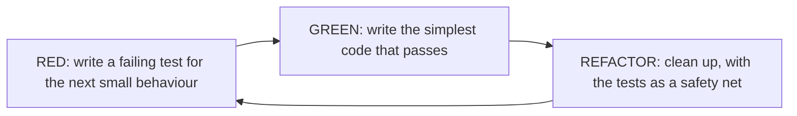

# TDD, Linting and Static Typing

Professional code quality comes from **feedback loops**: tests that run in seconds, linters that flag bugs as you type, a type checker that proves whole classes of errors impossible, and automation (pre-commit hooks, CI) that enforces all of it on every change. This lesson covers **test-driven development** (red–green–refactor), the modern Python toolchain (**ruff**, **mypy/pyright**, **pre-commit**), and a code-review checklist. These are the habits that separate scripts from maintainable systems.

## 1. Test-driven development



A worked micro-example: a speed limiter for a robot.

```python
# 1. RED: describe the behaviour first
def test_limits_speed_to_max():
    assert limit_speed(5.0, max_speed=2.0) == 2.0

# 2. GREEN: the simplest thing that passes
def limit_speed(v, max_speed):
    return min(v, max_speed)

# 3. RED again: a new requirement exposes a gap
def test_limits_reverse_speed():
    assert limit_speed(-5.0, max_speed=2.0) == -2.0     # fails: min(-5, 2) = -5

# 4. GREEN
def limit_speed(v, max_speed):
    return max(-max_speed, min(v, max_speed))

# 5. REFACTOR: names, docstring, types, with the tests still green
```

**Benefits:** you design the interface from the caller's point of view, every line exists to satisfy a test (so coverage is high), the code stays testable, and refactoring is safe. **Limits:** TDD is less effective for exploratory work or UI layout, and tests can lock in a bad design if you skip the refactor step.

> [!TIP]
> Bug-fix TDD is the easiest habit to adopt: **first write a test that reproduces the bug** (it fails), then fix it (it passes). The bug can never silently return.

## 2. Linting and formatting: ruff

```toml
# pyproject.toml
[tool.ruff]
line-length = 100
target-version = "py312"

[tool.ruff.lint]
select = ["E", "F", "W", "I", "B", "UP", "SIM", "N"]   # pycodestyle, pyflakes, isort, bugbear, pyupgrade...
```

```bash
ruff check .            # lint: unused imports, undefined names, mutable default args, bare except...
ruff check --fix .      # auto-fix what's safe
ruff format .           # format (a black-compatible style)
```

What linters catch, before any test runs:

| Rule | Bug example |
|---|---|
| F401 / F841 | unused import or variable (often a typo elsewhere) |
| F821 | undefined name (`pritn(x)`) |
| B006 | mutable default argument `def f(x=[])` |
| B904 / E722 | bare `except:` or swallowed exception context |
| B007 | unused loop variable |
| UP | outdated syntax (`List[int]` → `list[int]`) |

**Formatters** end style debates: the code looks the same no matter who wrote it, which makes diffs meaningful.

## 3. Static type checking: mypy and pyright

```python
def average(xs: list[float]) -> float:
    return sum(xs) / len(xs)

average([1, 2, 3])          # OK
average("abc")              # mypy: Argument 1 has incompatible type "str"; expected "list[float]"

def find_robot(name: str) -> Robot | None: ...
r = find_robot("rover")
r.drive()                   # mypy: Item "None" of "Robot | None" has no attribute "drive"
if r is not None:
    r.drive()               # OK: narrowed
```

```bash
mypy --strict src/       # or: pyright src/
```

Type checkers catch `None` errors, wrong argument types, typos in attribute names and broken refactors across the whole codebase, and adopting them **gradually** works (start with new modules, then add `--strict` per package). The Advanced Typing lesson covers generics and protocols.

## 4. Automating everything: pre-commit and CI

```yaml
# .pre-commit-config.yaml
repos:
  - repo: https://github.com/astral-sh/ruff-pre-commit
    rev: v0.6.9
    hooks:
      - id: ruff
        args: [--fix]
      - id: ruff-format
  - repo: https://github.com/pre-commit/mirrors-mypy
    rev: v1.11.2
    hooks:
      - id: mypy
```

```bash
pre-commit install       # now the checks run on every `git commit`
```

CI (GitHub Actions or similar) runs lint, type checks and the full test suite on every push and pull request, so nothing broken merges. The quality bar is enforced by tools, not by memory.

## 5. A code-review checklist

1. **Correctness:** does it do what the ticket says? Edge cases (empty, None, max sizes, concurrency)? Error handling?
2. **Tests:** are there tests for the new behaviour and the bug fixed? Do they fail without the change?
3. **Design:** single responsibility, clear names, no duplication, appropriate abstractions (not premature ones).
4. **Readability:** could a newcomer understand it? Comments explain *why*, not *what*.
5. **Safety:** input validation, no secrets in code, resource cleanup (`with`), thread safety.
6. **Performance:** obvious complexity traps (O(n²) on large data, N+1 queries), but no premature micro-optimisation.
7. **Consistency:** follows the codebase conventions, and the linters and type checkers pass.

## 6. Exam-ready answers

> [!EXAM]
> **Test-driven development and code quality tools.** Test-driven development is an iterative practice in which a developer first writes a failing test for a small piece of desired behaviour (red), then writes the minimal code that makes it pass (green), then improves the design while keeping the tests passing (refactor); it produces testable designs and a comprehensive regression suite. Linters such as ruff statically detect probable bugs and style violations (unused or undefined names, mutable default arguments, bare except clauses), and formatters enforce a consistent layout. Static type checkers such as mypy and pyright analyse type annotations to detect type mismatches, possible None dereferences and attribute errors without running the code. Pre-commit hooks and continuous integration run these checks and the test suite automatically on every change.

## 7. Cheat sheet

| Need | Tool / practice |
|---|---|
| design with tests | red → green → refactor |
| fix a bug | first write a failing test that reproduces it |
| lint + auto-fix | `ruff check --fix .` |
| format | `ruff format .` |
| type check | `mypy --strict` / `pyright` |
| run checks on commit | `pre-commit install` |
| run everything on push | CI: lint + types + tests |
| config in one place | `pyproject.toml` |

> [!INTERVIEW]
> **"How do you keep code quality high on a team?"** Automate the objective parts: a formatter (no style debates), a linter with a curated rule set, a type checker run in strict mode on new code, and a fast test suite, all enforced by pre-commit hooks locally and required CI checks on pull requests. Then focus human code review on what tools can't judge: correctness against requirements, design, naming, test quality and edge cases. Add TDD or at least tests-with-every-change, regression tests for every bug, and small, frequent pull requests that are easy to review.
