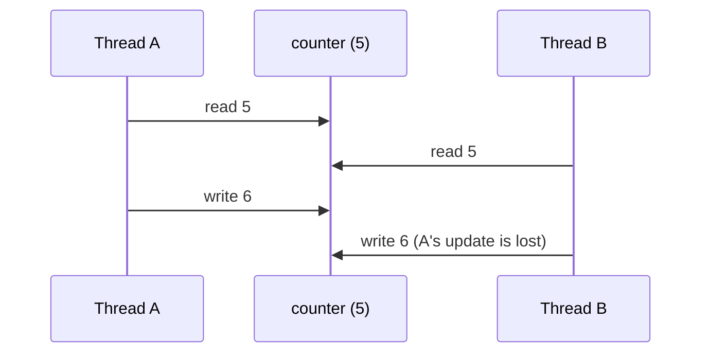

# Threading

A **thread** is an independent flow of execution inside one process. All threads share the same memory: globals, objects, open files. In Python, threads are the natural tool for **I/O-bound concurrency**: talking to several sensors, network services or files at once, keeping a GUI or robot control interface responsive while work happens in the background. This lesson covers creating and joining threads, sharing data safely with locks, race conditions, daemon threads, and the thread-safe `queue` that should be the backbone of most threaded designs.

## 1. Creating threads

```python
import threading, time

def poll_sensor(name, period):
    for i in range(3):
        print(f"{name}: reading {i}")
        time.sleep(period)              # blocking I/O or sleep releases the GIL

t1 = threading.Thread(target=poll_sensor, args=("lidar", 0.1))
t2 = threading.Thread(target=poll_sensor, args=("imu", 0.05), name="imu-thread")
t1.start(); t2.start()                  # both run concurrently
t1.join(); t2.join()                    # wait for both to finish
```

Or subclass `Thread` and override `run()`. Useful attributes are `threading.current_thread().name`, `threading.active_count()` and `t.is_alive()`.

> [!KEY]
> `start()` begins execution in the new thread. Calling `run()` directly just runs the function in the *current* thread, which is a common mistake. Always `join()` threads you start (or make them daemons), or the program can't exit cleanly and errors in them go unnoticed.

## 2. Race conditions

```python
counter = 0
def increment(n):
    global counter
    for _ in range(n):
        counter += 1          # LOAD, ADD, STORE: a thread switch can happen in between

threads = [threading.Thread(target=increment, args=(1_000_000,)) for _ in range(4)]
for t in threads: t.start()
for t in threads: t.join()
print(counter)                # may be LESS than 4,000,000: lost updates
```



Whether you *observe* lost updates depends on the interpreter version, timing and switch interval. With the GIL, short loops may often happen to give the right answer, and **free-threaded Python makes races frequent**. A race is a bug even if your test passes. Correctness must come from synchronisation, not luck.

## 3. Locks

```python
lock = threading.Lock()

def increment(n):
    global counter
    for _ in range(n):
        with lock:                # acquire, then release automatically (even on exceptions)
            counter += 1
```

| Primitive | Purpose |
|---|---|
| `Lock` | mutual exclusion, non-reentrant (acquiring twice in the same thread deadlocks) |
| `RLock` | reentrant: the same thread may acquire it again (needs matching releases) |
| `Event` | one thread signals, others `wait()` |
| `Condition` | wait until a condition on shared state becomes true |
| `Semaphore(n)` | at most n holders: limit concurrent access to a resource |

(The Synchronization lesson covers these and deadlocks in depth.)

> [!TIP]
> Keep critical sections **short**: lock, update shared state, unlock. Don't do I/O or slow computation while holding a lock. **Prefer not sharing at all**: give each thread its own data and communicate results through a queue.

## 4. `queue.Queue`: the safe way to communicate

```python
import queue, threading

tasks = queue.Queue(maxsize=100)       # thread-safe FIFO; maxsize gives backpressure
results = queue.Queue()

def worker():
    while True:
        item = tasks.get()             # blocks until an item is available
        if item is None:               # sentinel: time to stop
            tasks.task_done()
            break
        results.put(item * item)
        tasks.task_done()

workers = [threading.Thread(target=worker) for _ in range(4)]
for w in workers: w.start()
for i in range(20): tasks.put(i)
for _ in workers: tasks.put(None)      # one sentinel per worker
tasks.join()                           # waits until every put item has been marked task_done
for w in workers: w.join()
print(sorted(results.get() for _ in range(20)))
```

This **producer–consumer** pattern decouples the stages and needs no explicit locks, because the queue does all the synchronisation. `queue.LifoQueue` and `queue.PriorityQueue` are also available.

## 5. Daemon threads and shutdown

```python
t = threading.Thread(target=heartbeat, daemon=True)   # killed abruptly when the main thread exits
t.start()
```

Daemon threads don't keep the program alive, but they're stopped **without cleanup** (no `finally`, unflushed files). For anything holding resources, use a **stop event** and join:

```python
stop = threading.Event()
def run():
    while not stop.is_set():
        do_work()
        stop.wait(0.1)                # sleeps, but wakes immediately when stop is set
t = threading.Thread(target=run); t.start()
...
stop.set(); t.join()                  # graceful shutdown
```

## 6. Thread-local data and exceptions

```python
local = threading.local()             # each thread sees its own attributes
local.conn = open_connection()

threading.excepthook = lambda args: log.error("thread %s crashed: %s", args.thread.name, args.exc_value)
```

An exception in a thread doesn't propagate to the thread that started it: it's printed and the thread dies. Use `concurrent.futures` (next lessons) when you need results and exceptions back.

## 7. Exam-ready answers

> [!EXAM]
> **Threads in Python.** The `threading` module creates threads that run concurrently within one process and share its memory. A thread is created with `threading.Thread(target=..., args=...)`, begun with `start()` and waited for with `join()`; daemon threads do not prevent program exit and are terminated abruptly. Because threads share data, unsynchronised read-modify-write operations cause race conditions and lost updates, which are prevented with locks (`threading.Lock`, used in `with` statements) protecting critical sections. The thread-safe `queue.Queue` supports producer–consumer designs without explicit locking. In CPython, the GIL allows only one thread to execute bytecode at a time, so threads speed up I/O-bound but not CPU-bound pure-Python work; it does not make application code thread-safe.

## 8. Cheat sheet

| Need | Code |
|---|---|
| start and wait | `t = Thread(target=f, args=(...)); t.start(); t.join()` |
| protect shared state | `with lock: ...` |
| pass work between threads | `queue.Queue` + sentinel values |
| graceful stop | `threading.Event` + `join()` |
| background helper | `daemon=True` (no cleanup!) |
| per-thread state | `threading.local()` |
| results and exceptions back | `ThreadPoolExecutor` |

> [!INTERVIEW]
> **"How would you design a robot node that reads three sensors at different rates and runs a control loop?"** Use one thread per blocking sensor reader, each pushing timestamped readings into a thread-safe `queue.Queue` (or keeping only the latest value in a lock-protected slot). The control loop runs at a fixed rate in its own thread, using `time.monotonic()` for scheduling, and consumes the latest readings without blocking. A shared `threading.Event` signals shutdown, and all threads are joined, so motors are stopped in `finally` blocks. Avoid shared mutable state beyond the queues, keep critical sections tiny, and never do slow I/O while holding a lock. For many network connections, use asyncio instead. For heavy computation, use processes or vectorised libraries.
